# Digital Cell Maze Lab

An experimental, **offline-first**, biologically inspired computing project. The aim is to discover whether a compact, evolvable genome can control the local reactions of a spatial substrate and solve previously unseen mazes more efficiently than conventional pathfinding. **No such speed improvement has yet been demonstrated here.**

The central distinction: **one organism solves one entire maze.** The many grid sites are the organism's internal computing medium, *not* independent intelligent agents. Dozens or thousands of organisms, each possessing a different genome, can be evaluated in a population and selectively reproduced/mutated.

## Current checkpoint — October 20, 2026

The [V12Y fixed-parent opportunity assay](results/mating_opportunity.md) is
complete and independently audited. **Lighter regulatory linkage helps, but
related variation is still too sparse for the proposed long crossover test.**
With larger segments and extra donors, expected pre-mutation multigene transfer
is 3.89% for carried histories and 6.41% for fresh histories. Neither clears the
frozen design screen. These are static probabilities, not new solver gains.

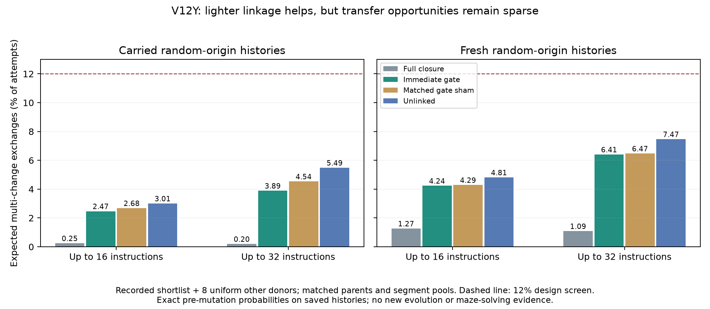

The assay covers all 18,432 historical mating attempts plus 2,880 snapshot probes,
with zero organism calls and zero new mazes. Main work took 109.33 seconds;
independent audit 190.69 seconds. The exclusion set remains **255,356 layouts**.
Thirty-one opportunity/related tests and six separate retention-prototype tests pass.

The [longer-run setup](docs/LONG_SEARCH_SETUP.md) prepares two 75-minute designs:
first mutation with versus without a reserve of related variants; then a sexual
comparison conditional on a fresh activation pass. The reserve selector is
implemented and tested. Runner integration, registration, calibration and exact
replay preflight remain; these specifications are not yet launch-ready jobs.
See the [handoff](docs/MATING_OPPORTUNITY_PROGRESS.md) before continuing.

## Completed activation pilot V12X-R1

The [V12X-R1 crossover activation pilot](results/linkage_restart.md) is complete
and audited. **The activation gate fails, so the longer efficacy run is not
launched.** All 36 conditions finish 32 matched generations with equal evaluation
counts. Dependency-preserving mating retains multiple changed donor instructions
in 0.26% of carried and 0.98% of fresh-origin attempts; unrestricted crossover
reaches 2.12% and 4.10%. No replicate reaches the preregistered 10% threshold.

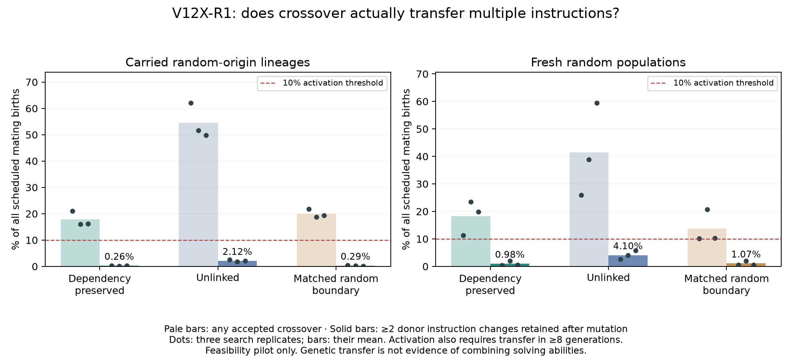

The diagnostics identify limited related variation and an overly restrictive
transitive dependency rule. This is not evidence that random-origin evolution
or recombination is impossible, and no new generalization gain is claimed.
The [next proposal](results/linkage_restart/next_experiment.md) tests immediate
gate-writer linkage and donor opportunities on saved populations before more
maze-evolution compute. All lineages and RNG states are preserved.

An earlier attempt was invalidated by an offspring-ID collision, preserved, and
restarted with new seeds and unique IDs. Combined main candidate compute is
639.32/720 seconds; combined main wall time is 1,103.12 seconds, with calibration
and audit additional. The clean restart's audit passes 669,056 independent raster
grades and 549,272 exact native replays; 38 focused/related tests pass. Exclude
**255,356 whole layouts** from future independent data. See the
[handoff](docs/LINKAGE_RESTART_PROGRESS.md) for provenance and complete costs.

## Completed compatibility study V12W

The [V12W compatibility factorial](results/compatibility_map.md) is complete and
independently audited. **Edit 12 identifies a concrete genetic interaction:**
with the old output STORE present, positive-prefix solving falls from 125/480
pairs to zero; without that STORE it remains 124/480. The same pattern holds in
all eight combinations of the other three edits, with harmful effects in all
eight independent contexts. These 32 constructed conditions are diagnostic
probes, not new evolved discoveries.

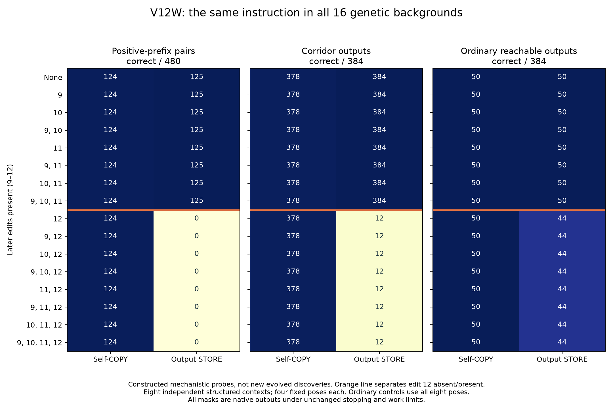

All factorial variants still fail paired prefix-4/8 tasks. The separate preserved
specialist solves 60/288 of those pairs and remains important. General solving,
reliable disconnected-case handling and speedup remain unestablished.
Main compute: 215.94 seconds under a 720-second cap. Audit passes 106,560 exact
candidate replays and 114,552 independent raster grades; 28 focused/related tests
pass. Exclude **251,380 whole layouts** from future independent data.

See the [report](results/compatibility_map.md), [handoff](docs/COMPATIBILITY_MAP_PROGRESS.md)
and [unlaunched crossover proposal](results/compatibility_map/next_experiment.md).
The next controlled choice is whether preserving parent-derived instruction
dependencies during crossover helps acquire new routing abilities, with equal
budgets, fresh random-origin populations and mutation/resampling controls.

## Completed causal dissection V12V

The [V12V causal dissection](results/causal_dissection.md) is complete and
independently audited. **The channel-4 mechanism is confirmed on new inputs,
and a simple genetic reversion proves harmful in the later background.**

Mutation 2 works without the preceding deletion: positive-prefix solving goes
from 0 to 344/1,440 pairs. Suppressing/restoring channel 4 exactly matches the
predicted native counterpart in all 18,944 diagnostic responses, including work
counters. But restoring the old output store in the final descendant collapses
solving from 320 to 8/1,440 pairs. The same store helps in the earlier background.

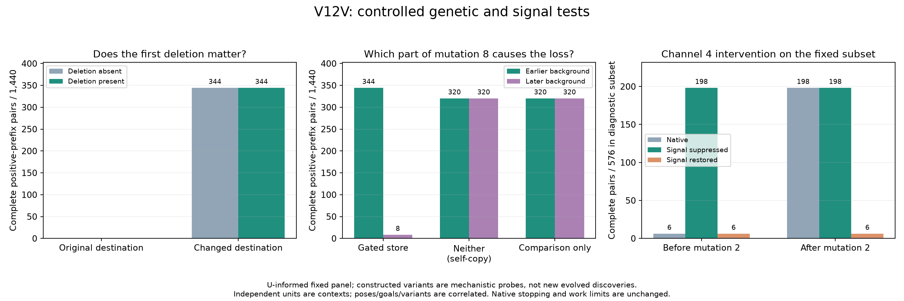

These are fixed historical models and four labeled mechanistic probes, not new
evolved discoveries. Long-prefix generalization and general maze solving remain
unestablished; there is no speedup claim. The failed repair remains separate from
all original populations. Main compute is 300.48 seconds under a 720-second cap;
audit passes 128,064 exact candidate replays and 147,192 independent raster grades.
Thirty focused/related tests pass. Exclude **243,540 whole layouts** in future data.

See the [report](results/causal_dissection.md), [handoff](docs/CAUSAL_DISSECTION_PROGRESS.md)
and [unlaunched interaction-map proposal](results/causal_dissection/next_experiment.md).
The next proposed test identifies which of four later edits changes the store's
effect before defining a module for mutation or recombination to preserve.

## Completed historical mutation map V12U

The [V12U historical mutation map](results/lineage_mapping.md) is complete and
independently audited. **One saved operand mutation accounts for the carried
lineage's large solving gain on eight new structural contexts.** No new evolution
or final-based model replacement occurred.

Positive-prefix complete pairs jump from **0/960 to 238/960** at edit 2, corridors
from 38/768 to 768/768, and ordinary shortest outputs from 21/384 to 56/384. Later
edits add no successful pairs here; edit 8 loses 14 positive pairs and 48 corridors.
Static inspection suggests the useful change suppresses an existing channel 4
signal. That mechanism still needs its own controlled intervention.

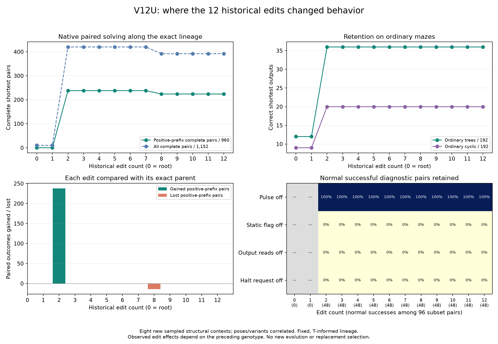

This is an identified transition in one selected random-origin lineage, not a
general solver: all 13 intermediates fail the prefix 4/8 paired tasks, all 18 random-origin
models fail disconnected controls, and no speedup is established. Preserve the
separate long-prefix specialist and the 68-gene random control. Native inference
uses 239.22 seconds of a 720-second cap. Audit passes 105,328 exact candidate replays
and 118,888 independent raster grades;40 focused/related tests pass.

See the [report](results/lineage_mapping.md), [handoff](docs/LINEAGE_MAPPING_PROGRESS.md)
and [unlaunched causal-dissection proposal](results/lineage_mapping/next_experiment.md).
Exclude **233,432 whole layouts** from future independent data, including all
unqueried fixture/final variants. Preserve all old populations and RNG states.

## Completed mechanism and transfer assay V12T

The [V12T mechanism and transfer assay](results/routing_mechanism.md) is complete
and independently audited. **Exact ancestor comparisons confirm acquired branch
routing in selected random-origin lineages, but reliable general solving remains
unestablished.** No new evolution occurred in this assay.

Two fresh descendants complete 8 and 32 of 1,280 positive-prefix goal-switch
pairs; their exact random immigrant roots complete zero. Carried descendants
complete 168 and 116, and the spliced descendant 96. A preserved specialist
completes paired 20-edge routes in particular orientations of one hook context.
The 68-gene random control matches the stronger fresh descendant's paired score.
None passes the all-orientation long-prefix transfer screen.

The simple finite-pruning predictor explains only 54–61% of branched outputs
prospectively. Goal-input and output-feedback dependencies differ by lineage;
all five descendants lose the tested successes when their halt request is disabled.
All random-origin models fail the 640 non-isolated disconnected inputs. The best
ordinary result is a preserved ancestor, illustrating why diversity matters.

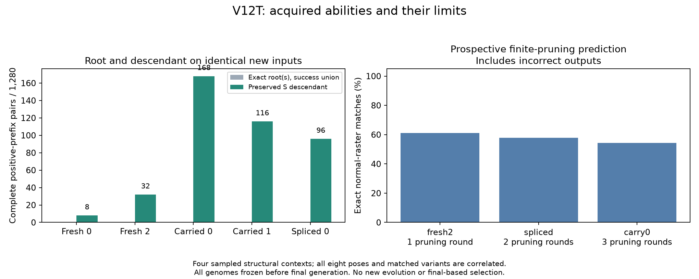

Four sampled structural contexts and 64 ordinary bases are small, explicit
limits; poses and variants are correlated. Main inference uses 194.93 seconds
under a 720-second cap. Audit passes 134,112 exact candidate replays, 149,232
graded response rasters, all ancestry events and prior completion hashes.
40 focused/related tests pass; not a fresh full-suite run. Preserve all original
populations/RNG and exclude **225,592 whole layouts** from future independent data.

See the [report](results/routing_mechanism.md),
[handoff](docs/ROUTING_MECHANISM_PROGRESS.md), and
[unlaunched proposal](results/routing_mechanism/next_experiment.md) to map the
preserved 12-edit carried lineage on new data before another evolutionary change.
After a fresh clone, restore S's losslessly chunked ancestry log with
`.venv/bin/python tools/archive_composition_births.py restore` before prior-hash
checks or audits.

## Completed recombination comparison V12S

The [V12S recombination comparison](results/composition_study.md) and three-step
research reassessment are complete and independently audited. **Sustained search
finds stronger random-origin routing, but compatible recombination does not show
a replicated advantage over mutation.**

294 matched generations run for 72.22 minutes across 18 conditions. Two fresh mutation
lineages complete 132 and 224 of 864 positive-prefix pairs on new contexts; matched
recombination/resampling primaries complete zero. Carried mutation yields 512/390/512,
recombination 448/512/224, versus 224 each for frozen/resampling controls. Only one
recombination replicate passes both gates—and its winner has no splice ancestry.
There are 45,248 actual splices, 97.3% transferring a single instruction. This does not
establish useful combination of functional modules.

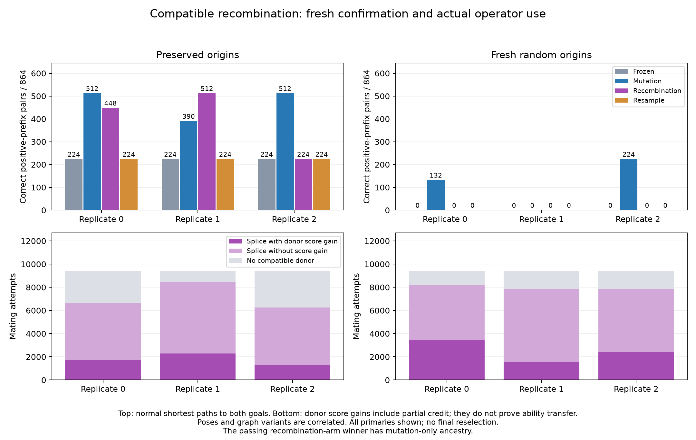

Preserve the rarer prefix-four/cycle specialist and the fresh descendants. The best
ordinary result is 74/384; all random-origin models fail 128 partition-disconnected
inputs. General solving, multirange advantage and speedup remain unestablished.
The [report](results/composition_study.md) distinguishes structural transfer,
ancestry, lost skills and proposed mechanism tests. The follow-up is now completed as V12T above.

Audit passes 3,456,354 exact candidate replays and all
birth/RNG/selection reconstruction. Training replay is sampled as preregistered;
validation/final replay is complete. All populations and raw data remain saved.
Exclude **217,240 whole layouts** next. See the
[handoff](docs/COMPOSITION_PROGRESS.md), including lossless ancestry-log restoration
after a fresh clone, and the [unlaunched proposal](results/composition_study/next_experiment.md).

## Completed mutation-accessibility study V12R

The [V12R mutation-accessibility assay](results/mutation_accessibility.md) is
complete and independently audited. **Longer random mutation walks change more
outputs, but no tested mutant improves the discovery routing score, and no final
model solves a paired route through an internal junction.**

Five preserved random-origin lineages, three RNG blocks and eight walks per block
produce 360 queried checkpoints at one/four/sixteen edits, with 120 fresh random
controls. Output changes rise from 7/120 to 26/120 to 75/120, while old-skill
retention falls. Both correctness and partial-progress gates fail. A final-only
exception improves 152 corridors and partial wave geometry, but no paired branches;
it remains preserved with its full ancestry.

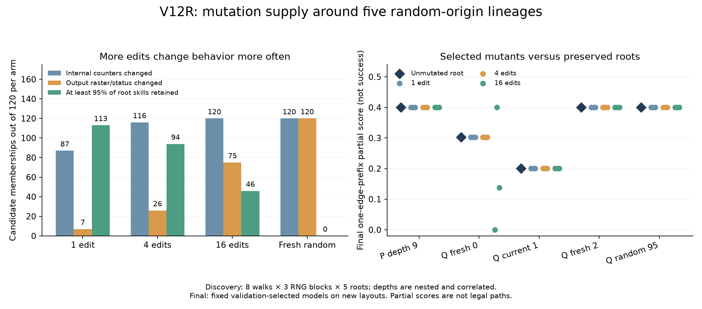

The assay uses 133.24 candidate seconds under a 12-minute cap. Its disclosed
pre-data timing amendment preserves all orientations and the frozen pool. The
independent audit passes 889,728 exact candidate replays, 905,280 graded rasters,
all mutation/RNG records and all prior completion hashes. Twenty focused tests
passed; 283 collected, not a full-suite run. General solving and speedup remain
unestablished. Random-origin discovery remains central.

Exclude **191,784 whole layouts** next. See the [report](results/mutation_accessibility.md),
[handoff](docs/MUTATION_ACCESSIBILITY_PROGRESS.md), and [unlaunched mutation-targeting
proposal](results/mutation_accessibility/next_experiment.md). The proposed contrast
tests whether execution-informed targeting produces useful variation before
another long search, with the same random edit vocabulary and no known-solver injection.

## Completed shared-prefix study V12Q

The [V12Q shared-prefix evolution pilot](results/shared_prefix.md) is complete
and independently audited. **Useful goal-conditioned waves reappear in fresh
random-origin lineages, but no selection solves a paired route through the first
internal junction.** Both origin blocks fail the larger-run gate in all three
replicates.

On untouched source-at-junction tasks, fresh mixed evolution gives 288/384 core
pairs, versus 96/384 for junction-only evolution, 16/384 for resampling and 0/384
for frozen controls. These are secondary gains: every primary remains 0/128 on
one-edge-prefix pairs. All 31 random-origin final models also fail positive-prefix,
two-junction and alternative-cycle pairs. An unmutated 95-gene random draw matches
the strongest wave phenotype; do not attribute all useful behavior to mutation.

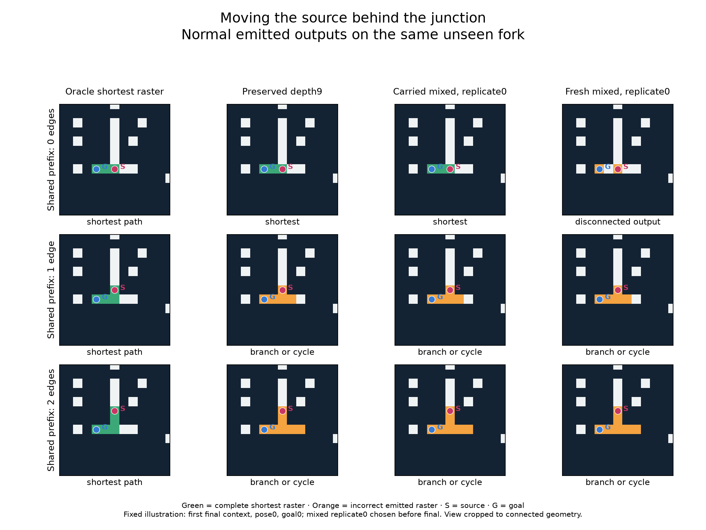

32 matched generations across 18 conditions of 96 organisms produce 24,192
single-edit descendants and17,280 random draws. Main inference 251.23 seconds under
a 12-minute ceiling; audit passes 1,373,184 exact candidate replays and all births,
RNG, archived choices and prior completion hashes. 32 focused tests pass; 273
collected, not a full-suite run. All populations and diversity remain preserved.
No general solving, multirange advantage or speedup has been established.

Exclude **187416 whole layouts** next. See the [report](results/shared_prefix.md),
[handoff](docs/SHARED_PREFIX_PROGRESS.md), and [unlaunched mutation-accessibility
proposal](results/shared_prefix/next_experiment.md). The proposal tests whether
available edits yield a useful branch-isolation signal before another long search.

## Completed mutation-transition study V12P

The [V12P mutation-transition study](results/mutation_transition.md) is complete
and independently audited. **Edit9 creates a local feedback connection and the
first paired-solving gain.** The founder through edit8 completes no pairs;
edits9–16 complete544/2080 paired evaluations and all4160 corridors on the new
matched corpus. Exact-input deduplication gives416/1952 paired tasks.

The behavior is now clearer:every saved reachable raster at depths9 and16
matches a goal-centered wave extending as far as the source. It solves tested
source-at-junction choices with arms up to six edges, but moving the source one
edge back on the same layout produces an extra branch. Degree controls and
preselected interventions show that source degree alone does not explain the
failure, and the static goal flag is necessary for the tested successes.

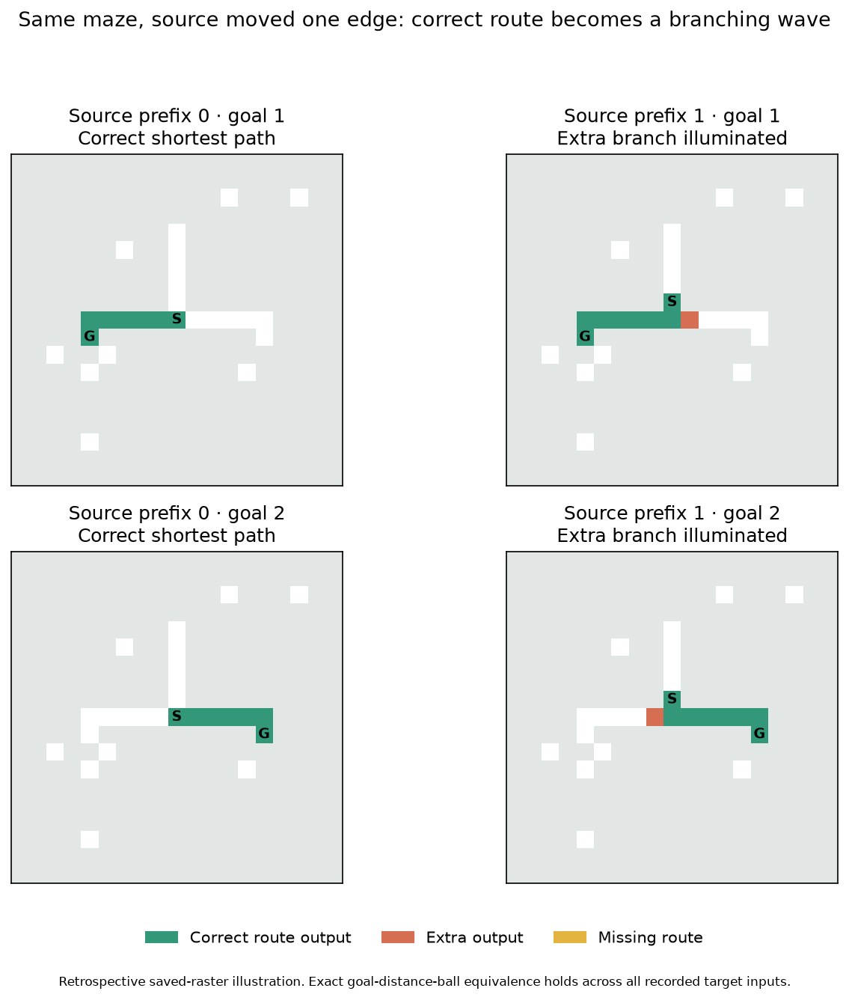

This is evidence for a useful random-origin propagation primitive. Path isolation
across internal junctions remains missing; general solving, beneficial multirange
use and speedup remain unestablished. The next proposal is a small controlled
shared-prefix curriculum test with protected skills and a separate fresh-random
track. That proposal is now complete as V12Q above.

Main inference: **116.32 seconds**,904960 calls. Audit passes first attempt:
977640 exact candidate replays,1015080 independent raster grades and all2140 prior
completion entries. A separate saved-data check verifies24960 goal-wave masks.
Twenty-two focused tests pass;263 collected,not a fresh full suite. Exclude
**181928 whole layouts** next. See the [report](results/mutation_transition.md),
[handoff](docs/MUTATION_TRANSITION_PROGRESS.md) and
[historical curriculum proposal](results/mutation_transition/next_experiment.md).

## Completed cumulative-mutation assay V12O

The [V12O cumulative-mutation assay](results/mutation_depth.md) is complete and
independently audited. **A new random-origin descendant acquires a short-route
skill after a performance-blind 16-edit walk.** On untouched final layouts it
completes 64 non-adjacent shortest-path pairs, all 32 adjacent pairs and all 320
corridors. Its original founder and depth-1/depth-4 checkpoints complete no pairs.

The new skill works for two- and three-edge choices at the source, in straight
and turning forms, all eight poses. It fails the tested one-edge shared-prefix
forks. Only one of 576 deep walks supplies the new interior branch response;
the broader discovery gate fails, so no evolution pilot launches. This is a
rare confirmed gain, not general solving or a replicated population advantage.

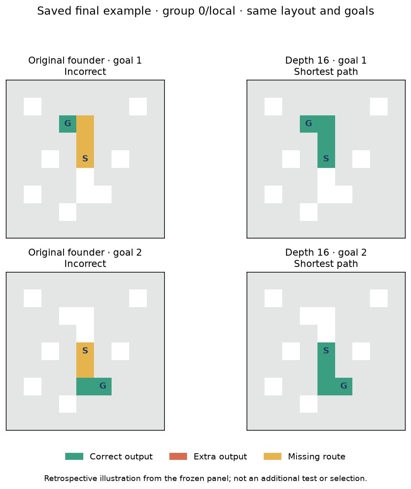

Two other depth-16 descendants solve every matched corridor and correctly report
the isolated disconnected goals, while still failing every paired choice.
All intermediate genomes and RNG are saved. The next proposal freezes the new
lineage's seventeen states and tests the mutation transition and transfer limits
on a new matched corpus, before considering a larger evolutionary run.

Main inference: **349.14 seconds**, 3,100,320 calls. Audit passes first attempt:
3,475,080 exact candidate replays, 3,477,960 independently graded rasters and
all 1,883 prior completion entries. Twenty-two focused tests covered;252 tests
collected, not a fresh full suite. Exclude **178,232 whole layouts** next.
Beneficial multirange use and speedup remain unestablished. See the
[handoff](docs/MUTATION_DEPTH_PROGRESS.md) and
[lineage proposal](results/mutation_depth/next_experiment.md), now completed as V12P above.

## Completed branch-pressure calibration V12N

The [V12N branch-pressure calibration](results/branch_pressure_calibration.md) is
complete and audited. **The new pressure did not change selection**, so the
conditional evolution pilot was not launched. Across three preserved random
founder groups and their one-edit neighborhoods, its interior branch-choice score
was zero on all queried calibration cases.

Most edits changed computation counters, but only **1–5 of 192 children per
cohort changed a returned mask**. Independent final data also exposes a calibration
coverage limitation: an unchanged founder has small one-sided responses in
quarter-turn orientations omitted from calibration. It still completes no
non-adjacent pair. The next proposal tests cumulative mutation and all eight poses,
with equal-budget controls, before choosing a further evolution or runtime study.
Random-origin discovery remains open; this was not a test of extended evolution.

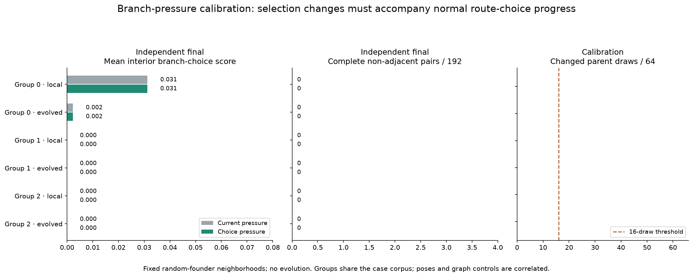

Main inference: **49.42 seconds**, 426,960 calls. Audit passes first attempt:
428,400 exact candidate replays, 432,720 independent raster grades and 1,641 prior
completion entries. Twenty-one focused tests pass; 241 repository tests collected,
not a fresh full suite. Exclude **177,032 whole layouts** next. General solving,
beneficial multirange use and speedup remain unestablished. See the
[handoff](docs/BRANCH_PRESSURE_CALIBRATION_PROGRESS.md) and
[cumulative-variation proposal](results/branch_pressure_calibration/next_experiment.md), now completed as V12O above.

## Completed inherited exposure calibration V12M

The [V12M inherited exposure calibration](results/exposure_calibration.md) is
complete and audited. **Inherited suppression improves an older Branch model
from 32 to 48 unseen paired solutions, but matches switching all nonlocal values
off.** Gains cover only straight-goal forms, so its broader pilot gate fails.

The fresh random-origin calibration exposes a more actionable issue: partial
credit changes selection in all three founder groups, yet their selected organisms
**fill the entire reachable component for either goal**. They solve every matched
corridor but zero paired choices. A separate unmutated local founder completes
16 adjacent pairs and is preserved. The next proposal tests pressure that rewards
choosing the correct branch while suppressing the alternative, before a longer run.
M is fixed-pool calibration, not a new evolutionary trajectory.

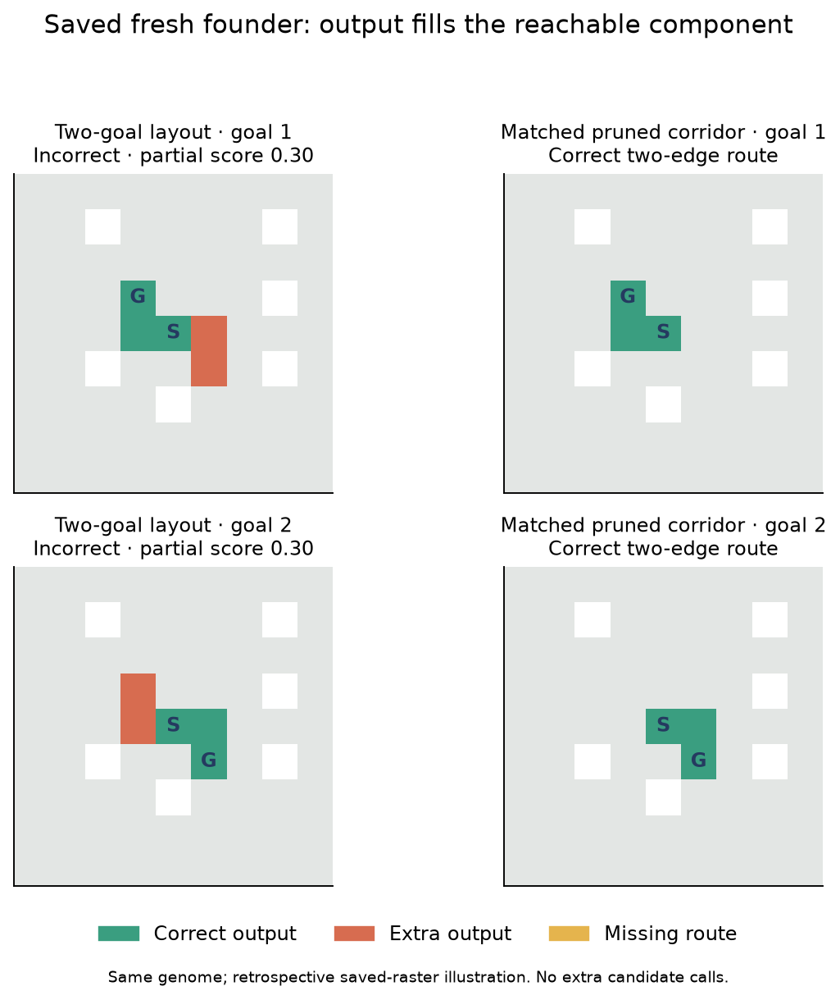

Main inference: **317.58 seconds**, 313,464 calls. Audit passes first attempt:
390,900 exact candidate replays, 395,796 independent raster grades, all selection
records and 1,390 prior completion entries. Ten new plus sixteen related focused
tests pass; 230 collected, not a fresh full suite. Exclude **175,592 whole layouts**
next. General solving, beneficial multirange use and speedup remain unestablished.
See the [handoff](docs/EXPOSURE_CALIBRATION_PROGRESS.md) and
[pressure-calibration proposal](results/exposure_calibration/next_experiment.md), now completed as V12N above.

## Completed lineage confirmation V12L

The [V12L lineage confirmation](results/lineage_confirmation.md) is complete and
independently audited. **The new K2 random-origin descendant completes 192 unseen
fork pairs versus zero for its actual entry ancestor**, across twelve independent
templates, all poses, centred/off-centre junctions and asymmetric goal bends.
Its immediate parent has the same correctness; the latest edit reduces local reads.
It still fails paired extra-junction/cycle and four/eight-edge-prefix tasks.

On fixed mechanism probes, its successes require the static goal flag and survive
pulse removal, endpoint-check removal and nonlocal zeroing. Separately, zeroing
nonlocal values rescues the older broad Branch model **112→192 pairs**, with no
lost successful pairs/corridors across four independent templates and all three
goal forms. This supports a small **heritable exposure calibration**, not a claim
of useful multirange computation or a general solver. The secondary K1 lineage
regresses against its entry ancestor; the unmutated 68-gene draw remains useful.

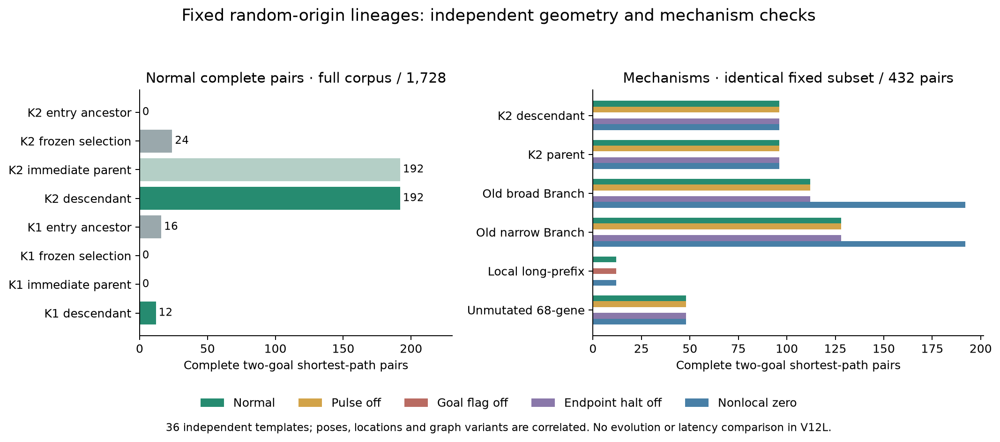

Main inference: **448.48 seconds / 720-second cap**, 253,440 calls. Audit passes
first attempt: 288,288 exact candidate replays, 303,984 independent raster checks,
all ancestry/baselines and 1,187 prior completion entries. Twenty-five focused tests
pass; 220 collected, not a fresh full suite. Exclude **170,840 whole layouts** next.
General solving, beneficial multirange use and speedup remain unestablished. See
the [handoff](docs/LINEAGE_CONFIRMATION_PROGRESS.md) and
[calibration proposal](results/lineage_confirmation/next_experiment.md), now completed as V12M above.

## Completed robustness-pressure study V12K

The [V12K robustness-pressure study](results/robustness_pressure.md) is complete
and audited. **A new random-origin descendant solves 64 unseen fork pairs across
eight contexts in every pose**, versus ten for its frozen initial selection. It
handles straight and turning goal arms and routes to eleven edges, but only
one/two-edge source prefixes; extra-junction/cycle pairs still fail.

Context-consistency pressure does not beat paired-count pressure: ten of twelve
paired searches stay genetically identical and every cohort fails the expansion
gate. Fresh founders complete no queried training pairs in this short pilot.
Their population/RNG states remain preserved; random-origin discovery stays open.

A separate new-corpus diagnostic confirms harmful nonlocal exposure in the older
broad Branch lineage: zeroing those values improves 88→128 pairs across four
contexts and both goal-arm shapes. The narrower variant improves on only two
contexts. This supports testing heritable exposure control, not a claim that
multiple ranges are beneficial or that a regulatory gate has evolved.

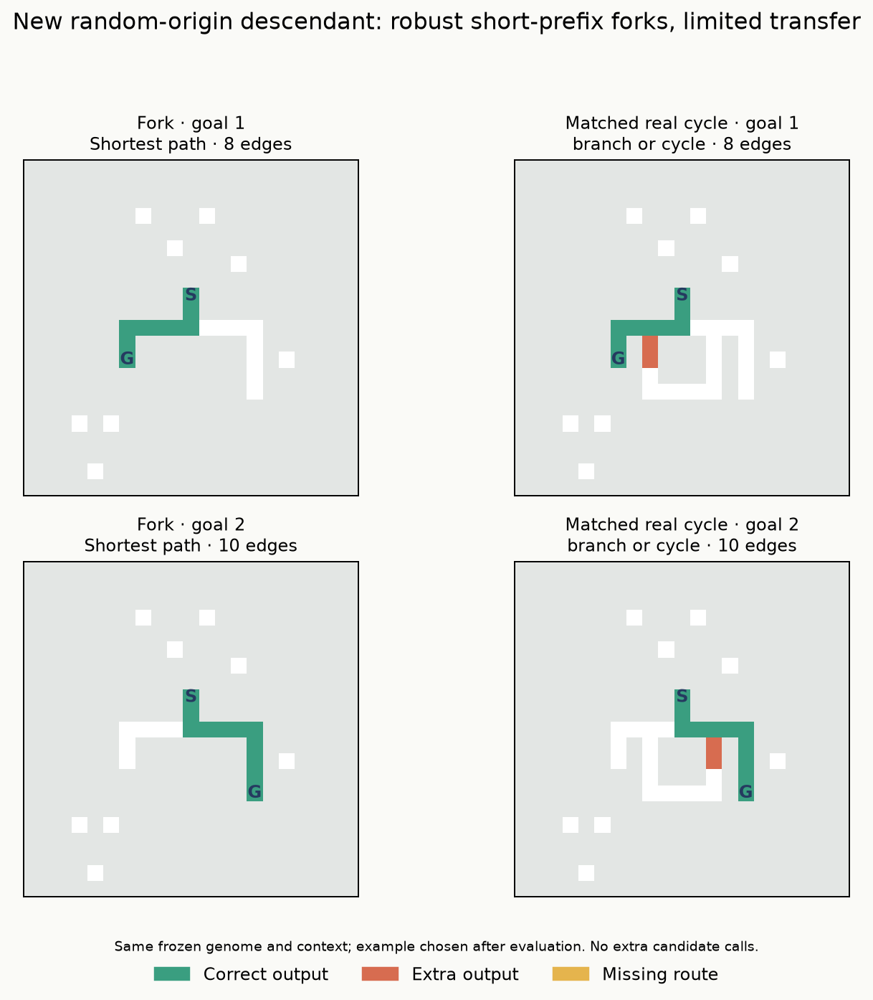

Search: **23 matched generations, 11.48 minutes / 12-minute cap**, 1.64 million
physical calls with equal logical budgets. Audit passes first attempt: 1,774,976
candidate replays, 1,786,496 raster checks and all thirty final states/RNG.
Twenty-nine focused tests pass; 212 collected, not a fresh full suite. Exclude
**163,928 whole layouts** next. General solving and speedup remain unestablished.
See the [handoff](docs/ROBUSTNESS_PRESSURE_PROGRESS.md) and
[confirmation/regulation proposal](results/robustness_pressure/next_experiment.md), whose lineage confirmation is now completed as V12L above.

## Completed matched junction-distance study V12J

The [V12J matched junction-distance study](results/junction_distance.md) is
complete and audited. **There is no universal four-edge decision ceiling, but
there is still no robust general solver.** Thirteen frozen random-origin models
and a separate known control were tested on twelve fresh matched contexts.
No evolution occurred.

An inherited local genome completes paired 17-edge fork routes with an eight-edge
source prefix, but loses its longer-prefix pairs when that prefix bends. Two
carried multirange variants show the opposite shape preference at prefix eight.
Their parents reproduce the same normal outputs; the shared ancestor and an
unmutated 68-gene random draw outperform several descendants. All random models
fail the broader transfer screen and no-path controls.

On two fixed mechanism contexts, **zeroing nonlocal values rescues 128 short
paired conditions per carried Branch model** (64 unique paired inputs), while
retaining read charges. The inherited local model's 27 successful probe pairs
need its goal pulse and endpoint-aware stopping. These results justify testing
robustness and regulation; they do not establish a beneficial multirange effect.

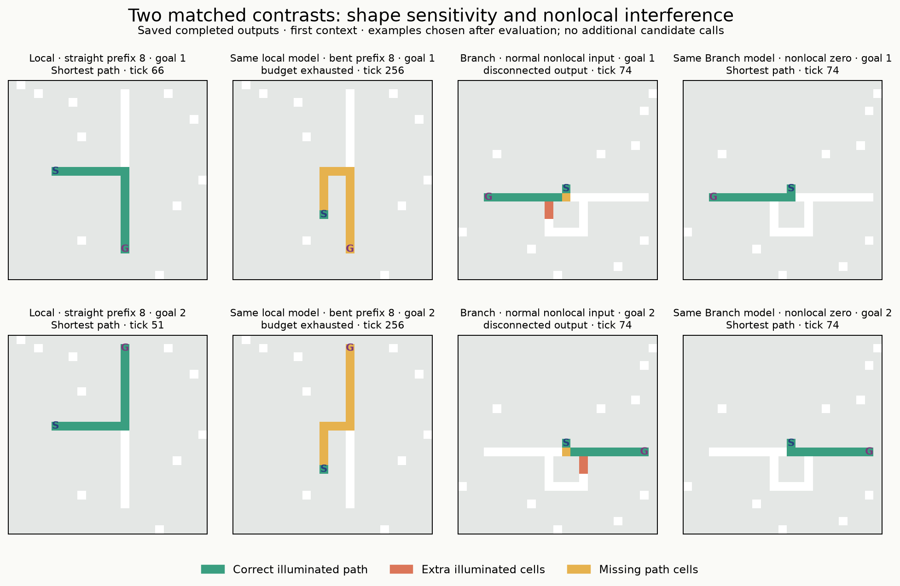

Main inference: **10.41 minutes / 12-minute cap**, 277,152 calls. Independent
audit passes on its first attempt: 279,470 candidate replays, all saved trajectories,
and 692 prior G/H/I completion entries. Twenty-eight focused tests pass (nine new);
204 collected, not a fresh full-suite run. All populations/RNG and raw evidence
remain intact. Exclude **150,776 whole layouts** next. See the
[completed handoff](docs/JUNCTION_DISTANCE_PROGRESS.md) and
[robustness-pressure proposal](results/junction_distance/next_experiment.md), now completed as V12K above.

## Completed equal-budget validation comparison V12I

The [V12I equal-budget validation comparison](results/validation_breadth.md) is
complete and audited. **Broader validation improves several existing selections,
but no cohort passes the preregistered two-of-three-replicate gate.** Both arms
use the same frozen condition pools (1,878 distinct genome/topology combinations)
and exactly 128 inputs/genotype. Narrow uses four contexts × four poses; broad
sixteen × one. Each arm makes 240,384 physical calls. No evolution occurs.

On a new 64-context final corpus, carried/local Branch complete pairs rise
**104→212 /4,608**, carried/multirange Current **432→492**, and carried/multirange
Branch **610→606**. Some replacements lose corridor competence or rare
longer-prefix skills. The original resampling control remains competitive:
broader validation recovers its unmutated 68-gene draw, which completes 80 fork
pairs while handling all corridors, but no two-junction or cycle pairs.

A preserved 254-gene random-origin G nominee, selected by **narrow** validation,
completes 416/1,536 pairs: all 32 short-prefix fork contexts in every pose, plus ten
real-cycle contexts in every pose. Its cycle successes all have a one-edge
source prefix. Across all selected models, no pair works with a 5–8-edge source
prefix. General solving, multirange causality and speedup remain unestablished.

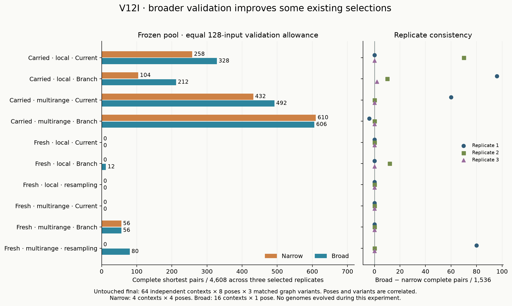

Main inference took 8.88 minutes within a closed 12-minute cap; the separate audit
passes 666,328 candidate replays and 679,000 raster checks. Thirty-one focused tests
pass (ten new); 195 are collected, not a fresh full-suite run. All prior states and
new raw evidence remain intact. Exclude **144,120 whole layouts** next. The
[proposed next step](results/validation_breadth/next_experiment.md) is a bounded
junction-distance/branch-suppression test before more breeding, now completed as V12J above.
See the [completed handoff](docs/VALIDATION_BREADTH_PROGRESS.md).

## Completed fixed-panel confirmation V12H

The [V12H fixed-panel confirmation](results/routing_transfer.md) is complete.
**The previous G leader fails all 2,304 new branched inputs, while retaining
690/768 matched corridors.** All G primary and frozen selections were tested;
no genome was trained or reselected. Models and protocol were pushed in
`e5e30e8` before final generation.

One older random-origin local variant completes **17/384 fork pairs, 15/384
two-junction pairs and 3/384 genuine-cycle pairs**. It was already in the frozen
controls. The cycle successes are three poses of one six/six-edge context with
18/18-edge alternatives. No context works in all eight poses, no model completes
a 10–18-edge pair, and every replicate fails the robust-transfer screen.

The 48 independent contexts hold endpoints and shortest paths fixed across three
graph complexities, with shared corridor controls. Between G and H, prefix length,
board size and sampling also change; the transfer decline is not attributable to
one variable. Goal-flag-dependent signalling is measurable in the G leader, but
does not produce correct paired choices here. General solving, a causal
multirange advantage and a speedup remain unestablished.

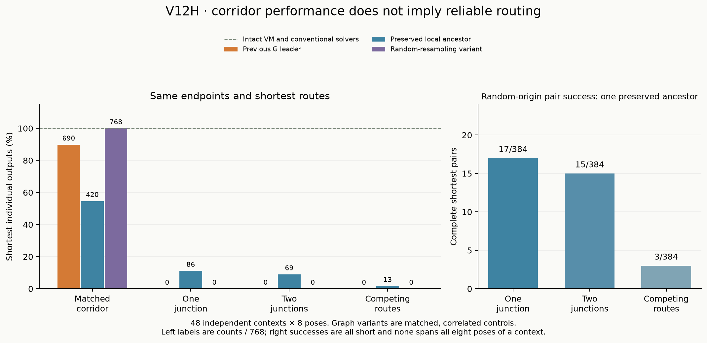

Inference took **152.76 seconds** under a fixed ten-minute cap; the complete audit
passes after an audit-only NumPy-count serialization repair. All old populations,
RNG and raw evidence are preserved. Ten new tests are covered, plus eight focused
existing adapter tests; this was not a full 185-test run. Future independent
studies must exclude **138,712 whole layouts**. H proposed a
[budget-matched validation-coverage comparison](results/routing_transfer/next_experiment.md),
now completed as I above. See the
[completed handoff](docs/ROUTING_TRANSFER_PROGRESS.md).

## Completed minimal-fork pilot V12G

The [V12G minimal-fork pilot](results/fork_pressure.md) is complete: **113 matched
generations in 11.78 minutes**, 30 populations of 96 organisms, 2.24 million
responses. Preregistration was pushed in `83f78c6`; all selections were frozen
and pushed in `f1b6bf9` before fresh final generation.

One continued random-origin Branch selection completes **128/192 fresh goal
pairs**, spanning 16 bases in all eight poses, including four longer pairs up to
9/9 edges. Continued multirange Branch totals **216/576** across replicates,
versus Current **146/576** and frozen **124/576**. Continued local Branch is
worse: **128/576 versus 150/576 Current**. Gains are uneven, and no cohort passes
the preregistered larger-run gate. The search budget is closed.

Fresh evolution yields six local and eight multirange complete pairs; random
resampling yields two and **32**, respectively. All these counts are out of 576
paired tests across three replicates, on a deliberately small fork grammar.
The 68-gene resampling winner is an unmutated random draw. The strongest carried
variant retains all 128 successes with either goal-pulse removal or nonlocal
zeroing; public goal flags and endpoint halting remain. **No causal multirange
advantage, general solver, or speedup is established.** Measured successful fork
outputs are a median 48.05× slower than compiled BFS.

The final tests include matched pruned corridors and disconnected inputs. Cycles
are dangling loops, so this does not test shortest-path competition among
alternative cyclic routes. All selections, populations/RNG, raw masks and
lineages are preserved. The audit checks every search raster and reproduction
transition and replays all 43,080 final candidate responses. Twelve new tests
pass; the full 175-test suite was not rerun. Future studies must exclude
**136,536 whole layouts**. See the [completed handoff](docs/FORK_PRESSURE_PROGRESS.md)
and [next proposal](results/fork_pressure/next_experiment.md), which is not launched.

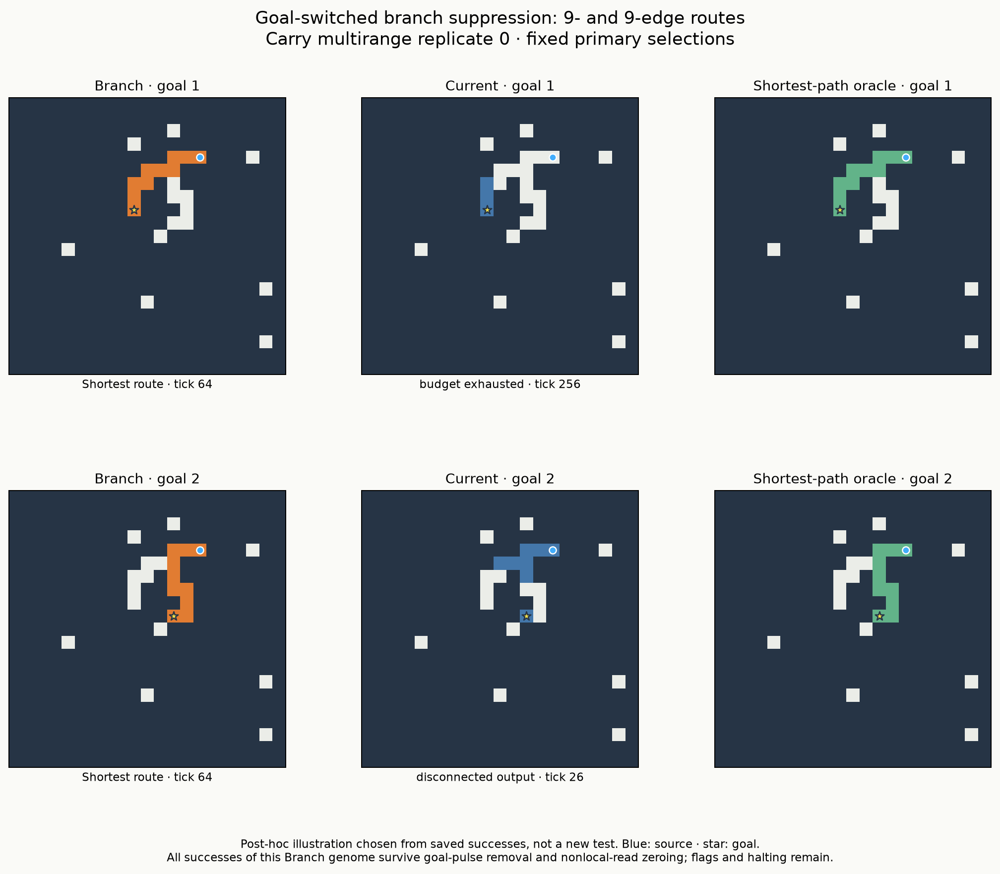

## Completed independent confirmation V12F

The [V12F independent confirmation](results/route_confirmation.md) is complete.
**The preserved longer-route genome fails transfer: 0/768 fresh reachable
routes and 0/384 complete goal pairs.** Its parent also scores zero; the original
checkpoint achieves 10 individual short routes and two paired poses of one cyclic
base, and the Paired replacement achieves five individual short routes. None of
the four solves a 9–32-edge input. BFS and the intact wavefront solve all 768
reachable and 64 disconnected inputs.

The mechanism is clearer. Switching goals changes the target's junction state
in all 384 pairs, but it never selects both correct exits. Static flag removal
leaves measured trajectories unchanged; removing the pulse removes the measured
goal response. Removing endpoint checks makes it emit after two ticks, without
reaching the goal. No legal path occurs in any of 266,312 saved trajectory frames.
A post-hoc geometry check finds that the earlier 9/24/25-edge successes all lay
within **winding corridors with no internal branch junctions**. The confirmation
also uses new generators, so the distribution change limits causal comparisons.

All models and protocol were pushed in `9298bd0` before fresh case generation.
Inference took 123.65 seconds under a fixed ten-minute cap; independent audit
191.35 seconds. Every normal output and complete trajectory replays correctly.
Ten new tests are covered alongside the previous 153, plus five focused existing
tests; no full 163-test run is claimed. All raw evidence and prior population/RNG
checkpoints remain intact. Future studies must exclude **125,008 whole layouts**.

Random-origin discovery remains an active research direction. The
[next recommendation](results/route_confirmation/next_experiment.md), not launched,
is a controlled minimal-fork learning test focused on suppressing wrong branches,
with useful corridor and short-route diversity preserved. The unchanged search
recipe should not receive another long run merely because of the earlier isolated
long outputs. See the [completed handoff](docs/ROUTE_CONFIRMATION_PROGRESS.md).

## Completed controlled comparison V12E

The [V12E controlled comparison](results/foundation_pair.md) is complete:
**500 additional matched generations, 865→1365, in 75.14 minutes**, across 18
conditions of 96 organisms. It compares completed-pair-first and Current
evolution from identical fresh-origin populations/RNG, plus resampling controls.
Both breeding policies use the same final validation archive rule. All models
and time-course selections were frozen and pushed in `c3106fb` before new test
cases were generated; preregistration was `c8fe1cf`.

**Local Paired selections improve fresh 3–4-edge pairs to 44/144**, versus
16/144 Current, 9/144 at the V12D checkpoint on the same cases, and zero for
resampling. They cover eight independent base layouts, three in all eight
paired poses, and retain every adjacent pair. The stricter screen nevertheless
passes only **1/3 local and 0/3 evolved-range replicates**, below the required
two. Evolved-range Paired yields 10/144 versus Current's 12/144. No primary
model completes a pair in the 5–8- or 9–16-edge bands.

A separate preserved local genome, born at generation 858 and selected from
validation in the Current arm, solves unseen **9-, 24- and 25-edge tree routes**
with 2, 5 and 12 turns. Removing the goal pulse breaks all three. Both arms
initially selected this genome; Paired later replaced it with a better short-pair
validation model. These rare successes justify focused confirmation, not a
general-solving claim. See the [long-route illustration](results/foundation_pair/visuals/longer_current_example.png).

Primary ordinary accuracy is 11/216 under either local policy, 13/216 evolved
Current and 11/216 evolved Paired. All primary cohorts solve 0/48 disconnected
cases. Compiled BFS/A*/bit-wavefront solve all 216 reachable and 48 disconnected
cases. Random-origin elementary outputs remain a median **54.28× slower than
compiled BFS**. Nonlocal zeroing removes six of Current/evolved's 12 short-pair
successes, but there is no net multirange advantage. Pulse removal preserves
28/44 local Paired 3–4-edge pairs; static goal flags and endpoint halting remain.

Search used 11.01 million responses and 631.80 MiB peak RSS. Independent audit
passes 756,000 exact program reproductions, 450,000 mutations, 868,464 fitness
records, 6,981,492 graded search rasters and every final output/replay. Ten new
tests are covered alongside the previous 143; this was not a full 153-test run.
All next populations/RNG, ancestry and raw masks are preserved. Future studies
must exclude **124,392 whole layouts** through V12E.

The [next recommendation](results/foundation_pair/next_experiment.md) is a bounded
independent confirmation and mechanism study of the longer-route precursor,
before another large search. It has **not been launched**. See the
[protocol](docs/FOUNDATION_PAIR_V12E.md) and [completed progress record](docs/FOUNDATION_PAIR_PROGRESS.md).

## Completed continuation V12D

The [V12D continuation](results/foundation_continuation.md) is complete:
**423 additional matched generations in 75.32 minutes**, carrying all 24
populations of 96 organisms and their RNG states from generation 442 to 865.
Runtime, capacity, fitness and selection stayed unchanged. Every final model
was frozen and pushed before fresh confirmation layouts were generated.

**The fresh-origin cohort with evolvable ranges passes the stronger screen in
two of three replicates.** On the same new cases, complete non-adjacent shortest
pairs rise from 0/432 at the V12C checkpoint to **28/432**, versus zero for
continued resampling. Individual shortest outputs rise 30/864→103/864. Three
independent layouts work in all eight paired poses (two trees and one cyclic),
and all 144 adjacent pairs are retained. Most successes are two-edge routes;
no primary model completes a pair in the dedicated 4–8- or 8–16-edge levels.
This is a stronger transferable short-route primitive, not a general solver.

The prespecified same-corpus time course gives 0/0/8/22/28 complete pairs at
additional generations 0/48/128/256/423. Removing the goal pulse eliminates
all 28 paired successes; zeroing nonlocal values preserves all 28. The
interventions condition on successful cases. They support goal-pulse dependence
but do not establish that longer-range signalling caused the improvement.

Every current cohort solves **0/176 ordinary distance≥8 cases**; the best solves
7/216 ordinary reachable cases. BFS/A*/bit-wavefront solve 216/216 and 48/48
disconnected cases. Eligible elementary timings are a median **63.25× slower
than compiled BFS**. Search adds 12.43 million responses at 472.05 MiB peak RSS.
The independent audit passes 380,700 new mutations, 979,680 fitness records,
6,274,032 graded search rasters and all final outputs/replays. Six new regression
tests pass, in addition to coverage of the previous 137 tests; the entire
143-test suite was not rerun. Full populations/RNG and raw data are preserved.

V12E excluded all **85,548 whole layouts** through
V12D, including unqueried symmetries and software fixtures. Do not retune against
inspected final cases. That checkpoint recommended a matched test of
complete-pair-first selection versus the current ordering, at fixed capacity,
runtime and compute, with new 3–8-edge transfer and retention criteria.
That proposal became the completed V12E study above. See the
[V12D protocol](docs/FOUNDATION_CONTINUATION_V12D.md) and
[completed progress record](docs/FOUNDATION_CONTINUATION_PROGRESS.md).

## Calibration and first stable search V12A–C — historical

The [calibration-first research plan](docs/FOUNDATION_GOAL_PROGRESS.md) is complete.
[V12A](results/foundation_calibration.md) verifies the intact runtime but fails its
repair gate. [V12B](results/foundation_repair.md) passes after comparing single-edit
and wider mutations on orientation-balanced batches. Known solver controls remain
separate from every random-origin population.

The [V12C report](results/foundation_study.md) records **442 matched generations
in 75.15 minutes**, across 24 conditions of 96 organisms, followed by fresh
confirmation and independent audit. **Fresh local evolution passes the elementary
screen in two of three replicates:** 86/864 shortest non-adjacent outputs and
9/432 complete goal pairs, versus zero for matched resampling and initial frozen
controls. These are correlated poses of fewer independent layouts; none of this
cohort's successful base groups works in all poses.

Longer search helped in this recipe: fresh local selections at generations
48/128/256/442 achieve 0/8/36/86 non-adjacent shortest outputs on the same final
corpus. This supports continued random-origin research, **not a general solver**.
The best ordinary cohort solves 7/216 cases; all cohorts solve 0/181 ordinary
distance≥8 cases and 0/48 disconnected cases. BFS/A*/bit-wavefront solve 216/216
and 48/48. Eligible elementary outputs are a median 48.95× slower than BFS.
No net multirange advantage is established.

Search uses 13.33 million responses and 436.0 MiB peak RSS on one local Apple M4
process. The audit passes for 397,800 mutations, 1,026,048 fitness records,
5,972,328 independently graded search rasters and every final output. There are
137 current tests covered: 136 full-suite passes plus one later time-course test.
All populations/RNG, ancestry, raw masks and earlier studies are preserved.
At V12D launch, all **52,424** recorded whole layouts were excluded from new
training and confirmation; V12C validation was deliberately reused.

The unchanged 75-minute continuation proposed here became the completed V12D
study above, with V12C frozen selections as extra controls and a stronger
paired-transfer, retention and orientation criterion. Read the original
[protocol](docs/FOUNDATION_STUDY_V12C.md) and
[confirmation notes](docs/FOUNDATION_STUDY_CONFIRMATION.md).

Reproduction commands use a new output directory. They reproduce the original
seed, not a new independent experiment:

```bash
caffeinate -i .venv/bin/python -u -m maze_evolution.foundation_study --out results/repeat_foundation
.venv/bin/python -m maze_evolution.foundation_study_timecourse --out results/repeat_foundation --freeze
# Commit the selection freeze before generating final cases.
.venv/bin/python -m maze_evolution.foundation_study_confirm --out results/repeat_foundation
.venv/bin/python -m maze_evolution.foundation_study_audit --out results/repeat_foundation
.venv/bin/python -m maze_evolution.foundation_study_timecourse --out results/repeat_foundation
.venv/bin/python -m maze_evolution.foundation_study_interventions --out results/repeat_foundation
.venv/bin/python -m maze_evolution.foundation_study_report --out results/repeat_foundation
PYTHONPATH=output/plot-libs .venv/bin/python tools/plot_foundation_study.py --out results/repeat_foundation
```

Plot dependencies are optional and isolated via `requirements-figures.txt`.
Completed packets refuse overwrite. A continuation needs a new version, protocol
and output directory; do not change completed budgets or select on final cases.

The [research audit after V11](results/research_audit_2026_10_18.md) is complete.
It recommends continuing random-origin research, while calibrating the search
and developmental timing before adding another reward term. Evolved causal
signalling and context-specific fork choices are real; transferable general
solving and competitive efficiency remain unestablished. The retrospective
audit finds a tick-16 shaping bias against the known two-stage wavefront
development and quantifies the limited number of new mutants per generation.
No evolution or candidate inference was run for this audit.

That audit motivated the now-completed V12 calibration and longer study.
Known solver controls must never enter random-origin lineages. The earlier
hidden-context reward proposal below remains deferred, not executed.

## Heritable capacity V11 — historical

The [heritable capacity study V11](results/capacity_growth.md) is complete.
Twelve conditions continue 96 random-origin organisms for 48 generations,
comparing 128- and 256-gene ceilings at identical state capacity, objective,
mutation modes and inference work limits. Both start with the same native
populations, RNG states and protected variants. Old-program inference parity
was verified before training; no known solver enters these lineages.

**Programs grew; unseen path accuracy did not improve.** Evaluated programs
reach 228 genes, with a 240-gene program saved in the prepared next population.
Both capacities solve local **0/216** and evolved-range **1/216** using the
primary task archives, matching frozen controls. Secondary local choice
archives solve 4/216 versus 3/216 frozen under either cap. Every success is a
one-edge route. All selected models solve **0/180 distance ≥8** cases and
**0/42 paired routes**, with 0/18 strict paired choices. BFS/A*/wavefront solve
all reachable and disconnected cases. No competitive speedup is established.

A wider fixed-model diagnostic finds inherited goal-dependent hidden state
at fork exits on 3–4 of 18 pairs in one evolved-range lineage. It does not
produce correct choices. These are post-hoc observations on reused final
layouts, not new accuracy results. The signal was already present in a frozen
control; greater capacity did not establish better use of it.

Main run: **17.01 minutes, 213.2 MiB peak**. Tests: 122 full-suite passes,
4 focused passes after the final study guard edit, plus one extra exact
256-gene bound regression; all 123 current tests are covered. Independent
audits pass for 23,655 child mutation traces, 59,127 fitness records, saved
rasters, archive selection, lineage, layouts and source/model/storage hashes.
All population/RNG checkpoints and earlier results are preserved.

The next test proposed at V11 completion, now deferred by the research audit:
keep the larger capacity and compare current pressure with an added,
bounded hidden-context discrimination term at the exits. Keep complete routes
and strict paired choices above shaping. Preregister the term and fresh-layout
test before training; exclude all **9,296 whole layouts** seen through V11.
The [next-study proposal](results/capacity_growth/next_experiment.md) is not an
executed experiment. Random-origin discovery remains central.

See the [V11 protocol](docs/GROWTH_STUDY_V11.md) and
[diagnostic specification](docs/GROWTH_DIAGNOSTICS_V11.md). Use a new output
directory for reproduction; saved study directories refuse overwrite.

```bash
.venv/bin/python -m maze_evolution.growth_equivalence --out results/repeat_capacity_equivalence.json
.venv/bin/python -m maze_evolution.growth_study --out results/repeat_capacity
.venv/bin/python -m maze_evolution.growth_diagnostics --out results/repeat_capacity
.venv/bin/python -m maze_evolution.growth_audit --out results/repeat_capacity --repack
.venv/bin/python -m maze_evolution.growth_context --out results/repeat_capacity
.venv/bin/python -m maze_evolution.growth_context --out results/repeat_capacity --verify
.venv/bin/python -m maze_evolution.growth_report --out results/repeat_capacity
```

The study requires the canonical pre-training parity packet
`results/capacity_equivalence.json`; the repeated parity command above provides
a separate comparison. The saved study's report additionally includes its
editorial discussion/next-study files and the initial audit record.

## Goal-distance curriculum V10 and confirmation V10A — historical

The [matched goal-distance curriculum V10](results/distance_curriculum.md) and
[frozen-primitive confirmation V10A](results/distance_confirmation.md) are complete.
Twelve conditions continue96 organisms for48 generations, comparing Fixed hard
goals with near1/2→2/3→far goals on **identical maze/source/fork geometry**.
Capacity stays8 channels/128 genes; both use the same Choice-first objective.

**The curriculum did not establish transfer.** Primary task archives and frozen
controls solve0/216 unseen reachable mazes and0/179 at distance≥8. All selected
models make0/18 strict paired choices and0/42 paired complete routes. The
secondary multirange Curriculum choice archive solves one adjacent-endpoint
case. BFS/A*/wavefront solve all216 ordinary/42 paired targets and all no-path
cases. There is no competitive speedup.

Curriculum has more valid short training outputs, but no regular training
pair has both ordinary routes correct. Multirange strict training responses:
1 Curriculum versus15 Fixed; local0. Early shortened cues remove deceptive
fork bearings. Boundary-leader and frozen-control replays distinguish training
completion from independent transfer.

**One new training-only choice is preserved.** Native multirange replicate2,
birth30 genome i1472, chooses both proper exits at a fork6 edges from source,
with goals2/3 farther. A radius-2 read destination46→59 is sufficient on that
case; the other changed row is unnecessary there. Goal pulse and long reads
are both needed. It produced18 mutated offspring but left the final population;
its full genotype/ancestry is saved explicitly. V10A froze child,parent,root and
tested12 new matched near/far layouts:0/12 strict choices and0/24 routes at
either distance for all three. BFS48/48. The training response is real but
context-specific; random-origin discovery remains central.

Search13.82min; main16.95min; peak203.5MiB. Full suite116 passed, then4 focused
checks passed after final edits (117 current tests covered). Independent audits
verify59004 fitness records,268848 junction rasters,227 valid training claims,
48 selected normal replays and1440 boundary-assay outputs. Main and V10A
source/model/layout/lineage/storage checks pass; all populations/RNG and useful
neutral variants remain saved. Earlier source/raw results are unchanged.

The next test proposed then, now completed as V11: test128-versus256-gene capacity with a common copy-and-diverge block
mutation operator, matched native populations/protection and hard objective.
First verify old-genome inference equivalence; keep caps/work explicit. All
8702 saved layouts must be excluded. No known solver enters these lineages.

```bash
.venv/bin/python -m maze_evolution.distance_study --out results/repeat_distance
.venv/bin/python -m maze_evolution.distance_diagnostics --out results/repeat_distance
.venv/bin/python -m maze_evolution.distance_audit --out results/repeat_distance --repack
.venv/bin/python -m maze_evolution.distance_training_diagnostic --out results/repeat_distance
.venv/bin/python -m maze_evolution.distance_training_verify --out results/repeat_distance
.venv/bin/python -m maze_evolution.distance_report --out results/repeat_distance
```

See [V10 protocol](docs/DISTANCE_STUDY_V10.md),
[training-time diagnostic detail](docs/DISTANCE_DIAGNOSTICS_V10.md), and
[V10A protocol](docs/DISTANCE_CONFIRMATION_V10A.md). V10A's freeze/confirmation
commands use the recorded canonical V10 training assay; primary V10 outputs
never change in response to post-hoc diagnostics.

## Strict paired-choice priority V9 — October 18, 2026

The [strict paired-choice study V9](results/choice_priority.md) is complete;
**112 tests pass**. Twelve conditions evolved 96 organisms for 48 generations,
comparing Prefix scoring with a strict paired-choice priority below complete
route correctness. Both use the same V8 populations/ancestors, archives,
eight-channel/128-gene capacity and unchanged V6 pulse runtime.

**The new priority did not change evolution.** All six matched pressure pairs
have identical ordered genotype populations throughout and identical final RNG
states. Multirange training has 19 strict-both responses per pressure across
four batches; local has none. Unprotected positive genotypes produce the same
40 mutated offspring under both pressures. Global best sets match in all four
active pools, and 512 post-hoc matched-seed parent draws agree. These rare
choices already reproduce; transfer is the current bottleneck.

Primary task archives solve local **1/216** and multirange **0/216**, matching
frozen controls. All selected models make **0/18** paired fork choices and
0/42 paired complete routes. BFS/A*/wavefront solve all 216 ordinary and 42
paired reachable targets plus all no-path cases. No speed advantage is found.

The inherited local success has nine edges and one turn. Moving its goal to
an intermediate path site leaves output concentrations/source states identical
at every tick 1–19; the common endpoint-aware halt emits a five-edge prefix at
tick 11 instead of nine edges at tick 19. It remains a growth precursor.

Both pressures find the same validation-only fork lineage at births 3/5. It
needs the goal pulse but retains its paired choice when nonlocal reads are
zeroed on that case. It does not transfer to the fresh paired set. All 19
strict training responses have proper incoming source connections and
shortest incoming prefixes in an additional raster diagnostic.

The gate failed. Search **13.90 minutes**, main **17.09 minutes**, main peak
**200.4 MiB**. Audits cover 58,998 fitness records, 59,046 priority records,
267,356 junction masks and 6,908 final/diagnostic normal outputs. Full population/
RNG checkpoints, 32,258 new IDs and neutral diversity remain saved. V1–V8/V8A
source and raw results are unchanged.

Next: test a near-to-far goal-distance curriculum at fixed capacity/objective,
keeping validation and final tasks difficult and independent. This tests
whether attainable goal-control subfunctions can compose across distance.
Random-origin discovery, capacity, regulation and evolutionary time remain
open research tracks; no known solver rules enter these lineages.

```bash
.venv/bin/python -m maze_evolution.choice_study --out results/repeat_choice
.venv/bin/python -m maze_evolution.choice_diagnostics --out results/repeat_choice
.venv/bin/python -m maze_evolution.choice_audit --out results/repeat_choice --repack
.venv/bin/python -m maze_evolution.choice_path_diagnostic --out results/repeat_choice
.venv/bin/python -m maze_evolution.choice_selection_diagnostic --out results/repeat_choice
.venv/bin/python -m maze_evolution.choice_report --out results/repeat_choice
```

See the [V9 protocol](docs/CHOICE_STUDY_V9.md) and
[`results/choice_priority/`](results/choice_priority/). Post-hoc path/selection
assays are labelled and do not alter primary selection or accuracy.

## Junction choices V8 and confirmation V8A — October 18, 2026

The [junction-choice study V8](results/junction_choice.md) and its
[frozen-primitive confirmation V8A](results/junction_confirmation.md) are complete;
**106 tests pass**. Twelve conditions evolved 96 organisms for 48 more generations,
comparing current Balanced pressure with source-dependent fork-choice credit.
The runtime, 128-gene/eight-channel capacity and input stayed fixed. Both V7
lineages and their protected diversity remain preserved.

Multirange Junction task archives solve **3/216** unseen shortest paths, versus
0/216 Balanced and 1/216 frozen. All task arms solve **0/174** long cases and
0/42 paired targets. The three Junction successes are only 1–3 edges, including
two paths with one turn; no mandatory detour is solved. BFS/A*/wavefront solve
all 216 ordinary and 42 paired reachable inputs and all no-path cases. There is
no competitive speedup or established general solver.

**Two validation-only fork-choice primitives emerged**, one per multirange
pressure. They choose the proper source-connected exit under switched goals;
both need the goal pulse and nonlocal reads on their qualifying examples.
One primitive requires an instruction reorder **and** a scratch-register
redirection: either change alone fails, while their combination succeeds.
This demonstrates cooperating changes in that parent/context, not a general
regulatory strategy. Full validation routes remain wrong.

Neither primitive transfers to the 12 new V8A confirmation layouts: **0/12**
paired fork choices and 0/24 complete routes, also 0/12 and 0/24 for their roots/
parents. The primary final selections make 0/18 unseen paired choices. A
supplemental validation archive preserves both primitives, including one the
mean-J archive missed because broad prefix growth ranked higher.

The extension gate failed. Search 13.47 minutes; main 16.54 minutes; main peak
RSS 208.2 MiB. Full population/RNG and 33,334 new individual lineages are saved.
All 6,908 main final/diagnostic normal outputs and 58,686 fitness records were
audited; V8A additionally verifies 124 candidate and 24 BFS outputs. V1–V7
source/raw data remain unchanged. These bounded negatives leave the capacity,
regulation and longer-evolution hypotheses open.

Next test: protect both cooperating variants in common initial cohorts, then
compare strict paired-choice-first selection with the current prefix-weighted
reward on new layouts, keeping full route correctness primary. Preserve
neutral diversity and require transfer before an hour-scale extension.

```bash
.venv/bin/python -m maze_evolution.junction_study --out results/repeat_junction
.venv/bin/python -m maze_evolution.junction_diagnostics --out results/repeat_junction
.venv/bin/python -m maze_evolution.junction_audit --out results/repeat_junction --repack
.venv/bin/python -m maze_evolution.junction_report --out results/repeat_junction
.venv/bin/python -m maze_evolution.junction_confirmation --out results/repeat_confirmation
```

See the [V8 protocol](docs/JUNCTION_STUDY_V8.md),
[V8A protocol](docs/JUNCTION_CONFIRMATION_V8A.md),
[`results/junction_choice/`](results/junction_choice/) and
[`results/junction_confirmation/`](results/junction_confirmation/).

## Balanced two-goal pressure V7 — October 18, 2026

The [balanced two-goal study V7](results/balanced_goal.md) is complete; **100 tests
pass**. Twelve conditions continued V6 random-origin populations for 48 further
generations with 96 organisms each. Both arms use the same goal pulse, genome
capacity, starting genotypes and archive-selection rules. Balanced pressure
adds credit for the weaker of two goal responses, alongside the existing
credit for the stronger response. Both reward maxima match; mixed unreachable
pairs retain their original scoring.

**Multirange two-goal output improved:** weaker-goal score B is 0.0310 versus
0.0215 frozen and 0.0048 under Mean pressure. Both-direction qualification is
2/18 unseen regular pairs, versus 1/18 frozen and 0/18 Mean. The improvement is
concentrated in one replicate; local Mean performs better than local Balanced.
Removing the goal pulse or nonlocal reads reduces the multirange Balanced B
score to zero. These are intermediate output measures, not correct routes.

Primary task archives solve local 4/216 under either pressure (same frozen),
multirange 1/216 Balanced and 2/216 Mean (frozen 1/216). All task arms solve 0/165
long cases and 0/42 paired targets. An existing local genome produces a five-edge
path with two turns; completed task successes span 1–5 edges. BFS/A*/wavefront
solve all 216 primary and 42 paired reachable targets plus all no-path cases.
No competitive speedup is demonstrated.

The new junction diagnostic finds 0/9 pairs with both required choices correct.
In 6/9 multirange Balanced tree pairs, source-connected output reaches the fork
under both goals and illuminates both outgoing alternatives. Goal-sensitive
growth is still missing useful branch suppression. Mean changes source state
in 11/18 pairs at tick 16 versus 4/18 Balanced; more source response alone does not
predict the better paired output here.

The extension gate failed. Search 13.18 minutes; main run 16.18 minutes; peak RSS
192.2 MiB. All 6,888 final/diagnostic normal outputs and 58,240 fitness records
were audited. Population/RNG, lineage, balanced/goal/task/source archives and
neutral diversity remain preserved. V1–V6 source and raw data are unchanged.
Construction tests used a separate seed; models froze before final layouts.

The next controlled experiment should reward source-connected, goal-dependent
junction choices, including suppression of the wrong branch, against the
current pressure. Include cyclic shortest-step ties and deceptive detours,
keep all oracle labels in fitness, and reserve fresh layouts. Preserve both
lineages; capacity stayed fixed in V7, so the capacity hypothesis remains open.

```bash
.venv/bin/python -m maze_evolution.balance_study --out results/repeat_balance
.venv/bin/python -m maze_evolution.balance_diagnostics --out results/repeat_balance
.venv/bin/python -m maze_evolution.balance_audit --out results/repeat_balance
.venv/bin/python -m maze_evolution.balance_report --out results/repeat_balance
```

See the [V7 protocol](docs/BALANCE_STUDY_V7.md) and
[`results/balanced_goal/`](results/balanced_goal/). Exact unseen shortest paths,
latency and memory remain the mission's final measures.

## Goal-state pulse V6 — October 18, 2026

The [goal-state pulse study V6](results/goal_beacon.md) is complete; **95 tests
pass**. Twelve conditions continued random-origin populations for 48 generations
with 96 organisms each. Both input arms use identical initial genotypes and the
same product objective. The treatment adds an initial goal pulse in channel 1;
all primitive rules, eight channels and the 128-gene limit stay fixed. Both V5
arms' validation-selected task/goal/transmission variants are preserved.

**Goal communication improved on unseen paired layouts.** Multirange goal
archives score 0.0390 versus 0.0135 frozen Pulse and 0.0137 evolved Flag. Changing
the goal changes source state by tick 16 in 8/18 regular pairs, versus 5/18
frozen Pulse and 1/18 Flag. Removing the pulse from those evolved genomes, or
zeroing nonlocal reads, reduces the intermediate goal score to zero. These are
precursor measures; no paired output is a legal route.

Route accuracy remains unchanged: local task archives solve 2/216 primary
reachable mazes, matching frozen controls; multirange arms solve 0/216. All task
arms solve 0/178 distance≥8 cases, 0/133 mandatory-detour cases and 0/42 paired
targets. One inherited local success spans seven edges with a turn on a new
maze. It is present before V6 evolution. BFS/A*/wavefront solve all 216 primary
and 42 paired reachable targets, and all disconnected cases. No competitive
speedup is established.

The extension gate did not pass. Search took 13.11 minutes; the main run with
holdouts/timing took 16.31 minutes, with 180.1 MiB peak RSS on the M4. All 6,888
final/diagnostic normal outputs and 58,100 training fitness records were audited.
Full population/RNG, lineage and frozen controls remain available. The report
records one protocol deviation: a construction-only test used the study seed
before training, without evaluating a candidate; actual final output evaluation
occurred only after model freeze. Future construction tests should use a
separate seed. V1–V5 source/raw results are unchanged.

The next controlled test should compare mean versus balanced two-goal pressure
at fixed pulse input and capacity. Higher mean score can favor one direction
while losing the other. A supplemental validation-only archive preserves
balanced variants from both V6 arms without additional final evaluation. Keep
these, the transmission variants and inherited directional growth; reserve
fresh layouts and retain exact path correctness as the final measure.

```bash
.venv/bin/python -m maze_evolution.beacon_study --out results/repeat_beacon
.venv/bin/python -m maze_evolution.beacon_diagnostics --out results/repeat_beacon
.venv/bin/python -m maze_evolution.beacon_audit --out results/repeat_beacon
.venv/bin/python -m maze_evolution.beacon_report --out results/repeat_beacon
```

See the [V6 protocol](docs/BEACON_STUDY_V6.md) and
[`results/goal_beacon/`](results/goal_beacon/). Random-origin discovery remains
central; this bounded experiment identifies a useful signalling change and an
unresolved route-construction problem.

## Factorized curriculum V5 — October 18, 2026

The [factorized curriculum study V5](results/factor_curriculum.md) is complete;
**88 tests pass**. Twelve paired conditions continued six V4 populations for
48 generations with 96 organisms each. Both arms protect inherited signalling
and goal-sensitive variants. One arm rewards connected growth and goal response
separately, then transitions to the same product reward as its control.

**An isolated new filament appeared in the control arm:** it emits a correct
10-edge shortest path with three turns through two junctions on one independent
paired 9×9 maze. Ancestry analysis links its first success to three gene-row
edits from a failing parent. It moves west/south, fails the other goal and all
three rotated versions, and develops identically under both goals through its
successful stopping tick. The shared runtime's endpoint check supplies the
different stopping time. This is a concrete precursor of growth following maze
geometry; goal-directed branch choice is still absent.

The curriculum has no demonstrated unseen advantage. Its local/multirange task
archives each solve 1/216 primary reachable cases, versus 2/216 local and 1/216
multirange controls. Every task arm solves 0/177 distance≥8 primary cases and
0/197 cases requiring a turn. The isolated turned success is on the separate
paired set: local control 1/42; curriculum arms 0/42. BFS/A*/bit-wave solve all
reachable and disconnected cases. Curriculum task archives classify 12/48
primary no-path cases, with no false claims on reachable primary cases, versus
0/48 frozen; the disconnected family has a corner/partition bias.

Multirange goal-archive probe scores are 0.0068 curriculum versus 0.0089 control;
local scores both 0.0106. These are intermediate scores, not completed paths.
The extension gate did not pass. Search took 13.02 minutes; the full main run
took 16.05 minutes on the M4, with 162.8 MiB peak RSS. Full population/RNG and
lineage checkpoints are preserved. V1–V4 code/results remain unchanged.

Exploratory validation probes show limited goal information reaching the source,
even by tick64. The next controlled test should compare symmetric source/goal
initialization with the existing convention, at fixed capacity and objective.
The source has an initial state pulse plus a local flag; the goal currently has
only a flag. A goal pulse supplies public stimulus, without inserting a solver.
Keep all validation-selected archives from both arms and reserve fresh layouts.

```bash
.venv/bin/python -m maze_evolution.factor_study --out results/repeat_factor
.venv/bin/python -m maze_evolution.factor_diagnostics --out results/repeat_factor
.venv/bin/python -m maze_evolution.factor_timecourse --out results/repeat_factor
.venv/bin/python -m maze_evolution.factor_lineage_diagnostic --out results/repeat_factor
.venv/bin/python -m maze_evolution.factor_prefix_diagnostic --out results/repeat_factor
.venv/bin/python -m maze_evolution.factor_audit --out results/repeat_factor
.venv/bin/python -m maze_evolution.factor_report --out results/repeat_factor
```

See the [preregistered protocol](docs/FACTOR_STUDY_V5.md) and
[`results/factor_curriculum/`](results/factor_curriculum/). The time-course and
isolated-success analyses are explicitly post-hoc diagnostics, not new accuracy
tests or model tuning. Raw rasters, gene edits, costs and source hashes are saved.

## Goal-conditioned study V4 — October 18, 2026

The [goal-conditioned continuation V4](results/goal_conditioning.md) is complete;
**84 tests pass**. Twelve paired conditions continued six V3 random-origin
populations for 40 generations with 96 organisms each, comparing the existing
transmission objective against an added goal-dependent output reward. Genome
capacity and inference limits stayed fixed. Each population protects its learned
V3 signalling elite; no known solver was inserted.

Some goal-sensitive, branched outputs evolved, but their validation gains did
not establish an unseen advantage. On separate goal-pair tests, the multirange
goal archive scores 0.0022 under goal pressure versus 0.0071 in its transmission
control; local scores are 0.0033 versus 0.0035. No archive meets the
both-directions criterion on a final pair. These scores are intermediate output
diagnostics, not completed routes.

| Final task archive | Shortest / reachable | Distance ≥8 shortest |
| --- | ---: | ---: |
| Local, either objective | 1/216 | 0/174 |
| Evolvable ranges, either objective | 0/216 | 0/174 |
| Compiled BFS / A* / bit-wave | 216/216 | 174/174 |

The one local success is an adjacent endpoint and matches its frozen control.
All candidates fail the separate 42 reachable paired-goal tests; conventional
baselines solve all 42 and all six no-path cases. No competitive speedup emerged.

Search took 9.67 minutes; recorded training plus recovered final evaluation and
timing took 15.32 minutes. The original final generator exhausted its unused
9×9 corner-DFS layouts before evaluating any final output. Only final 9×9
perfect mazes changed to Wilson spanning trees, after genomes were frozen.
The report records that sampling deviation, timing scope and memory limits.
All 7,128 primary, 1,296 paired and 192 ablated normal outputs were rechecked.
Logs preserve every evaluated genotype, fitness, snapshot, parent and RNG state.

The next controlled test should provide separate intermediate credit for
source-dependent connected growth and goal-dependent modulation, then require
their conjunction. Training shows connected output is common but goal-specific
progress is rare. Keep random-origin discovery central, capacity fixed and
reserve fresh layouts; these finite negative runs do not establish impossibility.

```bash
.venv/bin/python -m maze_evolution.goal_recovery --run --out results/repeat_goal
.venv/bin/python -m maze_evolution.goal_diagnostics --out results/repeat_goal
.venv/bin/python -m maze_evolution.goal_audit --out results/repeat_goal
.venv/bin/python -m maze_evolution.goal_report --out results/repeat_goal
```

See the [preregistered design](docs/GOAL_STUDY_V4.md) and
[`results/goal_conditioning/`](results/goal_conditioning/). V1–V3 code/results
remain unchanged. The recovery runner handles the documented sampling failure
without restarting training or changing frozen genomes.

## Source-pressure study V3 — October 18, 2026

The [source-dependent pressure continuation](results/source_pressure.md) is complete;
**76 tests pass**. It forks six saved random-origin populations, pairs current and
causal signalling objectives, and runs 96 organisms for 160 additional generations
per condition. The genome capacity and inference runtime remain fixed. Search
including probes took 60.45 minutes on the M4; fresh tests and timing brought the
main run to 64.22 minutes. No known solver entered the random-origin lineages.

A measurable precursor improved on 174 unseen reachable cases with endpoint
distance at least eight:

| Transmission archive | Frozen initial | Current objective | Causal pressure |
| --- | ---: | ---: | ---: |
| Local mean signal score | — | 0.3071 | 0.3071 |
| Evolvable ranges mean signal score | 0.2480 | 0.4185 | 0.5090 |

The score measures source-dependent hidden activation and subtracts leakage into
other components. Causal pressure leads in two of three held-out replicates.
Zeroing nonlocal reads reduces its score to 0.0809. Leakage is higher than under
the current objective, and a broadcast does not encode a legal path.

**No general shortest-path solver or speed advantage emerged.** Final multirange
task archives solve 2/216 reachable mazes under either objective, versus 4/216 for
their initial frozen task selections. Local task archives solve 2/216 under the
current objective and 0/216 under causal pressure. Every final task arm solves
0/174 cases at distance>=8. All observed organism successes are straight paths
of only 1–2 edges. Compiled BFS/A* solve all 216 reachable and all 48
disconnected cases. The report distinguishes diagnostic transmission archives
from task archives and reports complete outputs, latency and real work.

Random-origin discovery remains active. Populations, RNG states and ancestry are
preserved in [`results/source_pressure/`](results/source_pressure/). A justified
next experiment preserves these signalling lineages and tests goal-conditioned
path thinning, with completed shortest paths still first and another fresh final
set. More complexity remains a hypothesis; it is not inferred from gene count.

```bash
.venv/bin/python -m maze_evolution.signal_study --out results/repeat_source_pressure
.venv/bin/python -m maze_evolution.signal_diagnostics --out results/repeat_source_pressure
.venv/bin/python -m maze_evolution.signal_audit --out results/repeat_source_pressure
.venv/bin/python -m maze_evolution.signal_report --out results/repeat_source_pressure
```

See the [preregistered design](docs/SIGNAL_PRESSURE_V3.md). V1/V2 raw results and
runtime/search modules are unchanged.

## Range/regulation study V2 — October 18, 2026

The [range/regulation continuation](results/range_and_regulation.md) is complete:
**63 tests pass**. V2 adds eight state channels, up to 128 typed genes, conditional
expression, local/fixed/evolvable signalling radii, diversity-preserving search,
independent resampling controls and exact population/RNG checkpoints.

The study ran 656,640 training responses (724,176 including validation) in about
12 minutes on the M4. All models were frozen before 264 entirely fresh test cases.
The expanded random-origin cohort used 96 organisms × 120 generations × three
seeds for each topology, 14.4× V1's population-generation slots per run.

| Rich random-origin population | Evolved shortest / reachable | Independent sampling | Initial frozen |
| --- | ---: | ---: | ---: |
| Local | 2/216 | 2/216 | 0/216 |
| Evolvable ranges | 1/216 | 2/216 | 0/216 |

All random-cohort successes were adjacent endpoints. None solved the 165 cases
with distance at least eight. Large genomes and improved partial scores did not
yet produce a general algorithm. **Random-origin discovery remains an active
track**: checkpoints retain the populations for longer continuation rather than
restart them. Greater capacity, time and regulatory pressure remain hypotheses.

Seeded local/fixed/evolvable arms each solved 211/216, with five budget failures
and 48/48 correct no-path outputs. Their champions did not use nonlocal reads.
The same frozen local seed solves 189/216 at the old work cap, so its gain to
211 comes from inference budget, not evolved range use. No speed advantage over
compiled BFS was found. See the [preregistered protocol](docs/RANGE_STUDY_V2.md).

```bash
.venv/bin/python -m maze_evolution.range_study --out results/repeat_ranges
.venv/bin/python -m maze_evolution.range_audit results/repeat_ranges
```

Defaults reproduce the saved design. Full compressed lineage/fitness/output logs,
initial controls, timing samples and 48 continuation checkpoints are in
[`results/range_and_regulation/`](results/range_and_regulation/). The new runtime
permits a broad initial activation to develop/prune before stopping; V1's immediate
endpoint halt is preserved in V1 but removed in V2. V2 gates still pay dispatch
cost, and all ranges share hard work and memory caps.

## First local experiment — October 17, 2026

The context bundle is imported and the project is prepared for development on an
Apple M4 Mac with 16 GiB memory and Python 3.13.15. Its **41 tests passed**, including
genome validation, synchronous execution, independent raster validation and
deterministic evolution replay. Maze generation is reproducible, the compiled
baseline runs, and the NumPy-only fallback was checked. See the local
[smoke output](results/local_setup_2026-10-17.txt) and
[environment/source metadata](results/local_setup_2026-10-17.json).

The first bounded genome runtime, evaluator and evolutionary pilot are complete.
Read [the full experiment and phenotype audit](results/first_evolution.md).
Three runs of 32 organisms over 25 generations compared random and wavefront-seeded
populations with their frozen initial champions. All champions were frozen before
generating the final test set.

| Initialization | Evolved shortest paths / reachable tests | Frozen control |
| --- | ---: | ---: |
| Random | 4/240 | 4/240 |
| Wavefront seed | 200/240 | 200/240 |

The random successes simply light every open pixel on unbranched snake corridors.
They do not demonstrate learned maze solving. Seeded organisms solve all 96
same-size unseen cases and all 48 disconnected cases. Forty larger/structural
cases exhaust the common read budget. Two runs delete a redundant persistence
instruction (29→28 genes, 2.22% less counted work), with unchanged accuracy.
The generic interpreter is about 150× slower than compiled BFS in the sampled
17×17 timings. These are pilot implementation comparisons, not a competitive win.

This checkpoint motivated the local/fixed/evolvable multi-distance continuation
above. The [original range proposal](docs/MULTIDISTANCE_PLAN.md) remains available;
the actual V2 design and changed limits are recorded separately.

## Start here (for Codex)

1. Read [`AGENTS.md`](AGENTS.md) (repository coding-agent instructions).
2. Read [`docs/THREAD_CONTEXT.md`](docs/THREAD_CONTEXT.md), then [`docs/EXPERIMENT_SPEC.md`](docs/EXPERIMENT_SPEC.md).
3. Run the existing baseline and tests.
4. Give Codex the prompt in [`CODEX_START_HERE.md`](CODEX_START_HERE.md).

## Quick start

```bash
python -m venv .venv
source .venv/bin/activate                 # Windows: .venv\\Scripts\\activate
python -m pip install -r requirements-dev.txt
python -m pytest -q
python cellular_maze_lab.py --sizes 33,65,129 --samples 6 --render --out-dir output
```

Only `numpy` is essential for the reference script. `numba` provides a compiled BFS baseline. `Pillow` renders image triptychs; `pytest` runs tests. The reference implementation is CPU-only and makes **no network or LLM calls**.

For the verified local environment, activate the existing `.venv`. To recreate
its exact package versions with `uv` on Python 3.13:

```bash
uv venv --python 3.13 .venv
uv pip install --python .venv/bin/python -r requirements-lock.txt
.venv/bin/python -m pytest -q
.venv/bin/python cellular_maze_lab.py --sizes 33,65 --samples 3 --seed 1729
```

`requirements-lock.txt` records the packages tested on macOS arm64; dependency
and wheel compatibility on other platforms still needs verification. `.venv`
and generated `output/` images stay out of Git.

## Run the evolutionary experiment

The interpreter uses Numba from `requirements-dev.txt`. It evaluates four local
uint16 channels with a closed 14-operation instruction set; genomes cannot execute
Python or call the evaluator. See [the genome](maze_evolution/genome.py),
[runtime](maze_evolution/runtime.py), [evaluator](maze_evolution/evaluator.py),
and [selection/experiment harness](maze_evolution/experiment.py).

```bash
.venv/bin/python -m pytest -q
.venv/bin/python -m maze_evolution.experiment --out results/repeat_evolution --seed 20261017 --replicates 3 --population 32 --generations 25 --samples 8 --benchmark-repeats 30
.venv/bin/python -m maze_evolution.inspect_results results/repeat_evolution
```

Choose a fresh output directory for each run. The saved pilot took about 25 seconds
after cached JIT warm-up. This includes evolution, final tests and timing; a first
compilation may take longer. Raw genomes/parents, all training fitnesses, exact
maze inputs, output masks, timings and environment metadata are in
[`results/first_evolution/`](results/first_evolution/).

## Files

| Path | Purpose |
|---|---|
| `cellular_maze_lab.py` | Runnable baseline: Python BFS, Numba BFS (optional), bit-packed wavefront, dead-end retraction; random/perfect/snake/comb maze generators |
| `tests/` | Core solver correctness tests, including cyclic and disconnected mazes |
| `maze_evolution/` | Typed genome, bounded interpreter, datasets, independent evaluator, evolution, baselines and audit |
| `AGENTS.md` | Repo-wide guardrails and next mission for coding agents |
| `CODEX_START_HERE.md` | Ready-to-paste Codex instruction |
| `docs/THREAD_CONTEXT.md` | Conversation handoff and user intentions |
| `docs/ARCHITECTURE.md` | Biological-to-computational mapping, organism vs cell and runtime model |
| `docs/EXPERIMENT_SPEC.md` | Initial evolution experiment, fitness, measures, baselines, phases, acceptance tests |
| `docs/RESEARCH.md` | Prior art and scientific cautions |
| `docs/MULTIDISTANCE_PLAN.md` | Proposed local/multi-distance experiment and validation sequence |
| `requirements-lock.txt` | Exact package versions used in the local setup check |
| `results/local_setup_2026-10-17.*` | This Mac's setup checks, metadata and smoke timings |
| `examples/` | Example 65×65 maze/result images from prior work |
| `results/baseline_smoke.txt` | A smoke run on this environment; **not** a scientific performance study |

## What exists vs what remains

**Existing**: standard/compiled BFS, compiled A*, exact bit-parallel wavefront,
leaf-pruning toy baseline, maze generators, bounded heritable programs, local
organism runtime, deterministic mutation/selection, frozen controls, independent
holdout validation, full-raster timing and recorded visual results.

**Also implemented in V2**: multi-distance sensing, conditional gene expression,
larger random-origin genomes, diversity/lexicase search, training-sample-matched
independent search controls and exact checkpoint resumption.

**Not yet built**: a reliable random-origin solver, hierarchical or 3D substrates,
exact CPU-budget-matched search controls, a broad optimized conventional baseline
audit, or a competitive result.

## Experiment boundaries

- No paid APIs, cloud services, AWS deployment, foundation-model inference or unneeded dependencies.
- Do not use BFS or a precomputed solution *inside* the organism at inference time. Ground truth may be computed offline for scoring.
- Do not benchmark naive Python BFS alone and call a win; include compiled baselines and complete end-to-end wall-clock cost.
- Do not confuse millions of logically simultaneous grid updates with millions of CPU/GPU cores or zero-cost computation.
- Preserve reproducibility: fixed seeds, explicit environmental metadata, unseen tests and detailed result logs.
