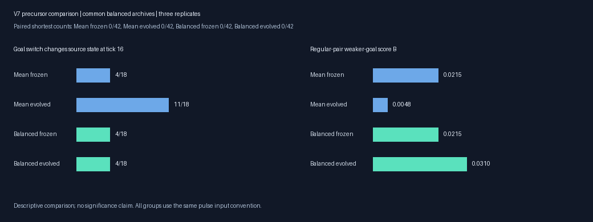
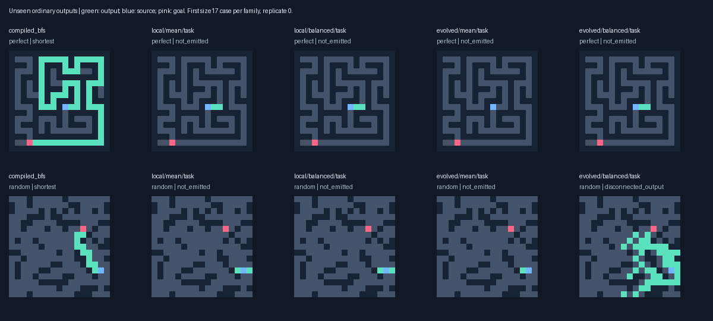
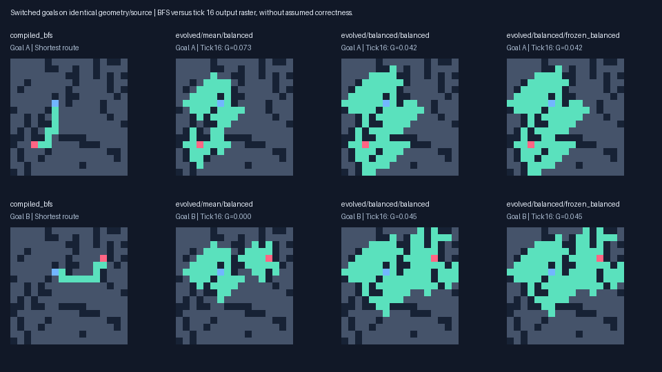

# Balanced two-goal pressure: V7

Multirange task archives solve **1/216** unseen shortest routes under Balanced pressure versus **2/216** under Mean and **1/216** frozen. Local Balanced solves 4/216. Multirange Balanced solves 0/165 at distance≥8 and 0/42 on independent paired targets. These are completed ordinary outputs.

The common balanced archives score **B=0.0310** under Balanced pressure, versus **0.0048** under Mean and **0.0215** frozen on independent regular goal pairs. Their mean individual-goal scores are G=0.0509, 0.0386 and 0.0352. B averages the weaker goal within each regular pair; G averages all paired inputs, including mixed cases. These are intermediate measures with different denominators, not path-correctness or significance claims.

Both-direction qualification is 2/18 under multirange Balanced pressure, 0/18 Mean and 1/18 frozen. The gain is concentrated in replicate 1; replicate 0 retains its frozen weaker-goal score and replicate 2 declines slightly on this new set. Local Mean has the higher B score. This does not establish a universally better pressure or a solver.

The extension gate was **False** after 48 generations. Three replicates per condition support a descriptive controlled comparison.



## What changed

All organisms use the unchanged V6 goal-pulse runtime, eight uint16 channels and at most 128 typed genes. The treatment changes only goal reward: Mean gives case i 2G_i; Balanced gives G_i+min(G_A,G_B). Pair totals are 2(G_A+G_B) versus (G_A+G_B)+2min(G_A,G_B), both at most 4. With one absent goal response the stronger side retains half its previous credit, while improving the weaker side becomes more valuable. Mixed reachable/unreachable pairs retain 2G_i in both arms, avoiding an impossible two-route requirement.

Normal validity, optimality and no-path utility precede shaping. Partial output and source transmission terms are unchanged; incomplete routes carry no size/cost tie-break. Probe horizon 16, source ablation, primitive semantics and hard limits are identical. BFS and oracle graph distances remain outside inference.

The base is each V6 Pulse next population and RNG. Both V6 arms contribute their validation task/goal/source archives, protected ancestors and supplemental balanced variants. Missing genotypes replace documented last nonprotected slots. Both V7 arms share the same initial genotype sequence, RNG and fixed protected variants. All prior raw populations remain intact. No parent is chosen using final-test accuracy and no known solver is inserted into a random-origin lineage.

Validation uses Mean scoring in both arms. A common balanced archive ranks regular-pair weaker-goal score, both-direction qualification, Q, mean G, validity and optimality. Both arms nominate training balanced leaders alongside the same overall/source/goal/Q/S leaders and niche rule. Task archives use normal route fitness without probe rewards. Frozen controls are initial common task/balanced selections. New validation archives never automatically re-enter reproduction. Mean-goal/source/Q/S archives remain saved as validation diagnostics; final selections here are task and balanced archives. Absolute V6/V7 archive scores are not a pressure-only comparison.

Seed 2026101805; twelve conditions, 96 organisms each, local/evolvable ranges × Mean/Balanced × three replicates. Training uses rotating size 9 pairs, then 17 after generation 23; fixed validation has six pairs/replicate, reachable distances≥8. All V1–V6 whole layouts are excluded. Size 9 perfect mazes use Wilson trees; larger trees use DFS, alongside cyclic random, disconnected and rectangular cases. The construction preflight uses seed 1074, separate from this study. All models froze before final layouts and outputs were generated. See [preregistered protocol](../docs/BALANCE_STUDY_V7.md).

## Validation continuation gate

The prior numeric gate now targets the common balanced archive B, with Balanced as candidate and Mean as control. It requires at least two additional shortest validation routes versus both frozen and control on a topology, or sufficiently large replicated gains in B,Q,S,both-direction qualification, both maze families and retained transmission. Transmission or mean G alone cannot trigger extension.

| Topology | Rep | Frozen B | Mean B | Balanced B | Q | S | Both | Pass |
|---|---:|---:|---:|---:|---:|---:|---:|---|
| local | 0 | 0.0000 | 0.0331 | 0.0000 | 0.1647 | 0.0000 | 0.00 | False |
| local | 1 | 0.0000 | 0.0000 | 0.0000 | 0.1741 | 0.0000 | 0.00 | False |
| local | 2 | 0.0150 | 0.0362 | 0.0362 | 0.0218 | 0.1977 | 0.25 | False |
| evolved | 0 | 0.0654 | 0.0767 | 0.0654 | 0.0286 | 0.1995 | 0.25 | False |
| evolved | 1 | 0.0162 | 0.0304 | 0.0388 | 0.0306 | 0.2243 | 0.25 | False |
| evolved | 2 | 0.0535 | 0.0570 | 0.0598 | 0.0337 | 0.2678 | 0.25 | False |

## Fresh completed outputs

Primary set:264 layouts, 216 reachable and 48 unreachable. Paired set:24 layouts/48 targets, 42 reachable at distance≥8 and 6 unreachable. All arms share inputs. Repeated labels may select the same genome and are not independent discoveries. Per-family and size summaries remain in JSON/CSV.

| Archive | Valid | Shortest | Distance≥8 shortest | Correct no-path |
|---|---:|---:|---:|---:|
| compiled_astar | 216/216 | 216 | 165/165 | 48/48 |
| compiled_bfs | 216/216 | 216 | 165/165 | 48/48 |
| evolved/balanced/balanced | 0/216 | 0 | 0/165 | 0/48 |
| evolved/balanced/frozen_balanced | 0/216 | 0 | 0/165 | 0/48 |
| evolved/balanced/frozen_task | 1/216 | 1 | 0/165 | 0/48 |
| evolved/balanced/task | 1/216 | 1 | 0/165 | 0/48 |
| evolved/mean/balanced | 0/216 | 0 | 0/165 | 0/48 |
| evolved/mean/frozen_balanced | 0/216 | 0 | 0/165 | 0/48 |
| evolved/mean/frozen_task | 1/216 | 1 | 0/165 | 0/48 |
| evolved/mean/task | 2/216 | 2 | 0/165 | 0/48 |
| local/balanced/balanced | 3/216 | 3 | 0/165 | 0/48 |
| local/balanced/frozen_balanced | 3/216 | 3 | 0/165 | 0/48 |
| local/balanced/frozen_task | 4/216 | 4 | 0/165 | 16/48 |
| local/balanced/task | 4/216 | 4 | 0/165 | 16/48 |
| local/mean/balanced | 1/216 | 1 | 0/165 | 0/48 |
| local/mean/frozen_balanced | 3/216 | 3 | 0/165 | 0/48 |
| local/mean/frozen_task | 4/216 | 4 | 0/165 | 16/48 |
| local/mean/task | 4/216 | 4 | 0/165 | 16/48 |
| wave_bit | 216/216 | 216 | 165/165 | 48/48 |

| Task archive | Turn-required shortest | Mandatory-detour shortest | False no-path on reachable |
|---|---:|---:|---:|
| compiled_bfs | 187/187 | 133/133 | 0/216 |
| local/mean/task | 1/187 | 0/133 | 0/216 |
| local/balanced/task | 1/187 | 0/133 | 0/216 |
| evolved/mean/task | 0/187 | 0/133 | 0/216 |
| evolved/balanced/task | 0/187 | 0/133 | 0/216 |

Turn-required means endpoints differ in both coordinates; mandatory detour means oracle distance exceeds Manhattan distance. Perfect mazes are trees and cyclic cases need separate evidence. Disconnected results also need caution: the family has a separating-wall and fixed-corner-source bias. These subsets describe already selected outputs and never retune genomes.

Across repeated candidate archive outputs, legal paths span 1–5 edges; 4 contain turns. Full case/shape records are saved. Compare frozen controls before attributing a success to V7 evolution.



## Independent paired outputs and probes

B averages 18 regular pairs;G,Q,S average 48 targets; source signal averages 42 reachable targets. Both-direction qualification is an intermediate output threshold, separate from complete path legality.

| Archive | Normal shortest | Correct no-path | B | G | Q | S | Both | Source |
|---|---:|---:|---:|---:|---:|---:|---:|---:|
| compiled_astar | 42/42 | 6/6 | — | — | — | — | — | — |
| compiled_bfs | 42/42 | 6/6 | — | — | — | — | — | — |
| evolved/balanced/balanced | 0/42 | 0/6 | 0.0310 | 0.0509 | 0.0333 | 0.1908 | 0.1111 | 0.4911 |
| evolved/balanced/frozen_balanced | 0/42 | 0/6 | 0.0215 | 0.0352 | 0.0247 | 0.1300 | 0.0556 | 0.4495 |
| evolved/balanced/frozen_task | 0/42 | 0/6 | 0.0000 | 0.0015 | 0.0080 | 0.0076 | 0.0000 | 0.5026 |
| evolved/balanced/task | 0/42 | 0/6 | 0.0000 | 0.0015 | 0.0080 | 0.0076 | 0.0000 | 0.5026 |
| evolved/mean/balanced | 0/42 | 0/6 | 0.0048 | 0.0386 | 0.0224 | 0.1737 | 0.0000 | 0.5160 |
| evolved/mean/frozen_balanced | 0/42 | 0/6 | 0.0215 | 0.0352 | 0.0247 | 0.1300 | 0.0556 | 0.4495 |
| evolved/mean/frozen_task | 0/42 | 0/6 | 0.0000 | 0.0015 | 0.0080 | 0.0076 | 0.0000 | 0.5026 |
| evolved/mean/task | 0/42 | 0/6 | 0.0000 | 0.0015 | 0.0019 | 0.0076 | 0.0000 | 0.5138 |
| local/balanced/balanced | 0/42 | 0/6 | 0.0031 | 0.0043 | 0.0845 | 0.0415 | 0.0000 | 0.4270 |
| local/balanced/frozen_balanced | 0/42 | 0/6 | 0.0031 | 0.0025 | 0.0834 | 0.0122 | 0.0000 | 0.5623 |
| local/balanced/frozen_task | 0/42 | 2/6 | 0.0000 | 0.0000 | 0.0777 | 0.0000 | 0.0000 | 0.5623 |
| local/balanced/task | 0/42 | 2/6 | 0.0000 | 0.0000 | 0.0777 | 0.0000 | 0.0000 | 0.5623 |
| local/mean/balanced | 0/42 | 0/6 | 0.0127 | 0.0152 | 0.0947 | 0.0800 | 0.0000 | 0.3233 |
| local/mean/frozen_balanced | 0/42 | 0/6 | 0.0031 | 0.0025 | 0.0834 | 0.0122 | 0.0000 | 0.5623 |
| local/mean/frozen_task | 0/42 | 2/6 | 0.0000 | 0.0000 | 0.0777 | 0.0000 | 0.0000 | 0.5623 |
| local/mean/task | 0/42 | 2/6 | 0.0000 | 0.0000 | 0.0777 | 0.0000 | 0.0000 | 0.5623 |
| wave_bit | 42/42 | 6/6 | — | — | — | — | — | — |

| Multirange archive | Rep | B | G | Qualified regular pairs |
|---|---:|---:|---:|---:|
| evolved/mean/balanced | 0 | 0.0115 | 0.0725 | 0/6 |
| evolved/mean/frozen_balanced | 0 | 0.0528 | 0.0666 | 1/6 |
| evolved/balanced/balanced | 0 | 0.0528 | 0.0660 | 1/6 |
| evolved/balanced/frozen_balanced | 0 | 0.0528 | 0.0666 | 1/6 |
| evolved/mean/balanced | 1 | 0.0000 | 0.0170 | 0/6 |
| evolved/mean/frozen_balanced | 1 | 0.0000 | 0.0152 | 0/6 |
| evolved/balanced/balanced | 1 | 0.0303 | 0.0655 | 1/6 |
| evolved/balanced/frozen_balanced | 1 | 0.0000 | 0.0152 | 0/6 |
| evolved/mean/balanced | 2 | 0.0029 | 0.0261 | 0/6 |
| evolved/mean/frozen_balanced | 2 | 0.0118 | 0.0239 | 0/6 |
| evolved/balanced/balanced | 2 | 0.0099 | 0.0212 | 0/6 |
| evolved/balanced/frozen_balanced | 2 | 0.0118 | 0.0239 | 0/6 |

Of 768 saved tick 16 paired rasters, 0 form legal paths even assuming an emitted status. This diagnostic status never replaces actual normal stopping.

Representative first 17×17 cyclic paired case in replicate 0, goal A (`test_pairs/r0/p3/s0/random/17x17/a`): normal status `emitted`, outcome `disconnected_output`. The tick 16 raster lights 90 positions with 90 in the source component and 89 excess branches. The saved raster and BFS route are shown below; signaling scores do not override path correctness.



## Bounded goal-information timecourse

Fixed genomes observe goal A/B on identical geometry/source, at ticks 8/16/32/64 with stopping disabled and hard budgets intact. All targets lie at least eight graph edges away. Goal-caused source-state differences are communication evidence; they do not prove a distance map or correct branch choice. All eight source channels are compared; hidden excludes output channel 2 and stop channel 7.

| Balanced archive | Tick | Aligned | Any source response | Hidden | Output concentration | Stop |
|---|---:|---:|---:|---:|---:|---:|
| evolved/balanced/balanced | 8 | 18/18 | 2 | 2 | 1 | 2 |
| evolved/balanced/balanced | 16 | 18/18 | 4 | 3 | 2 | 1 |
| evolved/balanced/balanced | 32 | 18/18 | 2 | 2 | 0 | 1 |
| evolved/balanced/balanced | 64 | 18/18 | 1 | 1 | 0 | 0 |
| evolved/balanced/frozen_balanced | 8 | 18/18 | 3 | 3 | 0 | 0 |
| evolved/balanced/frozen_balanced | 16 | 18/18 | 4 | 4 | 3 | 1 |
| evolved/balanced/frozen_balanced | 32 | 18/18 | 3 | 3 | 0 | 0 |
| evolved/balanced/frozen_balanced | 64 | 18/18 | 3 | 3 | 1 | 1 |
| evolved/mean/balanced | 8 | 18/18 | 4 | 4 | 0 | 0 |
| evolved/mean/balanced | 16 | 18/18 | 11 | 11 | 6 | 4 |
| evolved/mean/balanced | 32 | 18/18 | 9 | 8 | 2 | 0 |
| evolved/mean/balanced | 64 | 18/18 | 8 | 7 | 2 | 1 |
| evolved/mean/frozen_balanced | 8 | 18/18 | 3 | 3 | 0 | 0 |
| evolved/mean/frozen_balanced | 16 | 18/18 | 4 | 4 | 3 | 1 |
| evolved/mean/frozen_balanced | 32 | 18/18 | 3 | 3 | 0 | 0 |
| evolved/mean/frozen_balanced | 64 | 18/18 | 3 | 3 | 1 | 1 |
| local/balanced/balanced | 8 | 18/18 | 0 | 0 | 0 | 0 |
| local/balanced/balanced | 16 | 18/18 | 0 | 0 | 0 | 0 |
| local/balanced/balanced | 32 | 18/18 | 0 | 0 | 0 | 0 |
| local/balanced/balanced | 64 | 18/18 | 0 | 0 | 0 | 0 |
| local/balanced/frozen_balanced | 8 | 18/18 | 0 | 0 | 0 | 0 |
| local/balanced/frozen_balanced | 16 | 18/18 | 0 | 0 | 0 | 0 |
| local/balanced/frozen_balanced | 32 | 18/18 | 0 | 0 | 0 | 0 |
| local/balanced/frozen_balanced | 64 | 18/18 | 0 | 0 | 0 | 0 |
| local/mean/balanced | 8 | 18/18 | 0 | 0 | 0 | 0 |
| local/mean/balanced | 16 | 18/18 | 0 | 0 | 0 | 0 |
| local/mean/balanced | 32 | 18/18 | 0 | 0 | 0 | 0 |
| local/mean/balanced | 64 | 18/18 | 0 | 0 | 0 | 0 |
| local/mean/frozen_balanced | 8 | 18/18 | 0 | 0 | 0 | 0 |
| local/mean/frozen_balanced | 16 | 18/18 | 0 | 0 | 0 | 0 |
| local/mean/frozen_balanced | 32 | 18/18 | 0 | 0 | 0 | 0 |
| local/mean/frozen_balanced | 64 | 18/18 | 0 | 0 | 0 | 0 |

## Goal-dependent output choices at a junction

This diagnostic was added during training, before final output inspection, and never affects selection. On each perfect-tree pair, find the last shared vertex of the two unique oracle routes and the distinct next neighbor required by each goal. At tick 16, a correct local choice requires the source-connected output to include that junction and its wanted neighbor while excluding the other goal’s neighbor. Both goals must make their respective choice for a pair to qualify. All geometry/oracle work occurs only in this post-freeze analysis; no extra candidate inference is run. This is a local readout diagnostic, not a claim of a completed path, and some source-to-junction distances can exceed the probe horizon.

| Balanced archive | Aligned tree pairs | Both choices correct | Junction connected under both goals | Same three output bits |
|---|---:|---:|---:|---:|
| evolved/balanced/balanced | 9/9 | 0 | 6 | 8 |
| evolved/balanced/frozen_balanced | 9/9 | 0 | 5 | 7 |
| evolved/mean/balanced | 9/9 | 0 | 4 | 8 |
| evolved/mean/frozen_balanced | 9/9 | 0 | 5 | 7 |
| local/balanced/balanced | 9/9 | 0 | 5 | 8 |
| local/balanced/frozen_balanced | 9/9 | 0 | 5 | 9 |
| local/mean/balanced | 9/9 | 0 | 5 | 8 |
| local/mean/frozen_balanced | 9/9 | 0 | 5 | 9 |

The multirange Balanced selection makes both correct choices in 0/9 tree pairs. In 5, the source reaches the junction under both goals and all three readout positions are lit under both: the fork remains open in both directions. Thus the current two-goal progress proxy can improve while a specific junction choice remains absent. A different subset also fails to reach the junction by tick 16; the saved distance metadata distinguishes that from an incorrect choice.


## Frozen pulse-removal and nonlocal-read interventions

Pulse removal uses the same selected genotype with the original goal flag retained, removing only initial goal channel 1 activation. Source-present/removed probes use that same convention. This tests learned dependence on the extra stimulus, without retraining or reselection.

| Archive | Original B | Pulse removed B | Original G | Pulse removed G | Removed shortest |
|---|---:|---:|---:|---:|---:|
| evolved/balanced/balanced | 0.0310 | 0.0000 | 0.0509 | 0.0060 | 0/42 |
| evolved/balanced/frozen_balanced | 0.0215 | 0.0039 | 0.0352 | 0.0116 | 0/42 |
| evolved/balanced/frozen_task | 0.0000 | 0.0000 | 0.0015 | 0.0000 | 0/42 |
| evolved/balanced/task | 0.0000 | 0.0000 | 0.0015 | 0.0000 | 0/42 |
| evolved/mean/balanced | 0.0048 | 0.0000 | 0.0386 | 0.0000 | 0/42 |
| evolved/mean/frozen_balanced | 0.0215 | 0.0039 | 0.0352 | 0.0116 | 0/42 |
| evolved/mean/frozen_task | 0.0000 | 0.0000 | 0.0015 | 0.0000 | 0/42 |
| evolved/mean/task | 0.0000 | 0.0000 | 0.0015 | 0.0000 | 0/42 |
| local/balanced/balanced | 0.0031 | 0.0031 | 0.0043 | 0.0043 | 0/42 |
| local/balanced/frozen_balanced | 0.0031 | 0.0000 | 0.0025 | 0.0000 | 0/42 |
| local/balanced/frozen_task | 0.0000 | 0.0000 | 0.0000 | 0.0000 | 0/42 |
| local/balanced/task | 0.0000 | 0.0000 | 0.0000 | 0.0000 | 0/42 |
| local/mean/balanced | 0.0127 | 0.0031 | 0.0152 | 0.0043 | 0/42 |
| local/mean/frozen_balanced | 0.0031 | 0.0000 | 0.0025 | 0.0000 | 0/42 |
| local/mean/frozen_task | 0.0000 | 0.0000 | 0.0000 | 0.0000 | 0/42 |
| local/mean/task | 0.0000 | 0.0000 | 0.0000 | 0.0000 | 0/42 |

Every radius>1 read returns zero in both ordinary inference and source probes, with attempted reads charged. This preserves genomes and all other stimuli.

| Archive | Original B | Nonlocal ablated B | Original source | Ablated source | Ablated shortest |
|---|---:|---:|---:|---:|---:|
| evolved/balanced/balanced | 0.0310 | 0.0000 | 0.4911 | 0.0831 | 0/42 |
| evolved/balanced/task | 0.0000 | 0.0000 | 0.5026 | 0.0930 | 0/42 |
| evolved/mean/balanced | 0.0048 | 0.0038 | 0.5160 | 0.1944 | 0/42 |
| evolved/mean/task | 0.0000 | 0.0000 | 0.5138 | 0.2994 | 0/42 |

## Cost, latency, memory and capacity

Search including validation/probes took **13.18 min**; main run including final outputs/timing **16.18 min**. Peak process RSS **192.2 MiB**, on Apple M4, Python 3.13.15, packages {'llvmlite': '0.50.0', 'numba': '0.68.0', 'numpy': '2.5.4', 'pillow': '13.0.0', 'pytest': '9.1.1'}. Training/selection used 256,512 normal responses and 513,024 probes, charging 429,551,381,624 dispatch-plus-attempted-read units. These are logical work, not CPU instructions. Slots and hard caps match; actual phenotype work and validation nominee overlap may differ.

| Condition | Train responses | Validation responses | Inference work | Probe work |
|---|---:|---:|---:|---:|
| evolved/balanced | 55,296 | 10,164 | 39,845,286,426 | 54,167,866,153 |
| evolved/mean | 55,296 | 10,344 | 41,486,397,231 | 53,483,422,895 |
| local/balanced | 55,296 | 7,260 | 73,103,935,395 | 47,930,264,096 |
| local/mean | 55,296 | 7,560 | 71,277,093,166 | 48,257,116,262 |

Normal timing includes decoding, stimulus/state initialization, updates and full raster emission; genome construction, oracle fitness and developmental probes are excluded. JIT warm-up matches production read-only dtype/signature. Thirty repetitions use randomized solver order; the table reports medians across 12 case medians plus the full warm sample range. Wrong outputs never count as faster solutions.

| Arm | Median case median, μs | Warm range, μs | Shortest timed repetitions | Max inference arrays |
|---|---:|---:|---:|---:|
| compiled_bfs | 5.08 | 2.46–17.79 | 360/360 | 45,774B |
| compiled_astar | 8.96 | 3.29–40.21 | 360/360 | 68,099B |
| wave_bit | 30.15 | 8.21–163.83 | 360/360 | unreported |
| local/mean/task | 12747.87 | 1161.75–39475.25 | 0/360 | 151,747B |
| local/balanced/task | 12751.03 | 1146.75–39073.88 | 0/360 | 151,747B |
| evolved/mean/task | 2593.84 | 404.25–37720.83 | 0/360 | 151,747B |
| evolved/balanced/task | 2476.10 | 405.58–38722.83 | 0/360 | 151,747B |

Each completed open-site update logically copies eight uint16 states old→new: 32 bytes of read/write payload. The following accounting excludes partial ticks, extra comparisons/register operations, gene reads/writes and allocation; caches/compiler optimization can change physical DRAM traffic. State buffers alone occupy 32N bytes; the complete kernel has an explicit 64N+65536 byte ceiling. Probes add work and counterfactual memory; host RSS separately includes Python/JIT and logging.

| Task archive | Completed open-site ticks | Logical state copy, MiB | Attempted neighbor reads | Dispatches | Active fraction |
|---|---:|---:|---:|---:|---:|
| local/mean/task | 28,292,666 | 863.4 | 2,509,335,627 | 3,619,602,137 | 0.737 |
| local/balanced/task | 28,292,666 | 863.4 | 2,509,335,627 | 3,619,602,137 | 0.737 |
| evolved/mean/task | 16,066,590 | 490.3 | 1,696,683,712 | 2,062,375,124 | 0.731 |
| evolved/balanced/task | 15,358,475 | 468.7 | 1,628,407,886 | 1,956,182,071 | 0.736 |

The twelve task genomes contain 126–128 genes. Conservative output/explicit-stop slices contain 21–57 potentially relevant genes. This is syntactic dependency, not dynamic necessity or effective computational capacity; full-state quiescence can also depend on other channels. Increasing maze size multiplies sweep and expression work. Long reads may cross walls, while emitted paths still must obey four-neighbor maze geometry.


### Mutation effects on matched training batches

For newly born children whose parent is also evaluated on that same rotating batch, compare the saved normal/probe binary rasters, normal status/steps and partial/source/goal metrics. Hidden trajectories can differ despite matching these records. This is a conditional subset of mutations, not an unbiased neutrality estimate. Fitness comparison omits the final cost tie-break. The diagnostic was specified during training before final inspection and adds no inference runs.

| Condition | Matched new children | Genotype changed | Same recorded behavior | Changed genotype, same behavior | Higher / lower training fitness |
|---|---:|---:|---:|---:|---:|
| evolved/balanced | 4667 | 4615 | 2217 | 2165 | 304 / 1960 |
| evolved/mean | 4541 | 4492 | 1945 | 1896 | 317 / 2107 |
| local/balanced | 4720 | 4672 | 2279 | 2231 | 455 / 1567 |
| local/mean | 4700 | 4644 | 2349 | 2293 | 408 / 1562 |

## Verification and reproducibility

All 6,888 final/diagnostic normal outputs were independently reassessed, with 768 saved-raster goal checks and 58,240 training/validation fitness decompositions. The audit also checked every balanced reward/metric, 12 archive maxima, 34,822 lineage identities, all source/layout hashes, hard bounds and common initial/frozen controls. It replayed 48 selected responses and reassessed all 99 training/validation legal-path claims. Audit cost 11.13s; all checks passed.

Post-freeze diagnostics cost 17.61s, 960 ordinary responses, 4224 probes and 10,044,431,631 logical work units, separate from training and headline latency. Core source and protocol hashes were saved before training; genome SHA256 was saved before constructing final layouts. V1–V6 source/raw results remain unchanged.

New logs were losslessly repacked 41,440,654→28,414,915 bytes in 9.52s. Decoded and stored hashes for all 24 files are preserved.

## Next controlled experiment

Test explicit credit for source-connected, goal-dependent junction choices against the current Balanced pressure, keeping pulse input, genome capacity and inference limits fixed. Use rotating fresh pairs whose targets require different next neighbors at a shared decision point; include deceptive detours so direct goal bearing cannot solve the task. Compute allowed shortest-branch labels only in fitness, never in candidate inference, and require the chosen branch to belong to the source-connected output while the wrong branch is suppressed. For cyclic mazes, allow every valid shortest first step instead of rewarding an arbitrary BFS tie. These implementation/credit details must be preregistered before the next run.

Preserve both Mean and Balanced lineages, source-signal and directional-growth variants, common balanced archives, neutral diversity and population/RNG states. The final measure remains completed shortest paths on fresh mazes, including turns/detours, plus real cost; a junction precursor alone is insufficient. Capacity stayed fixed in V7, so the capacity hypothesis remains open.

## Reproduce

```sh
.venv/bin/python -m pytest -q
.venv/bin/python -m maze_evolution.balance_study --out results/repeat_balance
.venv/bin/python -m maze_evolution.balance_diagnostics --out results/repeat_balance
.venv/bin/python -m maze_evolution.balance_audit --out results/repeat_balance
.venv/bin/python -m maze_evolution.balance_report --out results/repeat_balance
```

Complete next populations/RNG and all validation archives remain in the checkpoints. Resume with an increased absolute generation target and new log streams; never overwrite earlier experiment outputs. Next experiments must exclude all inspected V1–V7 layouts. Random-origin discovery remains central; bounded failure is not an impossibility result.
