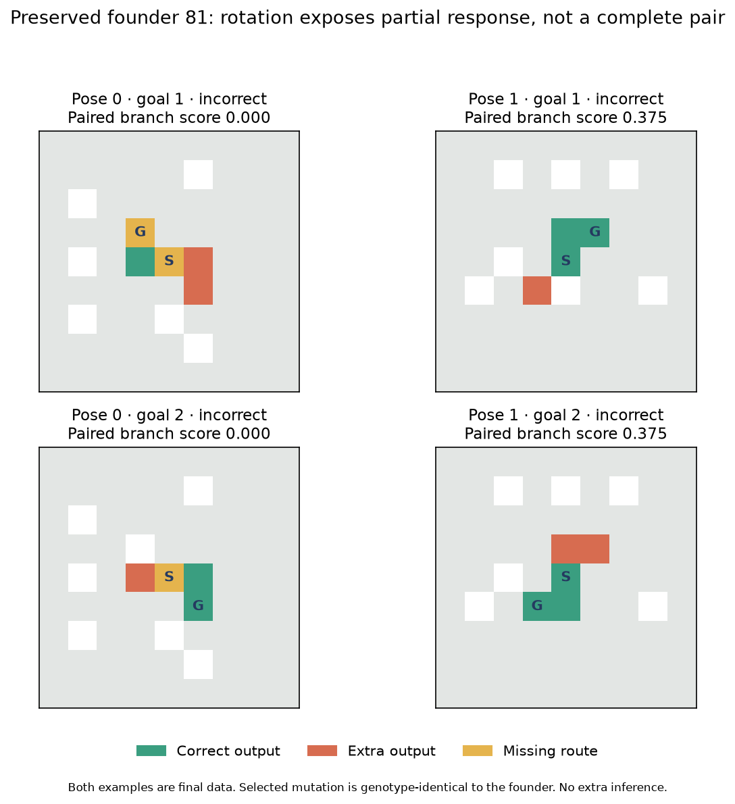

# V12N branch pressure calibration finds sparse output variation and a pose coverage limit

**The proposed branch-choice pressure fails its readiness gate. No evolutionary
pilot was launched.** Across three preserved random founder groups and their
single-edit neighborhoods, every candidate received zero branch-choice credit on
the queried calibration cases. Current and proposed pressure therefore made
identical parent, elite and nominee choices. Independent confirmation does not
show a pressure advantage or any complete non-adjacent goal pair.

This result is narrower than “random-origin solving cannot emerge.” The saved
outputs reveal two useful facts. First, most mutations change work or stopping
counters, but very few change output masks. Second, the calibration's four poses
omit 90-degree rotations where one preserved founder shows a small, one-sided
branch response. We need to measure cumulative behavioral variation with complete
orientation coverage before committing more compute to this objective.

## The controlled change

The new evaluator compares two ordinary emitted outputs for the same maze/source
and different goals. It measures whether each exclusive interior goal arm becomes
more illuminated when that arm is correct. Both goal-marker cells and all shared
path vertices are excluded from the contrast. The positive mean contrast is
multiplied by the weaker output's path F1, so extra output and missing route cells
reduce credit. Identical floods, constant branch choices and goal-pixel-only
switching earn zero. Correct paths earn one where both arms have interior cells.
Adjacent pairs and two-edge shared-prefix forks have no such interior cells and
remain judged by exact completion, not this proxy.

The new rank inserts this proxy immediately after complete-pair correctness and
before individual counts, including corridor correctness. Lexicase parent
selection receives the same field in the same position. The current-pressure
control sets that field to zero and reproduces the previous selector's behavior.
Both use identical tie-breaking, random seeds and protected-anchor rules. The new
score can reward a one-sided partial response, but the readiness gate additionally
requires a normal response in the correct direction on **both** interior arms.
No oracle label enters candidate inference; all runtimes and stopping rules remain
unchanged, with goal pulse enabled and exposure bits inert/all-on.

Source, protocol, pools, mutations/RNG and software fixtures were frozen and pushed
in **74fcc24 before any candidate call**. All twelve validation choices and their
evidence were pushed in **8bbf2cf before final generation**. Main seed 2026101909;
fixture seed 1284. There was no source repair, threshold change, scope reduction or
post-registration protocol deviation.

## Candidates, cases and equal evidence

Each of three groups starts with all 96 original M founders. Two independently
sampled single V3 instruction edits are applied to each original founder, giving
288 identities per group:96 founders and 192 children. The edits are not chained.
Every event, ineffective edit, genotype, parent and RNG state is saved. The
capacity ceiling remains256 genes. These are explicitly M-informed pools; no
known solver is introduced and no organism stores a particular maze's route.

All864 identities are evaluated under local-radius redirection and ordinary
nonlocal topology. There are1,662 distinct physical configurations after exact
aliasing. Both pressure policies receive the same logical evidence. The M
validation-selected component growers and founder 81 are protected identically
where they belong to the original group; no final-result-selected anchor is added.
The apparent selected “child” of group 0 founder 81 has an ineffective operand edit:
its **genome is exactly identical to the founder**, not a new discovery.

The new grammar has9×9 boards with adjacent goals, two-edge arms, two-edge
shared-prefix forks, three-edge arms and three-edge shared-prefix forks, each in
straight/turning forms. Every context also has six isolated clutter cells, matched
pruned corridors and two disconnected open goals. Independent clutter seeds make
whole layouts distinct, while route shapes repeat. This is a small tree grammar,
not a cyclic or general-maze test. No inference about large mazes follows.

| Stage | Seeded contexts | Queried poses | Inputs/model | Complete-pair opportunities |
|---|---:|---|---:|---:|
| Software fixtures |10|Pose 0 for profiling|60|10|
| Calibration |10|0,2,4,6|240|40|
| Validation |10|0,2,4,6|240|40|
| Independent final |30|All8|1,440|240|

All eight poses are saved and excluded even when unqueried. The final has48
adjacent and 192 non-adjacent pairs,480 corridors and 480 disconnected inputs per
model. Proxy-eligible pairs total 144 per model. Groups share the same case corpus;
founder RNG groups are independent, while poses, goals and matched controls are
correlated. “Three templates” can mean three clutter contexts of the same route
shape, not three independently different decision geometries.

Calibration provides414,720 logical candidate-input evaluations to each selector,
sharing398,880 physical calls. Each policy nominates two candidates per group and
topology;5,760 logical validation calls share2,160 physical calls. The final uses18
physical configurations, including the separate intact control, for25,920 calls.
No next generation was bred; parent draws are a selection simulation.

## Calibration fails to activate selection

Every candidate in all six group/topology combinations has zero positive proxy,
zero strict-both interior responses and zero complete non-adjacent pairs on the
queried calibration cases. Every cohort has:

- **0/64 changed parent identities** between policies;
- unchanged elite and nominee memberships;
- no parent-score advantage;
- no mutation meeting the preregistered decision-improvement criterion.

All protected anchors remain present. No calibration or final cohort passes, so
neither topology qualifies under the required two-of-three rule. The timing
preflight passed: projected calibration plus conservative validation61.56 seconds,
final55.52 seconds, comfortably below the fixed432/180second thresholds. This was a
scientific activation failure, not a failure to allocate the allowed compute.

## Most mutations alter computation but preserve output

A post-registration diagnostic compares only saved calibration responses. These
counts describe192 mutation opportunities per group, evaluated on240 inputs under
each topology; they are not probabilities over all possible mutations or mazes.

| Group / topology | Genetically changed children | Changed work/step counters | Changed mask on any input |
|---|---:|---:|---:|
|0 local|184|127|5|
|0 nonlocal|184|128|5|
|1 local|179|116|2|
|1 nonlocal|179|116|1|
|2 local|180|121|2|
|2 nonlocal|180|123|2|

The genetic-change counts repeat between topologies because the children are the
same; there are543 genuinely changed programs among 576 mutation opportunities.
“Counter change” includes steps, active-instruction count, reads, dispatches,
range reads or exposure checks. It does not establish hidden-state equivalence
or identify a particular inactive instruction. Many edits affect computation
without affecting the returned raster. Increasing nominal genome size alone would
not necessarily address that separation.

A few candidates do respond to goal changes away from the markers:5 local and 8 nonlocal candidates
in group 0, and 6 under each topology in group 1, out of 288 per cohort. Group 2 has none. On eligible normal
pairs, their nonzero directional contrasts are negative, not positive. Thus the
zero scores are not merely caused by marker exclusion, non-emission gating or a
missing path-overlap term. They reflect absent favorable interior contrast in
this particular queried orientation set. Clipping negative contrast to zero also
makes the new selector unable to distinguish those unhelpful responses from a
neutral flood; a future objective must assess that tradeoff prospectively.

## Confirmation exposes an orientation limitation

Current and proposed pressure select the same candidate in every cohort. Their
independent final outcomes are therefore identical:

| Group / topology | Adjacent pairs /48 | Non-adjacent pairs /192 | Mean branch score | Strict-both pairs | Corridors /480 |
|---|---:|---:|---:|---:|---:|
|0 local|12|0|0.03125|0|108|
|0 nonlocal|12|0|0.002315|0|12|
|1 local or nonlocal|0|0|0|0|480|
|2 local or nonlocal|0|0|0|0|480|

Group 0's selected identity is `branch_pressure/r0/f81/edit1`, the genotype-identical
copy of M's96-gene random founder 81. Under local topology it receives partial
score0.375 on12 paired poses: three turning two-edge templates at poses1,3,5,7.
Under nonlocal topology it scores1/6 on two poses,3 and 7, of one turning three-edge
template. None has a correct response on both interior arms; none completes the
non-adjacent pair. The original founder has exactly the same1,440 final masks under
each topology. These are preserved random-founder behaviors, not mutation gains.

**The calibration queried only even-numbered D4 poses**, which omit the quarter-turn
orientations exposing these positive partial responses. That is a limitation of
our calibration coverage. The final evidence does not overturn the failed
preregistered gate or establish a pressure effect, but it prevents the stronger
claim that this pool has no positive branch response in any orientation. The
illustration below rotates the same final layout; it is retrospective saved data,
not additional inference or a retuned selection.

Group 1's selected changed program retains its founder's final output masks;
group 2's nonlocal selection is another ineffective-edit copy of its component-growing
founder. Group 2's local selection comes from another founder, whose final was not
part of the frozen panel, so no new parent comparison was added. Component growers,
founder 81 and every other original founder remain preserved. No-path reporting
still fails for all selected random candidates, with no false reachable no-path
claims. All legal selected outputs are shortest. The separate intact VM, compiled
BFS, A* and bit-wavefront solve all 960 reachable and 480 disconnected final inputs.

## Cost, audit and reproducibility

- Calibration+validation: **47.843 candidate seconds**,401,040 calls,
  28,025,939,410 charged work units;59.027 seconds recorded execution wall,
  1,512 MiB peak RSS, within 480 seconds/500,000 calls.
- Final: **1.580 candidate seconds**,25,920 calls,880,207,878 work units;
  2.202 seconds recorded execution wall,819.09 MiB peak RSS, within 200 seconds/60,000 calls.
- Main total: **49.423 candidate seconds**,426,960 calls,28,906,147,288 work units.
  These execution wall measurements exclude initial corpus construction and
  warm-up; they are not end-to-end solver benchmarks.
- Software profiling separately: 0.182 candidate seconds,1,440 calls. Each of the
  three stages records one intact-candidate and three baseline warm-up calls.
  Final baselines add4,320 calls. No speedup claim is made.

Local Apple M4 CPU, 10 cores,16 GiB; Python 3.13.15, NumPy 2.5.4, Numba 0.68.0,
llvmlite 0.50.0, pytest 9.1.1. No cloud or model calls.

The audit **passes on its first attempt** in 71.303 seconds wall,1,742.88 MiB peak RSS:
428,400 exact candidate replays;432,720 independently graded rasters;4,320 baseline
replays; all 576 mutation events/RNG,288 original founders,768 parent draws,
3,456 independently checked ranks and 12 validation choices. It regenerates2,880
graph cases and checks177 frozen source hashes,10 input hashes and 1,641 prior
completion entries. Independent arithmetic checks every scored paired contrast
and full rank. There is no frozen-source repair or protocol deviation.

**21 focused tests pass:11 new and 10 related.** Repository-scoped collection finds
241 tests; this is not a fresh full suite. An initial unscoped collection traversed
optional plotting-library tests and failed on their missing test assets/dependency;
scoping collection to the repository's `tests` directory succeeds. Both collection
logs are preserved. This did not affect experimental code, source freeze or data.

All populations, sampled children, RNG, raw masks, counters, aliases, choice records,
final controls and earlier evidence remain intact. Output diagnostics and figures
are post-registration analyses of saved results, with zero additional candidate
calls. Exclude **177,032 whole layouts** next:175,592 through M plus 240 software
fixtures,240 calibration,240 validation and 720 final layouts, including every
unqueried pose. No inspected final case is reusable as training/validation.

## What should change next

This study makes an immediate pressure-only evolution pilot unjustified: the
proposed pressure did not change selection. It does not test extended evolution,
neutral drift, cumulative edits or larger heritable capacity. Those hypotheses
remain open. The apparent output neutrality is especially relevant to the user's
critical-mass idea: multiple changes might be needed before computation changes
become useful output, but these data do not yet demonstrate that mechanism.

The next proposal is a bounded **cumulative-mutation and orientation-coverage
assay** using all eight poses on entirely new cases. Preserve the original pools
and sample predeclared mutation walks to several edit depths without selecting
from the observed finals. Measure intermediate genetic/counter/output changes,
goal-response direction and ordinary completed pairs. Equal evaluation budgets
and single-edit/random-resampling controls should distinguish additional mutational
distance from merely evaluating more candidates. Only then choose between a
bounded diversity-preserving evolution pilot and a specific runtime/readout change.
Do not repeatedly invent more selective objectives without checking whether the
population contains behaviors they can act on. See the [unlaunched proposal](branch_pressure_calibration/next_experiment.md).
