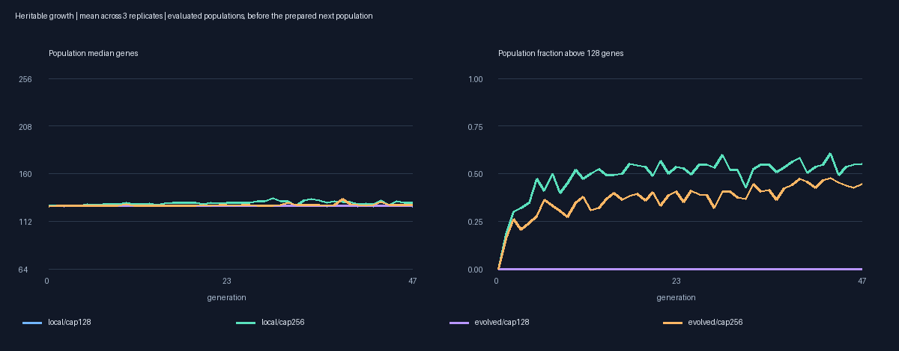
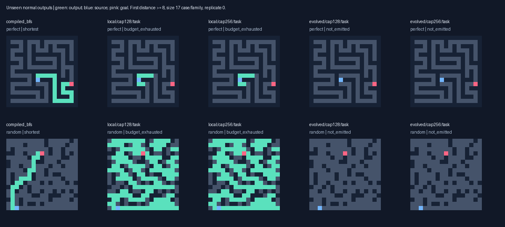
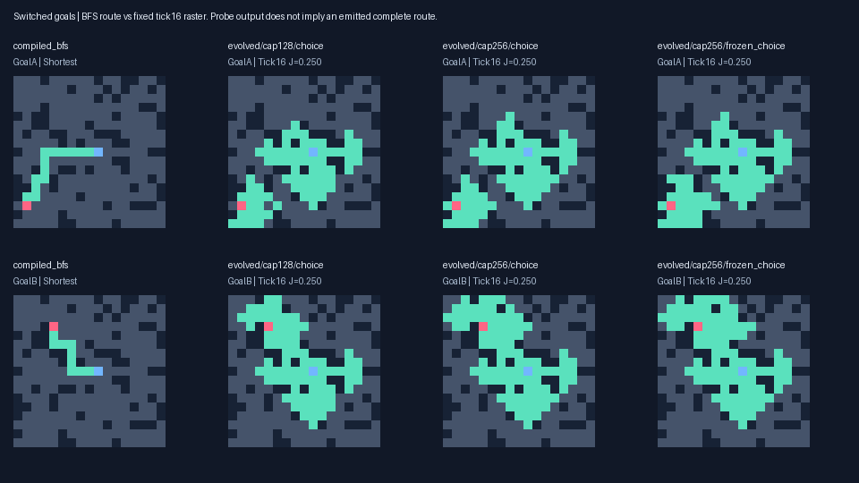

# Heritable program-capacity growth: V11

Twelve matched conditions continue 96 random-origin organisms for 48 generations, comparing gene ceilings of 128 and 256. Eight channels, opcodes, ranges, fitness, mutation modes, immigrant lengths and work limits stay common. Correct complete shortest outputs remain primary.

| Primary task archive | Valid / reachable | Shortest | Distance≥8 shortest | Paired shortest /42 | No-path /48 |
|---|---:|---:|---:|---:|---:|
| local/cap128/task | 0/216 | 0 | 0/180 | 0 | 32 |
| local/cap256/task | 0/216 | 0 | 0/180 | 0 | 32 |
| evolved/cap128/task | 1/216 | 1 | 0/180 | 0 | 16 |
| evolved/cap256/task | 1/216 | 1 | 0/180 | 0 | 16 |
| compiled_bfs | 216/216 | 216 | 180/180 | 42 | 48 |
| compiled_astar | 216/216 | 216 | 180/180 | 42 | 48 |
| wave_bit | 216/216 | 216 | 180/180 | 42 | 48 |

**Capacity grew, but unseen solving did not improve.** Evaluated programs reached 228 genes; the prepared next-generation checkpoint includes a 240-gene program. In the final evaluated expanded populations, 39–66 of 96 organisms per condition exceeded the old ceiling. This tests actual heritable growth, rather than merely raising an unused limit. Both capacities have identical primary accuracy: local task archives solve 0/216 and evolved-range task archives solve 1/216, matching their frozen controls. Secondary local choice archives solve 4/216 versus 3/216 frozen under either capacity. Every successful selected output is a one-edge route. All selected models solve 0/180 ordinary cases at distance ≥8 and 0/42 paired routes, with 0/18 strict paired fork choices. Compiled BFS, A* and wavefront solve every reachable case and correctly reject every disconnected case.

The inherited goal response remains a useful research lead. In a post-hoc assay, evolved-range choice models change hidden state around a fork under switched goals on 4/18 pairs at cap 128 and 3/18 at cap 256; all occur in replicate 2. The frozen model already responds on 3/18. Changes occur mainly at adjacent exits and do not produce correct paired choices. Thus a vertex-only measurement misses some context, while the wider measurement still provides no evidence that added capacity improved its use. These are concentration responses on reused final layouts, not independent discoveries or another accuracy test.

Growth has real costs. Among coeval cap 256 children that grew, 2,198/4,723 retain the saved behavioral fingerprint, 3,897 require more work and 1,473 complete fewer normal ticks than their parents. These conditional comparisons allow multiple edits and do not isolate the causal effect of length. Larger programs do not automatically become more effective programs.

The primary task selectors all retained genomes at or below 128 genes; one selected choice genome has 138 genes. Thus the primary comparison concerns the result of allowing growth under this search/selection scheme. The conditional training records and frozen boundary leaders give additional observations of grown candidates, but this is not an exhaustive holdout evaluation of every larger genome.

This result leaves the random-origin track open. Eight state channels and the work limits stayed fixed, immigrants stayed at 64–128 genes, and each child still received 1–6 edits regardless of genome length. The experiment tests one program-growth treatment over 48 generations. It does not test larger dynamic state, a length-scaled mutation rate, substantially longer evolution, or every form of regulatory complexity. All populations, RNG states, protected earlier primitives and intermediate variants remain available for continuation.

Extension gate **False** after [48] generations. Only replicated hard-validation transfer could extend training. More genes, prefix scores or one contextual choice alone cannot. Three replicates give descriptive comparisons; repeated archive copies/contexts are not independent discoveries.

## Controlled implementation and provenance

V3 lifts only the bounded gene ceiling. Both arms execute the same unchanged V6 normal/probe kernels on the same typed instruction arrays. Old-program state, normal masks, halt/status, counters and memory match exactly before training. V2 already had 1–8-gene block duplication; all seven mutation modes and cap 128 RNG behavior are retained. In cap 256, only capacity-dependent insertion/duplication eligibility changes. Both immigrant factories remain 64–128 genes, so extra DNA must grow through inheritance. No known solver enters a lineage. The old length-descriptor bin remains clamped at 3, so expanded programs get no extra niche or size bonus. Unfinished phenotypes get no cost/length penalty.

Fork matching V10 Fixed population/RNG; preserve native task/choice/J/B/G/source and protected variants from both V10 arms, strict supplements and every node of the short-cue training primitive in evolved replicate 2. All initial genotypes/RNG/protection match between capacities. New validation archives remain saved without automatically breeding. No cross-topology/replicate transfers. The common cohort/seed changes make cross-version absolute scores unsuitable as capacity effects.

The unchanged Choice-first rank is (valid, shortest, no-path utility, strict-both K, smooth shaping, cost only when all ordinary outputs correct). Case selection prioritizes valid/optimal/paired choice before epsilon.02 shaping. J=.25 source-dependent connected prefix+.75 causal correct-exit choice. All shortest exits are accepted individually; wrong exits must be off. Oracles/decision labels never enter inference. Same hard pair distribution in both arms, no near-goal curriculum.

Seed 2026101811, independent construction 1114, equivalence 1113; 8702 prior layouts excluded. Preregistration `7ea87d7e3c2f194a63f234496ad4109e7db2f161`; frozen model SHA `1cf1e1d644e93f24f66015190f622f62489c1620f8634f17c2bc95af283425a2` before final generation. 264 ordinary layouts and 24 separate paired layouts/48 inputs are common to both capacities, frozen controls and compiled baselines. Paired inputs: 42 reachable≥8,6 unreachable, 18 regular decisions. Source-prefix 2..8, goals≥4 beyond, disjoint all-shortest exits; even indices require deceptive bearing. Ordinary sizes 9/17/33/65 include trees, cycles, disconnected and rectangles.

## Actual growth and expression

| Condition | Last evaluated median genes | Last max genes | Last above128 /96 | Mutated children grown | Above128 mutant children | Capacity fallbacks |
|---|---:|---:|---:|---:|---:|---:|
| growth/evolved/cap128/0 | 128.0 | 128 | 0 | 556/1989 | 0 | 1028 |
| growth/evolved/cap128/1 | 128.0 | 128 | 0 | 378/1894 | 0 | 1106 |
| growth/evolved/cap128/2 | 127.0 | 128 | 0 | 366/1470 | 0 | 799 |
| growth/evolved/cap256/0 | 128.0 | 146 | 39 | 1080/1994 | 1134 | 0 |
| growth/evolved/cap256/1 | 129.0 | 228 | 49 | 1023/1888 | 1365 | 0 |
| growth/evolved/cap256/2 | 128.0 | 156 | 40 | 823/1465 | 825 | 0 |
| growth/local/cap128/0 | 127.0 | 128 | 0 | 507/2218 | 0 | 1219 |
| growth/local/cap128/1 | 127.5 | 128 | 0 | 398/2139 | 0 | 1260 |
| growth/local/cap128/2 | 127.0 | 128 | 0 | 433/2147 | 0 | 1410 |
| growth/local/cap256/0 | 128.0 | 192 | 44 | 1162/2191 | 1464 | 0 |
| growth/local/cap256/1 | 129.0 | 174 | 49 | 1176/2141 | 1351 | 0 |
| growth/local/cap256/2 | 134.0 | 199 | 66 | 1167/2119 | 1735 | 0 |

Last evaluated population precedes the prepared next-generation checkpoint. Counts repeat genotypes/opportunities. Every child’s concrete trace is independently reconstructed; cap 128 fallbacks retain the old operand mutation. Extra length is potential capacity, not evidence of effective complexity.

| cap256 training subset | Evaluations | Mean genes | Valid normals / calls | Strict pair responses | Mean completed normal ticks | Normal budget exhaustion | Work |
|---|---:|---:|---:|---:|---:|---:|---:|
| local/at_most128 | 7075 | 120.4 | 7/28300 | 0 | 37.94 | 7521 | 43,548,381,775 |
| local/above128 | 6749 | 142.7 | 8/26996 | 0 | 41.56 | 8661 | 56,265,903,717 |
| evolved/at_most128 | 8780 | 121.9 | 1/35120 | 6 | 23.56 | 5193 | 45,085,490,913 |
| evolved/above128 | 5044 | 142.8 | 1/20176 | 0 | 24.02 | 4086 | 34,725,071,687 |

| cap256 topology | Coeval children that grew | Same recorded behavior | Higher fitness | More work | Fewer completed ticks |
|---|---:|---:|---:|---:|---:|
| local | 2431 | 1098 | 227 | 1989 | 880 |
| evolved | 2292 | 1100 | 171 | 1908 | 593 |

Grown versus≤128 within cap 256 is a CONDITIONAL lineage/selection comparison, not a randomized subcomparison. Different programs/cases/nomination overlap can change work and completed ticks. Arm assignment is the controlled capacity comparison.

## All selected unseen outputs

| Archive | Shortest / reachable | Paired shortest /42 | Strict both /18 | J |
|---|---:|---:|---:|---:|
| evolved/cap128/choice | 0/216 | 0 | 0 | 0.2348 |
| evolved/cap128/frozen_choice | 0/216 | 0 | 0 | 0.2460 |
| evolved/cap128/frozen_task | 1/216 | 0 | 0 | 0.0579 |
| evolved/cap128/task | 1/216 | 0 | 0 | 0.0579 |
| evolved/cap256/choice | 0/216 | 0 | 0 | 0.2460 |
| evolved/cap256/frozen_choice | 0/216 | 0 | 0 | 0.2460 |
| evolved/cap256/frozen_task | 1/216 | 0 | 0 | 0.0579 |
| evolved/cap256/task | 1/216 | 0 | 0 | 0.0579 |
| local/cap128/choice | 4/216 | 0 | 0 | 0.2596 |
| local/cap128/frozen_choice | 3/216 | 0 | 0 | 0.2596 |
| local/cap128/frozen_task | 0/216 | 0 | 0 | 0.0278 |
| local/cap128/task | 0/216 | 0 | 0 | 0.0278 |
| local/cap256/choice | 4/216 | 0 | 0 | 0.2596 |
| local/cap256/frozen_choice | 3/216 | 0 | 0 | 0.2596 |
| local/cap256/frozen_task | 0/216 | 0 | 0 | 0.0278 |
| local/cap256/task | 0/216 | 0 | 0 | 0.0278 |

| Task archive | Turn-required shortest | Detour-required shortest | False no-path on reachable |
|---|---:|---:|---:|
| local/cap128/task | 0/191 | 0/134 | 0 |
| local/cap256/task | 0/191 | 0/134 | 0 |
| evolved/cap128/task | 0/191 | 0/134 | 0 |
| evolved/cap256/task | 0/191 | 0/134 | 0 |

Representative local/cap 128/task failure: `test_goal/r0/170000000/perfect/17x17`,  oracle 23 edges; status `read_budget`,  204 ticks,`budget_exhausted`.

Representative local/cap 256/task failure: `test_goal/r0/170000000/perfect/17x17`,  oracle 23 edges; status `read_budget`,  204 ticks,`budget_exhausted`.

Representative evolved/cap 128/task failure: `test_goal/r0/170000000/perfect/17x17`,  oracle 23 edges; status `quiescent`,  72 ticks,`not_emitted`.

Representative evolved/cap 256/task failure: `test_goal/r0/170000000/perfect/17x17`,  oracle 23 edges; status `quiescent`,  72 ticks,`not_emitted`.

Successful shapes are saved; a short inherited path or endpoint-aware halting does not establish general goal-guided routing. All valid outputs are still counted. Per-size/family/distance records and every failure remain in raw outputs/summary.

## Fixed-model diagnostics

Goal-pulse removal retains static goal flags. Nonlocal ablation zeroes radius>1 reads and charges attempted reads. 8/16/32/64-tick source/junction state changes are communication, not correct choices. Forced probes override ordinary halting. All intervention rasters, costs, structural opportunity labels and training-source entry checks are saved; no reselection.

| Current choice archive | Goal switch changes source state at16 /18 | Junction state at16 /18 | Junction state at64 /18 |
|---|---:|---:|---:|
| local/cap128/choice | 0 | 0 | 0 |
| local/cap256/choice | 0 | 0 | 0 |
| evolved/cap128/choice | 0 | 2 | 0 |
| evolved/cap256/choice | 0 | 1 | 0 |

A separate post-hoc assay checks the fork AND its adjacent exits in hidden channels 0, 1, 3, 4, 5, 6 at tick 16. Output channel 2 and stop channel 7 are excluded from the hidden measure. Both switched goals are tested with the source present and removed. The same frozen models and already inspected final pairs are reused; this is a mechanism diagnostic with no training or reselection.

| Choice model | Goal changes hidden region /18 | Hidden vertex /18 | Hidden exits /18 | Output-exit concentrations /18 | Source × goal interaction /18 |
|---|---:|---:|---:|---:|---:|
| local/cap128/choice | 0 | 0 | 0 | 0 | 0 |
| local/cap256/choice | 0 | 0 | 0 | 0 | 0 |
| evolved/cap128/choice | 4 | 0 | 4 | 3 | 8 |
| evolved/cap256/choice | 3 | 1 | 3 | 1 | 7 |
| evolved/cap256/frozen_choice | 3 | 1 | 3 | 1 | 7 |

The evolved-range signal occurs only in replicate 2 and is already present in its frozen control. Goal-dependent state at an exit can exist without a changed fork vertex. Concentration changes do not necessarily cross the binary output threshold or choose a correct exit. The source × goal metric compares signed goal contrasts with/without source; it can be positive even when the source-present goal contrast is zero. It therefore establishes an interaction, not useful context or correct routing. All these models still have zero strict final paired choices.

No primary hard-validation choice archive qualifies on both switched goals. All earlier native variants, including `i1472`,  remain protected.

| Topology/capacity | Training leader generation | Hard-validation strict /12 | Final strict /18 | Final shortest /42 |
|---|---:|---:|---:|---:|
| local/cap128 | 15 | 0 | 0 | 0 |
| local/cap128 | 31 | 0 | 0 | 0 |
| local/cap128 | 47 | 0 | 0 | 0 |
| local/cap256 | 15 | 0 | 0 | 0 |
| local/cap256 | 31 | 0 | 0 | 0 |
| local/cap256 | 47 | 0 | 0 | 0 |
| evolved/cap128 | 15 | 0 | 0 | 0 |
| evolved/cap128 | 31 | 0 | 0 | 0 |
| evolved/cap128 | 47 | 0 | 0 | 0 |
| evolved/cap256 | 15 | 0 | 0 | 0 |
| evolved/cap256 | 31 | 0 | 0 | 0 |
| evolved/cap256 | 47 | 0 | 0 | 0 |

Leaders are frozen before final generation. Boundary batches contain one regular tree pair and one mixed pair, so miss cyclic training opportunities. Reused-training leader/frozen/final replays are not holdouts; leader replay equals its original full training record exactly.

## Real cost and capacity limits

Search+validation/probes **14.15 min**; main including final correctness/timing **17.01 min**. Main peak **213.2 MiB**, Apple M4, Python 3.13.15, packages `{'llvmlite': '0.50.0', 'numba': '0.68.0', 'numpy': '2.5.4', 'pillow': '13.0.0', 'pytest': '9.1.1'}`. 267,156 search normal responses/534,312 probes, 444,031,737,693 logical dispatch+attempted-read units. These are VM units, not hardware instruction counts. Extra code consumes the same bounded budget and can leave fewer complete ticks.

Pre-training parity 14.94 s, 1052 native program/topology pairs, 7712 normals/10016 probes, 7,854,260,840 work. Post-freeze diagnostics 30.23 s, 14,762,910,806 units; compression 10.26 s; audit 23.10 s, audit peak 384.7 MiB. Separate audits/replays are outside main elapsed/work. An earlier audit took 23.36 s; the repeat corrects diagnostic temporal labels from inherited near/far names to early/middle/late. All V11 training pairs use the common hard distribution. Primary data and fitness are unchanged.

Post-hoc hidden-context assay 0.671 s, 312 probes, 331,774,764 work; independent replay 0.690 s and the same work. All 312 states/masks/counters replay exactly; 288 original-mask/vertex comparisons match. Its source and input hashes are preserved separately.

Latency includes decoding, initialization, updates and raster emission. Fitness/oracle/probes are excluded and charged separately. Same production mutability/dtype/signature warmup, 30 randomized repetitions/case, 12 cases/arm. Median of case medians and full sample range. Wrong outputs cannot claim speedup; baseline VM counters are uninstrumented placeholders.

| Arm | Median case median μs | Warm range μs | Correct timed repetitions | Largest explicit arrays |
|---|---:|---:|---:|---:|
| compiled_bfs | 4.58 | 2.21–18.58 | 360/360 | 46514B |
| compiled_astar | 7.69 | 2.75–46.04 | 360/360 | 69635B |
| wave_bit | 24.80 | 5.00–258.08 | 360/360 | unreported |
| local/cap128/task | 13360.77 | 341.46–36204.54 | 0/360 | 151747B |
| local/cap256/task | 13364.12 | 334.88–36424.12 | 0/360 | 151747B |
| evolved/cap128/task | 6429.29 | 314.50–41739.25 | 0/360 | 151747B |
| evolved/cap256/task | 6425.03 | 316.92–37422.88 | 0/360 | 151747B |

| Task archive | Completed site-ticks | Logical state-copy MiB | Neighbor reads | Dispatches | Active fraction |
|---|---:|---:|---:|---:|---:|
| local/cap128/task | 29,345,778 | 895.6 | 2,664,569,328 | 3,736,495,096 | 0.737 |
| local/cap256/task | 29,345,778 | 895.6 | 2,664,569,328 | 3,736,495,096 | 0.737 |
| evolved/cap128/task | 19,005,782 | 580.0 | 1,779,685,601 | 2,318,299,731 | 0.773 |
| evolved/cap256/task | 19,005,782 | 580.0 | 1,779,685,601 | 2,318,299,731 | 0.773 |

Eight-channel double buffers stay 32 N bytes; each completed open-site tick copies 32 logical bytes old→new. This excludes partial ticks, register/gene operations and allocation; cache/compiler effects change DRAM traffic. Max 256-gene array 7168 B, existing explicit memory ceiling 64 N+65536 unchanged. Grid propagation and repeated updates remain scaling costs.

Selected archive genes 114–138; conservative output/stop slices 10–65. These are syntactic potential dependencies, not proof of useful effective complexity.

Conditional coeval changed-DNA neutrality: 8396/17176 (48.9%) match the saved normal/probe/status/partial/source/goal fingerprint. Hidden state, expression and work can differ. Full population/RNG, all archived genes and neutral variants remain available.

## Verification and reproduction

All checks pass: 91 frozen sources, 59,127 fitness records, 23,655 child traces, 270,324 J rasters, 41 valid training claims, 48 selected normal replays, 1440 phase-assay outputs, 12 each task/choice/J/B archive maxima. Source/model/lineage/protection/layout/storage and arm ceilings are verified. Unit checks cover exact old mutation RNG, trace replay, bounds, full-state/fitness parity, common primitive cohorts, exact resume, gate and independent full construction through 192 generations.

Tests: 122 passed in 422.06 s in the full suite before the extra bound regression. After the final study guard edit, 4 focused tests passed; the additional exact 256-gene regression passed separately (1 test in 0.14 s). All 123 current tests are covered; this is not a claim of one full 123-test run. Commands: `.venv/bin/python -m pytest -q`, `.venv/bin/python -m pytest tests/test_growth_limits.py -q`,  and the growth-study/equivalence/diagnostic/audit/report commands in the protocol. The post-hoc command is `.venv/bin/python -m maze_evolution.growth_context --out results/capacity_growth`,  followed by the same command with `--verify`.

Commands/protocol: `docs/GROWTH_STUDY_V11.md`; raw results: `results/capacity_growth/`. Earlier source/raw data remain immutable. Random-origin emergence stays central. A negative bounded experiment cannot establish impossibility of greater capacity, regulation or longer evolution.

## Next controlled experiment

Keep the expanded capacity and test **hidden goal-context discrimination at the exits** as a precursor objective. Some existing evolved-range programs already carry a goal-dependent hidden response there, yet no selected model chooses both exits correctly. The next question is whether giving this intermediate response a smoother, direction-specific learning signal helps it become useful output control.

Fork the six native cap 256 populations and RNG states into matched current-pressure and hidden-context-pressure arms. Keep 96 organisms, eight channels, the 256-gene ceiling, mutation, hard fork distribution, protected cohorts and inference limits identical. Continue to preserve the capped controls as checkpoints. No known solver enters any random-origin lineage; do not reset or discard grown programs.

Change only a continuous shaping term below complete-path correctness and strict paired-choice priority. Preregister a bounded hidden-channel contrast across both switched goals: credit concentration differences that distinguish the two correct exit sets, penalize wrong-exit responses, and compare source-present with source-removed probes. Exclude direct source/goal sites, output/stop channels and zero-change pairs. Fix channel aggregation and normalization before production training, using independent synthetic fixtures. Any oracle exit labels remain fitness-only. A raw state difference or a source × goal interaction alone is insufficient credit. Keep the current route, branch and source-transmission terms common, and publish the exact added term and its scale before running.

Use a 48-generation screen with the existing validation-based extension gate, charging all extra probes. Extend only for replicated improvement in hard-validation complete routes or strict paired choices over both frozen and current-pressure controls. Then freeze the models before generating new ordinary and paired holdouts. Include trees, cycles and disconnected grids; exclude all **9,296 whole layouts** seen through V11. Report hidden context, correct exit choices and complete shortest rasters separately. No hour-scale extension is justified by hidden-state differences alone.

This is a proposed next study, not an executed or preregistered V12 experiment. A positive result must first survive fresh layouts and show that context helps the emitted path.
