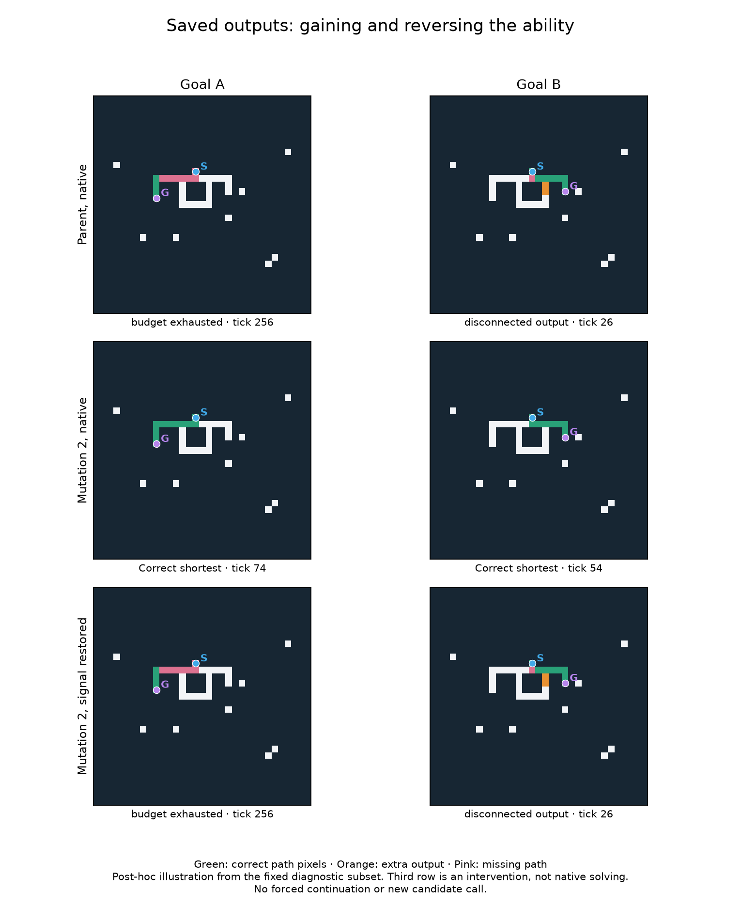

# V12V — a confirmed signal mechanism and a harmful reversion

The controlled tests identify why historical mutation 2 helps on these mazes:
**it suppresses the old signal into channel 4**. Removing that signal reproduces
the improved genome's complete responses; restoring it reproduces the earlier
failures. The mutation works without the preceding deletion.

The second result changes our repair strategy. Mutation 8 originally loses some
abilities by removing an output store. But putting that exact store back into
the later descendant is strongly harmful: positive-prefix paired solving falls
from **320/1,440 to 8/1,440**. A rule that helps in the earlier background damages
the later one. The intervening edits have changed its effect.

This assay uses 12 new structural contexts and a panel frozen before final
generation. Eleven models are preserved random-origin historical programs, four
are explicitly constructed mechanistic probes, and one is the separate intact
known solver. No evolution or replacement selection occurred. Registration
`0ae3d5a` was pushed before the new final corpus was generated.

## Mutation 2 does not require the first deletion on these inputs

The 2×2 test crosses the first deletion with the destination change at instruction
103. The fourth combination, `dest_only`, is a constructed one-edit probe in the
original narrow root; the other three combinations are exact historical genomes.

| Preceding deletion | Destination change | Positive-prefix pairs /1,440 | Corridors /1,152 | Ordinary shortest /384 |
|---|---|---:|---:|---:|
| Absent | Absent: d00 |0|58|51|
| Present | Absent: d01 |0|58|51|
| Absent | Present: dest_only probe |344|1,152|82|
| Present | Present: historical d02 |344|1,152|82|

The deletion changes no output mask, status or stopping tick on any of the 6,080
native inputs, either with or without the destination edit. Work and memory
records differ because the program lengths differ; we do not call these complete
record matches. The positive-pair interaction is zero in each of the 12 contexts.
The destination edit is sufficient in this tested root background, not necessarily
in an arbitrary random genome.

The 344 positive pairs comprise 176 forks, 88 two-junction cases and 80 genuine
alternative-cycle cases. Every context contributes successes. Thirty-two
positive-prefix context/variant groups work in all eight poses. Success remains
limited to prefixes 1 and 2; all these early programs fail prefixes 4 and 8.
The longest completed paired route reaches 13 edges on one arm.

The gain is not absolute dominance on every task: across all pairs the destination
edit gains 589 and loses one prefix-zero pair. Four individually correct branched
outputs are lost. It gains 31 ordinary outputs and 1,094 corridor outputs without
losing an ordinary or corridor success here.

## The channel-4 prediction survives an exact response test

The edit redirects a neighboring-channel minimum from scratch register 44 to 32.
As U's static inspection predicted, this leaves zero available to the final
channel-4 store. The new scratch register 32 write does not create a retained signal: its
later store is overwritten before the tick commits.

V tests this through a bounded diagnostic adapter. At the existing final
channel-4 store, suppression writes zero; restoration writes the neighbor value
already calculated and charged by instruction 103. The adapter adds no neighbor
lookup, hidden timestep, answer information or stopping change. Actual subsequent
work remains measured. The stored radius and `REMOTE_MIN` opcode name do not
mean a range experiment: every tested model uses local topology.

Each of four early genomes receives both interventions on a fixed subset of
2,368 inputs: four structural contexts, all their queried poses/variants and all
ordinary cases. There is no success filtering. The eight predictions comprise
four effect contrasts and four sham controls:

- Suppressing channel 4 in either earlier parent matches its destination-edited
  counterpart's native response.
- Restoring channel 4 in either edited genome matches its corresponding parent's
  native response.
- Suppression in the edited genomes and restoration in the parents match their
  own native responses, as predicted for the shams.

**All 18,944 responses match exactly**, including masks, statuses, ticks, grading,
read/dispatch/exposure counters and reported array memory. This is much stronger
than matching aggregate scores. It is still finite-case evidence in these two
closely related backgrounds, not a proof of a general solver or universal circuit.
Normal adapter parity is checked separately against native inference.

The illustration is a post-hoc selection from the already fixed diagnostic
subset. Its third row is a channel-restoration intervention under normal stopping,
not a native solution or forced continuation. Plotting makes no candidate calls.

## Mutation 8 loses an output store; restoring it later is not a repair

A three-state test separates the original gated STORE, a self-COPY with no
semantic effect, and the EQ instruction that replaced the STORE. All programs
stay within the 256-gene cap. The self-COPY keeps a charged instruction slot;
there is no uncharged compound operation or extra instruction beyond the limit.

| Instruction at the tested site | Earlier d07 background: positive pairs /1,440 | Later d12 background: positive pairs /1,440 |
|---|---:|---:|
| Original gated output STORE |344|8|
| Neither STORE nor EQ: self-COPY |320|320|
| EQ only |320|320|

In the earlier background, removing the store loses 24 positive pairs and 24
prefix-zero pairs, plus 96 corridor outputs. Adding EQ after the store is removed
changes none of the 6,080 complete response records. In the later background,
replacing EQ by the self-COPY likewise changes no response record. The observed
historical loss therefore comes from removing the store, not from EQ's added
effect in the store's absence. STORE plus EQ together was not tested.

However, restoring the original store in d12 loses **312 of its 320 positive
pairs**, with no positive-pair gains. All-pair performance drops 560→32;
corridors drop 1,056→72; ordinary shortest outputs drop 82→76. The losses occur
in every structural context. This is a same-corpus, same-background, one-site
comparison; the probe's exact parent and overwritten instruction are preserved.

The store's effect is +24 positive pairs earlier and −312 later, a difference
of −336 on this corpus. With the store absent, the earlier and later backgrounds
complete exactly the same pairs. Thus later changes that leave this paired skill
unchanged can alter how another rule behaves when it is reinstated.

We have not identified which of historical edits 9–12 causes that dependency,
or whether several interact. It would be premature to repair the live lineage,
remove apparently neutral genes globally, or splice this store into another
organism. All probes remain separate from the preserved evolutionary population.

## Limits and controls

The carried specialist still provides different capabilities: 198 positive pairs,
including 94 at prefixes 4 or 8, eight cycle pairs, and routes reaching 19 edges
on one arm. None of its positive-prefix context/variant groups works in all eight
poses. Its ordinary score is 17/384 versus its broad ancestor's 72/384. It remains
worth preserving despite its lower aggregate paired score than d02.

The fresh descendant completes 96 positive fork pairs, covering prefix 1 in all
12 contexts and all eight poses; its exact immigrant root completes none. The
unmutated 68-gene draw also completes those 96 pairs. Their ordinary scores are
16/384 and 0/384 respectively. These fixed-model observations do not establish
an evolutionary-policy or genome-capacity advantage.

Four historical models—fresh2, its root, carry1 and random68—correctly report
no path on eight poses of the **same single ordinary base with an isolated goal**.
All other no-path cases fail for them; the other non-intact models/probes score
zero of 1,088. None solves a structured nonisolated no-path control. This is not
new general disconnected-maze reasoning. No false reachable no-path claim or
legal-but-nonshortest normal output occurs in this panel.

BFS, A*, bit-wave and the intact control solve all 4,992 reachable and 1,088
disconnected queried inputs per control. No latency benchmark was run. General
solving, a causal multirange advantage and a speedup remain unestablished.
The 82/384 ordinary score is on a different corpus from U's 56/384; the historical
genome is unchanged, so that between-study difference is not a new evolutionary gain.

These are 12 sampled contexts, three per shape, and 64 ordinary base layouts.
Poses, goals and graph/prefix variants within a context are correlated. Shape and
tail lengths are not independently crossed. The panel and hypotheses are U-informed.
This supports particular genetic and signal effects on new inputs, not hundreds
of independent evolutionary discoveries.

## Reproducibility and cost

Seed 2026101917, fixture 1364. All 233,432 whole layouts through U are excluded,
plus 2,780 new fixture layouts. Final generation saves 12,416 inputs, including
unqueried variants, representing 7,328 whole layouts. All are excluded from future
independent data: **243,540 cumulative whole layouts**. Each model receives the
same 6,080 native inputs. Exact synthetic edits and historical provenance, every
response mask/counter and all old population/RNG states are preserved.

Main inference uses 116,224 calls and 300.48 candidate seconds of the 720-second
cap; 173,939,169,752 work units; 306.08 seconds wall. Calibration is separate:
11,840 calls and 28.95 candidate seconds of 180 allowed, 29.50 seconds wall.
Warmup calls/time are logged separately. These are cost records, not a speed race.

Eleven new and 19 related tests pass (30 total), not a fresh full-suite run. An
initial pre-registration test incorrectly assumed every fixture symmetry would
have a distinct whole-layout hash. It was corrected to count actual unique
layouts; the unchanged fixture has 2,780, not 2,784. The initial test log is retained.
No registered scientific source was changed or repaired after final generation.

The first complete audit passes: **128,064 exact candidate replays**,
19,128 baseline replays, 147,192 independently graded response rasters,
4,736 native/adapter parity checks and an independent tally of all 18,944
signal-equivalence comparisons. It verifies 215 source and 11 input hashes, all
5,189 previous completion hash entries, 12 historical edits, four synthetic edits
and corpus regeneration. Audit wall time is 348.28 seconds; peak RSS is
1,400.73 MiB. Main/fixture peak RSS is 572.08/244.08 MiB.
See [audit.json](causal_dissection/audit.json). There is no independent second
diagnostic interpreter; normal parity and the independently tallied native-proxy
predictions are the cross-checks for that adapter.

The next proposed step is a bounded compatibility map of edits 9–12 with the
output store present/absent, on new data. That could identify a meaningful unit
for later mutation or recombination to preserve. It is a proposal only, not a new
run or a reason to expand compute automatically. See
[next_experiment.md](causal_dissection/next_experiment.md) and the
[full result tables](causal_dissection/data_tables.md).
