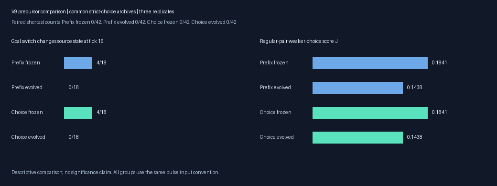
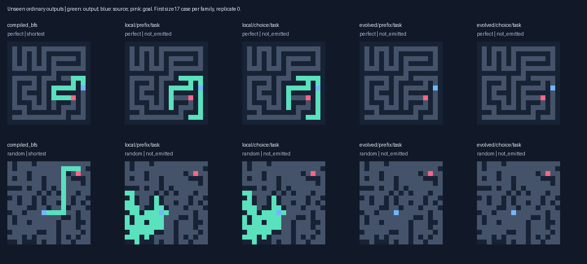
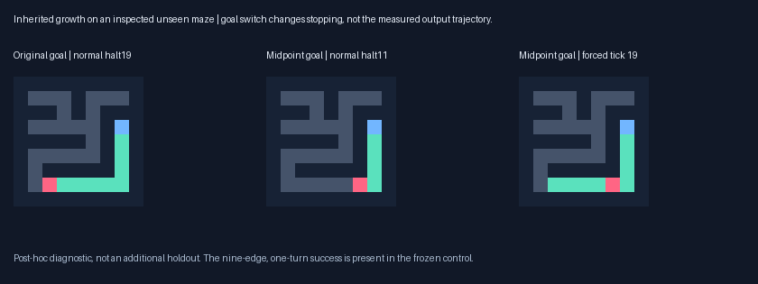
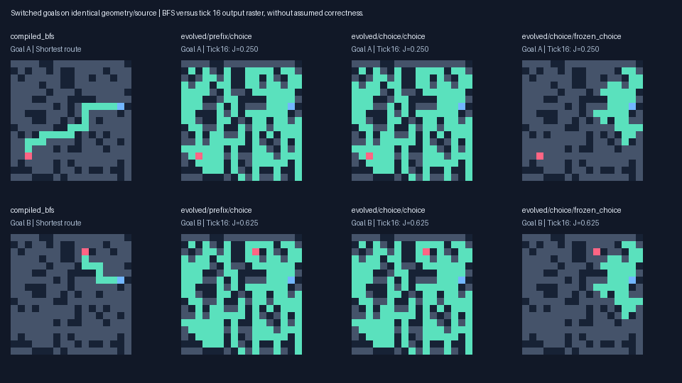
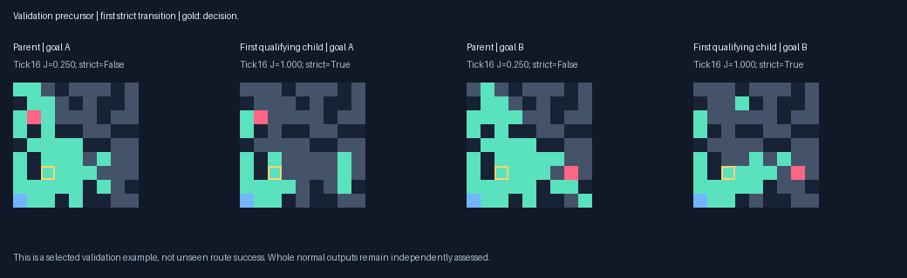

# Strict paired-choice priority: V9

Multirange task archives complete **0/216** unseen shortest paths with Choice-first pressure, versus **0/216** with Prefix and **0/216** frozen. Choice-first solves **0/171** at distance ≥8 and **0/42** paired reachable targets. Compiled BFS, A* and wavefront complete 42/42 paired and 216/216 ordinary routes. Correctness remains the primary measure; no competitive speedup is established.

The common strict-choice archives make correct choices under both switched goals on **0/18** pairs under Choice-first pressure, **0/18** under Prefix and **0/18** frozen. Their weaker-choice scores are J=0.1438, 0.1438, 0.1841. J includes partial source-dependent prefix credit; it is not route correctness. Three replicates support a descriptive comparison, without a significance claim.

The preregistered extension gate was **False** after [48] generations. A negative bounded experiment does not establish impossibility of random-origin discovery.

All six matched pressure pairs have identical ordered genotype populations throughout and identical final RNG states. Paired training successes already reproduce under the existing score; raising their priority changes neither the observed trajectories nor the sampled counterfactual parent choices. The bottleneck identified here is transfer across contexts.



## Controlled comparison and provenance

The V6 pulse VM is unchanged: eight uint16 channels,128 typed genes, source/goal pulses and flags, output2,stop7. Both pressures call the exact V8 Junction evaluator, preserving J=.25 source-dependent connected prefix +.75 shortest-exit choice, normal partial output and hidden source-transmission shaping. All cyclic shortest-exit ties are accepted individually; wrong exits must be off. Mixed pairs keep their prior goal shaping. Oracle labels remain outside inference.

The isolated selection change is global rank(V,O,N,0,S,W) for Prefix versus(V,O,N,K,S,W) for Choice-first: V=valid routes,O=shortest routes,N=no-path utility,K=number of strict-both pairs,S=unchanged continuous score,W=old cost tie-break. Normal correctness dominates every precursor; cost/length does not penalize unfinished phenotypes. Per-case lexicase ranks validity,optimality,paired strict bit,then smooth score with epsilon.02. Prefix inserts a constant zero and reproduces the old decisions/RNG. Choice-first gives both cases the same pair-level bit.

Both arms fork the same matching V8 Junction next population/RNG, protect validation-selected task/junction/balanced/goal/source variants and prior protected ancestors from both V8 arms, supplemental strict-choice selections and saved qualifying ancestors. Variants remain in their native topology/replicate. Both arms have identical initial genotypes, protection, eight nomination criteria and common validation objective(Prefix). The primary choice archive ranks strict-both rate,then mean minJ,B,G,validity,optimality; the task archive uses normal fitness only. New validation archives do not automatically breed. Fresh immigrants, neutral diversity and full continuation checkpoints remain preserved.

Preregistration commit `9efe3154b56802b766c35f7e46021bf3d15148b9`; frozen model SHA256 `74b6135000533707aa7fdc367152365e227047044ac92b043648d77e071c5cfb`. Seed2026101808, independent full-capacity construction seed1094; all 7502 V1–V8/V8A layouts excluded. Final layouts were constructed only after selection freeze.264 ordinary layouts and24 separate paired layouts/48 inputs are common to both arms. The paired set has42 reachable targets≥8 and6 unreachable, including18 eligible regular decisions. Sampling matches V8: shared shortest prefix at source distance2..8,goals≥4 beyond,disjoint shortest-exit sets; even indices require misleading Manhattan bearing. Between-version comparisons also change common starting/archival policy and seeds; only the within-V9 pressure comparison isolates the priority.

## Completed unseen outputs

| Arm | Valid / reachable | Shortest | Distance≥8 shortest | Correct no-path /48 | False no-path |
|---|---:|---:|---:|---:|---:|
| compiled_astar | 216/216 | 216 | 171/171 | 48/48 | 0 |
| compiled_bfs | 216/216 | 216 | 171/171 | 48/48 | 0 |
| evolved/choice/choice | 1/216 | 1 | 0/171 | 0/48 | 1 |
| evolved/choice/frozen_choice | 2/216 | 2 | 0/171 | 0/48 | 0 |
| evolved/choice/frozen_task | 0/216 | 0 | 0/171 | 16/48 | 0 |
| evolved/choice/task | 0/216 | 0 | 0/171 | 16/48 | 0 |
| evolved/prefix/choice | 1/216 | 1 | 0/171 | 0/48 | 1 |
| evolved/prefix/frozen_choice | 2/216 | 2 | 0/171 | 0/48 | 0 |
| evolved/prefix/frozen_task | 0/216 | 0 | 0/171 | 16/48 | 0 |
| evolved/prefix/task | 0/216 | 0 | 0/171 | 16/48 | 0 |
| local/choice/choice | 2/216 | 2 | 1/171 | 1/48 | 0 |
| local/choice/frozen_choice | 1/216 | 1 | 0/171 | 0/48 | 0 |
| local/choice/frozen_task | 1/216 | 1 | 1/171 | 16/48 | 0 |
| local/choice/task | 1/216 | 1 | 1/171 | 16/48 | 0 |
| local/prefix/choice | 2/216 | 2 | 1/171 | 1/48 | 0 |
| local/prefix/frozen_choice | 1/216 | 1 | 0/171 | 0/48 | 0 |
| local/prefix/frozen_task | 1/216 | 1 | 1/171 | 16/48 | 0 |
| local/prefix/task | 1/216 | 1 | 1/171 | 16/48 | 0 |
| wave_bit | 216/216 | 216 | 171/171 | 48/48 | 0 |

| Task archive | Turn-required shortest | Mandatory-detour shortest | Paired shortest /42 |
|---|---:|---:|---:|
| local/prefix/task | 1/196 | 0/135 | 0/42 |
| local/choice/task | 1/196 | 0/135 | 0/42 |
| evolved/prefix/task | 0/196 | 0/135 | 0/42 |
| evolved/choice/task | 0/196 | 0/135 | 0/42 |

Selected current task/choice successes span 1–9 edges and at most 1 turns. Full successful shapes are in `success_shapes.json`; a success can be inherited or supplied by common endpoint-aware halting. It is not automatically an evolved goal-guided algorithm. Per-size/family results and all failures are in the raw summary/output records.



## Paired decisions and communication

| Arm | Weaker-choice J | Strict both /18 | Old balanced B | Mean G | Source transmission | Paired shortest /42 |
|---|---:|---:|---:|---:|---:|---:|
| evolved/choice/choice | 0.1438 | 0/18 | 0.0000 | 0.0012 | 0.5281 | 0/42 |
| evolved/choice/frozen_choice | 0.1841 | 0/18 | 0.0000 | 0.0118 | 0.6049 | 0/42 |
| evolved/choice/frozen_task | 0.0000 | 0/18 | 0.0000 | 0.0000 | 0.2874 | 0/42 |
| evolved/choice/task | 0.0000 | 0/18 | 0.0000 | 0.0000 | 0.2874 | 0/42 |
| evolved/prefix/choice | 0.1438 | 0/18 | 0.0000 | 0.0012 | 0.5281 | 0/42 |
| evolved/prefix/frozen_choice | 0.1841 | 0/18 | 0.0000 | 0.0118 | 0.6049 | 0/42 |
| evolved/prefix/frozen_task | 0.0000 | 0/18 | 0.0000 | 0.0000 | 0.2874 | 0/42 |
| evolved/prefix/task | 0.0000 | 0/18 | 0.0000 | 0.0000 | 0.2874 | 0/42 |
| local/choice/choice | 0.2063 | 0/18 | 0.0000 | 0.0057 | 0.5616 | 0/42 |
| local/choice/frozen_choice | 0.2480 | 0/18 | 0.0022 | 0.0183 | 0.5616 | 0/42 |
| local/choice/frozen_task | 0.0655 | 0/18 | 0.0000 | 0.0000 | 0.5616 | 0/42 |
| local/choice/task | 0.0655 | 0/18 | 0.0000 | 0.0000 | 0.5616 | 0/42 |
| local/prefix/choice | 0.2063 | 0/18 | 0.0000 | 0.0057 | 0.5616 | 0/42 |
| local/prefix/frozen_choice | 0.2480 | 0/18 | 0.0022 | 0.0183 | 0.5616 | 0/42 |
| local/prefix/frozen_task | 0.0655 | 0/18 | 0.0000 | 0.0000 | 0.5616 | 0/42 |
| local/prefix/task | 0.0655 | 0/18 | 0.0000 | 0.0000 | 0.5616 | 0/42 |

B=min of old G scores within each regular pair; G averages all inputs, including mixed ones. J averages regular pairs only. Denominators differ. Every regular final pair is eligible for the decision assay. Choice selection ranks strict-both before J, so a higher J alone is not a victory.

| Multirange strict-choice archive | Replicate | J | Strict both /6 | Mean G |
|---|---:|---:|---:|---:|
| prefix | 0 | 0.1417 | 0/6 | 0.0010 |
| prefix | 1 | 0.1107 | 0/6 | 0.0028 |
| prefix | 2 | 0.1790 | 0/6 | 0.0000 |
| choice | 0 | 0.1417 | 0/6 | 0.0010 |
| choice | 1 | 0.1107 | 0/6 | 0.0028 |
| choice | 2 | 0.1790 | 0/6 | 0.0000 |

| Training pressure/topology | Source-connected decisions | Positive choice C | Strict individual | Strict both pairs |
|---|---:|---:|---:|---:|
| local/prefix | 20561/48384 | 2022 | 1517 | 0/24192 |
| local/choice | 20561/48384 | 2022 | 1517 | 0/24192 |
| evolved/prefix | 25895/48384 | 796 | 604 | 19/24192 |
| evolved/choice | 25895/48384 | 796 | 604 | 19/24192 |

These counts include repeated genomes and rotating training cases. They diagnose the selection landscape, not independent discoveries or unseen success.

## Reproductive use of paired choices

This diagnostic was specified during training before final inspection. A positive genome has K>0 on that generation’s rotating batch. Unprotected means its genotype differs from every fixed protected variant. Track actual retention and mutation-parent use in the next population. Counts repeat genotypes/contexts; the ratios describe repeated selection opportunities rather than independent replications. In this run all paired ordered genotype populations and final RNG states are identical.

| Condition | Generations with unprotected positive | Positive individual opportunities | Retained | Offspring from positive parents / all mutant offspring |
|---|---:|---:|---:|---:|
| local/prefix | 0/144 | 0 | 0 | 0/6888 |
| local/choice | 0/144 | 0 | 0 | 0/6888 |
| evolved/prefix | 3/144 | 10 | 5 | 40/6073 |
| evolved/choice | 3/144 | 10 | 5 | 40/6073 |

| Topology | Replicate | First strict opportunity | First population divergence |
|---|---:|---:|---:|
| local | 0 | None | None |
| local | 1 | None | None |
| local | 2 | None | None |
| evolved | 0 | 16 | None |
| evolved | 1 | 2 | None |
| evolved | 2 | 14 | None |

None means no event in the recorded generations. Every matched pair remains identical through the full run, including its final RNG state. The audit verifies equality before the first opportunity as a control check. A new priority has no selective effect when every candidate has K=0.

A second diagnostic, specified during training, removes the desired exits from each saved strict-choice raster and checks source can still reach the junction. This tests arrival from the incoming side rather than connection through the desired branch itself; a shortest incoming prefix is also recorded. It does not change the preregistered K or primary measures.

| Condition | Strict-both training responses | Incoming side correct under both goals | Both shortest incoming prefixes |
|---|---:|---:|---:|
| local/prefix | 0 | 0 | 0 |
| local/choice | 0 | 0 | 0 |
| evolved/prefix | 19 | 19 | 19 |
| evolved/choice | 19 | 19 | 19 |

A post-hoc selection replay uses the 4 observed Prefix pools with K>0. Across 512 matched-seed lexicase draws, 0 parent IDs and 0 parent genotypes change. Global best sets change in 0 pools. First-case route/strict/smooth filtering is saved for inspection. This is conditional on these observed pools, not a claim that strict priority is redundant in every possible population. No candidate inference or training is added. This analysis took2.13s.

## Inherited nine-edge path: goal-switch diagnostic

The frozen local task genome completes a nine-edge path with one turn. The current task archive has the same genotype. This capability predates V9. On this inspected final layout, move the target to the oracle-path midpoint without changing the genome or geometry. It emits a five-edge shortest prefix at tick 11 instead of the original nine-edge path at tick 19. Forced probes show identical complete output concentrations and source states under both targets at every ticks 1–19. Both ordinary stops satisfy the common runtime’s source-stop and endpoint conditions. Thus the measured tissue follows the same growth trajectory; endpoint-aware stopping picks the path length on this example. This is preserved as inherited growth, without claiming goal-guided routing.



This is post-hoc on an inspected final case, not another holdout or a tuned genome. Original assay:0.080s, 2 normal responses/38 probes,2,540,210 work units; independent replay:0.055s, 2,540,210 units. All rasters, trajectories and source/model hashes are saved.

## Paired output details


| Strict-choice archive | Connected junction /36 goals | Mean prefix R | Mean choice C | Strict individual /36 | Wrong exits lit /36 |
|---|---:|---:|---:|---:|---:|
| evolved/choice/choice | 13/36 | 0.603 | 0.069 | 2/36 | 24/36 |
| evolved/choice/frozen_choice | 27/36 | 0.768 | 0.042 | 1/36 | 27/36 |
| evolved/prefix/choice | 13/36 | 0.603 | 0.069 | 2/36 | 24/36 |
| evolved/prefix/frozen_choice | 27/36 | 0.768 | 0.042 | 1/36 | 27/36 |
| local/choice/choice | 28/36 | 0.825 | 0.028 | 1/36 | 27/36 |
| local/choice/frozen_choice | 34/36 | 0.992 | 0.000 | 0/36 | 34/36 |
| local/prefix/choice | 28/36 | 0.825 | 0.028 | 1/36 | 27/36 |
| local/prefix/frozen_choice | 34/36 | 0.992 | 0.000 | 0/36 | 34/36 |

| Strict-choice archive | Goal changes source state at16 /18 | Goal changes junction state at16 /18 | Junction state at64 /18 |
|---|---:|---:|---:|
| local/prefix/choice | 0/18 | 0/18 | 0/18 |
| local/choice/choice | 0/18 | 0/18 | 0/18 |
| evolved/prefix/choice | 0/18 | 1/18 | 1/18 |
| evolved/choice/choice | 0/18 | 1/18 | 1/18 |
| evolved/choice/frozen_choice | 4/18 | 5/18 | 4/18 |

The final18 regular pairs contain 1 with multiple valid shortest exits and 11 with a deceptive detour at the chosen decision. For1/18, both goal inputs lie beyond16 open edges from every decision-region site. Radius1 rules cannot distinguish those local exit bits by tick16; at least one goal input is within that radius on the remaining pairs. This is a post-freeze structural opportunity diagnostic, not an accuracy adjustment. Multirange reads can shorten geometric influence chains but must demonstrate actual useful choice.

Hidden goal-dependent state at a junction is distinct from a correct exit and from a complete route. Fixed-horizon probes ignore ordinary halting, so their rasters are diagnostics. The saved probe-route audit tests hypothetical tick16 emission separately; it cannot turn a nonhalting normal organism into a solver.



## Fixed-genome interventions

| Strict-choice archive | Native J | Goal pulse removed J | Native strict both /18 | Removed /18 |
|---|---:|---:|---:|---:|
| local/prefix/choice | 0.2063 | 0.2063 | 0/18 | 0/18 |
| local/choice/choice | 0.2063 | 0.2063 | 0/18 | 0/18 |
| evolved/prefix/choice | 0.1438 | 0.1577 | 0/18 | 0/18 |
| evolved/choice/choice | 0.1438 | 0.1577 | 0/18 | 0/18 |

| Multirange archive | Native J | Nonlocal reads removed J | Native source | Removed source | Shortest /42 |
|---|---:|---:|---:|---:|---:|
| evolved/choice/choice | 0.1438 | 0.1012 | 0.5281 | 0.2291 | 0/42 |
| evolved/choice/task | 0.0000 | 0.0000 | 0.2874 | 0.1955 | 0/42 |
| evolved/prefix/choice | 0.1438 | 0.1012 | 0.5281 | 0.2291 | 0/42 |
| evolved/prefix/task | 0.0000 | 0.0000 | 0.2874 | 0.1955 | 0/42 |

## Validation-only emergence and ancestry

The validation replay archive equals the preregistered primary choice archive, independently checked against every nomination. Both pressure labels here describe the same evolved genotype trajectory, not separate discoveries. It does not alter breeding or final selections. Post-freeze replays follow each qualifying archive’s ancestry on its first qualifying validation pair. The example is selected by validation qualification and cannot establish unseen generalization. Its paired choice survives nonlocal ablation here but disappears without the goal pulse; this is specific to the qualifying case.

| Condition | First qualifying birth | Parent→child row changes | Ancestry nodes | Final strict both | Normal shortest /2 |
|---|---:|---:|---:|---:|---:|
| choice/evolved/choice/2 | 3 | 3 | 3 | 1.0 | 0/2 |
| choice/evolved/prefix/2 | 3 | 3 | 3 | 1.0 | 0/2 |

Row differences are not necessarily individual mutation operations: insertion/deletion can shift subsequent rows. Birth0 means qualification was already present in the initial genotype. Later parent/child transitions are context-specific and do not isolate which changed row is necessary.

| Same validation organism | Goal pulse | Nonlocal reads ablated | J | Strict both | Shortest /2 |
|---|---:|---:|---:|---:|---:|
| choice/evolved/choice/2 | False | False | 0.2500 | 0.0 | 0/2 |
| choice/evolved/choice/2 | True | True | 1.0000 | 1.0 | 0/2 |
| choice/evolved/prefix/2 | False | False | 0.2500 | 0.0 | 0/2 |
| choice/evolved/prefix/2 | True | True | 1.0000 | 1.0 | 0/2 |



These ancestry/intervention assays add 20 independently reassessed normal outputs across 6 replayed ancestry nodes, with their full source probes and cost recorded in `diagnostics.json`. `strict_validation_archive.json` preserves the validation-only genotypes for a fresh continuation.

Removing the goal pulse retains the static goal flag. Nonlocal ablation returns zero for radius>1 reads while charging attempted reads. These post-freeze interventions reuse final layouts without reselection; they diagnose dependence, not a separately selected treatment.

## Real cost and capacity

Search with validation/probes: **13.90 minutes**. Main experiment including final accuracy/timing: **17.09 minutes**. Main-run peak RSS **200.4 MiB**, Apple M4, Python3.13.15, {'llvmlite': '0.50.0', 'numba': '0.68.0', 'numpy': '2.5.4', 'pillow': '13.0.0', 'pytest': '9.1.1'}. Training/selection charged 265,608 normal responses and 531,216 source probes, with 436,915,640,448 logical dispatch-plus-attempted-read units. These are not hardware CPU instruction counts. Conventional solvers’ VM counters are uninstrumented placeholders, not zero hardware work. Same slots/caps need not yield equal actual work because phenotypes and validation nominee overlap differ.

Full inference timing includes decoding, initialization, updates and raster emission; fitness/oracle/probe cost is outside these latency samples. JITs warm matching production signatures.30 repetitions per case, randomized solver order,12 cases/arm across3 replicates. The table gives the median of case medians and the full sample range; failed paths confer no speed advantage.

| Arm | Median case median μs | Warm range μs | Correct timed repetitions | Largest inference arrays |
|---|---:|---:|---:|---:|
| compiled_bfs | 4.67 | 2.42–21.54 | 360/360 | 45850B |
| compiled_astar | 7.35 | 3.92–36.92 | 360/360 | 69203B |
| wave_bit | 26.57 | 13.54–185.12 | 360/360 | unreported |
| local/prefix/task | 10731.49 | 2308.46–46495.54 | 0/360 | 151747B |
| local/choice/task | 10734.93 | 2285.79–40520.92 | 0/360 | 151747B |
| evolved/prefix/task | 3630.39 | 403.04–36458.29 | 0/360 | 151747B |
| evolved/choice/task | 3624.51 | 402.42–36200.92 | 0/360 | 151747B |

Each completed open-site tick copies eight uint16 states old→new,32 bytes of logical read/write payload. This excludes partial ticks, gene/register operations and allocations; caches/compiler optimization change physical DRAM traffic. State buffers alone are32N bytes; the kernel’s explicit array ceiling is64N+65536. Host RSS includes Python/JIT/logging.

| Task archive | Completed open-site ticks | Logical copy MiB | Neighbor reads | Dispatches | Active fraction |
|---|---:|---:|---:|---:|---:|
| local/prefix/task | 30,505,508 | 931.0 | 2,377,446,178 | 3,901,052,990 | 0.710 |
| local/choice/task | 30,505,508 | 931.0 | 2,377,446,178 | 3,901,052,990 | 0.710 |
| evolved/prefix/task | 15,966,246 | 487.3 | 1,696,234,776 | 1,932,331,603 | 0.745 |
| evolved/choice/task | 15,966,246 | 487.3 | 1,696,234,776 | 1,932,331,603 | 0.745 |

Task genomes contain 114–128 genes, with conservative output/stop dependency slices of 10–55 genes. These are syntactic potential dependencies; semantic redundancy and full-state quiescence can differ. Genome length is not effective complexity.

Among 18,232 newly born children with a parent evaluated on the same training batch, 18,048 change genotype and 8,784 of those match the behavioral fingerprint of normal/probe rasters, status/steps and partial/source/goal scores (48.7%). Fitness excluding cost is higher for 1,286, lower for 6,722, equal for 10,224. This conditional subset is not an unbiased neutrality estimate; work/expression counters and hidden trajectories may differ. Preserve these variants.

The observed cost offers no advantage over conventional solvers. Larger grids increase per-tick state traffic and graph-distance propagation time; long reads only help if their causal information produces valid output. Capacity, regulation, time and new selection pressures remain testable hypotheses.

## Verification and reproduction

All 70 frozen source hashes, prior layout exclusions, 32,258 new individual lineages, protected variants and shared initial cohorts verify. Independently reassessed 5,016 ordinary, 912 paired, 768 pulse-removed and 192 nonlocal-ablated normal outputs. Replayed 48 selected normal outputs. Checked 58,998 fitness records, 59,046 priority records,267,356 junction rasters and 100 valid training claims, plus all 12 strict-choice,12 task,12 junction and12 balanced validation archive maxima. Complete next populations/RNG, immutable earlier results, all rasters and lossless compressed logs are saved. 112 tests passed before training.

Post-freeze diagnostics took 20.30s, audit 19.51s and lossless recompression 10.15s. Stored and decoded log hashes are in `storage.json`. Audit source hashes, cost breakdowns, manifests/labels, environment, protocol and archive provenance are independently inspectable.

```sh
.venv/bin/python -m pytest -q
.venv/bin/python -m maze_evolution.choice_study --out results/choice_priority_reproduction
.venv/bin/python -m maze_evolution.choice_diagnostics --out results/choice_priority_reproduction
.venv/bin/python -m maze_evolution.choice_audit --out results/choice_priority_reproduction --repack
.venv/bin/python -m maze_evolution.choice_path_diagnostic --out results/choice_priority_reproduction
.venv/bin/python -m maze_evolution.choice_selection_diagnostic --out results/choice_priority_reproduction
.venv/bin/python -m maze_evolution.choice_report --out results/choice_priority_reproduction
```

Use a fresh directory; historical output directories reject overwrites. Full protocol: `docs/CHOICE_STUDY_V9.md`. Machine-readable raw results: `results/choice_priority/`. Frozen source revisions/hashes fix this experiment; future continuations must use new modules/seeds.

## Interpretation and next experiment

Choice-first priority did not change the evolutionary trajectory in this screen. All six matched pressure pairs have identical ordered genotype populations at every generation and identical final RNG states. The field was implemented and exercised: each multirange arm recorded 19 strict-both training responses across four active batches, while local arms recorded none. Unprotected positive genotypes had 10 repeated opportunities, survived unchanged 5 times and produced 40 mutated offspring under either pressure. All four active pools have the same global best sets; 512 post-hoc matched-seed parent draws also select the same IDs/genotypes. The new discrete priority was redundant for the observed selection outcomes. This does not establish redundancy in every possible population.

The bottleneck observed here is transfer across contexts. Qualifying primitives already reproduce, and both pressures discover the same validation-only lineage at birth 3 (retained at birth 5). It requires the goal pulse on its qualifying 9×9 fork, but survives zeroing nonlocal reads on that example. All19 strict-both training responses per multirange pressure also have correct incoming source connections and shortest incoming prefixes in the additional entry diagnostic. Nevertheless selected models solve 0/18 unseen paired choices and 0/42 paired full routes. The sole long ordinary task success is a frozen nine-edge directional-growth capability whose measured output trajectory does not change when the goal moves.

A justified next controlled experiment tests a near-to-far goal-distance curriculum against the current minimum-distance training distribution, with the same capacity, protected lineages and common objective. Start with genuinely source-dependent two-goal decisions where goals are close to the fork, then increase goal-to-fork distance on a fixed preregistered schedule. Keep validation and final mazes at the harder distances, preserve all known variants and neutral diversity, and use new layouts excluding every inspected corpus. This tests whether repeated, attainable goal-control subfunctions can compose across distance; it must not insert wavefront rules or routes. Capacity/regulation/longer evolutionary time remain open hypotheses. A longer run should require reproducible transfer rather than a larger precursor scalar.
