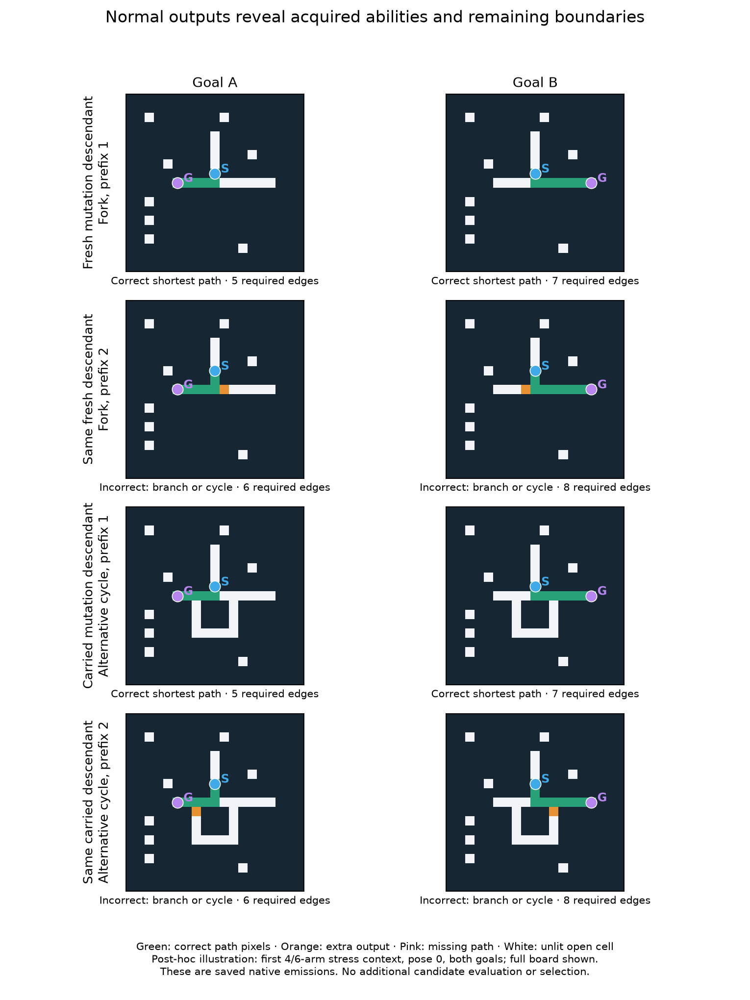

# V12S compatible recombination and sustained evolution

Completed and independently audited on the local Apple M4 CPU. **The preregistered replicated recombination screen does not pass for either origin group.**
The fixed 75-minute allowance produces 294 matched generations
in 72.22 minutes, including initial validation. Its
closed stopping condition is `wall_reserve`. No budget extension occurs.

The longer search finds useful random-origin routing descendants, including two
fresh-origin selections that transfer positive-prefix fork solving. It does not
show a consistent advantage for sexual recombination. The sole recombination-arm
primary passing both stages has **no splice in its ancestry**. General maze
solving, reliable disconnected-case handling and competitive speed remain unestablished.
All candidate comparisons here use local topology; they provide no causal test
or new evidence of a multirange advantage.

## Why this comparison

The reassessment restores the broader preserved capability set: earlier internal-
junction/cycle and longer-prefix specialists alongside recent goal-wave lineages.
Failure in the recent wave experiments does not erase those older abilities.
The common starting panel preserves 16 exact random-origin identities. Existing
runtime storage comprises eight persistent channels and 64 scratch registers;
coordinating propagation, selective output and stopping remains a plausible
bottleneck. Greater raw capacity alone has not been established as the remedy.

Sexual recombination is a justified experiment because it can transfer multiple
coordinated instructions. Register and channel meanings can differ across genomes,
however. The static audit finds only eight eligible directed pairings among 240
panel pairings, all within related lineages. Exact instruction anchors are
structural similarity, not certified historical homology or functional modules.
The [saved assessment](research_reset/assessment.md) contains the full synthesis
and research references; it involved no candidate inference.

## Fixed experimental contrast

Carry and fresh origins each have three independently seeded replicates and
mutation, recombination and random-resampling arms: 18 populations of 96 organisms.
Each carried population protects all 16 historical identities and adds 80 random
founders. Fresh populations contain only new random founders. All arms within a
replicate share their starting pool, selection, evaluation schedule and archives.
Known-solver genes never enter a lineage. Old populations and RNG states remain intact.
Carried replicates share the historical panel; they are independent search RNG
replicates, not independent rediscoveries of those older lineages. Older V3
programs retain their genes in a common V4 wrapper; historical scores from other
runtimes are not treated as same-runtime gains.
Reproduction consumes different random draws after the common initial RNG state.
Immigration counts are matched, but later immigrant genotypes and individual
mutations are not paired across arms. These are policy comparisons across RNG
replicates, not same-parent counterfactual crossover tests.

All arms retain 24 organisms per generation. Evolution produces nine random
immigrants and 63 single-edit children; resampling produces 72 random draws.
Recombination attempts mating for 32 of its 63 children. A bounded shortlist
contains four lexicase-selected and four uniform donors. Compatible donors rank
by improvements on the recipient's current tasks, prioritizing paired correctness,
shortest paths, legal paths and then partial credit. Different goals can therefore
favor different parents without using holdout performance.

A splice replaces a bounded instruction segment between matching anchors, with
matching register-write and persistent-store sets and no additional scratch
requirements. Every splice is followed by the same one-edit mutation used in the
mutation-only arm. This tests the combined mating-and-splicing policy, not their
separate causal effects. It does not test arbitrary cross-family transplantation.

Native local runtime, input flags, endpoint stopping, 256-gene capacity and work
limits are common. Training uses two new contexts and 12 inputs per organism per
generation. The easy task cycles all 12 arm/shape forms and eight poses every 96
generations. Hard-task prefixes cycle one/two/four with the generation index;
their pairing with arm lengths is not a full factorial curriculum. Every 32
generations, two current nominees per condition receive the same 3,456-input
validation set. The initial 576 founder memberships receive validation once;
their results are logically reused across the three matched arms.

The [protocol](../docs/COMPOSITION_V12S.md) was pushed in `f650b93` and the
feasibility profile in `4750c0f` before validation generation.
All populations, RNG states, choices and search data were frozen in
`b9f8a7f` before final generation. No selection uses final results.

## Untouched confirmation

The final corpus contains 28 new structured contexts, all eight poses, two goals,
prefixes 0/1/2/4, and matched forks, second junctions and real alternative cycles.
It contains 1,152 branched pairs, including 864 positive-prefix
pairs, and 2,304 corridor inputs. A separate transfer test adds 48 ordinary
9 by 9 reachable bases and 16 partition-disconnected bases in all eight poses.
Total: 7,424 inputs per model, 4,992 reachable and 2,432
disconnected. Independent units are contexts/base layouts; poses and variants
are correlated. Route forms recur, so the structured set is a diagnostic test.

Complete positive-prefix pairs per primary selection, denominator 864:

| Origin | Replicate | Frozen initial | Mutation | Recombination | Resampling | Recombination gate validation / final |
|---|---:|---:|---:|---:|---:|---|
| carry | 0 | 224 | 512 | 448 | 224 | False / False |
| carry | 1 | 224 | 390 | 512 | 224 | True / True |
| carry | 2 | 224 | 512 | 224 | 224 | False / False |
| fresh | 0 | 0 | 132 | 0 | 0 | False / False |
| fresh | 1 | 0 | 0 | 0 | 0 | False / False |
| fresh | 2 | 0 | 224 | 0 | 0 | False / False |

The recombination primary must pass both stages: at least 16 new positive-prefix pairs and
16 more than every control, two complete eight-pose groups, eight extra-junction
positive pairs, four contexts, retained junction/corridor skills and no increased
false no-path claims. At least 96 matched generations and two passing replicates
within an origin group are required. Passing replicate lists are
`{'carry': [1], 'fresh': []}`. Secondary archives cannot replace a failed primary.
Correct no-path retention was not part of this gate. The passing selection loses
the frozen winner's isolated-goal no-path answers, which are reported separately.

Additional primary outcomes:

| Condition | All pairs | Extra-junction positive pairs | Corridors | Ordinary shortest | Correct no-path |
|---|---:|---:|---:|---:|---:|
| carry/0/mutation | 800 | 64 | 2272 | 72/384 | 0/2432 |
| carry/0/recombination | 736 | 0 | 2304 | 40/384 | 2304/2432 |
| carry/0/resample | 448 | 0 | 2304 | 16/384 | 2304/2432 |
| carry/1/mutation | 654 | 10 | 2064 | 34/384 | 2304/2432 |
| carry/1/recombination | 800 | 64 | 2304 | 74/384 | 0/2432 |
| carry/1/resample | 448 | 0 | 2304 | 16/384 | 2304/2432 |
| carry/2/mutation | 800 | 64 | 2272 | 74/384 | 0/2432 |
| carry/2/recombination | 448 | 0 | 2304 | 16/384 | 2304/2432 |
| carry/2/resample | 448 | 0 | 2304 | 16/384 | 2304/2432 |
| fresh/0/mutation | 244 | 0 | 2272 | 10/384 | 2304/2432 |
| fresh/0/recombination | 224 | 0 | 2304 | 8/384 | 2304/2432 |
| fresh/0/resample | 224 | 0 | 2304 | 8/384 | 2304/2432 |
| fresh/1/mutation | 224 | 0 | 2304 | 8/384 | 2304/2432 |
| fresh/1/recombination | 224 | 0 | 2304 | 8/384 | 2304/2432 |
| fresh/1/resample | 224 | 0 | 2304 | 8/384 | 2304/2432 |
| fresh/2/mutation | 448 | 0 | 2304 | 24/384 | 2304/2432 |
| fresh/2/recombination | 224 | 0 | 2304 | 8/384 | 2304/2432 |
| fresh/2/resample | 224 | 0 | 2304 | 8/384 | 0/2432 |

BFS, A* and bit-wave each emit correct outputs for all 4,992 reachable
and 2,432 disconnected inputs. The intact VM control emits
4,992 shortest paths and 2,432 correct no-path
answers. No latency benchmark is conducted; there is no speedup claim.

## Did the mating operator activate

| Origin and replicate | Attempts | Actual splices | Donor pair-score gain | Partial-only donor gain | Direct children retained |
|---|---:|---:|---:|---:|---:|
| carry/0 | 9,408 | 6,647 | 409 | 459 | 238 |
| carry/1 | 9,408 | 8,448 | 709 | 731 | 258 |
| carry/2 | 9,408 | 6,267 | 292 | 373 | 186 |
| fresh/0 | 9,408 | 8,178 | 812 | 1,485 | 343 |
| fresh/1 | 9,408 | 7,853 | 386 | 640 | 229 |
| fresh/2 | 9,408 | 7,855 | 461 | 988 | 275 |

There are 45,248 actual splices among 56,448 attempts.
Of these, 1,238 transfer more than one
instruction and 177 change program length.
Donor gains measure its current-batch score relative to the recipient, not the
offspring's inherited skill. The retained column counts distinct direct spliced
children retained at least once after evaluation. Each splice also receives a
mutation, so successful ancestry alone cannot identify which change caused a gain.

At their first training evaluation, 2,354
direct spliced children have both parents still present on the same batch;
483 of them emit a raster/status
sequence different from both. These are selected parent-retention comparisons,
not all spliced children and not a causal test of skill composition. Full
recipient/donor denominators and retention counts are saved in the descriptive packet.

Recombination primary ancestry within this new comparison:

| Origin and replicate | Selected identity | Genes | Study birth | Distinct ancestral splices | Study roots |
|---|---|---:|---:|---:|---:|
| carry/0 | `carry/0/recombination/i20652` | 254 | 287 | 249 | 3 |
| carry/1 | `carry/1/recombination/i14092` | 256 | 196 | 0 | 1 |
| carry/2 | `carry/2/recombination/i19758` | 96 | 275 | 295 | 1 |
| fresh/0 | `fresh/0/recombination/i19854` | 225 | 276 | 1939 | 1 |
| fresh/1 | `fresh/1/recombination/i16312` | 225 | 227 | 1864 | 1 |
| fresh/2 | `fresh/2/recombination/i16864` | 155 | 235 | 1176 | 1 |

Both parental edges are preserved in `birth.parents`. Historical anchors are
roots of this comparison, not claimed original random founders. The descriptive
packet preserves root identities for every selected alias and final population
counts with splice ancestry. Last-generation births have not yet been evaluated:
1,296 across all populations.

## What the acquired abilities do and do not establish

The strongest carried primaries complete every tested fork form at prefixes one
and two in all eight poses, plus the tested extra-junction/cycle forms at prefix
one. Their 512 positive-prefix pairs include 64 extra-junction pairs. They reach
eight-edge paired routes. The shared narrow-Branch root completes only 16
positive-prefix pairs on these same final inputs; the selected descendants gain
496 pairs beyond that root. The mutation-only replicate 0 selection is 12 edits
from this root; the passing recombination-arm selection is six ordinary mutations
from it, with no sexual event. This is real improvement from a preserved
random-origin program, but does not credit recombination for that improvement.

Carried mutation replicate 1 is different and worth preserving: its 390 positive
pairs include 86 at prefix four, including six second-junction and four genuine
alternative-cycle pairs. Paired routes reach ten edges. It is less uniformly
correct than the 512-pair selections. These counts are correlated poses and graph
variants; they do not represent 86 independent maze structures. Its broad-Branch
root completes 40 positive pairs; 350 selected successes are new relative to it.
The result reinforces the value of keeping complementary capabilities rather
than retaining only the highest aggregate score.

Fresh mutation replicate 0 completes 132 positive-prefix pairs across 28 clutter
contexts, including some prefix-two routes up to eight edges, but no base works
in all eight poses. Fresh mutation replicate 2 completes all 224 prefix-one fork
pairs across the 28 contexts, all eight poses, with routes up to seven edges. Both
fail extra-junction pairs. These have 96- and 75-step mutation lineages from separate new
random immigrants. Their exact roots were not final-panel members, so the present
test does not isolate which edits created the ability or exclude a capable
immigrant precursor. The fresh mutation-policy outcomes exceed matched frozen,
resampling and recombination primaries on this corpus; they are secondary findings
under a protocol whose primary hypothesis concerns recombination.

The carried replicate 0 spliced primary combines ancestry from three related
historical panel roots, with 249 distinct splice events in its ancestry graph.
It completes 448 positive pairs, including 368 beyond the union of those roots'
tested positive successes, but no positive-prefix extra-junction pairs. Its paired
mutation control completes 512. Mutation and selection also occur along this
ancestry; these data do not identify a causal gain from any particular splice.

The operator is active, not inert, but 97.3% of transfers contain one instruction.
Only 3,069 transfers select a donor with a paired-correctness advantage on the
current batch. Most exchanges are among compatible relatives, and many have no
positive donor score gain at all. This result tests a conservative small-segment
policy. It does not rule out useful modular recombination with stronger interfaces
or inherited structural markings. It also does not justify scaling this policy
unchanged: the primary advantage is unreplicated and its sole passing selection
has mutation-only ancestry.

In the illustrated fresh descendant, moving the source from prefix one to two
leaves an extra output pixel on the wrong arm. The carried cycle example shows
an analogous residual branch. This suggests a limited suppression or stopping
rule as a hypothesis, not a demonstrated channel-level mechanism. No new
mechanism ablations or forced-trajectory claims are made in this experiment.

A post-hoc oracle-based observer compares the saved masks with a goal-distance
ball followed by zero through six synchronous leaf-pruning rounds, preserving
source and goal. It performs **zero candidate calls** and never enters inference,
fitness or genome selection. On the 2,304 branched inputs (excluding corridors):

| Selection | Best-fitting tested pruning rounds | Exact emitted-mask matches | Unpruned-wave matches |
|---|---:|---:|---:|
| Fresh mutation replicate 2 | 1 | 2,016 | 672 |
| Carried recombination replicate 0, actually spliced | 2 | 2,016 | 608 |
| Carried mutation replicate 0 | 3 | 2,048 | 480 |

Matches include incorrect rasters; they are not additional solved paths. This
supports limited pruning of a spreading signal as a mechanism hypothesis, not
an exact or causal explanation. The orientation-sensitive fresh replicate 0 and
the prefix-four carried variant fit this simple family less well (best 848 and
1,502 masks respectively). All tested fits, including ordinary transfer, are in
`raster_hypothesis_fit.json`. The model family and round range were chosen after
inspecting outputs, so these are explanatory observations, not new confirmation.
An independent graph BFS, neighbor-set pruning and manual bit-packing implementation
reproduces every fit count across 29,952 saved reachable rasters; it also makes
zero candidate calls. This verifies the observer calculation, not its causal interpretation.

The final structured route forms are shared with validation; new clutter and
layout seeds test transfer within that grammar, not arbitrary unseen routing
structures. Ordinary transfer remains weak: the best primary solves 74/384
reachable inputs, with successes at distances between one and seven. All 40 physical
random-origin models fail all 128 ordinary partition-disconnected inputs even
when they solve the isolated-goal no-path controls. Thus high matched-task counts
do not establish a general algorithm or reliable unreachable-goal reasoning.

The next useful step is a bounded mechanism-and-transfer comparison of the new
fresh descendants and their exact random roots, alongside the carried short- and
longer-prefix variants. Freeze that panel before another new corpus, vary bends
and junction placement beyond these shared forms, and separate normal correctness
from diagnostic interventions. This is a proposal only. Preserve recombination
as an option, but require evidence of useful transferable modules before another
large mating run. More time helped expose delayed capabilities here; it is not
evidence that time or scale alone will remove the remaining limits.

## Compute and independent verification

Main candidate inference, including final confirmation, uses
3309.88/5,400 candidate seconds,
9,511,168 physical calls and 1,945,741,877,190 work
units. Search peak RSS is 943.27 MiB; confirmation
peak RSS is 1076.28 MiB. The separate profile uses 17,792
candidate calls. Search wall includes reproduction and checkpoints; equal
evaluation allowances do not imply identical computational work across arms.
The three recorded JIT warm-ups add three known-control candidate calls and nine
baseline calls separately. Saved-data analyses, illustrations and observer checks
perform no candidate inference.

Search cost after the shared founder screen, summed across three replicates:

| Origin and arm | Training plus later validation calls | Candidate seconds | Work units |
|---|---:|---:|---:|
| carry/mutation | 1,202,688 | 652.86 | 384,764,274,242 |
| carry/recombination | 1,202,688 | 590.58 | 347,930,297,471 |
| carry/resample | 1,202,688 | 447.27 | 263,746,384,903 |
| fresh/mutation | 1,202,688 | 251.85 | 146,883,724,856 |
| fresh/recombination | 1,202,688 | 352.00 | 208,921,953,439 |
| fresh/resample | 1,202,688 | 273.18 | 158,751,913,130 |

The initial 1,990,656 physical calls are separate and shared across policies;
they are not charged three times in the physical total above.

The independent audit passes all 2,913 prior completion
entries, 201 frozen source hashes and 16
input hashes. It reconstructs every birth, mutation, splice, parent choice,
fitness calculation, archive decision, population and RNG state. It regenerates
every corpus and checks geometry/orbits and pre-final commit ordering.

It performs 3,456,354 exact candidate replays,
independently grades 6,458,008 candidate
rasters, and replays 22,272 baseline outputs. All profile,
initial/later validation and final outputs receive exact replay and grading.
Training uses the preregistered deterministic 1/256 exact-replay sample, plus
independent grading of every training row the evaluator labels valid or correct
no-path. Other training rows, including incorrect no-path declarations, receive
the registered sample checks. This is not a full
training-inference replay. Audit wall is 2194.65 seconds with
1514.20 MiB peak RSS.

Ten new focused tests pass; 293 tests are collected, not a fresh full-suite run.
Before registration and candidate calls, an exhausted ordinary-maze fixture
supplier was replaced with the existing Wilson generator. The rejected partial
construction and all its layouts are preserved. Frozen scientific sources remain
unchanged. Exclude all **217,240 whole layouts through V12S**
from future independent data, including fixtures and unqueried poses.
A consolidated whole-layout hash set and its source manifest are saved as
`whole_layout_exclusions.json.gz` and `exclusion_sources.json`; their count is
independently matched to the regenerated audit corpus.

All raw rasters, two-parent birth events, validation selections, 32-generation
checkpoints, final populations and RNG states remain available under
`results/composition_study/`. The 199,165,540-byte birth log exceeds GitHub's
single-file limit and is preserved remotely in six ordered byte chunks, with
per-chunk and complete-log hashes. After a fresh clone, run
`.venv/bin/python tools/archive_composition_births.py restore` before the frozen
audit or prior-hash verification. This restores the exact original bytes, without
recompression or changes to scientific source. The local original stays intact.
The packaging test verifies a two-chunk round trip independently of the study.
Plotting uses a separate temporary environment; runtime dependencies are unchanged.
No subsequent experiment is launched.
