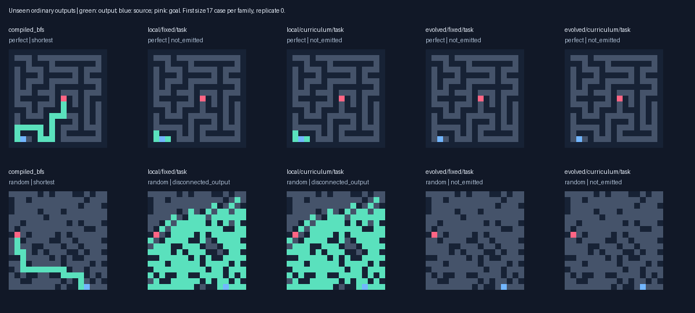
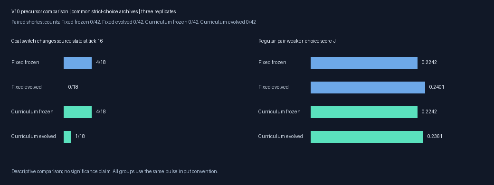
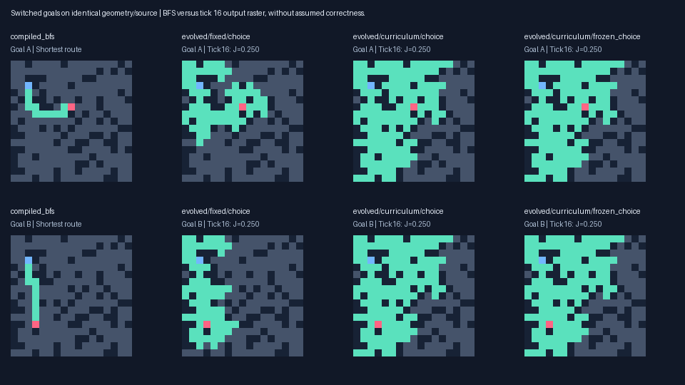
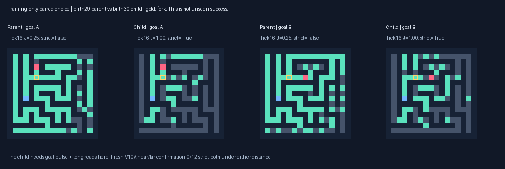

# Goal-distance curriculum: V10

This experiment compares a near-to-far goal curriculum with fixed hard goals on matched maze geometry, source and fork. Both use the same bounded runtime, genome capacity, Choice-first score and initial random-origin lineages. Complete correct shortest paths remain the primary result.

| Task archive | Unseen valid | Unseen shortest | Distance≥8 shortest | Paired shortest | Correct no-path |
|---|---:|---:|---:|---:|---:|
| local/fixed/task | 0/216 | 0/216 | 0/179 | 0/42 | 33/48 |
| local/curriculum/task | 0/216 | 0/216 | 0/179 | 0/42 | 33/48 |
| evolved/fixed/task | 0/216 | 0/216 | 0/179 | 0/42 | 16/48 |
| evolved/curriculum/task | 0/216 | 0/216 | 0/179 | 0/42 | 16/48 |
| compiled_bfs | 216/216 | 216/216 | 179/179 | 42/42 | 48/48 |
| compiled_astar | 216/216 | 216/216 | 179/179 | 42/42 | 48/48 |
| wave_bit | 216/216 | 216/216 | 179/179 | 42/42 | 48/48 |

The near-to-far curriculum **does not establish transfer**. Both primary task arms and frozen controls complete0/216 unseen reachable routes and0/179 at distance≥8; all selected models make0/18 strict paired choices and0/42 paired complete routes. The secondary multirange Curriculum choice archive completes one adjacent-endpoint case (two pixels,4 ticks,birth6 genotype); no longer success is hidden in that count. BFS/A*/wavefront complete every reachable route and no-path case. No competitive speedup is established.

Curriculum produces more valid short training outputs:122 local versus49 Fixed,52 multirange versus4 Fixed. No regular training pair has BOTH ordinary goal outputs correct. Multirange strict-probe opportunities are1 Curriculum versus15 Fixed (repeated genomes/contexts,not independent discoveries); local has0. Shortening cues also removes every deceptive fork bearing during the first32 generations, so easy completion cannot establish mastery of detours. Fixed-genome boundary leaders transfer0 choices/routes to final pairs. These observations do not support this particular curriculum as a bridge to general solving.

One birth30 Curriculum mutation does create a source-dependent,goal-pulse-dependent,long-read-dependent paired choice on its training example. It is explicitly preserved despite later leaving the population. Its separately frozen V10A confirmation fails on12 fresh matched near/far layouts. Rare regulatory subfunctions continue to arise, but reliable composition and transfer remain unestablished. Random-origin discovery stays central; capacity, regulation and evolutionary time remain live hypotheses.

Extension gate: **False** after [48] generations. Only common hard-validation transfer could trigger an extension. A higher easy-training score cannot. Three replicates give a descriptive comparison; archive copies and repeated training opportunities are not independent discoveries.

## Matched experiment

Fixed retains V8/V9 paired sampling: goals≥4 edges beyond a shared shortest-path fork2–8 edges from source, source-to-goal≥8 and disjoint sets of all shortest exits. Curriculum uses the identical layout/source/fork, moving endpoints down the same shortest branches to distances1/2 for generations0–15 and2/3 for16–31, with alternating goal order. Generations32 onward use identical far goals in both arms. Shortening endpoints changes target separation and deceptive bearing; these are recorded. Mixed disconnected inputs stay identical. Short labels are confined to training. Validation and final pairs stay hard.

Both arms use the unchanged V6 pulse VM:8 uint16 channels,≤128 typed genes; source/goal pulses and flags, output2,stop7. No oracle or branch label reaches inference. The same V8 J=.25 source-dependent connected prefix+.75 causal correct-exit score applies. V9 Choice-first ranking puts valid routes,shortest routes,no-path utility,strict-both count K,then smooth shaping in that order. A nearby goal light cannot earn strict credit unless it depends on the source and connects back to it. No known wavefront or solver rules enter these random-origin lineages.

Fork matching V9 Choice next-populations/RNG; protect native task/choice/J/B/G/source variants, prior protected genomes, strict supplements and qualifying ancestry from both V9 arms. Both conditions start with identical genomes/RNG and protection. New validation archives are saved but do not automatically breed. Rich random immigrants, neutral diversity and full continuation state remain.

Seed2026101809; independent construction preflight1104; 8096 prior layouts excluded. Preregistration commit `4aa60d6e28afbabbe1ec3f671e3a182d9058527b`. Model SHA256 `c6df4e29f961fcb0e62732c12a2fe34e245cb7710aae8409c35b7287c8ef8733` frozen BEFORE final generation. Final264 ordinary layouts and24 paired layouts/48 inputs are common to every arm. The paired set has42 reachable≥8 inputs,6 unreachable and18 regular decision pairs. Only intentional near/far training anchors share layouts; training,validation,final and all earlier experiments remain separate.

## Full outputs and failures

| Selected archive | Unseen shortest | Paired shortest /42 | Final strict both /18 | Final J |
|---|---:|---:|---:|---:|
| evolved/curriculum/choice | 1/216 | 0 | 0 | 0.2361 |
| evolved/curriculum/frozen_choice | 0/216 | 0 | 0 | 0.2242 |
| evolved/curriculum/frozen_task | 0/216 | 0 | 0 | 0.0407 |
| evolved/curriculum/task | 0/216 | 0 | 0 | 0.0813 |
| evolved/fixed/choice | 0/216 | 0 | 0 | 0.2401 |
| evolved/fixed/frozen_choice | 0/216 | 0 | 0 | 0.2242 |
| evolved/fixed/frozen_task | 0/216 | 0 | 0 | 0.0407 |
| evolved/fixed/task | 0/216 | 0 | 0 | 0.0701 |
| local/curriculum/choice | 0/216 | 0 | 0 | 0.1534 |
| local/curriculum/frozen_choice | 0/216 | 0 | 0 | 0.1766 |
| local/curriculum/frozen_task | 0/216 | 0 | 0 | 0.0278 |
| local/curriculum/task | 0/216 | 0 | 0 | 0.0394 |
| local/fixed/choice | 0/216 | 0 | 0 | 0.2088 |
| local/fixed/frozen_choice | 0/216 | 0 | 0 | 0.1766 |
| local/fixed/frozen_task | 0/216 | 0 | 0 | 0.0278 |
| local/fixed/task | 0/216 | 0 | 0 | 0.0394 |

| Task archive | Turn-required shortest | Detour-required shortest | False no-path on reachable |
|---|---:|---:|---:|
| local/fixed/task | 0/191 | 0/139 | 0 |
| local/curriculum/task | 0/191 | 0/139 | 0 |
| evolved/fixed/task | 0/191 | 0/139 | 0 |
| evolved/curriculum/task | 0/191 | 0/139 | 0 |

Representative local/fixed/task failure: `test_goal/r0/160000000/perfect/17x17`, oracle 20 edges; status `quiescent`, 107 completed ticks, `not_emitted`.

Representative local/curriculum/task failure: `test_goal/r0/160000000/perfect/17x17`, oracle 20 edges; status `quiescent`, 107 completed ticks, `not_emitted`.

Representative evolved/fixed/task failure: `test_goal/r0/160000000/perfect/17x17`, oracle 20 edges; status `quiescent`, 93 completed ticks, `not_emitted`.

Representative evolved/curriculum/task failure: `test_goal/r0/160000000/perfect/17x17`, oracle 20 edges; status `quiescent`, 93 completed ticks, `not_emitted`.

Successful output shapes are saved in `success_shapes.json`. A short path can be inherited or selected by common endpoint-aware halting; it is not automatically goal-guided routing. Per-size/family/distance records are in `summary.json` and raw outputs.

## Training versus transfer

| Topology/arm | Generations | Mean goal-to-fork distance | Deceptive pairs | Strict both / eligible pairs | Normal both shortest | Mean weaker J | Valid normal outputs |
|---|---:|---:|---:|---:|---:|---:|---:|
| evolved/curriculum | 0–15 | 1.50 | 0/8064 | 0/8064 | 0 | 0.1079 | 41 |
| evolved/curriculum | 16–31 | 2.50 | 0/8064 | 1/8064 | 0 | 0.1155 | 11 |
| evolved/curriculum | 32–47 | 13.45 | 4896/8064 | 0/8064 | 0 | 0.1200 | 0 |
| evolved/fixed | 0–15 | 6.64 | 4704/8064 | 10/8064 | 0 | 0.1151 | 2 |
| evolved/fixed | 16–31 | 9.92 | 4896/8064 | 4/8064 | 0 | 0.1206 | 2 |
| evolved/fixed | 32–47 | 13.45 | 4896/8064 | 1/8064 | 0 | 0.1216 | 0 |
| local/curriculum | 0–15 | 1.50 | 0/8064 | 0/8064 | 0 | 0.1123 | 47 |
| local/curriculum | 16–31 | 2.50 | 0/8064 | 0/8064 | 0 | 0.1236 | 46 |
| local/curriculum | 32–47 | 13.45 | 4896/8064 | 0/8064 | 0 | 0.1238 | 29 |
| local/fixed | 0–15 | 6.64 | 4704/8064 | 0/8064 | 0 | 0.1057 | 25 |
| local/fixed | 16–31 | 9.92 | 4896/8064 | 0/8064 | 0 | 0.1127 | 0 |
| local/fixed | 32–47 | 13.45 | 4896/8064 | 0/8064 | 0 | 0.1159 | 24 |

Strict-both uses forced16-tick causal rasters; normal-both-shortest instead counts complete correctly emitted routes under BOTH goals on a regular pair. Normal validity/optimality remains ahead of K in selection. These repeat genomes on rotating training contexts. Different cue distances make phase scores unsuitable as evidence of unseen transfer. The phase leader is the current globally ranked training leader at generations15,31,47, chosen before final layouts; secondary assays below reuse the common paired final set and cannot replace primary models.

| Topology/arm | Leader generation | Hard-validation strict both /12 | Final strict both /18 | Final shortest /42 |
|---|---:|---:|---:|---:|
| local/fixed | 15 | 0 | 0 | 0 |
| local/fixed | 31 | 0 | 0 | 0 |
| local/fixed | 47 | 0 | 0 | 0 |
| local/curriculum | 15 | 0 | 0 | 0 |
| local/curriculum | 31 | 0 | 0 | 0 |
| local/curriculum | 47 | 0 | 0 | 0 |
| evolved/fixed | 15 | 0 | 0 | 0 |
| evolved/fixed | 31 | 0 | 0 | 0 |
| evolved/fixed | 47 | 0 | 0 | 0 |
| evolved/curriculum | 15 | 0 | 0 | 0 |
| evolved/curriculum | 31 | 0 | 0 | 0 |
| evolved/curriculum | 47 | 0 | 0 | 0 |

The boundary generations15/31/47 all use one regular tree pair plus one mixed disconnected pair under the unchanged every-fourth-generation schedule. These snapshots do not represent every cyclic training opportunity. The following reused-training comparison was fixed during training, before final layouts existed. The phase leader was selected on its own batch and therefore has a selection advantage; this is not a holdout or a causal estimate of evolutionary improvement.

| Topology/arm | Boundary generation | Frozen-choice strict / eligible | Phase-leader strict | Final-choice strict |
|---|---:|---:|---:|---:|
| local/fixed | 15 | 0/3 | 0 | 0 |
| local/fixed | 31 | 0/3 | 0 | 0 |
| local/fixed | 47 | 0/3 | 0 | 0 |
| local/curriculum | 15 | 0/3 | 0 | 0 |
| local/curriculum | 31 | 0/3 | 0 | 0 |
| local/curriculum | 47 | 0/3 | 0 | 0 |
| evolved/fixed | 15 | 0/3 | 0 | 0 |
| evolved/fixed | 31 | 0/3 | 0 | 0 |
| evolved/fixed | 47 | 0/3 | 1 | 0 |
| evolved/curriculum | 15 | 0/3 | 0 | 0 |
| evolved/curriculum | 31 | 0/3 | 0 | 0 |
| evolved/curriculum | 47 | 0/3 | 0 | 0 |

## Preserved validation variants and causal assays

J and hidden goal-dependent state are precursors, not complete routes. Fixed16-tick probes override normal halting; their rasters cannot assert an actual emitted solution. All qualifying validation genotypes and ancestry remain available for continuation; their presence alone does not demonstrate generalization.

No current primary validation choice archive qualifies under both switched goals. Earlier native primitives remain protected; the new training-only primitive is documented separately below.

Removing the goal pulse keeps the static goal flag. Nonlocal ablation zeroes radius>1 reads while charging attempted reads. These are case-specific dependencies. Birth0 denotes a qualifying inherited variant. A later parent/child row difference does not establish which individual edit is necessary. Full final pulse/range interventions,8/16/32/64 state timecourses and structural opportunity diagnostics are saved separately without reselection.

| Topology/arm | Strict-both training responses | Enter from source without chosen exit / both goals | Shortest incoming prefixes / both goals |
|---|---:|---:|---:|
| local/fixed | 0 | 0 | 0 |
| local/curriculum | 0 | 0 | 0 |
| evolved/fixed | 15 | 15 | 15 |
| evolved/curriculum | 1 | 1 | 1 |

## One new training-only choice, preserved

The sole multirange Curriculum strict-both training response occurs at generation30 on a17×17 tree, fork6 edges from source and goals2/3 farther. Native genome i1472,birth30, descends through i94(birth0),i1213(birth25),i1402(birth29). The parent fails and the child has J=1/strict-both on that reused training pair. Both ordinary outputs remain incomplete. This is a new context-specific choice response, not a complete solver. It was retained once and produced18 mutated offspring; the exact genotype is absent from the final population. Full genotype and ancestry are explicitly saved for the next common protected cohort.

Two rows differ from the parent. Reversion assays show row25 alone,changing a radius-2 remote-read destination46→59,is sufficient for this response. Row117’s operand3→36 alone fails and is unnecessary on this case. This does not establish a cooperative two-edit interaction. Both goal-pulse removal and nonlocal-read removal destroy strict-both,J drops to.2. The effect therefore depends on both goal information and longer reads here.

This post-hoc assay was selected from training qualification after the main final evaluation. It never evaluates this newly selected model on V10’s inspected final set or changes V10 selections. Independently checked masks/source effects,replayed outputs and full work are saved.

Original assay1.166s,12 normals/24 probes,14,988,575 units. Verification0.126s,replay14,988,575 units; artificial edit-reversion assays 9,447,514 units,8 normals/16 probes. The initial tuple/list assertion retry and one repeated completed verification are separately recorded in `training_choice_execution_note.json`; the failed attempt’s wall time is unavailable. That implementation repair changes no training/raw result.

## Fresh frozen-primitive confirmation: V10A

After freezing the child,parent and root,12 fresh layouts test both near2/3 and far≥4 goal pairs. The child makes **0/12** near and **0/12** far strict-both choices and completes 0/24 near,0/24 far shortest paths. Parent/root also score zero complete choices/routes. BFS solves all48 input instances. The new training primitive does not transfer on this small confirmation, even at matched short cue distances. This does not establish impossibility. All8690 earlier layouts are excluded;12 new layouts bring the saved total to8702.

The [V10A report](distance_confirmation.md) records frozen model hashes, source/protocol, independent seed1105 construction/replay preflight, seed2026101810 production cases, full rasters/cost and independent verification. V10 primary results remain unchanged.

## Real cost and effective capacity

Search+validation/probes **13.82min**; main including final outputs/timing **16.95min**. Peak main RSS **203.5MiB**, Apple M4, Python3.13.15; dependencies `{'llvmlite': '0.50.0', 'numba': '0.68.0', 'numpy': '2.5.4', 'pillow': '13.0.0', 'pytest': '9.1.1'}`. Search charged 265,680 normal responses and 531,360 probes, 432,900,048,953 logical dispatch+attempted-read units. These are VM accounting units, not hardware instructions. Same caps/population do not guarantee equal actual work.

Post-freeze diagnostics 30.11s, including boundary-leader assays 9.38s; charged 14,728,199,603 additional units. Lossless log compression 10.40s; independent audit 20.36s. These are outside the main elapsed time. The audit includes replayed inference whose work is not folded into search.

Latency includes decoding,initialization,updates and final raster emission; fitness/oracle/probes are excluded and charged separately. Production-signature JIT warmup,30 randomized-order repetitions/case,12 cases/arm. Median of case medians and full sample range follow. Wrong/partial outputs cannot claim speedup. Conventional solver VM counters are uninstrumented placeholders, not zero hardware work.

| Arm | Median case median μs | Warm range μs | Correct timed repetitions | Largest explicit arrays |
|---|---:|---:|---:|---:|
| compiled_bfs | 4.63 | 2.33–17.00 | 360/360 | 46642B |
| compiled_astar | 6.09 | 3.00–37.08 | 360/360 | 68171B |
| wave_bit | 20.79 | 4.12–158.33 | 360/360 | unreported |
| local/fixed/task | 8182.65 | 883.58–35699.71 | 0/360 | 151747B |
| local/curriculum/task | 8187.60 | 884.75–35744.00 | 0/360 | 151747B |
| evolved/fixed/task | 2497.38 | 166.33–36548.46 | 0/360 | 151747B |
| evolved/curriculum/task | 6814.24 | 530.08–36913.88 | 0/360 | 151747B |

| Task archive | Completed open-site ticks | Logical state-copy MiB | Neighbor reads | Dispatches | Active fraction |
|---|---:|---:|---:|---:|---:|
| local/fixed/task | 26,680,727 | 814.2 | 2,286,461,927 | 3,413,364,842 | 0.710 |
| local/curriculum/task | 26,680,727 | 814.2 | 2,286,461,927 | 3,413,364,842 | 0.710 |
| evolved/fixed/task | 16,024,859 | 489.0 | 1,662,178,714 | 1,933,481,907 | 0.760 |
| evolved/curriculum/task | 18,927,154 | 577.6 | 1,770,984,008 | 2,307,974,543 | 0.773 |

A completed open-site tick copies eight uint16 states old→new:32 bytes of logical read/write payload. This excludes partial ticks,register/gene operations and allocations; cache/compiler effects change actual DRAM traffic. State double buffers use32N bytes; explicit kernel ceiling64N+65536. CPU propagation and repeated tissue updates remain scaling costs.

Selected genomes have 114–128 genes; conservative output/stop slices 10–66 genes. These are syntactic potential dependencies, not effective regulatory complexity.

Of 18,094 changed-DNA children with a parent evaluated on the same rotating batch, 8,434 (46.6%) share the saved behavior fingerprint. This conditional statistic covers binary normal/probe rasters,status/steps and partial/source/goal metrics; hidden trajectories,active work and expression can differ. Full populations,RNG,neutral variants and native cooperative precursors remain preserved.

## Verification and continuation

All checks pass: 79 frozen sources, 59,004 fitness records, 268,848 junction rasters, 227 valid training claims, 48 selected normal replays and 1440 phase-assay outputs. Task/choice/J/B archive maxima, exact near/far anchor transformations and distances, all prior-layout exclusions, lineage/protection, complete checkpoints, source/model hashes and lossless storage hashes are verified. The deterministic suite covers causal short labels, unchanged hard scoring, matched full-capacity construction through192 generations, gate behavior and exact resume.

Commands are in `docs/DISTANCE_STUDY_V10.md`. Raw records/checkpoints are in `results/distance_curriculum/`. Prior code/results remain immutable. Random-origin discovery remains central; this bounded comparison cannot establish impossibility.

Validation commands: full `pytest -q` passed116 tests in309.19s; after the last source-snapshot/resume edits, `pytest tests/test_distance.py -q -k "not fresh_capacity"` passed4 in1.87s. The117 currently collected tests are covered by those runs. V10A also passes an independent full construction/replay preflight(seed1105),then all192 production normal outputs and144 causal rasters are checked.

## Next controlled experiment

Test greater heritable program capacity with copy-and-diverge growth: a128-versus256-gene ceiling, the same eight channels/opcodes/range rules, same Fixed hard-pair objective and common block-duplication mutation operator. Start with identical native populations/RNG and preserve all prior primitives plus i1472/parent/root in both matching replicate2 cohorts. Allow no known solver insertion. First prove all lifted≤128-gene genomes reproduce the old VM under identical caps. Keep instruction/read/tick limits bounded and common; charge added dispatches and any reduction in completed ticks. Track actual grown genes,expression,dependency slices and behavior, since a larger ceiling alone is not effective complexity. Use wholly new layouts excluding8702 saved layouts and a validation-only extension gate. This tests the user’s capacity hypothesis directly; more easy-goal shaping at the same ceiling has not established transfer.
