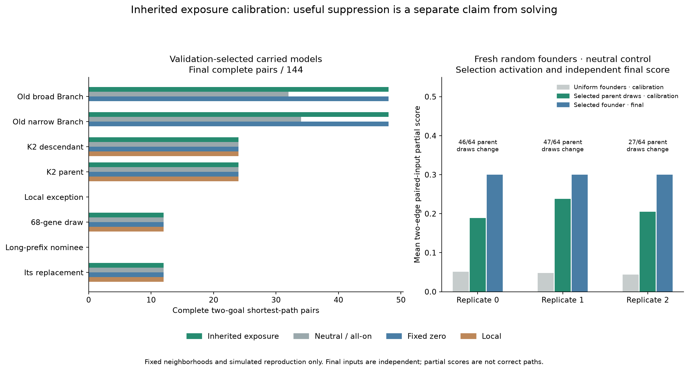
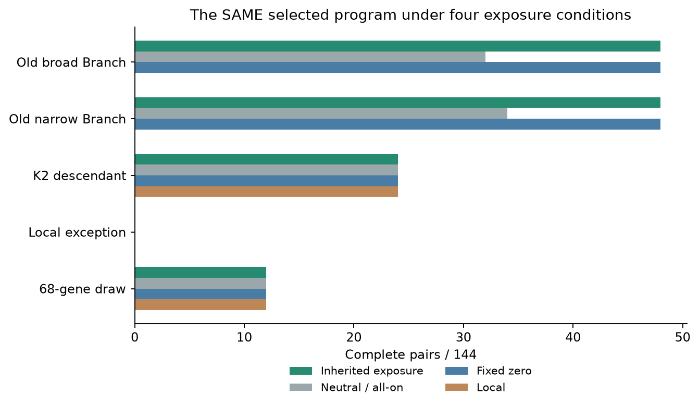

# V12M — inherited suppression works narrowly; the fresh gradient rewards flooding

The three-bit inherited exposure runtime is implemented and calibrated. **Turning
off selected nonlocal inputs improves preserved Branch models on new cases, but
matches disabling all nonlocal values.** Broad Branch's selected active program
completes **48/144 pairs**, versus32 with the same program fully exposed. The gain
is restricted to two straight-goal templates, so the preregistered broader carried
pilot screen **fails**. No new evolutionary search or budget extension occurred.

The fresh-origin track gives a different, important result. Partial credit changes
simulated reproduction in all three independent founder groups and passes the
prespecified numerical gradient screen. However, the three main selections emit
**the entire reachable component on every paired input**, unchanged by switching
goals. They solve every pruned corridor and obtain mean two-edge partial0.30, while
completing **zero paired tasks**. The screen detects an active fitness gradient;
the readouts show that this gradient can reward a behavior which does not choose
between goals. That distinction should guide the next experiment.

## What changed in the runtime

V4 adds a genome-owned three-bit mask controlling exposure at radii2,4,8. The V3
instruction program, local-radius semantics, expression gates, goal stimulus,
emission conditions and hard limits remain explicit. Suppression returns zero
without skipping the instruction, destination assignment or charged spatial
reads. All arms include the same mask storage and exposure-check accounting:

- **Active:** inherited bits control nonlocal values.
- **Neutral / all-on:** identical stored/mutated bits have no exposure effect.
- **Fixed zero:** all nonlocal values return zero, retaining charges.
- **Local:** remote opcodes instead read at radius1; this differs from zero-valued
  distant reads.

A mutation opportunity flips one uniform bit with probability1/5, otherwise makes
one existing V3 instruction edit with probability4/5. It does not add an extra
mutation. Mask-sensitive digests, exact events and RNG checkpoints are preserved.
The new kernel is a separate file; no old scientific source changed. The mask is
constant during a response. This is **inherited range suppression**, not dynamic
regulation. Existing register-dependent expression gates already provide a form
of regulation and are not a new discovery here.

Original reads, dispatches, active-instruction counts, masks, statuses and stopping
steps match the old all-on/externally-zeroed runtime. One additional charged
`exposure_checks` unit is recorded per active opcode14/15 in every arm; blocked
lookup slots are recorded separately as `suppressed_reads`. The mask buffer and
two counters add17 substrate-array bytes; process RSS is reported separately.
Parity covers3,276 fixture comparisons, and unit tests cover individual bits,
remote opcodes, local-radius preservation, early caps and mutation replay. There
is no latency benchmark or efficiency claim from these operation counts.

## Frozen pools, equal budgets and independent final cases

Source/protocol/pools/fixtures were pushed in **b85c25e** before scientific case
generation. All76 validation choices and their evidence were pushed in **e5fdf70**
before final generation. Mainseed2026101908; fixtures1274. All data are explicitly
L-informed in design, but whole layouts are new and the final set is independent
of selection. No inspected L or M final case became training/validation.

There are16 carried foundations: the thirteen random-origin J panel members plus
K2 target, parent and entry ancestor. Each supplies eight enumerated exposure
states and eight performance-blind one-edit siblings drawn from its all-on base:
16candidates per pool. Enumeration is an intervention grid, not eight births.
Three independent fresh groups contain96 rich random64–128-gene founders each,
with separately seeded random mask bits. There are544 logical candidate genotypes
and1,438 physical inference configurations across arms. The separate intact solver
never enters a founder, mutation or selection pool.

All arms use identical candidate identities and logical case budgets. Exact
physical duplicates are shared through saved aliases; this does not provide extra
selector evidence. Each fixed pool yields top-quarter elites,64lexicase parent
draws and two nominees. The parent draws are **simulated selection**, not an evolved
next generation. A second selection replay zeros partial credit on the same saved
responses. Nominees face a new validation set; one choice per pool/arm is frozen.
The final also tests the selected active program under neutral/zero/local exposure
and the original base under those controls, without feeding those results back.

| Stage | Carried cases per candidate | Fresh cases per candidate |
|---|---:|---:|
| Calibration |180inputs /54pairs|144inputs /24pairs|
| Validation, two nominees per arm |360inputs /108pairs|144inputs /24pairs|
| Independent final |480inputs /144pairs|1,152inputs /192pairs|

Carried calibration/validation use nine independent25×25templates, crossing three
goal forms and prefixes1straight/2straight/4bent. Matched forks, extra junctions,
real longer alternative cycles, corridors and disconnected controls are saved.
Calibration queries two poses; validation four. Final adds prefix8straight, for
12independent templates, alternates the queried centre/off-centre location and
uses four poses. Each carried final has96corridor and96disconnected inputs.

Fresh calibration/validation each have six independent9×9templates: adjacent
choices, two-edge arms and two-edge shared-prefix forks, each in two forms. Six
isolated clutter cells diversify layouts. Unreachable controls keep both endpoints
open and place the goal on an isolated cell. Final has24independent templates and
all8poses,384corridors and384unreachable inputs. Founder replicates share the same
case corpus; their RNG origins are independent. Poses, goals, graph variants and
translations are correlated, not extra independent samples.

Logical calibration budgets are350,208 calls and validation49,536, equal across
arms within each pool. Physical calibration/validation calls total253,368. Final
uses60,096 physical calls:70 carried configurations and23 fresh configurations,
with cross-origin aliases where applicable. All generated but unqueried poses and
locations are saved and excluded from future studies.

## Carried effects: real activation and a failed breadth gate

| Carried foundation | Active pairs | Neutral pairs | Fixed-zero pairs | Local pairs |
|---|---:|---:|---:|---:|
| Old broad Branch |48|32|48|0|
| Old narrow Branch |48|34|48|0|
| Broad Branch parent |48|32|48|0|
| Narrow Branch parent |48|34|48|0|
| K2 target |24|24|24|24|
| K2 parent |24|24|24|24|
| 68-gene random draw |12|12|12|12|
| Longer-prefix replacement |12|12|12|12|
| Local longer-prefix exception |0|0|0|0|

Denominator144 per row/arm. Each arm selects from the same pool, so programs can
differ between columns. The **matched-program** comparisons below isolate exposure.

Broad Branch active versus neutral changes47/64parent identities, including26
program changes, and both elite and nominee sets. Narrow changes55/64, including24
program changes. Their parents also show activation. K2 and most other foundations
do not. Fresh exposure changes only two parent draws in replicate0 and none in the
other two groups. The treatment contrast is concentrated in the old Branch family.

Broad active selects the unedited base program with mask4 (radius8 enabled;
radii2/4 suppressed). Narrow selects mask2 (radius4 enabled). Both complete24fork,
12two-junction and12cycle pairs, across six short-prefix templates, and all96
corridors. For the **same program**, broad improves32→48pairs and64→96corridors;
narrow34→48 and64→96. No normally successful pairs or corridors are lost.

But every one of their480 final masks matches that same program under **all-zero
nonlocal exposure**. Keeping a bit enabled therefore does not demonstrate useful
information from that radius. Redirecting those reads locally can fail while
zeroing succeeds: that contrast also does not prove beneficial distant signalling.
Related parent/child results are not independent evolutionary replications.

The broad rescue gains16pairs on two independent templates, **both straight-goal**.
It fails the frozen requirement for gains across at least two goal forms. The
arithmetic gate remains failed; no threshold was relaxed. Selected K2 target,
local exception and68-gene controls retain all paired/corridor successes of their
original bases. Local-exception paired retention is vacuous here because its base
completes no final pair; it retains44corridors. K2 retains24forkpairs and96corridors;
the68-gene draw retains12forkpairs and96corridors. Their nonzero selected mask bits
can be neutral tie-break outcomes, not learned useful exposure.

Remaining carried selections (long-prefix nominee, local-cycle exception, fresh
controls, shared ancestor and K2entry) do not establish new paired capabilities;
full per-model records are preserved. No selected model completes a prefix4/8 pair
in this final sample. Older successful exceptions remain preserved, not overwritten
or reselected from these final results.

## Fresh founders: selection moves, but the readout is the wrong target

The neutral-arm numerical gradient results are:

| Independent founder group | Founders above endpoint-only partial | Shaping changes parent draws | Uniform two-edge partial | Shaped-parent partial | Final selected partial |
|---|---:|---:|---:|---:|---:|
|0|16/96|46/64|0.051|0.189|0.300|
|1|14/96|47/64|0.048|0.238|0.300|
|2|14/96|27/64|0.044|0.205|0.300|

All three change elite sets and pass the prespecified numerical screen, including
an independent final partial gain over founder0. This screen explicitly allowed
partial improvement without a correct two-edge pair. Its recorded result remains
**3/3 pass**; that is not relabelled after examining the outputs.

A post-registration diagnostic uses only saved outputs. The neutral selections
are unmutated random founders: replicate0 founder14 (89genes), replicate1 founder62
(123genes), replicate2 founder14 (84genes). Each emits exactly the source-connected
component on **384/384 paired inputs**. All **192/192 two-goal pairs** have identical
masks. Active/fixed-zero selections reproduce that behavior. They get0/192complete
pairs,384/384corridors and mean two-edge paired partial0.30. This is a concrete
failure mode of the objective: component growth earns dense partial credit and
corridor correctness while both alternative goal arms remain illuminated. No
trajectory or intervention beyond the frozen assay was run; hidden mechanisms are
not inferred from identical output masks alone.

There is one useful separate control: the local arm in replicate0 selects unmutated
**96-gene founder81**, completing16adjacent pairs on four independently seeded
turning-goal templates, in four of eight poses each, with128/384corridors. It also
has some correct individual two-edge fork outputs, but **zero complete two-edge
pairs**. The remaining fresh local selections match the component-fill pattern.
No candidate was bred toward these final examples and no known solver was injected.

This establishes that a reproducible selection gradient exists and exposes where
it points. It does **not** establish evolution, useful exposure control in fresh
founders, or a path-selection mechanism. M does not test increased capacity or longer evolution, so those hypotheses
remain open. The fresh numerical pass is a reason to design a more discriminating bounded experiment, not to spend90minutes
rewarding the same whole-component output.

## Correctness controls and costs

All selected random-origin arms fail explicit no-path reporting:0/96carried and
0/384fresh disconnected controls, with no false reachable no-path claims. Every
legal selected normal output is shortest. The intact VM, BFS, A* and bit-wavefront
each solve all **1,152 reachable +480 disconnected queried final inputs** across
both corpora. No ordinary-maze or latency claim is added.

Software profiling originally predicted310.125candidate seconds for four-pose
calibration plus140.176conservative validation, exceeding the432preflight threshold.
The failed timing record is retained. **Before registration and before any main
case**, carried calibration was reduced from four poses to two; every pool,
validation/final/fresh query and scientific readiness threshold stayed fixed. The
revised projection303.423passed. No extra candidate call was used for that revision.
This was a pre-registration resource adjustment, not a post-registration change.

Main costs, separately from software profiling and audit:

- Calibration+validation: **233.838candidate seconds**,253,368calls,
  139,647,255,671charged work units;258.539seconds wall;1,387.59MiBpeakRSS.
- Independent final: **83.742candidate seconds**,60,096calls,
  49,728,170,044charged work units;85.822seconds wall;947.72MiBpeakRSS.
- Combined: **317.580candidate seconds**,313,464calls,189,375,425,715work units,
  within the separate480/300second caps. Final baselines add4,896calls.
- Software profile/parity:89.388candidate seconds,77,436calls,92.156seconds wall,
  including3,276new/old parity comparisons (two calls each). Warm-ups separately
  record two candidate and three baseline calls per stage.

Local Apple M4 CPU,10cores,16GiB; Python3.13.15,NumPy2.5.4,Numba0.68.0,
llvmlite0.50.0,pytest9.1.1. No cloud, LLM/model calls or paid infrastructure.

The audit **passes on its first attempt**: 390,900 exact candidate replays,
395,796 independently graded rasters, 4,896 baseline replays, 3,276 old/new adapter
comparisons, all 128 sampled mutations, 288 fresh founders, 9,728 reproductive
draws, 152 selection records and 76 validated choices. It regenerates 8,256 graph
cases and verifies 173 source hashes, 16 input hashes and all 1,390 prior completion
entries. Audit cost is **451.514 seconds wall and 1,702.05 MiB peak RSS**, separate
from the main experiment. No frozen-source repair or post-registration protocol
deviation occurred.

Ten new and sixteen related focused tests pass; **230 collected**, not a fresh
full-suite run. Raw masks/counters, all pools, sampled mutation events, RNG,
selection draws, validation aliases, final controls and old checkpoints remain
intact. The mask/component diagnosis and figures are labelled post-registration
analyses of saved data, with no new candidate inference.

Exclude **175,592 whole layouts** next:170,840throughL +1,008Mfixtures +1,008
calibration +1,008validation +1,728final. Tests reuse the saved fixtures; all
unqueried variants are included. The detailed [next proposal](exposure_calibration/next_experiment.md)
is not launched or preregistered.

## Recommendation

Preserve the suppressive Branch variants, but do not expand the carried exposure
pilot after its breadth gate failed. Keep the fresh-origin effort active: the next
controlled change should reward **goal-conditioned branch exclusion**, while
retaining component-growth/corridor skills and founder81's adjacent choices.
First require that the proposed pressure distinguishes goal-selective progress
from the observed flood response on new elementary paired contexts and changes
actual selection; then run a bounded matched pilot with current-pressure and
resampling controls. Keep exposure fixed for that causal comparison. Require
normal held-out paired gains in at least two independent evolutionary replicates,
with protected-skill retention, before60–90minutes. This addresses the diagnosed
objective bottleneck while preserving the user's random-origin research track.
