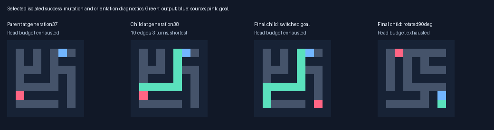
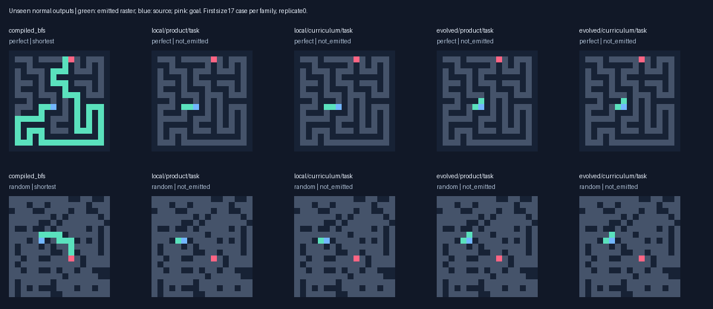
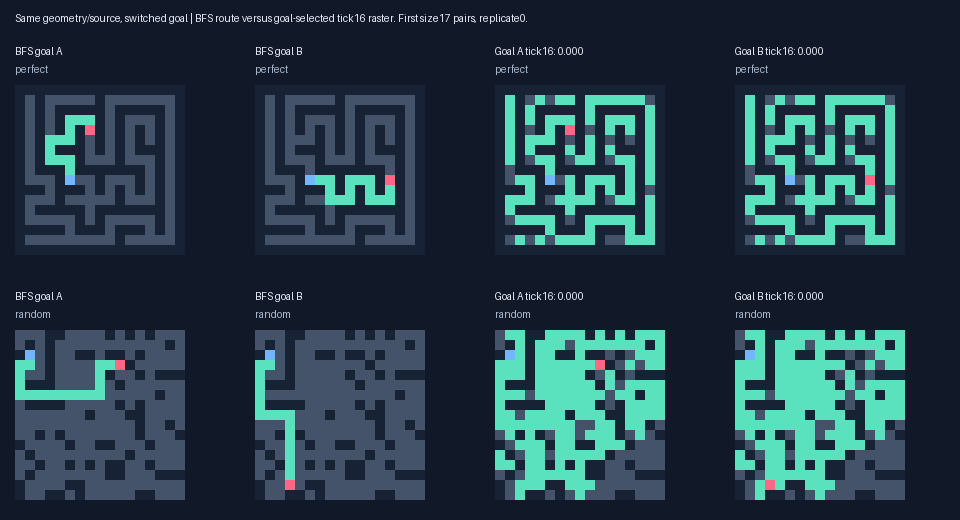

# Factorized reward curriculum: V5

Final multirange task archives solve **1/216** shortest routes under curriculum versus **1/216** under product pressure. Local curriculum solves 1/216. These are completed ordinary outputs; probe scores below are separate. Multirange curriculum solves 0/177 at distance>=8 and 0/42 independent paired reachable targets.

On the independent switched-goal set, goal-selected multirange archives have mean conjunction score 0.0068 under curriculum versus 0.0089 under product pressure; local scores are 0.0106 versus 0.0106. Both-direction qualification rates are 0.000 multirange and 0.000 local under curriculum. These are three-replicate descriptive comparisons, not a significance claim.

## Controlled continuation

Root 2026101803; twelve conditions,96 organisms each, 48 additional generations. The preregistered continuation gate was **False**. Six V4 goal-pressure populations and RNG states were forked into matched product/curriculum arms. Both protect the inherited V3 signalling elite and the V4 goal archive, deduplicated by genotype. Missing archive genotypes replace a documented last non-protected slot equally in both arms. No ancestor was chosen by final-test performance, and no known solver entered a lineage.

The runtime, eight state channels,64 registers and128-gene ceiling are unchanged. Training inference caps are 256 ticks,4096 attempted reads/site and32768 dispatches/site; validation/final caps1024 /8192 /131072. Both arms pay for the same ordinary inference and two source-present/removed tick16 observer runs per response. All oracle/path/distance operations remain outside candidate inference.

Let Q be source-dependent connected-output quality with a branch penalty, S goal-specific progress, and G=sqrt(Q*S). Product adds2G throughout. Curriculum addsQ+S for generations0–15, blends linearly to2G during16–31, and uses exactly2G thereafter. Both bonuses share the maximum2, but the separate sum deliberately gives more credit away from equal factors. Unreachable/unaligned pairs receive zero bonus. This compares factorization plus schedule; a constant additive arm would be needed to separate those effects.

Valid routes, optimality and no-path utility precede shaping. Failed outputs carry no cost tie-break. Validation always uses the product reward. Task archives use common ordinary-route fitness without any probe reward; goal/source/quality/specificity archives use their named validation statistic. Training overall and factor leaders are nominated identically in both arms. New V5 validation archives never automatically enter reproduction. Frozen controls are selected from the initial populations on the same new validation set.

Training uses two rotating divergent-goal pairs per generation, size9 initially and17 after generation23, all reachable targets at distance>=8. One mixed disconnected pair replaces the cyclic pair every fourth generation. Fixed validation has six pairs/replicate. All size9 perfect splits use Wilson spanning trees from the outset; larger trees retain DFS. Whole layouts from V1–V4 are excluded, and only intentional goal pairs share a layout. This environment change and added archive nominees apply equally to both arms; absolute V4/V5 scores are not an objective-only comparison. See the [protocol](../docs/FACTOR_STUDY_V5.md).

## Validation extension decision

Thresholds are exactly V4's: at least two additional optimal validation routes versus both frozen/product controls in a topology, or sufficiently large goal/quality/specificity gains in at least two replicates, with both-direction qualification, both maze families and retained source signalling. Q or S alone cannot trigger the longer run.

| Topology | Rep | Frozen G | Product G | Curriculum G | Q | S | Both | Pass |
|---|---:|---:|---:|---:|---:|---:|---:|---|
| local | 0 | 0.0000 | 0.0000 | 0.0000 | 0.1495 | 0.0000 | 0.000 | False |
| local | 1 | 0.0000 | 0.0000 | 0.0000 | 0.0561 | 0.0000 | 0.000 | False |
| local | 2 | 0.0487 | 0.0591 | 0.0591 | 0.0215 | 0.2074 | 0.250 | False |
| evolved | 0 | 0.0012 | 0.0012 | 0.0041 | 0.0120 | 0.0093 | 0.000 | False |
| evolved | 1 | 0.0091 | 0.0426 | 0.0112 | 0.0217 | 0.0370 | 0.000 | False |
| evolved | 2 | 0.0050 | 0.0519 | 0.0478 | 0.0256 | 0.1785 | 0.000 | False |

## Fresh completed outputs

Models froze before264 new primary layouts (216 reachable,48 disconnected) and24 independent goal-pair layouts (42 reachable targets,6 unreachable). Every paired reachable target has distance>=8. Primary sizes are9/17/33/65 perfect/cyclic plus rectangular9/17. Task/goal and frozen archive labels can repeat genotypes; these are not independent discoveries.

| Archive | Valid /216 | Shortest | Distance>=8 shortest | Correct no-path /48 |
|---|---:|---:|---:|---:|
| compiled_astar | 216/216 | 216 | 177/177 | 48/48 |
| compiled_bfs | 216/216 | 216 | 177/177 | 48/48 |
| evolved/curriculum/frozen_goal | 1/216 | 1 | 0/177 | 0/48 |
| evolved/curriculum/frozen_task | 1/216 | 1 | 0/177 | 0/48 |
| evolved/curriculum/goal | 0/216 | 0 | 0/177 | 0/48 |
| evolved/curriculum/task | 1/216 | 1 | 0/177 | 12/48 |
| evolved/product/frozen_goal | 1/216 | 1 | 0/177 | 0/48 |
| evolved/product/frozen_task | 1/216 | 1 | 0/177 | 0/48 |
| evolved/product/goal | 1/216 | 1 | 0/177 | 0/48 |
| evolved/product/task | 1/216 | 1 | 0/177 | 12/48 |
| local/curriculum/frozen_goal | 1/216 | 1 | 0/177 | 0/48 |
| local/curriculum/frozen_task | 1/216 | 1 | 0/177 | 0/48 |
| local/curriculum/goal | 1/216 | 1 | 0/177 | 0/48 |
| local/curriculum/task | 1/216 | 1 | 0/177 | 12/48 |
| local/product/frozen_goal | 1/216 | 1 | 0/177 | 0/48 |
| local/product/frozen_task | 1/216 | 1 | 0/177 | 0/48 |
| local/product/goal | 1/216 | 1 | 0/177 | 0/48 |
| local/product/task | 2/216 | 2 | 0/177 | 6/48 |
| wave_bit | 216/216 | 216 | 177/177 | 48/48 |

Curriculum task archives classify12/48 primary disconnected grids correctly, versus0/48 for their frozen selections, with0/216 false no-path claims on reachable primary tasks. Multirange product also reaches12/48; local product reaches6/48 with one false claim. Curriculum archives handle2/6 paired unreachable targets. These small gains do not establish general connectivity detection: primary disconnected sources are fixed at a corner and use a separating wall.


Across repeated candidate archive outputs, successes span 1–5 edges; 0/16 contain turns. Per-case evidence is in `success_shapes.json`. A long straight line alone does not establish maze solving. One inherited genome already solved an11-edge straight validation path before training; that is not a V5 evolutionary gain.


Diagnostic subsets: different source/goal rows **and** columns require a turn; oracle distance greater than Manhattan distance requires a detour. These post-selection analyses do not alter training or model selection.

| Task archive | Turn-required shortest | Detour-required shortest |
|---|---:|---:|
| compiled_bfs | 197/197 | 152/152 |
| local/product/task | 0/197 | 0/152 |
| local/curriculum/task | 0/197 | 0/152 |
| evolved/product/task | 0/197 | 0/152 |
| evolved/curriculum/task | 0/197 | 0/152 |

## An isolated new filament with turns

The local product task archive solves one independent paired9x9 perfect maze: **10 edges,3 turns, two internal junctions**, emitted at tick21. Its initial frozen selections solve0/42 paired targets. This is separate from the primary table and occurs in the control arm; it is not an advantage of the factorized curriculum.

A post-hoc trace of existing frozen ancestors finds the first success at generation38, after three gene-row edits from its failing generation37 parent. They change a MIN_POS source channel6 to7, redirect a NEIGHBOR result from scratch register61 to19, and change one XOR input from48 to19. The mutation set as a whole changes this response; individual necessity was not tested. The final generation42 descendant is seven mutational links from its inherited V4 root. No solver seed was introduced and no diagnostic mutant was bred into a population.

The filament moves only west and south. It fails the alternative goal on identical geometry and all three90-degree rotations of the successful task. Every state channel is identical under the two goals at each tick1–21. The common runtime checks whether both output endpoints are lit when the source stop channel is positive. This explains the successful stopping time without goal-specific branch choices in the developing state. It is a concrete precursor of growth that follows maze geometry with a directional bias; goal-guided junction choice and general shortest-path extraction remain absent.

These ancestor/rotation/prefix checks were chosen after inspecting this success. They diagnose an already inspected maze and are not new holdout accuracy. Full genomes, outputs, work and edits are saved in `turned_path_diagnostic.json` and `goal_prefix_diagnostic.json`.



Post-hoc cost 3.29s, 22 ordinary calls and 48 probes, charging 34,128,768 additional logical work units.


The final filament genome contains 127 genes. A conservative static slice identifies 21 potential output/stop gene dependencies across state channels [0, 1, 2, 4, 7]. This is not a minimal program or a count of dynamically necessary genes; full-state quiescence can depend on additional channels. Genome length alone does not establish effective regulatory complexity.


## Independent goal-pair outputs and probes

Normal path correctness is separate from fixed-tick probe measures. Q,S,G average all48 targets, with zero new credit for unreachable/unaligned cases. Source signal averages42 reachable targets; both-direction rate uses18 regular pairs. No new independent resampling arm was run.

| Archive | Normal shortest /42 | No-path /6 | G | Q | S | Both | Source signal |
|---|---:|---:|---:|---:|---:|---:|---:|
| compiled_astar | 42/42 | 6/6 | — | — | — | — | — |
| compiled_bfs | 42/42 | 6/6 | — | — | — | — | — |
| evolved/curriculum/frozen_goal | 0/42 | 0/6 | 0.0016 | 0.0132 | 0.0746 | 0.0000 | 0.5507 |
| evolved/curriculum/frozen_task | 0/42 | 0/6 | 0.0000 | 0.0119 | 0.0000 | 0.0000 | 0.6432 |
| evolved/curriculum/goal | 0/42 | 0/6 | 0.0068 | 0.0064 | 0.0367 | 0.0000 | 0.5154 |
| evolved/curriculum/task | 0/42 | 2/6 | 0.0000 | 0.0000 | 0.0000 | 0.0000 | 0.4334 |
| evolved/product/frozen_goal | 0/42 | 0/6 | 0.0016 | 0.0132 | 0.0746 | 0.0000 | 0.5507 |
| evolved/product/frozen_task | 0/42 | 0/6 | 0.0000 | 0.0119 | 0.0000 | 0.0000 | 0.6432 |
| evolved/product/goal | 0/42 | 0/6 | 0.0089 | 0.0168 | 0.0444 | 0.0000 | 0.4554 |
| evolved/product/task | 0/42 | 2/6 | 0.0000 | 0.0000 | 0.0000 | 0.0000 | 0.4334 |
| local/curriculum/frozen_goal | 0/42 | 0/6 | 0.0173 | 0.0394 | 0.0434 | 0.0556 | 0.5558 |
| local/curriculum/frozen_task | 0/42 | 0/6 | 0.0000 | 0.0222 | 0.0000 | 0.0000 | 0.3683 |
| local/curriculum/goal | 0/42 | 0/6 | 0.0106 | 0.0298 | 0.0545 | 0.0000 | 0.4220 |
| local/curriculum/task | 0/42 | 2/6 | 0.0000 | 0.0552 | 0.0000 | 0.0000 | 0.5515 |
| local/product/frozen_goal | 0/42 | 0/6 | 0.0173 | 0.0394 | 0.0434 | 0.0556 | 0.5558 |
| local/product/frozen_task | 0/42 | 0/6 | 0.0000 | 0.0222 | 0.0000 | 0.0000 | 0.3683 |
| local/product/goal | 0/42 | 0/6 | 0.0106 | 0.0298 | 0.0545 | 0.0000 | 0.4220 |
| local/product/task | 1/42 | 0/6 | 0.0000 | 0.0688 | 0.0000 | 0.0000 | 0.5553 |
| wave_bit | 42/42 | 6/6 | — | — | — | — | — |

Of 768 saved tick16 paired rasters, 0 form a legal path even with an assumed emitted status. Failed tick16 outputs are therefore not merely correct routes awaiting a stop signal. The isolated turned path forms later, at tick21. Assumed status is diagnostic only.


## Factor accessibility through the curriculum

Final population sequences are identical in 0/6 paired comparisons. Counts below are reachable training responses, often repeated organisms, not independent samples. Early means generations0–15, transition16–31, matched32 onward; the product control always uses alpha=1. Raw sums, maxima, factor co-occurrence and separate validation counts are saved.

| Topology / pressure | Phase | Reachable responses | Q>0 | S>0 | G>0 | Mean G |
|---|---|---:|---:|---:|---:|---:|
| evolved/curriculum | early | 17,280 | 6,573 | 241 | 201 | 0.00071 |
| evolved/curriculum | matched | 17,280 | 6,284 | 122 | 117 | 0.00033 |
| evolved/curriculum | transition | 17,280 | 7,029 | 110 | 99 | 0.00046 |
| evolved/product | early | 17,280 | 5,645 | 82 | 69 | 0.00027 |
| evolved/product | matched | 17,280 | 6,723 | 136 | 132 | 0.00038 |
| evolved/product | transition | 17,280 | 5,798 | 194 | 187 | 0.00074 |
| local/curriculum | early | 17,280 | 6,402 | 555 | 554 | 0.00351 |
| local/curriculum | matched | 17,280 | 7,113 | 217 | 215 | 0.00166 |
| local/curriculum | transition | 17,280 | 6,674 | 367 | 367 | 0.00252 |
| local/product | early | 17,280 | 5,980 | 574 | 573 | 0.00344 |
| local/product | matched | 17,280 | 6,091 | 191 | 191 | 0.00125 |
| local/product | transition | 17,280 | 5,762 | 356 | 355 | 0.00210 |

## Exploratory goal-information assay at frozen genomes

This diagnostic was added during training, before final evaluation, and never affects selection. The same source/maze is observed at tick16 with goalA/B. Count hidden-state differences at open sites at least two graph edges from both goals, excluding output/stop channels. Differences are caused by the changed goal stimulus, but are not proof of a distance map or correct route. Mixed disconnected pairs are saved separately and excluded from this table.

| Goal archive | Aligned regular pairs | Distal hidden response >0 | Mean distal fraction | Hidden response at source | Raster changes >0 |
|---|---:|---:|---:|---:|---:|
| evolved/curriculum/goal | 18/18 | 7 | 0.0912 | 0 | 6 |
| evolved/product/goal | 18/18 | 9 | 0.0678 | 0 | 9 |
| local/curriculum/goal | 18/18 | 6 | 0.0452 | 0 | 6 |
| local/product/goal | 18/18 | 6 | 0.0452 | 0 | 6 |

### Validation-only time course

Added after final inspection without changing genomes or selection. Compare all eight source state channels under switched goals at ticks8/16/32/64, with stopping disabled, including output/stop concentrations. Each entry uses12 regular validation pairs per arm. These are exploratory diagnostics, not another final score.

| Goal archive | Tick | Aligned | Any source state | Hidden | Output concentration | Stop |
|---|---:|---:|---:|---:|---:|---:|
| evolved/curriculum/goal | 8 | 12/12 | 0 | 0 | 0 | 0 |
| evolved/curriculum/goal | 16 | 12/12 | 1 | 1 | 0 | 0 |
| evolved/curriculum/goal | 32 | 12/12 | 3 | 3 | 1 | 0 |
| evolved/curriculum/goal | 64 | 12/12 | 3 | 3 | 2 | 1 |
| evolved/product/goal | 8 | 12/12 | 0 | 0 | 0 | 0 |
| evolved/product/goal | 16 | 12/12 | 1 | 0 | 1 | 1 |
| evolved/product/goal | 32 | 12/12 | 2 | 2 | 1 | 1 |
| evolved/product/goal | 64 | 12/12 | 2 | 2 | 1 | 1 |
| local/curriculum/goal | 8 | 12/12 | 0 | 0 | 0 | 0 |
| local/curriculum/goal | 16 | 12/12 | 0 | 0 | 0 | 0 |
| local/curriculum/goal | 32 | 12/12 | 0 | 0 | 0 | 0 |
| local/curriculum/goal | 64 | 12/12 | 0 | 0 | 0 | 0 |
| local/product/goal | 8 | 12/12 | 0 | 0 | 0 | 0 |
| local/product/goal | 16 | 12/12 | 0 | 0 | 0 | 0 |
| local/product/goal | 32 | 12/12 | 0 | 0 | 0 | 0 |
| local/product/goal | 64 | 12/12 | 0 | 0 | 0 | 0 |

Local goal archives show no source state response through tick64 on these pairs. Multirange archives show limited delayed responses:3/12 curriculum and2/12 product pairs at tick64. Making goal information usable at a decision site remains a candidate bottleneck; these measurements do not prove that a particular initialization change will solve it.

Time-course cost 0.58s, 384 probes, 297,046,584 logical work units.


## Frozen nonlocal-read ablation

Every radius>1 read returns zero in both ordinary inference and both source probes; attempted reads remain charged. Selected genomes are unchanged.

| Goal archive | Normal source signal | Ablated signal | Normal G | Ablated G | Ablated shortest /42 |
|---|---:|---:|---:|---:|---:|
| evolved/curriculum/goal | 0.5154 | 0.0422 | 0.0068 | 0.0171 | 0/42 |
| evolved/product/goal | 0.4554 | 0.0379 | 0.0089 | 0.0081 | 0/42 |

Post-freeze diagnostics: 1.01s, 96 normal responses, 384 probes and 548,673,313 logical work units.


## Actual compute, latency and memory

Training including validation/probes took **13.02 minutes**; whole main run including fresh tests/timing **16.05 minutes** on Apple M4, Python 3.13.15. Peak process RSS 162.8 MiB. 253,116 normal training/selection responses plus 506,232 developmental probes. Work counts dispatches plus attempted reads, not machine instructions. Candidate slots and caps match; actual work/nominee overlap varies with phenotype.

| Topology / pressure | Train responses | Validation responses | Inference work | Probe work |
|---|---:|---:|---:|---:|
| evolved/curriculum | 55,296 | 8,856 | 41,298,967,885 | 52,854,433,038 |
| evolved/product | 55,296 | 9,072 | 39,945,676,749 | 53,419,496,297 |
| local/curriculum | 55,296 | 6,912 | 72,021,696,521 | 48,371,807,623 |
| local/product | 55,296 | 7,092 | 71,225,660,047 | 47,467,111,462 |

Thirty warm randomized repetitions on12 fixed17/33 perfect/cyclic tasks per arm. Input decoding, internal updates and full raster emission are included; model construction, evaluator and probes are excluded. Median below is the median of case medians, range spans all repetitions. Failed outputs get no speed credit.

| Arm | Median us | Warm range us | Shortest timed responses /360 |
|---|---:|---:|---:|
| compiled_astar | 9.43 | 3.21–37.42 | 360/360 |
| compiled_bfs | 5.02 | 2.42–22.25 | 360/360 |
| evolved/curriculum/frozen_goal | 1683.72 | 508.79–7454.38 | 0/360 |
| evolved/curriculum/frozen_task | 1522.45 | 345.54–13919.04 | 0/360 |
| evolved/curriculum/goal | 1366.53 | 239.00–7843.08 | 0/360 |
| evolved/curriculum/task | 7295.09 | 766.75–38845.92 | 0/360 |
| evolved/product/frozen_goal | 1677.29 | 507.25–7506.00 | 0/360 |
| evolved/product/frozen_task | 1518.22 | 341.46–12435.42 | 0/360 |
| evolved/product/goal | 4333.65 | 510.21–37907.96 | 0/360 |
| evolved/product/task | 6461.74 | 765.00–39192.62 | 0/360 |
| local/curriculum/frozen_goal | 12123.55 | 556.29–35412.08 | 0/360 |
| local/curriculum/frozen_task | 5002.86 | 498.62–35814.83 | 0/360 |
| local/curriculum/goal | 11403.10 | 557.17–37482.00 | 0/360 |
| local/curriculum/task | 14053.31 | 2189.88–37223.42 | 0/360 |
| local/product/frozen_goal | 12122.33 | 555.88–38418.08 | 0/360 |
| local/product/frozen_task | 5005.32 | 490.42–35898.92 | 0/360 |
| local/product/goal | 11551.62 | 545.75–41196.54 | 0/360 |
| local/product/task | 14385.90 | 2185.38–44838.75 | 0/360 |
| wave_bit | 36.82 | 7.50–188.17 | 360/360 |

Largest reported inference array payload 151,747 bytes. Interpreter bounds remain64 bytes/site+64KiB; observer-pair bound80 bytes/site+64KiB; program at most3584 bytes. These exclude Python/JIT/evaluator/allocator overhead, included in RSS. A* heap payload is logical and bit-wave memory uninstrumented. Dense genome scans scale with ticks x open sites x gene count; gates still pay dispatch cost. No invalid output is evidence of computational advantage.

## Fixed visual samples

First size17 perfect/cyclic primary and paired cases from replicate0, without success filtering. Probe panels are intermediate states, separately labelled.





## Verification and limits

Checked 36 source hashes, six V4 checkpoint hashes, 37,415 new individual/parent links, all protected elites and the128-gene bound. Reassessed 5,016 primary, 912 paired and 96 ablated normal rasters, plus 59 valid claims from training/validation. Recomputed 768 paired probe metrics and checked 57,957 fitness/normal-rank/curriculum decompositions. Final264 primary and24 paired layouts are disjoint from 5,114 V1–V4 layouts and new train/validation. Full next populations/RNG states support exact replay, including curriculum-stage transitions tested by unit tests. Prior code and raw results remain unchanged.

The study has three replicates and a fixed grammar, mutation scheme, input initialization and tick16 probe horizon. Archive labels and repeated response counts are not independent samples. Neither a bounded negative outcome nor a precursor score establishes impossibility or useful general maze solving. The source gets initial channel0 activation plus a source flag, while the goal is exposed as a local read-only input flag; input accessibility is another hypothesis, not resolved by gene count alone.

## Next controlled experiment

Test **symmetric source/goal stimulus initialization** against the current convention, at fixed genome capacity and with the same product objective. The source gets initial channel0 activation and a local flag, while the goal has only a local flag. Supply an initial goal pulse in channel1 in the treatment arm, retaining both flags. This supplies stimulus, not a known solver or path rule. Preserve V5 task, goal and source archives from both pressure arms so the directional filament is retained. Use frozen controls for each input convention, measure communication to decision sites and exact turning/detour routes, and reserve new layouts. This tests information accessibility before assuming that larger genomes alone are the missing ingredient.

## Reproduce

```bash
.venv/bin/python -m pytest -q
.venv/bin/python -m maze_evolution.factor_study --out results/repeat_factor
.venv/bin/python -m maze_evolution.factor_diagnostics --out results/repeat_factor
.venv/bin/python -m maze_evolution.factor_timecourse --out results/repeat_factor
.venv/bin/python -m maze_evolution.factor_lineage_diagnostic --out results/repeat_factor
.venv/bin/python -m maze_evolution.factor_prefix_diagnostic --out results/repeat_factor
.venv/bin/python -m maze_evolution.factor_audit --out results/repeat_factor
.venv/bin/python -m maze_evolution.factor_report --out results/repeat_factor
```

Choose a fresh output directory. Raw masks, probes, full population/RNG checkpoints and all evaluated genomes/parents/fitnesses are in `factor_curriculum/`.

After benchmarking, lossless log packaging took 8.8s: 33.87 to 22.41 MiB. Decoded/stored hashes are in `storage.json`. All decoded bytes matched.
