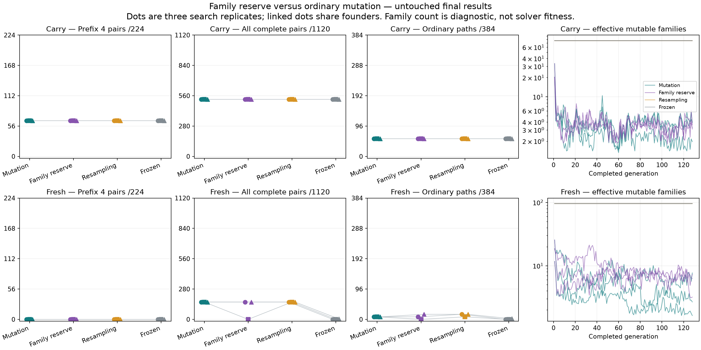
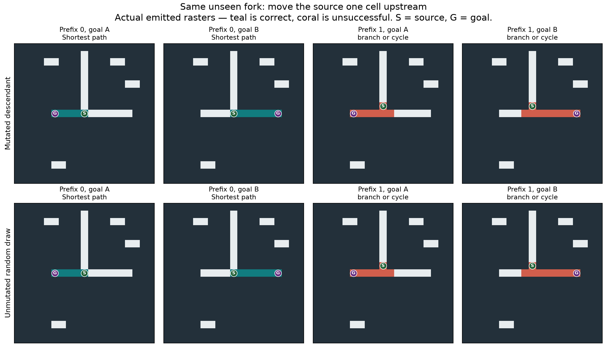

# V12Z family reserve and sustained mutation

**Preserving related genetic variation did not improve the primary maze-solving
result.** The registered gate fails in all three replicates of both origins,
for both mutation policies. The family reserve increases inherited-locus
variation in retained relatives, but that is not yet a computational benefit.

The local run completes **128 matched generations in
69.57 minutes**, including founder screening, under its
75-minute allowance. The registered reserve rule closes the run without an
extension. All populations, RNG states and useful variants remain preserved.
The independent audit passes; its scope and costs are below.



## What the untouched test shows

Final data contain 20 independently seeded structured contexts, eight poses,
two goals and prefixes 0/1/2/4/8, plus 48 ordinary reachable and 16 disconnected
9×9 base mazes in all eight poses. The total is 7,232 inputs/model:
1,120 branched goal pairs, 2,240 corridors, 384 ordinary reachable inputs and
2,368 disconnected inputs. Prefixes, graphs and poses within a context are
correlated. Structured contexts use a small fixed geometry grammar with new
clutter; route shapes can recur. They are not 1,120 independent novel topologies.

Every carried primary has the same successful-pair, corridor and ordinary-case
membership as its frozen reference: **526/1,120 complete pairs**, including
326/896 positive-prefix pairs, 66/224 prefix-four pairs, 36/224 prefix-eight pairs
and 8/128 positive-prefix alternative-cycle pairs; 2,064/2,240 corridors and
56/384 ordinary shortest outputs. Eleven of the twelve carried primaries retain
the exact historical specialist. Ordinary-mutation replicate 0 selects a
three-mutation-birth descendant with identical successful-case membership here.
There is no new carried correctness gain to claim.

For fresh origins, each entry below lists the three search replicates. A complete
pair requires correct shortest emitted paths for BOTH goals on the same layout.

| Policy | Complete pairs /1,120 | Positive-prefix pairs /896 | Ordinary shortest /384 |
|---|---:|---:|---:|
| Ordinary mutation | 160/160/160 | 0/0/0 | 8/8/8 |
| Family reserve | 160/0/160 | 0/0/0 | 8/0/16 |
| Random resampling | 160/160/160 | 0/0/0 | 16/8/16 |
| Frozen founders | 0/0/4 | 0/0/0 | 0/0/2 |

All 160-pair fresh successes are the **20 prefix-zero forks in all eight poses**.
The source is directly at the decision junction. All these fresh primaries fail
all positive-prefix pairs and all complete second-junction/alternative-cycle
pairs. Ordinary successes have only one- or two-edge routes, spanning at most
two base layouts. This is useful elementary behavior, but not general maze
solving. The family-reserve arm is not better than ordinary mutation or
resampling on this test.

Ordinary mutation reached the elementary validation behavior in all three fresh
replicates by generation 64, before resampling caught up. That early difference
is a correlated selection-data time course, not an enduring advantage: at the
final checkpoint and on untouched data, resampling also succeeds in all three.
Its winners are **unmutated random draws**, of 124, 106 and 120 genes. The ordinary
mutation winners have 122, 136 and 91 genes and 29, 7 and 11 mutation births in
their Z ancestry. These results support discovery from random origins, while
providing no final-correctness advantage of evolution or larger genomes for this
skill. Earlier validation discovery is a secondary lead about search efficiency
that needs its own controlled confirmation.
They do not establish a new project-wide capability beyond earlier specialists.

All evolved/resampled primaries correctly declare no-path on **0/2,368**
disconnected inputs, with zero false reachable no-path claims. One frozen fresh
reference correctly declares 1,752 disconnected cases but falsely declares
3,542/4,864 reachable inputs unreachable; that is not competent reachability
reasoning. Compiled BFS, A*, bit-wavefront and the separate intact VM solve all
4,864 reachable and 2,368 disconnected inputs. No latency benchmark or speedup
claim is made in this study. All candidates use local topology; no new causal
multirange comparison is present.

## What the failure looks like



This retrospective illustration uses stored final rasters only. The cells and
goals are identical across each source-position contrast. At the junction, both
a mutated descendant and an unmutated random draw emit the correct selected
arm. Moving the source one cell upstream produces a side stub at the junction.

The pattern is systematic in the six ordinary-mutation/resampling primaries:
all 320 one-cell-prefix fork outputs/model contain the oracle path plus exactly
one extra cell. At prefixes 2/4/8 all 320 fork outputs/model also contain the
oracle path, with multiple extra cells. These are **invalid native outputs**.
Path containment alone is insufficient, and no oracle cleanup or pruning was
applied. This diagnoses a visible output-selectivity problem on this grammar;
it does not yet identify whether stopping, propagation, or a particular gate
causes it. No new forced trajectories or mechanism ablations were run.

## Did the diversity intervention work

The two mutation arms share founders, capacity, runtime, training schedule,
parent selection, 44-survivor/52-birth turnover and seven random immigrants plus
45 single-edit children per generation. Only survivor retention differs. Both
protect the same historical anchors and retain four additional merit survivors.
The family arm can reserve twenty additional genotype-distinct relatives across
five ancestry groups, selecting farthest-first by inherited-locus mismatch.
Archives remain external and never silently reenter the population.

At the final retained-survivor snapshot, excluding protected anchors, mean
within-family distance between distinct genotypes is higher with the family
reserve in all six matched comparisons:

| Origin | Ordinary mutation, three replicates | Family reserve, three replicates |
|---|---|---|
| Carry | 4.7%, 6.9%, 4.4% | 9.8%, 14.5%, 18.4% |
| Fresh | 22.2%, 22.7%, 24.4% | 27.1%, 31.9%, 42.3% |

The final family reserve actually retains 20/13/18 reserved variants in carried
replicates and 14/20/20 in fresh replicates. Ancestry concentration is not uniformly
improved: effective mutable-family counts rise relative to ordinary mutation in
only three of six final comparisons. The trajectory plot includes newborns that
have not yet been evaluated. Genetic distance is a structural diagnostic;
neutral or harmful instructions can contribute, and no functional-module or
sexual-transfer benefit follows from this measurement alone.

Historical founder labels are deliberately separate except the documented
d07/d12 homologous pair. They are operational starting groups, not a claim to
have reconstructed every shared historical ancestor. Later asexual inheritance
and inserted/deleted/duplicated locus identities are replayed exactly.

## What the compute bought

There are 24 conditions of 96 organisms: carry/fresh × three replicates × ordinary
mutation/family reserve/resampling/frozen. The six matched pools share initial
screening physically, with those results reused logically across four arms.
Every condition receives **550,144 logical search responses**. Subsequent
training and nomination calls are physically separate and equal across arms;
equal evaluation counts do not imply equal time or charged work.

The run creates 119,808 offspring: 69,120 one-edit
mutation births and 50,688 new random draws.
There are 6,512,640 physical search calls and 2,017,046,991,212 charged
work units, with 464.83 MiB peak search RSS.

| Search component | Physical calls | Candidate seconds |
|---|---:|---:|
| Initial founder validation | 2,230,272 | 779.09 |
| Evolutionary training batches | 3,538,944 | 1911.72 |
| Subsequent validation nominations | 743,424 | 794.47 |

Training consumes about 55% of candidate inference time; screening and validation
consume the rest. Each condition makes only eight later nomination events,
covering roughly one to four families in the mutation arms. Thus this study
combines sustained training with broad but sparse nomination. Unnominated
population members were not tested on final data. This is a plausible selection
bottleneck to examine, not evidence that an undiscovered general solver exists.

The 96-generation schedule covers all poses but is not a full factorial of arm
length, prefix, shape and graph. Carry replicates share historical anchors;
they are separate search RNG histories, not independent rediscoveries of those
anchors. Random streams diverge after selection differs. The 44/52 turnover is
common within Z but differs from X's 24/72, so between-study score differences
cannot be assigned to the family policy alone.

## Audit and preservation

Registration **8c01929** was pushed before scientific validation/training.
Selections, all next states and raw search records were frozen and pushed in
**ef1dca6** before final generation. Seed 2026102004; fixture seeds 1434/1435;
software seed 23456789. All 6,923 prior completion hash entries verify.
The protocol is [FAMILY_EVOLUTION_V12Z.md](../docs/FAMILY_EVOLUTION_V12Z.md).

Calibration uses 17,696 calls and 3.39 candidate seconds. The discarded rehearsal
uses 165,888 calls including 82,944 exact replays, 60.44 candidate seconds and
79.93 wall seconds. Combined calibration/rehearsal remains below its 180-second
candidate cap. Forty-three focused/related tests plus four archive/replay-output integrity tests
pass; this is not a fresh full-suite run.

Final confirmation uses 289,280 physical candidate calls for
93 aliases/40 distinct models, 281.29 candidate seconds and
293.15 wall seconds, below the separate 600-second candidate cap.
The independent audit takes 2465.55 wall seconds and
985.58 MiB peak RSS. It verifies all
240 source and 21 input hashes,
regenerates the corpora, replays every selection/birth/RNG/checkpoint/archive,
and independently grades 6,819,616
main/profile/final rasters plus 82,944
rehearsal rasters. Exact inference replay covers all nontraining records and a
registered deterministic 1/256 training sample:
3,294,531 replays plus
82,944 rehearsal replays.
All 21,696 conventional baseline records are replayed.
Selection/reproduction replay shares production functions; raster grading uses
a separate implementation. No exhaustive training-inference replay is claimed.

Execution is on the local Apple M4 CPU, Python 3.13.15,
NumPy 2.5.4, Numba 0.68.0.
No remote model, cloud compute or paid provider was used. Audit and preparation
costs are additional to the search allowance, not hidden within 75 minutes.

The complete 131,653,270-byte ancestry log is preserved in four verified ordered
byte chunks. After a fresh clone, restore it before replaying the audit:

```bash
.venv/bin/python tools/archive_family_evolution_births.py restore
.venv/bin/python tools/replay_family_evolution_audit.py
```

The replay wrapper verifies the seal before and after the audit and writes its
new packet under `output/family_evolution_replays/`, preserving the sealed
original audit and all source artifacts. Production-signature JIT warmups are
logged separately from the candidate budgets.

Exclude all **272,464 whole layouts** through Z in any future
independent study, including unqueried poses and software fixtures, using
`family_evolution/whole_layout_exclusions.json.gz`. Never train or reselect on
these inspected final cases. No frozen-source repair or protocol deviation was
needed. All useful diversity, raw masks and exact lineage histories are preserved.

## Recommended next step

This result does not justify another unchanged long run. The random-origin track
remains open: random search and evolution both find structured goal-choice
behavior, but extra inherited variation alone did not extend its capability.

A bounded follow-up should freeze these exact successful fresh models, their
random controls and complementary historical specialists, then use new matched
cases to distinguish early stopping from persistent branch overgrowth. Normal
solutions must remain the endpoint; forced traces would be labelled diagnostic
and never rescored as successes. The one-cell stub gives a concrete target for
mechanism tests without installing a known solver or an oracle decoder.

The saved family populations also justify checking actual recombination
opportunity. More genetic distance is not the required activation result. The
separate sexual plan still needs a new preregistered pilot meeting its actual
retained-transfer gate before any 75-minute sexual comparison. It has not been
launched. Preserve the populations and useful variants while making that decision.
