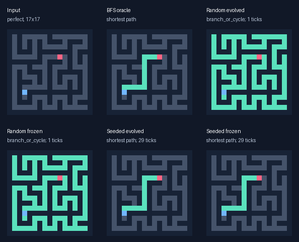
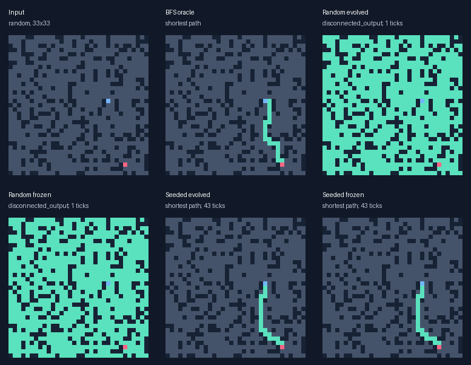
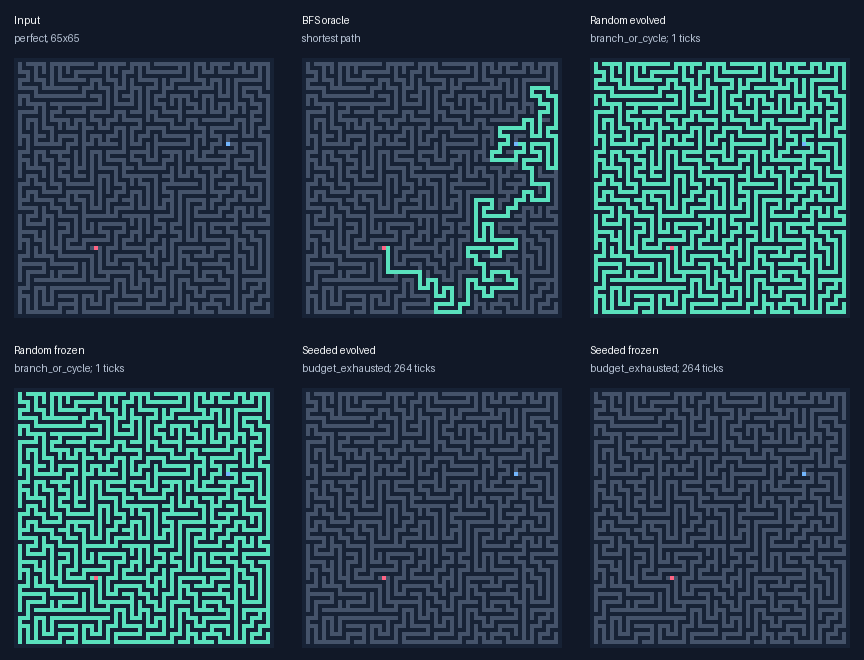

# First local-rule evolution experiment

This CPU pilot compares two initialization regimes and their frozen initial champions. It tests local rules only; multi-distance signalling is not implemented yet.

Run: 2026-10-17T23:21:38.158476-04:00; Apple M4; Python 3.13.15. 3 independent evolutionary seeds, 32 organisms, 25 generations, four rotating training mazes per generation.

## Unseen results

| Arm | Legal routes / reachable | Shortest / reachable | Correct no-path | Budget failures |
| --- | ---: | ---: | ---: | ---: |
| random_evolved | 4/240 | 4/240 | 0/48 | 0 |
| random_frozen | 4/240 | 4/240 | 0/48 | 0 |
| seeded_evolved | 200/240 | 200/240 | 48/48 | 40 |
| seeded_frozen | 200/240 | 200/240 | 48/48 | 40 |
| compiled_bfs | 240/240 | 240/240 | 48/48 | 0 |
| compiled_astar | 240/240 | 240/240 | 48/48 | 0 |
| wave_bit | 240/240 | 240/240 | 48/48 | 0 |

Same-size tests use new 9x9/17x17 perfect and cyclic random mazes with new endpoints. Larger tests use 33x33/65x65. Structural shifts include snake/comb and rectangular grids. Disconnected cases are counted separately. No-path accuracy is not substituted for reachable-maze solving.

| Arm / category | Shortest / reachable | No-path correct |
| --- | ---: | ---: |
| random_evolved / larger | 0/96 | 0/0 |
| random_evolved / no_path | 0/0 | 0/48 |
| random_evolved / same_size | 0/96 | 0/0 |
| random_evolved / structure_shift | 4/48 | 0/0 |
| random_frozen / larger | 0/96 | 0/0 |
| random_frozen / no_path | 0/0 | 0/48 |
| random_frozen / same_size | 0/96 | 0/0 |
| random_frozen / structure_shift | 4/48 | 0/0 |
| seeded_evolved / larger | 71/96 | 0/0 |
| seeded_evolved / no_path | 0/0 | 48/48 |
| seeded_evolved / same_size | 96/96 | 0/0 |
| seeded_evolved / structure_shift | 33/48 | 0/0 |
| seeded_frozen / larger | 71/96 | 0/0 |
| seeded_frozen / no_path | 0/0 | 48/48 |
| seeded_frozen / same_size | 96/96 | 0/0 |
| seeded_frozen / structure_shift | 33/48 | 0/0 |

## What changed during evolution

| Regime / replicate | Initial → final genes | Validation work change | New genotype? |
| --- | ---: | ---: | --- |
| random/r0 | 29 → 29 | 0.0% fewer instruction+read units | False |
| seeded/r0 | 29 → 29 | 0.0% fewer instruction+read units | False |
| random/r1 | 23 → 1 | 96.7% fewer instruction+read units | True |
| seeded/r1 | 29 → 28 | 2.2% fewer instruction+read units | True |
| random/r2 | 25 → 1 | 97.0% fewer instruction+read units | True |
| seeded/r2 | 29 → 28 | 2.2% fewer instruction+read units | True |

Random initialization produced 4 legal held-out routes. A useful partial phenotype or shorter genome is not evidence of a general solver. The seeded regime starts with a hand-designed shortest-path algorithm; its success is not discovery from scratch. Changes to it must be interpreted as program optimization or altered behaviour, not invention of wavefront search.

## Timing, work and memory

| Arm | Median of successful 17x17 instance medians (µs) | Successful timed instances |
| --- | ---: | ---: |
| compiled_astar | 2.92 | 6 |
| compiled_bfs | 2.09 | 6 |
| random_evolved | n/a | 0 |
| random_frozen | n/a | 0 |
| seeded_evolved | 318.25 | 6 |
| seeded_frozen | 324.17 | 6 |
| wave_bit | 12.40 | 6 |

Each selected instance uses 30 warm repetitions, with randomized solver order. Times include raw-byte input handling, reaction/search, termination and binary-raster emission. JIT, maze generation, oracle/validation, rendering and one-time per-genome program encoding are excluded. Individual medians/p95/min/max and all samples are saved. Failed outputs never count as fast solutions. These are implementation comparisons, not state-of-the-art claims.

Candidate work is deterministic site-instruction evaluations plus attempted spatial channel reads. MIN/ARGMIN charge four reads, neighbour/match one. Every executed gene is charged at every open site; full-grid scans and register resets additionally cost time and are not included in this proxy. Counts are not CPU instructions or energy.

Limits: {'max_steps': 512, 'reads_per_site': 2048, 'instructions_per_site': 16384, 'max_cells': 65536}. All arms share them. A read cap can bind before the tick cap, especially on long corridors. Budget-exhausted empty output is never labelled a correct no-path answer. A quiescent empty raster predicts no path and is scored against the oracle; quiescence is not a proof for arbitrary programs.

- random_evolved: largest accounted array payload 80,951 bytes; failure counts {'branch_or_cycle': 44, 'disconnected_output': 48, 'not_emitted': 192}.
- seeded_evolved: largest accounted array payload 80,951 bytes; failure counts {'budget_exhausted': 40}.

Memory accounting includes double-buffered four-channel uint16 state, uint8 input/output, int32 genome and scratch registers, plus a conservative input-check temporary. It excludes Python/Numba object/allocator overhead and the external evaluator/datasets. BFS is a conservative array bound; A* counts logical heap payload without spare capacity; bit-wave history is not instrumented. These are not fully comparable measured process peaks. Whole-run maximum RSS, including JIT and evaluator, was 132.8 MiB.

## Experimental contract and reproducibility

The genome has 1–32 typed instructions (14 operations) and four uint16 state channels. Output is channel 2 > 0. Scratch registers are local to one site. Spatial reads see only the previous tick; walls hold zero. Start stimulus initializes channel 0 to 1 once for every genotype. Seed channels encode first-arrival distance and one parent direction, then trace from goal to source using neighbour matches. These hidden values are computed locally by the genome; the independent evaluator supplies neither distances nor routes to inference.

Initialization: 32 random typed programs versus one exact 29-gene seed and 31 independently perturbed seeds (1–3 edits). The initial champion of each population is selected on validation and frozen. Evolution ranks each batch lexicographically by legal paths, shortest paths, no-path utility (correct no-path predictions minus false no-path claims on reachable mazes), bounded partial connectivity score, then lower instruction+read work. Latency does not drive selection. The top 1/8 survive; three-way tournaments from the top half produce mutation-only offspring with 1–3 requested edits. Edits may be neutral. No crossover or arbitrary generated-code execution is used.

Partial score for invalid outputs is clipped to [0, 0.99]: (0.1 for containing source + 0.8 × graph-distance progress of its lit component toward goal) / (1 + 2 × total excess degree above 2) − 0.2 × isolated-lit fraction. Wall leaks get zero. Legal paths receive zero shaping; their higher primary rank always dominates. This deliberately allows evaluator-derived graph distance for training feedback only. Empty masks get no reachable-maze credit.

Rotating training namespaces are paired between regimes. Validation selects the initial champion and archives the best of each generation’s training champions. All champions are saved before generating the final test mazes. SHA256 input+endpoint identities are checked for cross-split overlap. Final tests never influence selection. Frozen controls receive less search compute than evolution; this is an improvement-over-initialization ablation, not a matched-budget comparison with random search.

Raw files: config/environment, all newly created genomes and parent IDs, every training fitness, generation history, maze manifests with exact input bytes, frozen champions, every holdout output bitmask, and benchmark samples. Source hashes identify uncommitted code independently of the parent Git revision.

```bash
.venv/bin/python -m maze_evolution.experiment --out results/repeat_evolution --seed 20261017 --replicates 3 --population 32 --generations 25 --samples 8 --benchmark-repeats 30
```

## Visual samples

Samples are the first test cases at 17x17 perfect, 33x33 random and 65x65 perfect in replicate 0, not chosen by success. Blue = source; red = goal; green = emitted pixels, including invalid partial outputs.







## Next experiment

Hold this local runtime as a control, then add fixed and evolvable radii 1/2/4/8 under the same work accounting. First run a frozen-genome budget sweep on a separate diagnostic set to distinguish propagation limits from rule errors. Add matched-budget random search before attributing an advantage specifically to evolutionary selection. Expand training seeds and optimized conventional baselines before making any competitive claim.

## Post-run phenotype audit

This section inspects the saved outputs; it does not rerun selection or change the frozen champions, scoring or limits.

- **random/r0**: 96/96 outputs equal all open input cells; 0/96 contain only the source. Successful families: {'snake': 4}. Outputs/status/ticks unchanged from frozen: 96/96. Deleted instruction instances: 0.
- **random/r1**: 0/96 outputs equal all open input cells; 96/96 contain only the source. Successful families: {}. Outputs/status/ticks unchanged from frozen: 96/96. Deleted instruction instances: 23.
- **random/r2**: 0/96 outputs equal all open input cells; 96/96 contain only the source. Successful families: {}. Outputs/status/ticks unchanged from frozen: 96/96. Deleted instruction instances: 24.
- **seeded/r0**: 1/96 outputs equal all open input cells; 0/96 contain only the source. Successful families: {'perfect': 21, 'random': 32, 'snake': 1, 'comb': 2, 'rectangular': 8}. Outputs/status/ticks unchanged from frozen: 96/96. Deleted instruction instances: 0.
- **seeded/r1**: 1/96 outputs equal all open input cells; 0/96 contain only the source. Successful families: {'perfect': 26, 'random': 32, 'snake': 1, 'comb': 2, 'rectangular': 8}. Outputs/status/ticks unchanged from frozen: 96/96. Deleted instruction instances: 1.
- **seeded/r2**: 1/96 outputs equal all open input cells; 0/96 contain only the source. Successful families: {'perfect': 24, 'random': 32, 'snake': 1, 'comb': 2, 'rectangular': 8}. Outputs/status/ticks unchanged from frozen: 96/96. Deleted instruction instances: 1.

All 4 random-regime successes light every open input cell. In these cases the open input itself is already a legal shortest route. This favourable special case is not evidence of a general maze-solving procedure learned by evolution.

Runs random/r1, random/r2 compressed a source-only response to `STORE output, source_flag`. This is a fitness plateau: shape constraints alone did not bridge the gap to connected route construction.

Runs seeded/r1, seeded/r2 deleted `OR r15, r15, state_output`, the explicit persistence step. The goal remains active and the retained parent-linked chain sustains its own output, making that instruction redundant. One run also reordered independent instructions. Spatial reads, propagation depth and held-out outcomes remain unchanged. This is a small interpretable optimization, not a new pathfinding algorithm.
- seeded/r1: 29 → 28 genes; 45 → 44 instruction+read units per open site per tick (2.22% reduction).
- seeded/r2: 29 → 28 genes; 45 → 44 instruction+read units per open site per tick (2.22% reduction).

The first seeded budget failure was `test/r0/32/perfect/33x33`: shortest-path distance 205 edges requires 411 ticks for this seed's forward-and-backward process. It stopped at 272 ticks on `read_budget`, after 2,223,872 of 2,230,272 permitted reads. No extra budget was granted to convert this failure into a reported success.

The per-arm test denominator pools 288 case evaluations across 3 independently evolved runs. These contain 272 unique input/endpoint hashes. Snake and comb shapes repeat across replicates; those repeated structural checks are not independent randomly generated mazes.

## Verification

All 41 tests pass with `.venv/bin/python -m pytest -q`. The saved execution-source hashes and frozen-champion hash match. Lineage links cover 4,224 created genomes; logs contain 4,800 population evaluations and 2,016 final outputs across candidate arms and baselines. Cross-split input/endpoint overlap is absent. The phenotype audit can be reproduced with `.venv/bin/python -m maze_evolution.inspect_results results/first_evolution`.
