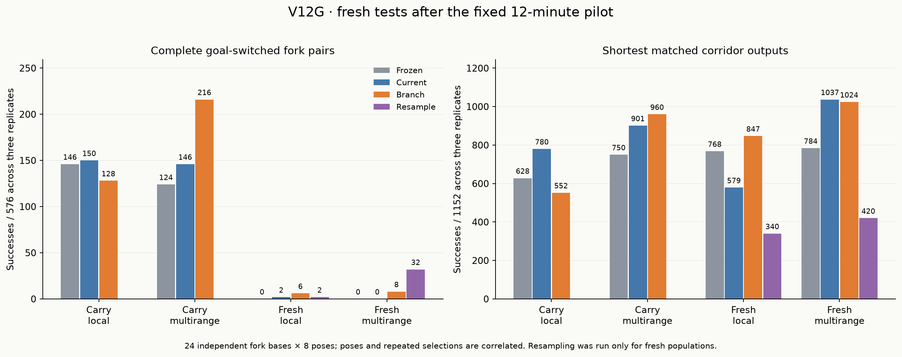
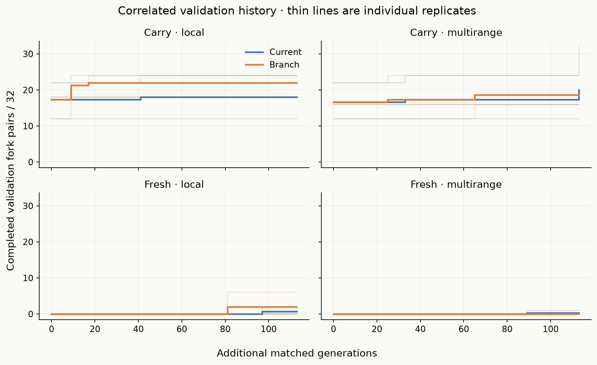

# V12G — useful branch suppression, uneven evolutionary transfer

The bounded pilot is complete. **One continued random-origin lineage now completes
128/192 unseen goal-switched fork pairs, covering 16 independent bases in all eight
orientations, including four longer bases.** This is useful evidence of local
routing behavior. It is still a restricted-task result: treatment gains vary
sharply across replicates, fresh evolution does not consistently beat random
resampling, and the strongest variant does not need nonlocal values on its
successful pairs. General maze solving and a speed advantage remain unestablished.

The preregistration and prepared populations were pushed in **83f78c6**. All final
selections were frozen and pushed in **f1b6bf9**, before new final-case generation.
There was no post-test tuning, reselection, or budget extension.

## What was tested

[Protocol](../docs/FORK_PRESSURE_V12G.md): 30 populations of 96 organisms, comprising
continued versus fresh random origin, local versus evolvable ranges, Current
versus Branch pressure, three replicates, and six fresh resampling controls.
Each pressure pair starts from identical prepared populations and RNG. Continued
populations inherit V12E Current states at generation 1365; 9–15 validation-selected
C/D/E variants are protected equally in both arms. Known solver controls never
enter those lineages. The four common validation archives and raw diversity are
retained; the pair archive is primary and the choice archive is secondary.

Capacity remains 256 genes and eight channels. Runtime, goal-pulse input, mutation,
elite protection and task schedule are common between pressures. Branch pressure
adds strict paired-exit priority and a score rewarding the incoming prefix,
correct exit and suppression of the wrong exit. It is a complete objective
contrast, not an experiment isolating the strict-choice bit from shaping or
lexicase tolerance. The pressure changes reproduction: all 12 matched evolution
pairs eventually differ in ordered genotype populations, first at generations 0–2.

Search finishes **113 matched generations in 706.51 seconds (11.78 minutes)**,
including 41.54 seconds of initial validation. Its conservative wall reserve stops
the next round. Search uses 2,236,032 physical responses, 269,773,599,386
read-plus-dispatch units, and 927.14 MiB peak RSS on an Apple M4 with 16 GiB RAM.
Full next populations, RNG, concrete mutation events and raw masks are saved.

The new grammar deliberately makes the branching question easier to study:
short induced forks, interior sources, both goal choices and all D4 orientations.
Training uses 2–4- and 3–7-edge routes; the final 5–10-edge stage also changes the
board from 13×13 to 21×21. Every fork-goal input has a matched corridor retaining
exactly its route while removing competing arms. These corridor controls use
different layouts and are never counted as goal-switch pairs.

The cyclic stratum attaches a **dangling loop**. It tests loop rejection, but
there are no competing simple source-to-goal routes: valid routes are unique in
this grammar. It does **not** establish shortest-path choice among alternative
cyclic routes. Eight isolated clutter cells are retained across matched inputs.
They diversify whole layouts; small route shapes can recur. Although they carry
no switched-goal label, they need not be computationally neutral, especially for
nonlocal reads or global stopping. The calibration had full intact-control
accuracy and correctly ordered 480 synthetic output scores.

## Fresh final results

There are 24 independent base forks, eight poses and two goals per base:
384 fork inputs/192 goal pairs, 384 matched corridor inputs, and 128 disconnected
inputs. All arms share this corpus. Each table cell below sums three replicates:
**576 paired tests and 1,152 corridor inputs per cohort**. These are correlated
poses and repeated shared layouts, not 576 independent mazes.

| Origin / range | Frozen pairs | Current pairs | Branch pairs | Resampling pairs |
|---|---:|---:|---:|---:|
| Continued / local | 146 | 150 | 128 | — |
| Continued / multirange | 124 | 146 | **216** | — |
| Fresh / local | 0 | 2 | 6 | 2 |
| Fresh / multirange | 0 | 0 | 8 | **32** |

| Origin / range | Frozen corridor outputs | Current | Branch | Resampling |
|---|---:|---:|---:|---:|
| Continued / local | 628 | 780 | 552 | — |
| Continued / multirange | 750 | 901 | 960 | — |
| Fresh / local | 768 | 579 | 847 | 340 |
| Fresh / multirange | 784 | 1,037 | 1,024 | 420 |

Compiled BFS, A*, bit-wavefront and the intact VM solve all 768 reachable inputs
and all 128 disconnected inputs in their single shared reference evaluation.

The continued multirange Branch total is encouraging but heterogeneous:
**[128,24,64] pairs**, versus Current **[28,72,46]** and frozen **[28,32,64]**.
One replicate improves greatly, another loses against Current, and the third
retains its frozen genotype. Continued local Branch is **[88,8,32]**, versus
Current **[80,40,30]**: its largest validation gain transfers poorly.

Primary individual shortest fork outputs, out of 1,152, are 390 Branch versus 439
Current in continued/local; 632 versus 460 in continued/multirange; 31 versus 18 in
fresh/local; 64 versus 2 in fresh/multirange. Resampling gives 24 and 105 in fresh
local and multirange. Do not replace the paired comparison with individual counts.

Disconnected results also vary. Continued local Current handles 128/384 versus
Branch 0/384; continued multirange Current 56 versus Branch 0. Fresh local gives
Current 46, Branch 32, resampling 48; fresh multirange 32,16,112. There are eight
false no-path claims on reachable inputs in fresh/local resampling and eight
in fresh/multirange Current; the other primary cohorts have zero. These small
cut-junction tasks are not a broad no-path benchmark.

## What the strongest lineage actually does

The strongest frozen primary is
`fork/carry/evolved/branch/evolution/0/i4549`, born and selected at additional
generation 64. It has 255 genes and 24 successive single-edit ancestral steps in
this pilot from the protected, validation-selected V12E Paired variant
`foundation_pair_paired/evolved/fresh/evolution/0/i108890`. Both pressures had
that ancestor available. This remains an exclusively random-origin lineage.

It completes 96 tree paired poses and 32 cyclic paired poses, spanning 12 tree and
four cyclic bases, every one in all eight orientations. Its 32 longer-stage
successes cover four bases with paired route lengths **6/8,8/7,8/9 and 9/9 edges**.
The longest illustration below uses saved outputs, selected post hoc for display;
it is not another independent test or a newly selected genome.

All 128 successful pairs remain complete when the **goal pulse is removed**, and
all 128 remain complete when **nonlocal values are zeroed** with read costs retained.
Public goal flags and endpoint-aware halting remain in both interventions. The
remaining goal information and stopping rule can therefore matter; this study
does not identify which is necessary. Calling this a causal multirange advantage
would be incorrect. The selected genome used 30,642,563 nonlocal reads in its 896
normal final responses, but availability and use are different from necessity.

Indeed, every tested primary model with complete pairs retains all of its
success-conditioned pairs under nonlocal zeroing. Pulse dependence varies. The
fresh local Branch winner loses all six complete pairs without the pulse; the
fresh multirange Branch winner retains all eight. These are interventions on
successful cases, not broad unseen ablation screens.

## Fresh discovery and the random-resampling control

Fresh local Branch completes six paired poses across three short tree bases,
with no base working in all eight poses. Its 133-gene winner has three single-edit
steps from a new random immigrant. Fresh multirange Branch completes eight poses
of one tree base with 5/4-edge routes; its 111-gene winner has 12 single-edit steps
from a new immigrant. Both effects occur only in replicate 1. The frozen fresh
selections complete zero pairs.

However, a **68-gene unmutated random draw**, born at resampling generation 63,
completes 32 paired poses across four tree bases, each in all eight orientations,
including one 6/8-edge pair. It beats the fresh multirange evolutionary treatment
on paired accuracy. This is useful evidence that the representation already
contains competent small-fork rules. It prevents a claim that these results
establish a reliable evolutionary discovery advantage, or that greater gene
count is necessary for these tasks. Random resampling includes validation-based
retention, but no inherited mutation from selected parents.

The prespecified choice archives remain secondary: complete-pair totals are
128 local/216 multirange for continued Branch, and 10 local/8 multirange for fresh
Branch. The fresh local secondary's10 does not replace the primary's six.
Raw archives and complete ancestry records remain available for future studies.

## Why the longer-run gate did not pass

The preregistered gate requires qualifying gains in at least two of three
replicates in one origin/range cohort, alongside completed bases and corridor
retention. Only **1/3 continued-local and 1/3 continued-multirange** qualify;
both fresh cohorts qualify 0/3. The gate was recorded before final generation,
and no final result overrides it. There is no automatic 60–90-minute extension.

The local replicate 1 illustrates the selection problem: validation improves
from 12 to 24 complete pairs, but fresh performance falls from 40 to 8. The current
validation set has only four independent bases per replicate; its 32 paired
poses do not supply 32 independent task structures. This supports widening
validation coverage as a hypothesis for the next search, not a proven cure.

The new corpus differs from V12F's larger, more difficult branching mazes.
The strong small-fork result does not reverse V12F's general-transfer failure,
nor establish a between-study pressure effect. No ordinary large-maze benchmark
was added here. The central lesson is that useful paired routing is expressible
and sometimes improves, while reliable discovery, transfer and efficiency remain
separate unresolved problems.

## Efficiency, audit and reproducibility

The prespecified timing sample contains 909 successful primary model/input cases:
260 forks and 649 corridors. Each uses three production-signature warmups and
five batches of ten complete input-to-output calls. Genome setup is excluded.
The median ratio to compiled BFS is **48.05× slower on forks** (range 8.15–118.47×)
and **21.71× slower on corridors** (7.32–111.45×). These are medians of casewise
warm timing ratios on the first 32 successful outputs per eligible model, not
population-wide or long-maze estimates. No failed output enters the ratios.
The strongest genome's maximum accounted input/program/state/output array payload
is 22,863 bytes; this is separate from process RSS and is not a total allocator bound.

Confirmation takes 23.06 seconds and 766.52 MiB peak RSS. It evaluates 45 distinct
model/topology combinations behind 121 selection aliases: 40,320 normal responses
and 2,760 ablation responses, plus 2,688 baseline responses. Timing adds 48,177
candidate and 48,177 BFS calls. Candidate/control work is 9,868,244,273 units for
confirmation/ablations and 1,403,426,432 additional units for timing, totaling
11,271,670,705. These phase durations exclude interactive preparation and reporting.

The successful independent audit takes 224.21 seconds and 1,304.36 MiB peak RSS.
It verifies 146 frozen source hashes, 11 input hashes, 15,424 graph cases,
3,816 decision labels, all 328,392 fitness records and 2,236,032 search rasters,
170,856 concrete mutations, 244,080 births/RNG reproductions and all 30 next states.
All 43,080 final candidate responses replay; 2,688 baseline rasters, 1,344 calibration
candidate rasters, 224 calibration BFS rasters and 480 synthetic scores pass.
Fresh founder regeneration is checked 1,728 times across aliased conditions
(576 prepared founder identities, representing 288 genotype draws copied across topologies), and 12 carried population copies are
checked against their six historical sources. Reproduction replay reuses the
selection implementation; graph/raster/fitness arithmetic is independent.

One audit-only repair was required: the first final replay comparator treated
native tuples and JSON lists in `range_reads` as unequal. A diagnostic confirmed
identical values, masks and all other fields for all 896 responses of that model;
canonical JSON comparison fixes it. The complete audit was rerun successfully.
The aborted audit had already replayed the search; its time is additional to the
successful 224.21 seconds. The original frozen auditor is preserved. The active
variant also bounds historical decoded-genome retention in RAM without dropping
checks. Neither change affects any candidate, training or final-assessment result.

All 12 new regression tests pass; 175 tests are collected, comprising the previous
163 plus these 12. This was **not** a fresh full 175-test run. All older source and
result packets are preserved. New studies must exclude **136,536 whole layouts**,
including software fixtures, unused poses and all this study's final cases.

[Raw analysis](fork_pressure/analysis.json), [verification](fork_pressure/verification.json),
[compute accounting](fork_pressure/compute_accounting.json),
[saved-evidence ancestry diagnostics](fork_pressure/saved_evidence_diagnostics.json),
and [completed handoff](../docs/FORK_PRESSURE_PROGRESS.md) retain the details.
The [next proposal](fork_pressure/next_experiment.md) is not launched.
