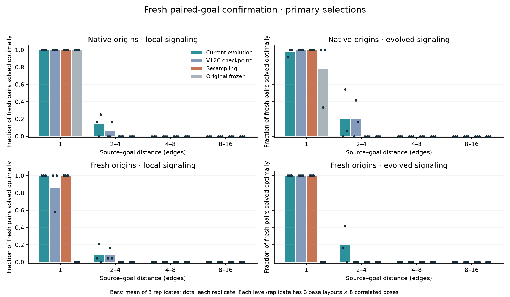
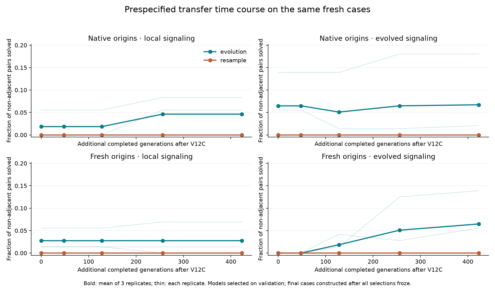
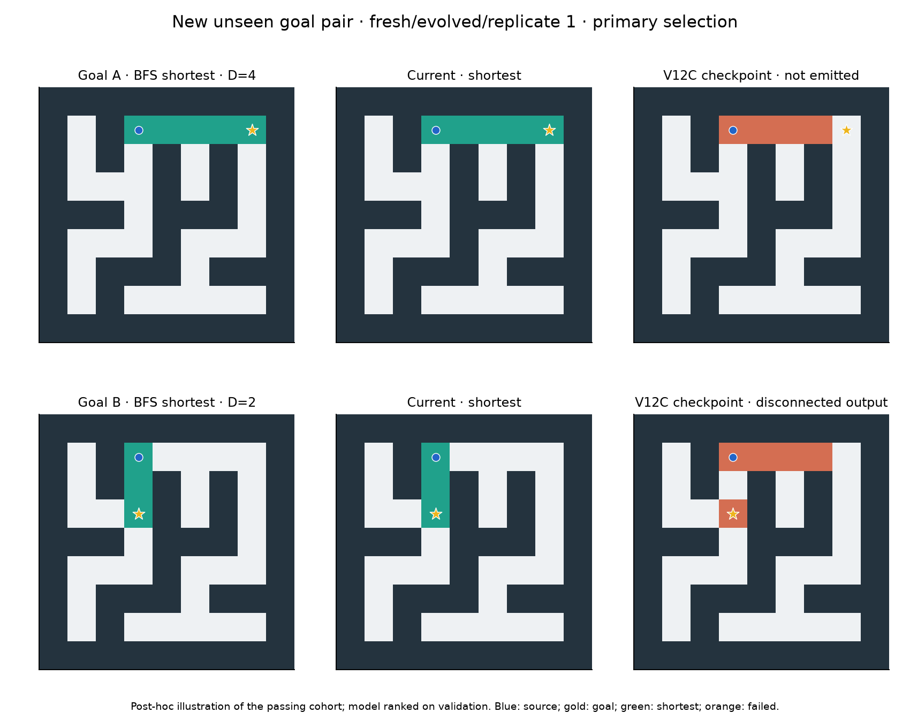
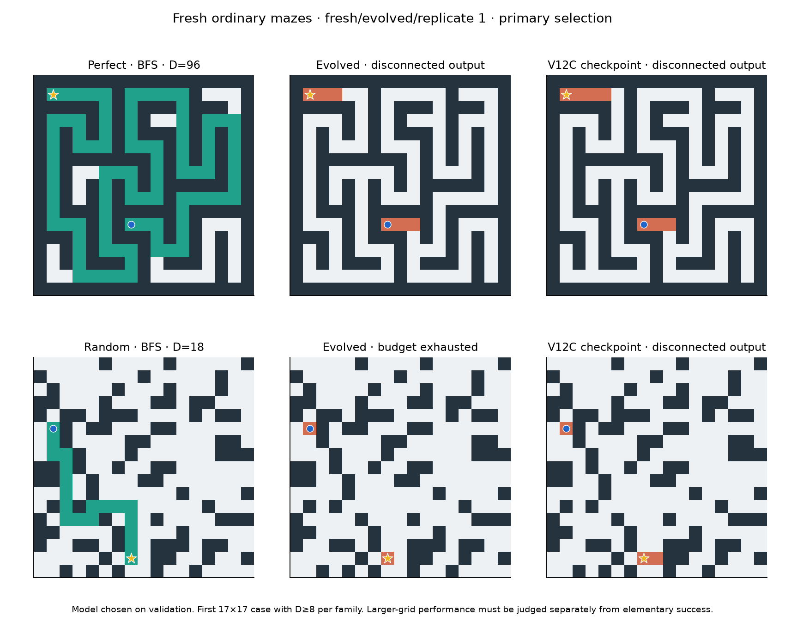

# V12D: unchanged evolution, paired transfer and retention

The continuation completed **423 additional matched generations**, from 442 to 865, in **75.32 minutes**. Termination: `wall_limit`. Cohorts passing the stronger preregistered screen: **fresh/evolved**. All 24 populations/RNG continued intact; all final selections froze before new confirmation layouts were generated.

**Additional evolutionary time produced a stronger, independently confirmed short-path result.** The fresh-origin cohort with evolvable ranges passes the preregistered screen in two of three replicates. Its complete non-adjacent pairs rise from **0/432** in the frozen V12C checkpoint to **28/432**, versus **0/432** for continued resampling. Individual non-adjacent shortest outputs rise from **30/864 to 103/864**. All three final selections retain all adjacent pairs: **144/144** across the cohort. This is evidence of transferable behavior acquired through continued random-origin evolution, with the runtime, capacity and search procedure unchanged.

The improvement includes three independent short-pair layouts solved under **all eight poses**, across two replicates: two tree layouts and one cyclic layout. Four base layouts have at least one successful pair. The scope is narrow: the all-pose pairs have two-edge routes. Twenty-four of the 28 completed pairs have two-edge routes to both goals; four pair a two-edge route with a four-edge route. No primary selection completes a pair in the dedicated 4–8-edge or 8–16-edge level. The third fresh multirange replicate still completes no non-adjacent pair. These observations support a robust short-path primitive, not a general maze-solving algorithm.

The prespecified time course reinforces the role of evolutionary time in this cohort. On the same fresh cases, models frozen at additional generations 0, 48, 128, 256, 423 complete **0,0,8,22,28 pairs**. Their individual non-adjacent shortest counts are 30,30,54,95,103. These are correlated measurements of models chosen before confirmation, not five independent holdout experiments. Fresh local evolution improves adjacent retention from 124/144 to 144/144 but remains at 12/432 non-adjacent pairs. Native local rises 8→20 pairs; native multirange 28→29. Their stronger-screen passing counts are respectively 1/3,1/3, versus 0/3 fresh local and 2/3 fresh multirange. More time helped particular lineages; it did not produce uniform progress.

**The successful cohort does not establish a causal multirange advantage.** On its 103 already successful non-adjacent elementary inputs, removing the initial goal pulse leaves 34 shortest outputs and **0/28 complete pairs**. Zeroing nonlocal read values preserves all 103 outputs and all 28 pairs. Static goal flags and endpoint-aware halting remain during pulse removal, and zeroed reads retain their work charge. The paired successes therefore depend on the initial goal pulse under this intervention; longer-range values are unnecessary for these tested successes. This does not characterize every failed input or prove that range availability played no role during evolution. It also provides no speed benefit from removing those reads, because the diagnostic deliberately keeps their charges.

Ordinary generalization remains weak. Current primary selections return shortest paths on **4/216 native local, 7/216 native multirange, 7/216 fresh local and 5/216 fresh multirange**, versus 2/216 for each resampling cohort. Every current cohort scores **0/176 at distance≥8**. The native multirange checkpoint solves one such longer case, which its continuation loses; it remains preserved as a control. Fresh multirange correctly reports no path on 1/48 disconnected inputs, matching its checkpoint; other current cohorts score 0/48. BFS, A* and bit-wavefront solve 216/216 reachable and 48/48 disconnected cases. The intact wavefront reference solves 210/216; six tree routes of 588–931 edges exceed its 1024-tick limit. No candidate receives speed credit for an invalid or incomplete route. Eligible random-origin elementary timings have a median **63.25×** runtime ratio to compiled BFS; the three fresh multirange primary comparisons span 40.69–137.33×, with median 74.57×.

The training distribution already supplied substantial longer practice: among 2,538 current-level goal endpoints counted once per pose orbit, 977 were two edges away, 739 three and 822 four. Absence of longer examples does not explain the short-range ceiling. The saved validation selection history exposes a narrower, testable issue: four of 56 primary replacements improve individual route counts while reducing complete non-adjacent pairs. One fresh multirange replacement loses its two 4–8-edge validation pairs. These are observed selection tradeoffs, not proof that a different ranking would generalize better. The full traces and populations preserve the variants for analysis and continuation.

**The next justified experiment is a matched test of complete-pair-first selection against the current ordering.** Fork the same fresh-origin populations/RNG, keep the runtime, 256-gene capacity, task schedule, local/multirange controls and compute limits fixed, and change only the priority of completed shortest pairs relative to individual successes. Retain frozen and resampling controls. Judge success on new 3–8-edge paired routes, all-pose coverage and retention of adjacent/two-edge behavior. This tests whether the useful goal-dependent primitive can be extended without repeatedly discarding paired capabilities. A bounded 75–90-minute study is now defensible; an unbounded continuation or larger genome alone is not supported by these results. Random-origin discovery remains central, and no known solver should enter its lineages. This recommendation has not been launched.

## Primary confirmation

Every elementary cell is **shortest individual outputs /288; complete shortest pairs /144**, across three replicates. Each replicate contributes six independent layouts per level, each in eight correlated poses and with two goals. Both outputs must be shortest-correct to count a pair. V12C checkpoint controls are evaluated on these same new cases; comparing this table with V12C's old test totals would confound changed cases with learning. Original frozen controls date from the beginning of V12C. “Fresh” identifies the originally random V12C cohorts and their descendants; no population was restarted for V12D. Continued resampling preserves 12 elites/niches and draws 84 new independent programs per generation; evolution preserves 12, draws 9 random immigrants and mutates 75 descendants.

| Origin/topology/selection | D=1 | D=2–4 | D=4–8 | D=8–16 | Ordinary legal; shortest | Ordinary shortest D≥8 | Correct no-path |
|---|---:|---:|---:|---:|---:|---:|---:|
| native/local/current evolution | 288/288; 144/144 | 78/288; 20/144 | 6/288; 0/144 | 0/288; 0/144 | 4/216; 4/216 | 0/176 | 0/48 |
| native/local/V12C checkpoint | 288/288; 144/144 | 64/288; 8/144 | 10/288; 0/144 | 0/288; 0/144 | 4/216; 4/216 | 0/176 | 0/48 |
| native/local/continued resampling | 288/288; 144/144 | 0/288; 0/144 | 0/288; 0/144 | 0/288; 0/144 | 2/216; 2/216 | 0/176 | 0/48 |
| native/local/original frozen | 288/288; 144/144 | 0/288; 0/144 | 0/288; 0/144 | 0/288; 0/144 | 2/216; 2/216 | 0/176 | 0/48 |
| native/evolved/current evolution | 282/288; 140/144 | 117/288; 29/144 | 4/288; 0/144 | 0/288; 0/144 | 7/216; 7/216 | 0/176 | 0/48 |
| native/evolved/V12C checkpoint | 288/288; 144/144 | 105/288; 28/144 | 2/288; 0/144 | 2/288; 0/144 | 8/216; 8/216 | 1/176 | 0/48 |
| native/evolved/continued resampling | 288/288; 144/144 | 0/288; 0/144 | 0/288; 0/144 | 0/288; 0/144 | 2/216; 2/216 | 0/176 | 0/48 |
| native/evolved/original frozen | 248/288; 112/144 | 0/288; 0/144 | 0/288; 0/144 | 0/288; 0/144 | 2/216; 2/216 | 0/176 | 0/48 |
| fresh/local/current evolution | 288/288; 144/144 | 81/288; 12/144 | 11/288; 0/144 | 0/288; 0/144 | 7/216; 7/216 | 0/176 | 0/48 |
| fresh/local/V12C checkpoint | 266/288; 124/144 | 77/288; 12/144 | 8/288; 0/144 | 2/288; 0/144 | 6/216; 6/216 | 0/176 | 0/48 |
| fresh/local/continued resampling | 288/288; 144/144 | 0/288; 0/144 | 0/288; 0/144 | 0/288; 0/144 | 2/216; 2/216 | 0/176 | 0/48 |
| fresh/local/original frozen | 0/288; 0/144 | 0/288; 0/144 | 0/288; 0/144 | 0/288; 0/144 | 0/216; 0/216 | 0/176 | 0/48 |
| fresh/evolved/current evolution | 288/288; 144/144 | 97/288; 28/144 | 5/288; 0/144 | 1/288; 0/144 | 5/216; 5/216 | 0/176 | 1/48 |
| fresh/evolved/V12C checkpoint | 288/288; 144/144 | 26/288; 0/144 | 4/288; 0/144 | 0/288; 0/144 | 4/216; 4/216 | 0/176 | 1/48 |
| fresh/evolved/continued resampling | 288/288; 144/144 | 0/288; 0/144 | 0/288; 0/144 | 0/288; 0/144 | 2/216; 2/216 | 0/176 | 0/48 |
| fresh/evolved/original frozen | 0/288; 0/144 | 0/288; 0/144 | 0/288; 0/144 | 0/288; 0/144 | 0/216; 0/216 | 0/176 | 0/48 |

| Separate reference | Ordinary legal | Ordinary shortest | Correct no-path |
|---|---:|---:|---:|
| compiled_bfs | 216/216 | 216/216 | 48/48 |
| compiled_astar | 216/216 | 216/216 | 48/48 |
| wave_bit | 216/216 | 216/216 | 48/48 |
| intact | 210/216 | 210/216 | 48/48 |

## Stronger criterion

A passing replicate needs more non-adjacent complete shortest pairs than **both** its V12C checkpoint and matched continued-resampling champion, plus at least 44/48 adjacent pairs. It also needs either a gain over both controls in level 1 base groups solved in all eight paired poses, or a gain in level 2 pairs across at least two independent level 2 layouts. A cohort needs two of three passing replicates. Different specialists cannot collectively satisfy retention. This is an exploratory screen across four cohorts, with no statistical-significance claim.

| Cohort/replicate | Non-adjacent pairs: current/checkpoint/resample (each /144) | Adjacent pairs | All-pose gain | 4–8-edge transfer gain | Pass |
|---|---:|---:|---:|---:|---:|
| native/local/r0 | 8/0/0 | 48/48 | True | False | True |
| native/local/r1 | 0/0/0 | 48/48 | False | False | False |
| native/local/r2 | 12/8/0 | 48/48 | False | False | False |
| native/evolved/r0 | 0/0/0 | 44/48 | False | False | False |
| native/evolved/r1 | 26/20/0 | 48/48 | True | False | True |
| native/evolved/r2 | 3/8/0 | 48/48 | False | False | False |
| fresh/local/r0 | 2/2/0 | 48/48 | False | False | False |
| fresh/local/r1 | 10/8/0 | 48/48 | False | False | False |
| fresh/local/r2 | 0/2/0 | 48/48 | False | False | False |
| fresh/evolved/r0 | 8/0/0 | 48/48 | True | False | True |
| fresh/evolved/r1 | 20/0/0 | 48/48 | True | False | True |
| fresh/evolved/r2 | 0/0/0 | 48/48 | False | False | False |

Full per-level, family, orientation-group, failure and per-replicate counts are in `analysis.json`. Secondary per-level archives and their checkpoint/initial counterparts remain labelled separately in raw confirmation. They never replace primary selections in the screen.

## Prespecified time course

Each cell is **non-adjacent shortest outputs /864; complete shortest pairs /432** across three replicates. These additional-generation boundaries were declared before search and selected solely from validation histories before any fresh final layouts. All time points share this same final corpus, so the measurements are correlated. The zero point is the V12C checkpoint champion.

| Cohort | +0 | +48 | +128 | +256 | +423 |
|---|---:|---:|---:|---:|---:|
| native/local/evolution | 74/864; 8/432 | 74/864; 8/432 | 73/864; 8/432 | 105/864; 20/432 | 84/864; 20/432 |
| native/local/resample | 0/864; 0/432 | 0/864; 0/432 | 0/864; 0/432 | 0/864; 0/432 | 0/864; 0/432 |
| native/evolved/evolution | 109/864; 28/432 | 109/864; 28/432 | 96/864; 22/432 | 115/864; 28/432 | 121/864; 29/432 |
| native/evolved/resample | 0/864; 0/432 | 0/864; 0/432 | 0/864; 0/432 | 0/864; 0/432 | 0/864; 0/432 |
| fresh/local/evolution | 87/864; 12/432 | 87/864; 12/432 | 87/864; 12/432 | 92/864; 12/432 | 92/864; 12/432 |
| fresh/local/resample | 0/864; 0/432 | 0/864; 0/432 | 0/864; 0/432 | 0/864; 0/432 | 0/864; 0/432 |
| fresh/evolved/evolution | 30/864; 0/432 | 30/864; 0/432 | 54/864; 8/432 | 95/864; 22/432 | 103/864; 28/432 |
| fresh/evolved/resample | 0/864; 0/432 | 0/864; 0/432 | 0/864; 0/432 | 0/864; 0/432 | 0/864; 0/432 |

## Search, ancestry and cost

The curriculum finishes at levels `[1, 1, 1]`. The original 144 validation inputs per replicate were deliberately retained for comparable archive ranks and skill certificates. Validation is reused selection data, not unseen evidence. New training uses seed 2026101816 and excludes all 52,424 older layouts, including old final cases, transformations and software fixtures. Candidate RNGs retain their ancestral states/seed; only the environment stream changes. Absolute generation phases preserve family/reflection balance, mixed-task cadence, validation slots and rotating execution order.

Capacity/runtime/fitness/selection remain unchanged: 8 channels, up to 256 genes, 256 ticks, 4096 reads and 32768 instruction dispatches per site. No known or repaired solver enters a random-origin lineage. The audit replays all new edits from the separately verified V12C parent states. `selected_ancestry` records mutation depths and roots across the continuous V12C+V12D lineage; a random immigrant is explicitly distinguished from an initial inherited founder. Syntactic dependencies, gene length and active/read counters characterize programs but do not prove functional complexity. A post-hoc reading of the existing validation records tracks every primary replacement in `primary_selection_changes.json`, including any tradeoff between individual correctness, adjacent retention and non-adjacent complete pairs. This adds no inference or selection rule.

Incremental search cost: **12,427,776 responses**, **2,196,347,479,944 dispatch-plus-read units**, **472.0 MiB peak RSS**. Each condition receives 517,824 new responses. Cumulative V12C+V12D responses: 25,754,112; cumulative work: 4,407,264,362,755. This is 75 minutes across all 24 conditions, not 75 minutes for each lineage. Warmup is separate. Small software checks and an early read-only integrity check ran during search; all such work finishes before timing. The host is Apple M4 / 16 GiB, one sequential search process, no GPU/cloud.

Fresh confirmation executes 33,912 distinct candidate/topology/budget/case combinations in 81.99s; reported aliases total 63,048. Elementary inference uses the training limits; ordinary generalization uses 1024 ticks / 8192 reads / 131072 dispatches per site. The 264 ordinary inputs include 216 reachable and 48 disconnected cases. Full rectangular/square orbits are saved and excluded, while only declared ordinary primary orientations are queried. Final exclusion total: **85,548 whole layouts**.

## Completed-output timing

Thirty randomized warm repetitions include bytes decoding, state initialization, updates and raster emission. Static model construction is reported separately. Candidate models enter a matched comparison only on shortest-correct outputs. References are timed on fixed 17×17 / 33×33 tree/cyclic cases and each selected elementary success. Ratios greater than 1 mean slower than compiled BFS. Genotypes may be primary, secondary or control selections; tiny-task timing does not establish general-solver efficiency.

| Eligible scope | Genotypes | Model/input comparisons | Median runtime / BFS | Range of per-case median ratios |
|---|---:|---:|---:|---:|
| known wavefront/ordinary | 1 | 12 | 576.32× | 98.89–2146.57× |
| random-origin/elementary | 67 | 69 | 63.25× | 14.73–624.76× |
| known wavefront/elementary | 1 | 1 | 8.84× | 8.84–8.84× |

`confirmation/timings.json` records all medians/ranges, warmups, input bytes and array payload estimates. These payload estimates differ from process RSS. Invalid or partial routes receive no speed credit.

## Verification and artifacts

Independent audit passes **380,700 new mutations**, **979,680 fitness records**, **6,274,032 graded search rasters**, all 63,840 final raster aliases and 33,912 distinct candidate replays. It checks every validation raster and every training record claiming legal output or correct no-path, plus a 1/512 sample of remaining records. Every saved fitness calculation is checked. Parent/source/input/selection hashes, ancestry, frozen controls, archive transitions, shared schedules, curriculum and response/work bounds pass. Audit cost 350.56 s / 1009.3 MiB, separately recorded. Time-course new inferences and intervention outputs have separate independent grades/replays.

Post-hoc input/range interventions, if present, condition on already successful non-adjacent outputs. Removing goal pulse leaves the static goal flag and endpoint-aware halt intact; zeroing nonlocal values retains their work charge. Interpret them as local dependence tests, not fresh accuracy or a clean multirange treatment effect. No tuning follows confirmation.

[Protocol](../docs/FOUNDATION_CONTINUATION_V12D.md) · [search packet](foundation_continuation/search_summary.json) · [confirmation](foundation_continuation/confirmation/summary.json) · [audit](foundation_continuation/verification.json) · [analysis](foundation_continuation/analysis.json). Full next populations/RNG remain in `foundation_continuation/checkpoints/` and `checkpoint.latest.json.gz`. Raw lineage/evaluation segments are immutable; a subsequent experiment needs a new protocol/output and updated exclusions.
