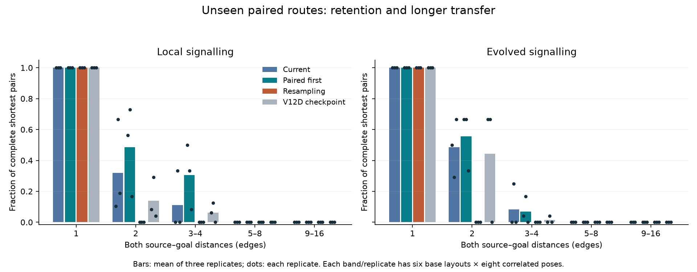
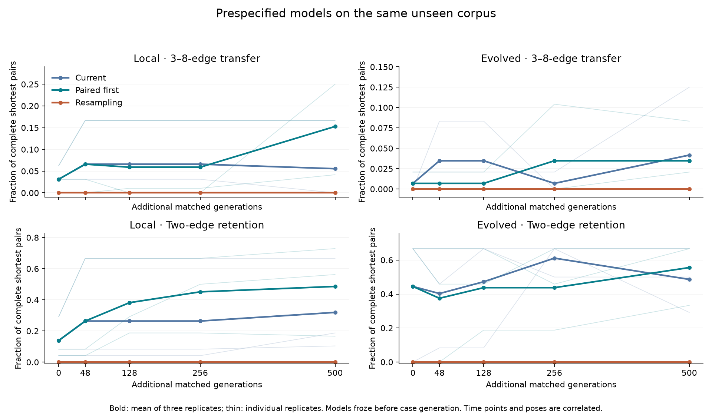
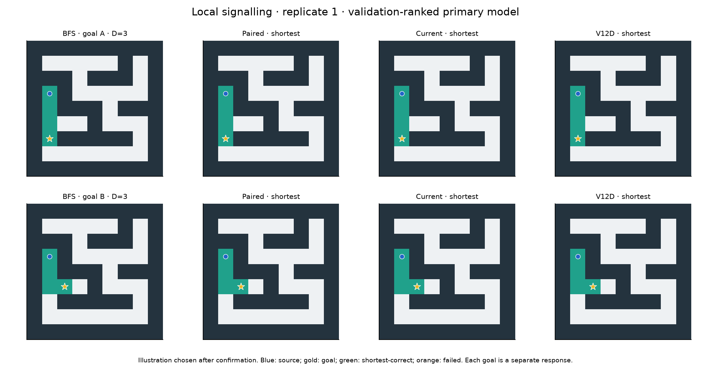
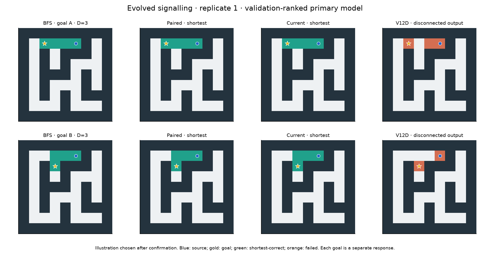
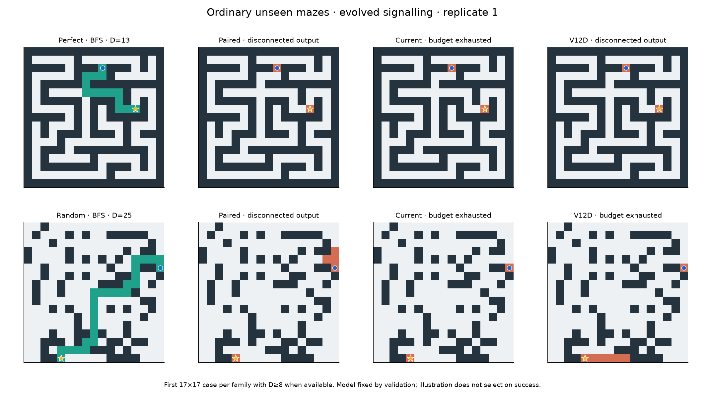
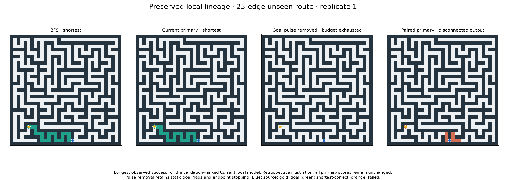

# V12E: completed-pair priority versus current selection

The matched comparison completes **500 additional generations** (865→1365) in **75.14 minutes** across 18 conditions of 96 organisms. Termination: `wall_limit`. Cohorts passing the preregistered transfer screen: **none**. All models and time-course selections froze before fresh confirmation layouts.

**The controlled comparison is informative but does not pass its replication gate.**
Paired-first selection passes the complete preregistered screen in one of three
local replicates and none of three evolved-range replicates; two were required.
There is a useful local short-route signal, alongside a different, sparse
longer-route precursor preserved by Current selection. Neither establishes a
general or competitive maze solver.

Local Paired primary selections complete **44/144 fresh 3–4-edge pairs**, versus
16/144 for Current, 9/144 for the starting V12D selections on these same cases,
and zero for resampling. These successes span eight independent base layouts;
three work in all eight paired poses. Eight successful poses have cycles in the
source component. Every completed 3–4-edge pair includes at least one route with
a turn. Exact-two pairs improve to 70/144 versus 46/144 Current and 20/144 at the
checkpoint, with all 144 adjacent pairs retained. The replicate detail matters:
Paired's challenge counts are 24,16,4 versus Current's 0,16,0. One replicate ties
Current, and the last has no all-pose challenge layout. The aggregate gain is
promising, but it does not satisfy the agreed consistency criterion. With
evolvable ranges, Paired completes 10/144 3–4-edge pairs versus Current's 12/144.
No primary selection completes a 5–8- or 9–16-edge pair.

**A preserved local lineage produces rare, much longer correct outputs.**
Current/local replicate 1 selects `foundation_study/local/fresh/evolution/1/i72095`,
born at generation 858, before this experiment. It is present in both starting
populations and becomes the common paired validation leader at generation 872 in
both arms. Current retains it; Paired later replaces it, with its final primary
replacement selected at generation 1240. On the new ordinary corpus, the old
genome emits shortest paths of **9, 24 and 25 edges**, with **2, 5 and 12 turns**,
all on trees. All three fail when the goal pulse is removed and survive nonlocal
zeroing. These are real completed rasters, independently replayed and graded.
They are not a new mutation discovered during V12E, and three successes do not
establish reliable long-route generalization. The observation also shows why
better short-pair validation scores cannot be assumed to preserve broader skills.
Current/evolved replicate 2 separately produces one eight-edge, two-turn tree
route from a V12E-born descendant; it too requires the pulse in this intervention
and survives nonlocal zeroing. Geometry is a descriptive reading of saved outputs,
not an additional holdout assay.

Mechanism remains mixed. Of local Paired's 44 successful 3–4-edge pairs, **28
remain complete without the goal pulse**. Static goal flags and endpoint-aware
stopping remain active, so this does not demonstrate independence from goal
information. Current/evolved's 12 successful 3–4-edge pairs fall to six when
nonlocal values are zeroed and to zero without the pulse. Thus some correct
paired outputs depend on nonlocal values in these contexts, while there is still
no net multirange advantage. Paired/evolved retains all ten of its 3–4-edge pairs
under nonlocal zeroing. Ablated reads retain their charges. These interventions
condition on success and do not measure a new generalization rate or identify
the complete algorithm.

The late local gain supports continuing the random-origin research. Its frozen
Paired selections at +0/+48/+128/+256/+500 generations produce 9/19/17/17/44
complete 3–8-edge pairs on this same corpus. The trajectory is non-monotonic,
and these are correlated measurements, not five independent replications. All
12 evolved primary lineages trace to random immigrants from V12C, never a known
solver; their roots were born at generations 1–81. All have 256 genes, but that
does not measure functional complexity. The selection intervention is real:
all six matched population trajectories diverge, and same-pool/same-RNG replay
finds 3,090 different parent genotypes among 450,000 actual parent draws under
the alternate ranking. That counterfactual is not another evolved replicate.

The practical limits remain large. Paired cohorts each solve 11/216 ordinary
reachable mazes and 0/179 ordinary cases at distance ≥8. Current solves 11/216
local and 13/216 evolved, including the four sparse longer successes above.
All primary cohorts solve 0/48 disconnected cases, with no false reachable
no-path claims. Compiled BFS, A* and bit-wavefront solve all reachable and
disconnected cases. Eligible random-origin elementary timings are a median
54.28× slower than compiled BFS; none of the longer random-origin successes
falls in the prespecified ordinary timing subset, so no timing claim is made
for those routes. The intact VM wavefront misses nine long ordinary tree routes
under its tick limit; that is distinct from the compiled reference results.

**Recommended next step, not launched:** independently confirm and explain the
preserved longer-route local genome before another large search. Freeze that
genome, its relevant saved predecessors and the Paired replacement; test new
goal-switched, orientation-balanced tree and cyclic layouts at longer distances,
with fixed-time trajectories and pulse/endpoint controls to distinguish useful
routing from special stopping or growth patterns. Keep all short-pair and
longer-route variants and the full population/RNG continuations. All 124,392
layouts used so far must be excluded. This is a focused mechanism and transfer
test, not a reason to abandon random-origin discovery or assume that capacity
alone will solve the remaining problem.

## Primary comparison under the same archival rule

Current and Paired evolution start from identical saved populations/RNG within each topology/replicate. The final primary model in EVERY arm uses the same validation rank: complete shortest pairs first, then individual validity/optimality/no-path and unchanged shaping/cost. This separates the breeding-policy comparison from different final archival rules. Old validation is reused selection data; all figures below use separately generated final cases unless labelled validation.

Each elementary cell is **complete shortest pairs /144**, across three replicates (six base layouts × eight correlated poses per band/replicate). Both goals lie within the stated distance band. Individual counts, failures, families, independent groups and every replicate are retained in `analysis.json` and raw outputs. The poses are not independent layouts. These bands differ from V12D; use the checkpoint on THESE cases for comparison. Source-component cycle counts are independently characterized: perfect: 0/45 base layouts have a cycle in the source component; random: 45/45 base layouts have a cycle in the source component. A random-grid family label alone is not taken as proof of a cycle in the source component.

| Topology/selection | D=1 | D=2 | D=3–4 | D=5–8 | D=9–16 | Ordinary legal; shortest | Ordinary D≥8 | Correct no-path; false claims |
|---|---:|---:|---:|---:|---:|---:|---:|---:|
| local/Current | 144/144 | 46/144 | 16/144 | 0/144 | 0/144 | 11/216; 11/216 | 3/179 | 0/48; 0/216 false |
| local/Paired | 144/144 | 70/144 | 44/144 | 0/144 | 0/144 | 11/216; 11/216 | 0/179 | 0/48; 0/216 false |
| local/Resampling | 144/144 | 0/144 | 0/144 | 0/144 | 0/144 | 3/216; 3/216 | 0/179 | 0/48; 0/216 false |
| local/V12D checkpoint | 144/144 | 20/144 | 9/144 | 0/144 | 0/144 | 11/216; 11/216 | 0/179 | 0/48; 0/216 false |
| local/Original frozen | 0/144 | 0/144 | 0/144 | 0/144 | 0/144 | 0/216; 0/216 | 0/179 | 0/48; 0/216 false |
| evolved/Current | 144/144 | 70/144 | 12/144 | 0/144 | 0/144 | 13/216; 13/216 | 1/179 | 0/48; 0/216 false |
| evolved/Paired | 144/144 | 80/144 | 10/144 | 0/144 | 0/144 | 11/216; 11/216 | 0/179 | 0/48; 0/216 false |
| evolved/Resampling | 144/144 | 0/144 | 0/144 | 0/144 | 0/144 | 3/216; 3/216 | 0/179 | 0/48; 0/216 false |
| evolved/V12D checkpoint | 144/144 | 64/144 | 2/144 | 0/144 | 0/144 | 7/216; 7/216 | 1/179 | 0/48; 0/216 false |
| evolved/Original frozen | 0/144 | 0/144 | 0/144 | 0/144 | 0/144 | 0/216; 0/216 | 0/179 | 0/48; 0/216 false |

The secondary selections below use the common ORIGINAL rank in both arms; they do not replace primary models or alter the screen.

| Topology/breeding policy | D=3–8 pairs | Non-adjacent shortest outputs | Ordinary shortest |
|---|---:|---:|---:|
| local/current | 8/288 | 195/1152 | 11/216 |
| local/paired | 42/288 | 336/1152 | 13/216 |
| evolved/current | 12/288 | 268/1152 | 13/216 |
| evolved/paired | 12/288 | 272/1152 | 11/216 |

| Separate reference | Ordinary legal | Ordinary shortest | Correct no-path |
|---|---:|---:|---:|
| compiled_bfs | 216/216 | 216/216 | 48/48 |
| compiled_astar | 216/216 | 216/216 | 48/48 |
| wave_bit | 216/216 | 216/216 | 48/48 |
| intact | 207/216 | 207/216 | 48/48 |

## Fixed transfer and retention criterion

A passing Paired primary must beat Current, the V12D checkpoint and resampling on complete 3–8-edge pairs; span at least two independent challenge layouts, including one with all eight paired poses correct; retain ≥44/48 adjacent pairs and ≥ceil(90% of its checkpoint's exact-two pairs). All requirements apply to the same genome. Two of three replicates must pass per topology. Zero two-edge baselines produce a zero threshold and are shown explicitly. This is an exploratory screen, not a significance claim.

| Replicate | D=3–8 pairs: Paired/Current/checkpoint/resample (each /96) | Adjacent | Two-edge retention | ≥2 challenge layouts | All-pose challenge layout | Pass |
|---|---:|---:|---:|---:|---:|---:|
| local/r0 | 24/0/3/0 | 48/48 | 27 ≥ 4 | True | True | True |
| local/r1 | 16/16/6/0 | 48/48 | 35 ≥ 13 | True | True | False |
| local/r2 | 4/0/0/0 | 48/48 | 8 ≥ 2 | True | False | False |
| evolved/r0 | 2/0/0/0 | 48/48 | 32 ≥ 29 | False | False | False |
| evolved/r1 | 8/12/2/0 | 48/48 | 32 ≥ 29 | True | False | False |
| evolved/r2 | 0/0/0/0 | 48/48 | 16 ≥ 0 | False | False | False |

## Prespecified same-corpus time course

Cells are **3–8-edge complete pairs /288; exact-two pairs /144**. Selections were fixed from validation histories before final-case generation; all time points reuse this corpus and are correlated.

| Cohort | +0 | +48 | +128 | +256 | +500 |
|---|---:|---:|---:|---:|---:|
| local/current/evolution | 9/288; 20/144 | 19/288; 38/144 | 19/288; 38/144 | 19/288; 38/144 | 16/288; 46/144 |
| local/paired/evolution | 9/288; 20/144 | 19/288; 38/144 | 17/288; 55/144 | 17/288; 65/144 | 44/288; 70/144 |
| local/current/resample | 0/288; 0/144 | 0/288; 0/144 | 0/288; 0/144 | 0/288; 0/144 | 0/288; 0/144 |
| evolved/current/evolution | 2/288; 64/144 | 10/288; 58/144 | 10/288; 68/144 | 2/288; 88/144 | 12/288; 70/144 |
| evolved/paired/evolution | 2/288; 64/144 | 2/288; 54/144 | 2/288; 63/144 | 10/288; 63/144 | 10/288; 80/144 |
| evolved/current/resample | 0/288; 0/144 | 0/288; 0/144 | 0/288; 0/144 | 0/288; 0/144 | 0/288; 0/144 |

## Search process and audit

Global rank changes `(V,O,N,P,S,W)`→`(P,V,O,N,S,W)` in the treatment; P counts BOTH shortest-correct emitted routes. The per-case pair field reordering is logically redundant on a fixed ordered pool because pair success implies individual correctness. Global ranking, elite/niche retention and nominee ordering can differ. `reproduction.json` reports actual exact replay and same-pool/same-RNG alternative parent choices; those counterfactuals are not another evolved trajectory. `matched_population_divergence` records differences between the actual two arms at every generation.

Every new child, its mutation events or random origin, parent draw, retained population and RNG hash replay from the verified starting states. The audit passes **756,000 new programs**, **450,000 mutations**, **868,464 fitness records**, **6,981,492 independently graded search rasters**, all **43,392 final raster aliases** and **21,584 distinct candidate replays**. Every validation raster, training success and a fixed 1/512 sample of other training records is graded; every saved fitness calculation is checked. Layout isolation, transformed labels, archive maxima, shared schedules, full continuation state, source/input hashes and work/response bounds pass. Auxiliary tests and the early integrity check are documented in `software_checks.json`.

The runtime/grammar and 8-channel/256-gene limits remain unchanged; mutation is still one requested edit. Search uses 256 ticks /4096 reads /32768 dispatches per site. Each evolution condition retains 12 elites/niches, adds 9 random immigrants and 75 descendants; resampling retains 12 and adds 84 independent programs. The common 12-input batch, four validation nominations every eighth absolute generation, and competence-driven curriculum are unchanged. Final levels: `[1, 1, 1]`. Shared curriculum transitions, if any, are reported in the raw summary. No known solver enters a random-origin lineage. Continuous C/D/E ancestry and syntactic dependency slices are saved; gene count and syntactic reachability are not proof of effective complexity.

New environment seed 2026101817, continuous candidate RNG, 85,628 earlier/fixture layouts excluded from new training. The 432 original validation responses remain explicit reused selection data. Final exclusion total: **124,392 whole layouts**, including unqueried ordinary transformations. No retuning against inspected final inputs.

## Cost and completed-output timing

Incremental search: **11,010,816 responses**, **2,181,458,317,643 dispatch-plus-read units**, **631.80 MiB peak RSS**. Parent histories are duplicated across forks and are not counted as additional compute. This is 75 minutes across all 18 conditions, not per population. Initial JIT warmup, software checks, audit, analysis, figures and Git operations are separate; small checks and the early audit ran during search and consume wall time available to all arms equally.

Confirmation: 82.09 s, 21,584 distinct candidate/model/case responses. Ordinary tests use 1024 ticks /8192 reads /131072 dispatches per site; elementary limits match training. Audit: 513.78 s, 1211.8 MiB peak. Host/dependency versions and exact counters are in the search packet. Local CPU only.

Thirty randomized warm repetitions include maze bytes decoding, state initialization, updates and emitted raster. Static model setup is separate. Only shortest-correct candidates receive matched timing comparisons; an invalid or partial output is not a faster solution. Ratios >1 mean slower than compiled BFS. Tiny-task timings do not establish general-solver efficiency.

| Eligible scope | Genotypes | Comparisons | Median runtime / BFS | Range of per-case ratios |
|---|---:|---:|---:|---:|
| known wavefront/ordinary | 1 | 12 | 331.95× | 75.69–3379.62× |
| random-origin/elementary | 23 | 23 | 54.28× | 35.14–141.99× |
| known wavefront/elementary | 1 | 1 | 8.73× | 8.73–8.73× |

Success-conditioned pulse/nonlocal interventions, if present, reuse successful final inputs. Static goal flags and endpoint halting remain during pulse removal; zeroed nonlocal values retain their work charges. These are local dependence diagnostics, not new generalization estimates or a clean topology treatment effect.

[Protocol](../docs/FOUNDATION_PAIR_V12E.md) · [search](foundation_pair/search_summary.json) · [confirmation](foundation_pair/confirmation/summary.json) · [audit](foundation_pair/verification.json) · [reproduction](foundation_pair/reproduction.json) · [analysis](foundation_pair/analysis.json). Full next populations/RNG and all raw lineage/evaluation data remain saved. A subsequent study needs a new protocol and all updated layout exclusions.
