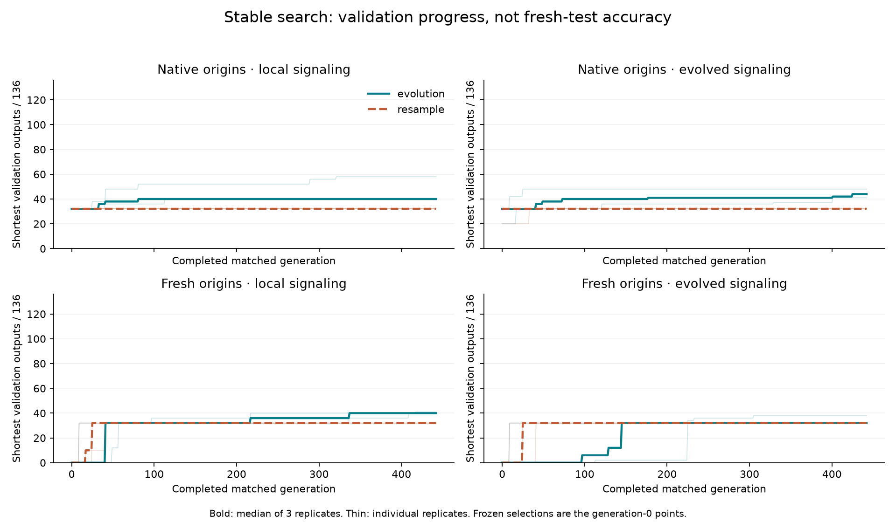
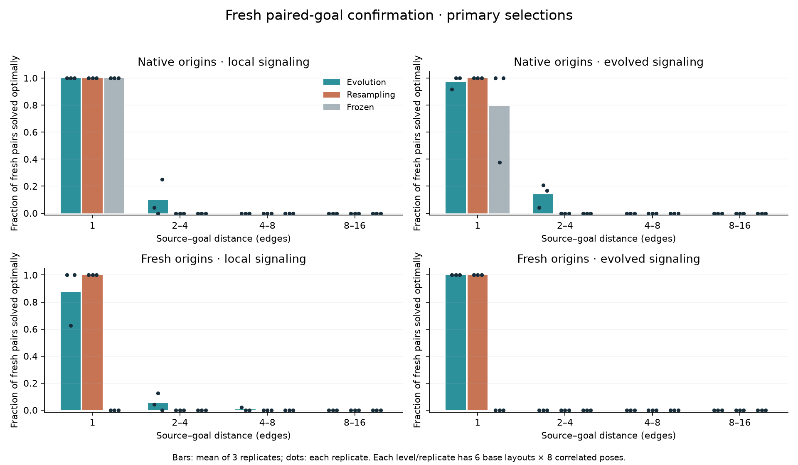
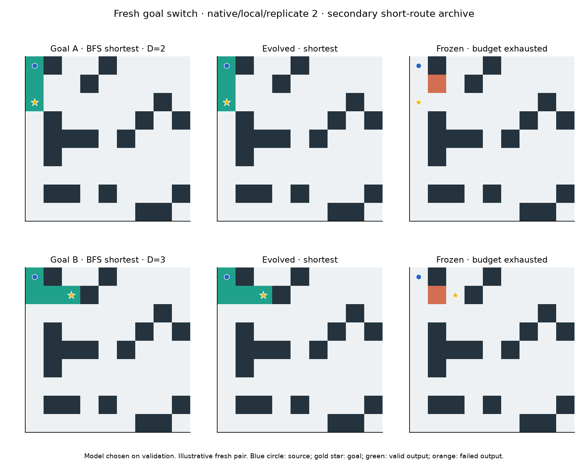
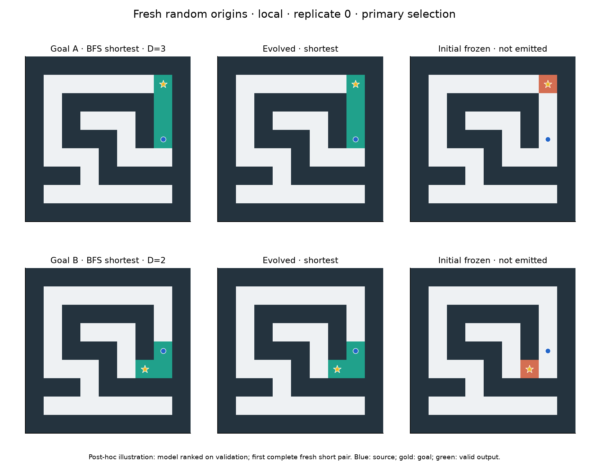
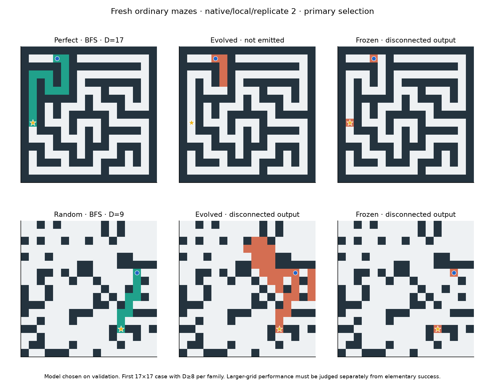

# V12C: stable random-origin search and fresh confirmation

The preregistered search completed **442 matched generations in 75.15 minutes** across 24 conditions. Termination: `wall_limit`. All selected genomes were frozen before fresh layouts were generated. Cohorts passing the elementary screen: **fresh/local**. The per-replicate evidence is below. These are bounded screening outcomes, not evidence of general or competitive maze solving.

**This is a real but narrow advance for random-origin discovery.** Fresh local populations meet the predefined elementary screen in two of three replicates: their final primary selections produce 86/864 shortest non-adjacent outputs and 9/432 complete shortest goal pairs, compared with zero for matched resampling and initial frozen controls. Those nine pairs span five independent base layouts across two replicates; their rotations are correlated observations. Both goals require correct, different route rasters. This is stronger evidence than an increase in a signalling proxy or a validation-only choice. It is still only 2.1% of the tested non-adjacent pairs, with no successful base group working under every symmetry in this cohort.

**More evolutionary time helped within this fixed recipe.** Fresh local primary selections score 0, 8, 36 and 86 non-adjacent outputs at generations 48,128,256 and 442; complete pairs increase 0,0,2,9. The corresponding resampling controls stay at zero. The earlier models were frozen before the final cases existed, so this comparison does not choose favorable checkpoints using test accuracy. A48-generation pilot would have missed the eventual fresh-origin result. These are correlated time points on one confirmation set, however. They do not isolate longer time from the ordinary-development fitness, mutation and population-policy changes relative to V11. Nor do they prove that further time must keep helping.

**The strongest mission claim remains unsupported.** On ordinary mazes, primary evolved cohorts solve only 3–7/216 reachable cases, all 1–5 edges long, and every cohort solves 0/181 ordinary distance≥8 cases and 0/48 disconnected cases. BFS, A* and bit-wavefront solve 216/216 and 48/48. The separate known wavefront program solves 209/216 and 48/48; its seven failures are long tree paths beyond the 1024-tick cap, consistent with its two-stage development. No candidate qualifies for the predetermined ordinary timing cases. Eligible tiny-task candidate timings are 16.70–610.92× slower than BFS, with a 48.95× median of matched-case median ratios. This supports continued emergence research, not a claim that we have a general or competitive solver.

The ordinary tree/cyclic distinction does not hide a broader success:

| Primary evolved cohort | Tree shortest /96 | Cyclic shortest /96 | Rectangular shortest /24 |
|---|---:|---:|---:|
| Native local | 2 | 4 | 0 |
| Native multirange | 3 | 3 | 0 |
| Fresh local | 4 | 3 | 0 |
| Fresh multirange | 1 | 2 | 0 |
| Each resampling cohort | 0 | 2 | 0 |
| Each conventional reference | 96 | 96 | 24 |

The displayed 17×17 examples show the failure concretely: the strongest validation-selected primary program grows a short fragment on a tree and a disconnected, overgrown raster on a cyclic maze. Neither is a completed path. The illustrative fresh-origin pair is much easier: one three-edge straight route and one two-edge route with a turn from the same source. It demonstrates a limited capability without concealing the distance gap. Figures are selected illustrations, not additional tests; the fresh-origin illustration was added after results were known, with its model chosen by frozen validation rank and the first complete short pair shown.

**Goal information contributes, while a multirange benefit remains unestablished.** Post-hoc interventions reuse 680 distinct successful non-adjacent model/input combinations across primary and secondary selections. Ordinary replay retains 680 shortest routes; removing the initial goal pulse retains 277, zeroing nonlocal read values retains 672, and doing both retains 273. All 2,720 intervention rasters are independently graded. For fresh local primary elementary successes specifically, goal-pulse removal retains 60/86, losing 26; nonlocal ablation changes none, as expected for a local model. Static goal flags and the endpoint-aware runtime halt remain available when the pulse is removed. These assays therefore demonstrate dependence on particular inputs, not a complete explanation of the algorithm or proof that surviving routes ignore the goal. They are conditioned on successes and cannot estimate an overall ablation accuracy.

Some multirange routes do require their nonlocal values: eight of the 680 selected successful combinations fail when those values are zeroed. That is a mechanism-level observation, not a net topology advantage. Fresh multirange populations finish with 30/864 non-adjacent outputs and 0/432 pairs, versus 86 and 9 for fresh local. Native multirange has more pooled pairs than native local, but only one replicate passes its screen and the native topology cohorts have different histories. The multirange track and all its checkpoints remain preserved.

**Capacity was available; effective complexity is still uncertain.** Search reaches the 256-gene ceiling. The three fresh local primary programs contain 167,255 and 185 genes and descend from independent random immigrants introduced during this run, with 131,222 and 146 logged mutation steps along their selected lineages. They are not known-solver descendants. Those counts describe ancestry, not the number of beneficial or necessary changes. Conservative output/stop dependency scans flag 37,35 and 58 potentially relevant genes respectively; they do not model all effects on quiescence or establish that the rest can be removed safely. On the last training batch, fresh local populations contain only 24–28 distinct output/status behaviors among 96 organisms despite much higher genotype diversity. More genome space alone is therefore not an established remedy.

Retention and orientation are concrete weaknesses. Fresh local primary selections retain 270/288 individual adjacent routes but only 126/144 complete adjacent pairs; one replicate sacrifices earlier behavior. No replicate advances past the 2–4-edge curriculum stage. The shared schedule advanced at generation 20 using an inherited population's certificate, before every fresh population had mastered adjacency. This is a documented fairness/learning tradeoff. Fixed validation also contains only two independent layouts per level per replicate, repeatedly consulted for hundreds of generations; the larger fresh set is essential. Ordinary disconnected cases retain the earlier corner/partition construction bias, so even a future positive there would need a broader disconnection test.

**The next experiment should be one unchanged 75-minute continuation.** The fresh local transfer curve is still improving, so changing the objective or adding channels immediately would make the next gain harder to interpret. Fork all 24 final next-population/RNG checkpoints, retain the existing local/multirange and evolution/resampling comparisons, and freeze today's primary selections as additional controls. Keep 8 channels,256 genes, the single-edit operator, ordinary stopping, task schedule and selection policy fixed. Generate new training layouts and reserve entirely new final orbits, excluding all 52,424 layouts now recorded. Do not inject any known solver or select parents using these inspected confirmation cases.

Before that continuation, preregister a stronger decision criterion: improvement in complete non-adjacent pairs over both today's frozen selections and continued resampling in at least two replicates of a cohort, plus improved all-symmetry short-pair coverage or 4–8-edge paired transfer while each passing replicate retains at least 90% of adjacent pairs. Report individual shortest paths, family/distance results and total work regardless of whether the criterion passes. Stop at the fixed budget. The current run justifies this further bounded time test; it does not justify open-ended compute, a larger genome ceiling or a GPU rewrite yet. If the unchanged recipe stalls, the evidence will support a separate controlled test of paired-skill retention rather than another unmeasured increase in complexity.

Calibration and verification are complete. V12A established intact-runtime correctness but failed its repair gate; V12B selected the single-edit policy on validation and confirmed 3/3 west-return,2/3 output-register and 1/3 two-return repairs. These control descendants never entered random-origin populations. V12C search used 75.15 min and 436.0MiB peak RSS; fresh confirmation 48.73 s; main independent audit 283.59 s and 726.8MiB peak; earlier-selection freeze 26.78 s; time-course evaluation/replay 10.53 s; interventions 1.99 s. The main study and these checks total about 81.35 min, excluding separate software testing, plotting and earlier calibration. Project verification is 136 full-suite passes plus the subsequently added time-course test passing separately (137 current tests covered). All full populations, RNG states, ancestry and raw rasters remain available for deterministic continuation.

Native V11 populations and separately labelled fresh random populations were compared under local and evolved-range topologies. Evolution/resampling shared founders, initial RNG, tasks and response counts. Resampling retained 12 elites and drew 84 independent programs; evolution retained 12, introduced 9 random immigrants and made 75 single-edit children. Frozen controls are initial validation selections. Known/repaired solver controls never entered these lineages.

Each elementary cell below is **shortest outputs /288; complete shortest pairs /144**, pooled across three replicates. Each replicate contributes six independent base layouts per level, each under eight symmetries and two goals. The pooled 288 responses are therefore not 288 independent layouts. The ordinary column is **legal /216; shortest /216**, using 72 independent reachable cases per replicate; the no-path column uses 16 disconnected cases per replicate. Primary global selections are used throughout this table.

| Cohort | D=1 | D=2–4 | D=4–8 | D=8–16 | Ordinary legal; shortest | Correct no-path |
|---|---:|---:|---:|---:|---:|---:|
| native/local/evolution | 288/288; 144/144 | 94/288; 14/144 | 8/288; 0/144 | 0/288; 0/144 | 6/216; 6/216 | 0/48 |
| native/local/resampling | 288/288; 144/144 | 0/288; 0/144 | 0/288; 0/144 | 0/288; 0/144 | 2/216; 2/216 | 0/48 |
| native/local/frozen | 288/288; 144/144 | 0/288; 0/144 | 0/288; 0/144 | 0/288; 0/144 | 2/216; 2/216 | 0/48 |
| native/evolved/evolution | 284/288; 140/144 | 102/288; 20/144 | 4/288; 0/144 | 2/288; 0/144 | 6/216; 6/216 | 0/48 |
| native/evolved/resampling | 288/288; 144/144 | 0/288; 0/144 | 0/288; 0/144 | 0/288; 0/144 | 2/216; 2/216 | 0/48 |
| native/evolved/frozen | 246/288; 114/144 | 0/288; 0/144 | 0/288; 0/144 | 0/288; 0/144 | 1/216; 1/216 | 0/48 |
| fresh/local/evolution | 270/288; 126/144 | 71/288; 8/144 | 13/288; 1/144 | 2/288; 0/144 | 7/216; 7/216 | 0/48 |
| fresh/local/resampling | 288/288; 144/144 | 0/288; 0/144 | 0/288; 0/144 | 0/288; 0/144 | 2/216; 2/216 | 0/48 |
| fresh/local/frozen | 0/288; 0/144 | 0/288; 0/144 | 0/288; 0/144 | 0/288; 0/144 | 0/216; 0/216 | 0/48 |
| fresh/evolved/evolution | 288/288; 144/144 | 30/288; 0/144 | 0/288; 0/144 | 0/288; 0/144 | 3/216; 3/216 | 0/48 |
| fresh/evolved/resampling | 288/288; 144/144 | 0/288; 0/144 | 0/288; 0/144 | 0/288; 0/144 | 2/216; 2/216 | 0/48 |
| fresh/evolved/frozen | 0/288; 0/144 | 0/288; 0/144 | 0/288; 0/144 | 0/288; 0/144 | 0/216; 0/216 | 0/48 |

| Separate reference | Ordinary legal | Ordinary shortest | Correct no-path |
|---|---:|---:|---:|
| compiled_bfs | 216/216 | 216/216 | 48/48 |
| compiled_astar | 216/216 | 216/216 | 48/48 |
| wave_bit | 216/216 | 216/216 | 48/48 |
| intact | 209/216 | 209/216 | 48/48 |

The per-replicate screen requires more shortest non-adjacent outputs than both matched resampling and frozen controls, plus at least one complete shortest pair in at least two independent base groups. At least two replicates in a cohort must pass. This is a descriptive screen with several cohort comparisons, not a hypothesis-test p-value. Pose correlations and shared task exposure are retained in the raw data.

| Cohort/replicate | Evolved non-adjacent | Resampled | Frozen | Evolved groups with a complete pair | Pass |
|---|---:|---:|---:|---:|---:|
| native/local/r0 | 26/288 | 0/288 | 0/288 | 1/18 | False |
| native/local/r1 | 12/288 | 0/288 | 0/288 | 0/18 | False |
| native/local/r2 | 64/288 | 0/288 | 0/288 | 2/18 | True |
| native/evolved/r0 | 30/288 | 0/288 | 0/288 | 1/18 | False |
| native/evolved/r1 | 38/288 | 0/288 | 0/288 | 2/18 | True |
| native/evolved/r2 | 40/288 | 0/288 | 0/288 | 1/18 | False |
| fresh/local/r0 | 22/288 | 0/288 | 0/288 | 3/18 | True |
| fresh/local/r1 | 34/288 | 0/288 | 0/288 | 2/18 | True |
| fresh/local/r2 | 30/288 | 0/288 | 0/288 | 0/18 | False |
| fresh/evolved/r0 | 12/288 | 0/288 | 0/288 | 0/18 | False |
| fresh/evolved/r1 | 18/288 | 0/288 | 0/288 | 0/18 | False |
| fresh/evolved/r2 | 0/288 | 0/288 | 0/288 | 0/18 | False |

Secondary transfer time course: added during training before any final layouts existed. Earlier validation selections were frozen and hashed before confirmation. Each cell is shortest non-adjacent outputs /864; complete shortest pairs /432 across three replicates. All time points reuse the same fresh cases, so they are correlated measurements, not independent replications.

| Cohort | g0 | g48 | g128 | g256 | g442 |
|---|---:|---:|---:|---:|---:|
| native/local/evolution | 0/864; 0/432 | 64/864; 10/432 | 76/864; 8/432 | 76/864; 8/432 | 102/864; 14/432 |
| native/local/resample | 0/864; 0/432 | 0/864; 0/432 | 0/864; 0/432 | 0/864; 0/432 | 0/864; 0/432 |
| native/evolved/evolution | 0/864; 0/432 | 59/864; 10/432 | 66/864; 10/432 | 75/864; 10/432 | 108/864; 20/432 |
| native/evolved/resample | 0/864; 0/432 | 0/864; 0/432 | 0/864; 0/432 | 0/864; 0/432 | 0/864; 0/432 |
| fresh/local/evolution | 0/864; 0/432 | 0/864; 0/432 | 8/864; 0/432 | 36/864; 2/432 | 86/864; 9/432 |
| fresh/local/resample | 0/864; 0/432 | 0/864; 0/432 | 0/864; 0/432 | 0/864; 0/432 | 0/864; 0/432 |
| fresh/evolved/evolution | 0/864; 0/432 | 0/864; 0/432 | 2/864; 0/432 | 16/864; 0/432 | 30/864; 0/432 |
| fresh/evolved/resample | 0/864; 0/432 | 0/864; 0/432 | 0/864; 0/432 | 0/864; 0/432 | 0/864; 0/432 |

Secondary per-level archives and their own frozen counterparts are in `analysis.json` and raw `confirmation/outputs.jsonl.gz`; they are never substituted for primary results. 105 distinct selected genotypes underlie the many report aliases. The primary ordinary corpus contains 0 successful distance≥8 outputs across all evolution/resampling condition selections; these aliases are not independent algorithm discoveries. Inspect their explicit case/distance distributions before attributing generality.

The common curriculum finishes at levels `[1, 1, 1]`. Four current-task rotations were combined with earlier-skill practice and next-level previews, with an explicit disconnected task every eighth generation. Advancement required one candidate to retain earlier paired skills while solving≥90% of current validation pairs. A certificate from any of the eight conditions advanced that replicate's shared schedule, so weaker populations could encounter harder tasks before their own mastery. This design tests a stable search recipe; it does not isolate every change from older studies.

Training used ordinary stopping and bidirectional partial-path credit, never forced tick-16 probes. The runtime remains 8 channels and at most 256 genes. Evaluated genomes reached 256 genes; registered/prepared genomes reached 256. Gene count and proxy-score gains are not evidence of an effective algorithm. `analysis.json` gives selected mutation depths, whether the current-study root was an inherited founder or random immigrant, active/dispatch counts and nonlocal reads. Reading a nonlocal channel alone does not establish a causal multirange advantage.

Search cost: **13,326,336 ordinary responses**, **2,210,916,882,811 dispatch-plus-read units**, **436.0 MiB peak process RSS**. Every condition receives the same number of responses; different programs consume different instructions/time within those slots. This is a 75-minute total study, not 75 minutes per lineage. The bounded total was distributed across 24 conditions. Full prepared populations/RNG and all raw traces are saved for continuation.

Fresh confirmation executes 25,456 distinct program/topology/budget/case combinations, with 42,504 reported aliases, in 48.73s. Elementary limits equal training: 256 ticks/4096 reads/32768 dispatches per site. Ordinary stress tests use 1024/8192/131072. Reference solvers emit complete rasters. Warm timing includes maze decoding, state initialization, updates and raster output; static program setup is separate. Thirty repeated timings, ranges, memory payload estimates and input-byte counts are in `confirmation/timings.json`. Failed routes receive no speed credit. No broad superiority claim follows from tiny-task timings.

| Eligible timing scope | Distinct genotypes | Model/input comparisons | Median runtime / BFS | Range of per-case median ratios |
|---|---:|---:|---:|---:|
| known wavefront control/ordinary | 1 | 12 | 389.50× | 138.81–1526.07× |
| random-origin/elementary | 43 | 45 | 48.95× | 16.70–610.92× |
| known wavefront control/elementary | 1 | 1 | 12.27× | 12.27–12.27× |

Ratios above1 are slower. Only correctly completed shortest outputs enter these matched-case comparisons; omitted scopes have no eligible candidate. Random-origin timings can include secondary or initial selections and are not a claim about every population member. The reference's30 warm repetitions on each selected case provide the denominator. Input arrays and emitted rasters are included; payload memory estimates and peak process RSS are different quantities. The host is an Apple M4 with16GiB RAM, using one sequential search process and no GPU/cloud. Software checks and a read-only ancestry audit ran concurrently during portions of search; fresh timings follow their completion.

Independent audit: **1,026,048 fitness records**, **397,800 mutation traces**, **5,972,328 independently graded search rasters**, every final raster and 25,456 distinct candidate replays. All pass, including source/input/selection hashes, founder identity, exact archives, layout exclusion and response/work bounds. Audit cost 283.59s, separately charged. Validation and every training record claiming a valid route or correct no-path are fully checked; the remaining training masks use the preregistered deterministic 1/512 record sample. All saved row-to-fitness arithmetic is checked.

Seed 2026101815; preregistration commit `74b2588`. Search excludes 17,748 previous whole layouts; final confirmation also excludes all search/validation layouts and eight software-only rectangle-transform fixtures created after launch. Those fixtures had no candidate inference and cannot overlap square training tasks. Final total exclusion count: **52,424 whole layouts**. All rotations/reflections are excluded, including constructed but unqueried ordinary poses.

Calibration preceding this run is retained separately: V12A fails its repair gate; V12B passes after testing single versus 1–6 edits on orientation-balanced batches. That evidence supports bounded searchability, not solver injection or random-origin success by itself.

Protocol: [V12C](../docs/FOUNDATION_STUDY_V12C.md). [Search packet](foundation_study/search_summary.json), [fresh confirmation](foundation_study/confirmation/summary.json), [independent audit](foundation_study/verification.json), [analysis](foundation_study/analysis.json).
