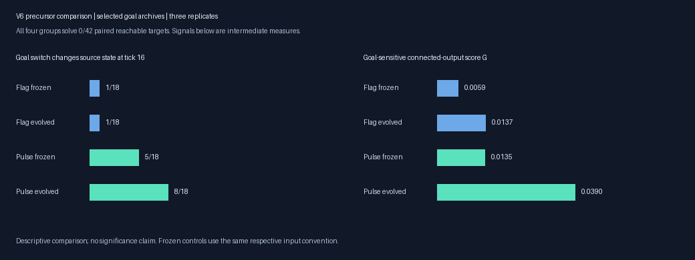
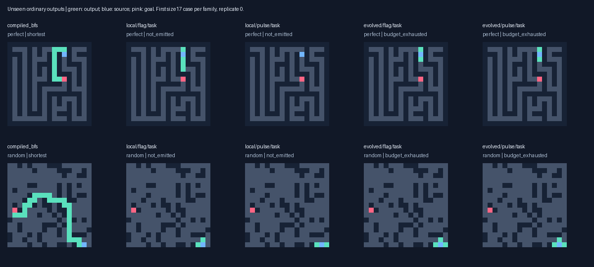
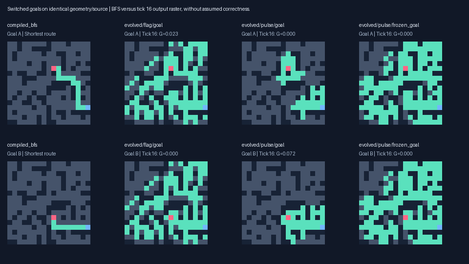

# Goal-state pulse experiment: V6

The evolved-range Pulse task archives solve **0/216** unseen shortest routes versus **0/216** with Flag inputs and **0/216** for the frozen Pulse controls. Local Pulse solves 2/216. Evolved Pulse solves 0/178 at distance ≥8 and 0/42 on independent paired targets. These counts concern completed ordinary outputs, separate from diagnostic communication scores.

Goal-selected multirange Pulse genomes improve the independent paired-output score G from 0.0135 frozen to 0.0390 after evolution, versus 0.0137 for Flag. At tick 16, switched goals change source state in 8/18 regular pairs versus 5/18 frozen Pulse and 1/18 Flag. For the same evolved Pulse genomes, removing the initial goal pulse reduces G to zero; disabling nonlocal reads also reduces G to zero. This supports learned use of both inputs in intermediate goal-specific output on this set. It does not establish completed route solving.

The preregistered extension gate was **False** after 48 generations. Three replicates per condition support descriptive comparisons; this is not a statistical significance claim.



## One controlled stimulus change

Flag uses exactly the prior public input: channel 0=1 at the source, plus source and goal flags. Pulse additionally initializes channel 1=1 at the goal. The primitive loop, eight channels, 128-gene ceiling, ranges, halting and V5 product reward stay fixed. A pulse is a stimulus, not a known propagation or path rule. The full Flag runtime and observer passed exact output/state/work parity tests against V2/V3, and the product fitness matched V5. Source-removal probes retain both goal inputs.

Each topology/replicate starts from the V5 product next population/RNG, with validation-selected task, goal and transmission archives from **both** V5 arms plus ancestral protected elites, deduplicated and protected equally in both V6 arms. Missing variants replace documented final nonprotected slots. Archive fields, not final-test successes, determine preservation. Initial genotype sequences match within each comparison. No known solver seed enters a random-origin lineage. Frozen task/goal controls are selected separately under each input convention, accounting for an immediate stimulus benefit without evolution.

The common product reward adds source-dependent transmission and 2 sqrt(Q S) to ordinary partial output, after completed legality/optimality/no-path criteria. Q measures source-dependent connected growth with branch penalties; S measures progress specifically toward the current goal compared with the alternative goal on identical geometry. Task archives use normal route fitness with no probe reward. Failed candidates carry no cost/length tie-break. New validation archives never automatically re-enter reproduction.

Seed 2026101804; 96 organisms × twelve conditions; nine new random immigrants/generation, 1–6 mutation edits, epsilon lexicase and phenotype niches. Training caps: 256 ticks/4096 reads/32768 dispatches per site; validation/final: 1024/8192/131072. Probes use aligned tick 16 with both source-present and source-removed responses; all probe work is charged. Oracle distances stay outside candidate inference.

All V1–V5 whole layouts were excluded. New Wilson 9×9 trees, larger DFS trees, cyclic random, disconnected and rectangular mazes were generated with shared rules across arms. Training switches size 9 to 17 after generation 23; validation has divergent goals and reachable distances≥8. The study generated 264 primary layouts and 24 paired layouts after model freeze in its own process. The paired reachable inputs all have distance≥8. See [preregistered protocol](../docs/BEACON_STUDY_V6.md).

**Protocol deviation:** the construction-only unit test used the study seed before training, so some layouts had already been constructed in a separate test process. That preflight evaluated no candidate genome or output; its function was to check whole-layout exclusion and generator capacity. Actual final outputs were first evaluated after all archives froze. No model was selected or tuned using preflight performance. The freeze-before-generation wording was therefore not literal; `protocol_notes.json` records the test and source hash. Future construction tests should use a separate seed.

## Validation extension decision

The fixed gate requires either at least two additional shortest routes versus both frozen Pulse and evolved Flag in a topology, or sufficiently large replicated gains in G,Q,S with both-goal qualification, both maze families and retained transmission. These are validation results, not final accuracy.

| Topology | Rep | Frozen Pulse G | Flag G | Pulse G | Pulse Q | Pulse S | Both | Pass |
|---|---:|---:|---:|---:|---:|---:|---:|---|
| local | 0 | 0.0123 | 0.0000 | 0.0123 | 0.0449 | 0.0104 | 0.000 | False |
| local | 1 | 0.0000 | 0.0000 | 0.0000 | 0.0863 | 0.0000 | 0.000 | False |
| local | 2 | 0.0784 | 0.0784 | 0.0784 | 0.0463 | 0.1897 | 0.250 | False |
| evolved | 0 | 0.0018 | 0.0033 | 0.0554 | 0.0237 | 0.1879 | 0.250 | False |
| evolved | 1 | 0.0377 | 0.0123 | 0.0589 | 0.0194 | 0.1892 | 0.000 | False |
| evolved | 2 | 0.0616 | 0.0748 | 0.1117 | 0.0475 | 0.4167 | 0.000 | False |

## Fresh completed paths

| Archive | Valid | Shortest | Distance≥8 shortest | Correct no-path |
|---|---:|---:|---:|---:|
| compiled_astar | 216/216 | 216 | 178/178 | 48/48 |
| compiled_bfs | 216/216 | 216 | 178/178 | 48/48 |
| evolved/flag/frozen_goal | 0/216 | 0 | 0/178 | 0/48 |
| evolved/flag/frozen_task | 0/216 | 0 | 0/178 | 12/48 |
| evolved/flag/goal | 0/216 | 0 | 0/178 | 0/48 |
| evolved/flag/task | 0/216 | 0 | 0/178 | 12/48 |
| evolved/pulse/frozen_goal | 0/216 | 0 | 0/178 | 0/48 |
| evolved/pulse/frozen_task | 0/216 | 0 | 0/178 | 0/48 |
| evolved/pulse/goal | 0/216 | 0 | 0/178 | 0/48 |
| evolved/pulse/task | 0/216 | 0 | 0/178 | 0/48 |
| local/flag/frozen_goal | 2/216 | 2 | 0/178 | 0/48 |
| local/flag/frozen_task | 2/216 | 2 | 0/178 | 16/48 |
| local/flag/goal | 2/216 | 2 | 0/178 | 0/48 |
| local/flag/task | 2/216 | 2 | 0/178 | 16/48 |
| local/pulse/frozen_goal | 2/216 | 2 | 0/178 | 0/48 |
| local/pulse/frozen_task | 2/216 | 2 | 0/178 | 16/48 |
| local/pulse/goal | 2/216 | 2 | 0/178 | 0/48 |
| local/pulse/task | 2/216 | 2 | 0/178 | 16/48 |
| wave_bit | 216/216 | 216 | 178/178 | 48/48 |

Labels may select the same genome; repeated archive outputs are not independent discoveries. Perfect mazes are trees, while random mazes can contain cycles. Per-family and per-size data are in the summary JSON/CSV. No-path results must be interpreted with false claims and generator structure: many disconnected test layouts have a fixed corner source and separating wall.

| Task archive | Turn-required shortest | Mandatory-detour shortest | False no-path on reachable |
|---|---:|---:|---:|
| compiled_bfs | 191/191 | 133/133 | 0/216 |
| local/flag/task | 1/191 | 0/133 | 0/216 |
| local/pulse/task | 1/191 | 0/133 | 0/216 |
| evolved/flag/task | 0/191 | 0/133 | 0/216 |
| evolved/pulse/task | 0/191 | 0/133 | 0/216 |

The two local successes are a seven-edge path with one turn on a fresh 9×9 tree, and a two-edge straight path on a 17×17 tree. Both already occur in the initial frozen selections; they are useful inherited random-origin behavior, without a new V6 route-accuracy gain.


Turn-required means the endpoints differ in both coordinates; mandatory detour means oracle distance exceeds Manhattan distance. These diagnostic subsets are computed after selection. Legal path shapes and exact case identifiers are saved in `success_shapes.json`.



## Independent goal-pair outputs and precursor measures

Normal correctness remains separate from probe G,Q,S and source transmission. G,Q,S average all paired inputs; unreachable/unaligned cases get no new bonus. Source transmission averages reachable inputs. Both-direction qualification uses regular divergent-goal pairs and is a proxy, not a legal-path metric.

| Archive | Normal shortest | Correct no-path | G | Q | S | Both | Source signal |
|---|---:|---:|---:|---:|---:|---:|---:|
| compiled_astar | 42/42 | 6/6 | — | — | — | — | — |
| compiled_bfs | 42/42 | 6/6 | — | — | — | — | — |
| evolved/flag/frozen_goal | 0/42 | 0/6 | 0.0059 | 0.0116 | 0.0343 | 0.0000 | 0.5567 |
| evolved/flag/frozen_task | 0/42 | 2/6 | 0.0000 | 0.0000 | 0.0000 | 0.0000 | 0.4980 |
| evolved/flag/goal | 0/42 | 0/6 | 0.0137 | 0.0120 | 0.0522 | 0.0000 | 0.3867 |
| evolved/flag/task | 0/42 | 2/6 | 0.0000 | 0.0000 | 0.0000 | 0.0000 | 0.4980 |
| evolved/pulse/frozen_goal | 0/42 | 0/6 | 0.0135 | 0.0084 | 0.0789 | 0.0000 | 0.5368 |
| evolved/pulse/frozen_task | 0/42 | 0/6 | 0.0016 | 0.0007 | 0.0055 | 0.0000 | 0.5316 |
| evolved/pulse/goal | 0/42 | 0/6 | 0.0390 | 0.0223 | 0.1371 | 0.0000 | 0.5668 |
| evolved/pulse/task | 0/42 | 0/6 | 0.0016 | 0.0007 | 0.0055 | 0.0000 | 0.5316 |
| local/flag/frozen_goal | 0/42 | 0/6 | 0.0052 | 0.0664 | 0.0124 | 0.0000 | 0.5601 |
| local/flag/frozen_task | 0/42 | 2/6 | 0.0000 | 0.0708 | 0.0000 | 0.0000 | 0.5596 |
| local/flag/goal | 0/42 | 0/6 | 0.0052 | 0.0664 | 0.0124 | 0.0000 | 0.5601 |
| local/flag/task | 0/42 | 2/6 | 0.0000 | 0.0841 | 0.0000 | 0.0000 | 0.5601 |
| local/pulse/frozen_goal | 0/42 | 0/6 | 0.0052 | 0.0703 | 0.0124 | 0.0000 | 0.5601 |
| local/pulse/frozen_task | 0/42 | 2/6 | 0.0000 | 0.0708 | 0.0000 | 0.0000 | 0.5596 |
| local/pulse/goal | 0/42 | 0/6 | 0.0052 | 0.0703 | 0.0124 | 0.0000 | 0.5601 |
| local/pulse/task | 0/42 | 2/6 | 0.0000 | 0.0708 | 0.0000 | 0.0000 | 0.5596 |
| wave_bit | 42/42 | 6/6 | — | — | — | — | — |

Representative failure, first 17×17 cyclic paired layout in replicate 0, goal A (`test_pairs/r0/p3/s0/random/17x17/a`): normal emission stops at tick 12 with failure `disconnected_output`. The tick 16 raster lights 43 positions, only 23 in the source component, with 16 excess branches. It therefore cannot be counted as a path despite strong source-dependent hidden signalling.


Of 768 saved tick 16 paired rasters, 0 form legal paths even when assessed with an assumed emitted status. This status is diagnostic only; normal results above require actual completed emission.



## Goal information reaching the source

After freeze, observe identical geometry/source with goal A versus goal B at ticks8/16/32/64, ignoring stopping but retaining hard budgets. Both targets are at least eight graph edges away. Differences at the source are caused by changing the goal stimulus; they do not establish a distance map, correct branch choice or shortest-route construction. All eight channels are included, with hidden states excluding output2 and stop7. The same assays cover task, goal and both frozen controls.

| Goal archive | Tick | Aligned regular pairs | Any source response | Hidden | Output | Stop |
|---|---:|---:|---:|---:|---:|---:|
| evolved/flag/frozen_goal | 8 | 18/18 | 0 | 0 | 0 | 0 |
| evolved/flag/frozen_goal | 16 | 18/18 | 1 | 1 | 0 | 0 |
| evolved/flag/frozen_goal | 32 | 18/18 | 2 | 2 | 0 | 0 |
| evolved/flag/frozen_goal | 64 | 18/18 | 2 | 2 | 0 | 0 |
| evolved/flag/goal | 8 | 18/18 | 0 | 0 | 0 | 0 |
| evolved/flag/goal | 16 | 18/18 | 1 | 0 | 1 | 0 |
| evolved/flag/goal | 32 | 18/18 | 6 | 6 | 3 | 2 |
| evolved/flag/goal | 64 | 18/18 | 6 | 6 | 4 | 4 |
| evolved/pulse/frozen_goal | 8 | 18/18 | 5 | 5 | 2 | 0 |
| evolved/pulse/frozen_goal | 16 | 18/18 | 5 | 5 | 1 | 2 |
| evolved/pulse/frozen_goal | 32 | 18/18 | 6 | 6 | 0 | 1 |
| evolved/pulse/frozen_goal | 64 | 18/18 | 4 | 4 | 0 | 0 |
| evolved/pulse/goal | 8 | 18/18 | 5 | 5 | 5 | 5 |
| evolved/pulse/goal | 16 | 18/18 | 8 | 7 | 5 | 4 |
| evolved/pulse/goal | 32 | 18/18 | 8 | 8 | 3 | 3 |
| evolved/pulse/goal | 64 | 18/18 | 9 | 8 | 2 | 1 |
| local/flag/frozen_goal | 8 | 18/18 | 0 | 0 | 0 | 0 |
| local/flag/frozen_goal | 16 | 18/18 | 0 | 0 | 0 | 0 |
| local/flag/frozen_goal | 32 | 18/18 | 0 | 0 | 0 | 0 |
| local/flag/frozen_goal | 64 | 18/18 | 0 | 0 | 0 | 0 |
| local/flag/goal | 8 | 18/18 | 0 | 0 | 0 | 0 |
| local/flag/goal | 16 | 18/18 | 0 | 0 | 0 | 0 |
| local/flag/goal | 32 | 18/18 | 0 | 0 | 0 | 0 |
| local/flag/goal | 64 | 18/18 | 0 | 0 | 0 | 0 |
| local/pulse/frozen_goal | 8 | 18/18 | 0 | 0 | 0 | 0 |
| local/pulse/frozen_goal | 16 | 18/18 | 0 | 0 | 0 | 0 |
| local/pulse/frozen_goal | 32 | 18/18 | 0 | 0 | 0 | 0 |
| local/pulse/frozen_goal | 64 | 18/18 | 0 | 0 | 0 | 0 |
| local/pulse/goal | 8 | 18/18 | 0 | 0 | 0 | 0 |
| local/pulse/goal | 16 | 18/18 | 0 | 0 | 0 | 0 |
| local/pulse/goal | 32 | 18/18 | 0 | 0 | 0 | 0 |
| local/pulse/goal | 64 | 18/18 | 0 | 0 | 0 | 0 |

## Same frozen genomes, swapped input convention

Each selected genome is evaluated under the opposite initialization on the same paired layouts. These post-freeze comparisons separate dependence on the pulse from a change in genotype; they do not select a new champion. Frozen controls refer to no V6 evolution, not an unevolved random genome.

| Archive | Original shortest | Swapped shortest | Original G | Swapped G | Original source | Swapped source |
|---|---:|---:|---:|---:|---:|---:|
| evolved/flag/frozen_goal->pulse | 0/42 | 0/42 | 0.0059 | 0.0110 | 0.5567 | 0.5204 |
| evolved/flag/frozen_task->pulse | 0/42 | 0/42 | 0.0000 | 0.0000 | 0.4980 | 0.4231 |
| evolved/flag/goal->pulse | 0/42 | 0/42 | 0.0137 | 0.0135 | 0.3867 | 0.4015 |
| evolved/flag/task->pulse | 0/42 | 0/42 | 0.0000 | 0.0000 | 0.4980 | 0.4231 |
| evolved/pulse/frozen_goal->flag | 0/42 | 0/42 | 0.0135 | 0.0053 | 0.5368 | 0.5610 |
| evolved/pulse/frozen_task->flag | 0/42 | 0/42 | 0.0016 | 0.0006 | 0.5316 | 0.6375 |
| evolved/pulse/goal->flag | 0/42 | 0/42 | 0.0390 | 0.0000 | 0.5668 | 0.5434 |
| evolved/pulse/task->flag | 0/42 | 0/42 | 0.0016 | 0.0006 | 0.5316 | 0.6375 |
| local/flag/frozen_goal->pulse | 0/42 | 0/42 | 0.0052 | 0.0052 | 0.5601 | 0.5601 |
| local/flag/frozen_task->pulse | 0/42 | 0/42 | 0.0000 | 0.0000 | 0.5596 | 0.5596 |
| local/flag/goal->pulse | 0/42 | 0/42 | 0.0052 | 0.0052 | 0.5601 | 0.5601 |
| local/flag/task->pulse | 0/42 | 0/42 | 0.0000 | 0.0000 | 0.5601 | 0.5601 |
| local/pulse/frozen_goal->flag | 0/42 | 0/42 | 0.0052 | 0.0052 | 0.5601 | 0.5601 |
| local/pulse/frozen_task->flag | 0/42 | 0/42 | 0.0000 | 0.0000 | 0.5596 | 0.5596 |
| local/pulse/goal->flag | 0/42 | 0/42 | 0.0052 | 0.0052 | 0.5601 | 0.5601 |
| local/pulse/task->flag | 0/42 | 0/42 | 0.0000 | 0.0000 | 0.5596 | 0.5596 |

## Nonlocal-read ablation

Every radius>1 read returns zero in ordinary inference and both source probes; attempted reads remain charged. Genomes stay frozen. This tests the contribution of long reads to these particular outputs.

| Archive | Original shortest | Ablated shortest | Original G | Ablated G | Original source | Ablated source |
|---|---:|---:|---:|---:|---:|---:|
| evolved/flag/goal | 0/42 | 0/42 | 0.0137 | 0.0000 | 0.3867 | 0.0650 |
| evolved/flag/task | 0/42 | 0/42 | 0.0000 | 0.0000 | 0.4980 | 0.0586 |
| evolved/pulse/goal | 0/42 | 0/42 | 0.0390 | 0.0000 | 0.5668 | 0.1211 |
| evolved/pulse/task | 0/42 | 0/42 | 0.0016 | 0.0000 | 0.5316 | 0.1046 |

## Actual compute and correctness-aware latency

Search including validation/probes: **13.11 min**; main run including final outputs and timing: **16.31 min**. Peak process RSS 180.1 MiB. Hardware Apple M4; Python 3.13.15; packages {'llvmlite': '0.50.0', 'numba': '0.68.0', 'numpy': '2.5.4', 'pillow': '13.0.0', 'pytest': '9.1.1'}. Training/selection charged 254,832 ordinary responses, 509,664 probes and 432,253,773,048 logical dispatch-plus-read work units. Work is not a CPU instruction count. Both arms have equal slots/caps; actual expressed work and validation nominee overlap may differ.

| Topology / input | Train responses | Validation responses | Inference work | Probe work |
|---|---:|---:|---:|---:|
| evolved/flag | 55,296 | 9,240 | 39,976,300,343 | 53,548,747,800 |
| evolved/pulse | 55,296 | 9,576 | 43,416,582,112 | 53,548,291,484 |
| local/flag | 55,296 | 7,260 | 71,503,688,830 | 47,537,752,853 |
| local/pulse | 55,296 | 7,572 | 74,869,873,796 | 47,852,535,830 |

Complete normal inference includes input decoding, state initialization/updates and full raster emission; genome construction, oracle fitness and probes are excluded. JIT warm-up uses the production read-only byte/program signature. Thirty repetitions use randomized solver order; below are medians across case medians and the full warm sample range. Incorrect outputs are not fast solutions.

| Arm | Median case median, μs | Warm sample range, μs | Shortest timed repetitions | Max inference arrays |
|---|---:|---:|---:|---:|
| compiled_bfs | 4.49 | 2.38–17.46 | 360/360 | 45,550 B |
| compiled_astar | 6.77 | 3.75–35.75 | 360/360 | 67,715 B |
| wave_bit | 26.49 | 11.67–190.42 | 360/360 | unreported |
| local/flag/task | 10167.10 | 2110.33–37953.33 | 0/360 | 151,747 B |
| local/pulse/task | 10188.54 | 2140.62–38130.92 | 0/360 | 151,747 B |
| evolved/flag/task | 15039.61 | 1932.71–37282.21 | 0/360 | 151,747 B |
| evolved/pulse/task | 5899.69 | 401.71–36047.67 | 0/360 | 151,747 B |

For the VM, the table below also records completed open-site updates and model-accounted state copy payload: eight uint16 values read and written per open site per completed tick, 32 bytes. It excludes partial ticks, additional register comparisons, gene writes/reads and allocation, and is not measured physical DRAM traffic; caches/compiler optimization can change hardware traffic. Attempted neighbor reads and dispatches are counted directly. This exposes the cost of synchronous sweeps alongside latency.

| Task archive | Completed open-site ticks | Logical state copy, MiB | Attempted neighbor reads | Dispatches | Active fraction |
|---|---:|---:|---:|---:|---:|
| local/flag/task | 27,325,774 | 833.9 | 2,512,985,223 | 3,485,064,325 | 0.726 |
| local/pulse/task | 27,713,408 | 845.7 | 2,490,213,405 | 3,533,760,189 | 0.738 |
| evolved/flag/task | 25,402,098 | 775.2 | 2,625,887,139 | 3,263,557,735 | 0.722 |
| evolved/pulse/task | 16,224,197 | 495.1 | 1,818,149,352 | 2,083,839,113 | 0.741 |

The twelve selected task genomes contain 126–128 genes; their conservative output/explicit-stop slices contain 21–60 potentially relevant genes. This syntactic slice is not a count of necessary genes or effective complexity; full-state quiescence can depend on other channels. Capacity, expression work and successful behavior must be measured separately. Full static records are in `capacity_diagnostics.json`.


The uint16 substrate uses two 8-channel buffers plus decoded input, output, scratch and program arrays, with an explicit 64N+65536 byte inference ceiling. Probe counterfactuals add memory and work; pair-array peaks are saved per response. Host RSS includes Python/JIT/logging and is separate from kernel arrays. Larger mazes multiply sites, active updates and instruction dispatch; multirange reads can cross walls but final paths must still obey four-neighbor geometry. A competitive solver requires correct emission and lower real cost, not just low wall-clock delay from broad communication.

Post-freeze diagnostics cost 17.94s and 10,133,301,850 additional work units: 960 ordinary responses, 4224 probes. These are separate from training and timing. Independent audit reassessed 5016 primary, 912 paired, 768 cross-input and 192 ablated outputs; verified 58,100 training fitness decompositions and all lineage/source/layout hashes. All 49 training/validation valid-path claims were reassessed. It verified 35,907 new individuals, hard gene bounds and paired initial populations, and replayed 48 selected outputs. All checks passed. Audit cost 10.98s.

New training logs were recompressed losslessly after timing: 37,931,112 → 25,672,002 bytes in 9.19s. Decoded/stored hashes for all 24 files are recorded. Old raw data remain unchanged.

## Preserving balanced variants for the next test

A post-hoc **validation-only** preservation archive ranks previously evaluated genomes by mean min(G_A,G_B) across regular goal pairs, then both-goal qualification, Q and mean G. This records existing genotypes from the logs; it does not breed a new genome, replace a frozen primary archive or add final evaluations. Some genotypes overlap the original selections. It prevents the single highest mean-G archive from being the only goal-sensitive variant carried forward. Balanced G averages the four regular validation pairs, while mean G averages all twelve validation inputs, including mixed pairs; these columns therefore have different denominators.

| Condition | Balanced G | Both | Mean G | Same identity as mean-G archive |
|---|---:|---:|---:|---|
| beacon/evolved/flag/0 | 0.0039 | 0.00 | 0.0033 | True |
| beacon/evolved/flag/1 | 0.0000 | 0.00 | 0.0000 | False |
| beacon/evolved/flag/2 | 0.0709 | 0.25 | 0.0748 | True |
| beacon/evolved/pulse/0 | 0.0660 | 0.25 | 0.0532 | False |
| beacon/evolved/pulse/1 | 0.0667 | 0.50 | 0.0541 | False |
| beacon/evolved/pulse/2 | 0.0469 | 0.25 | 0.0616 | False |
| beacon/local/flag/0 | 0.0000 | 0.00 | 0.0000 | False |
| beacon/local/flag/1 | 0.0000 | 0.00 | 0.0000 | True |
| beacon/local/flag/2 | 0.0725 | 0.25 | 0.0784 | True |
| beacon/local/pulse/0 | 0.0000 | 0.00 | 0.0000 | False |
| beacon/local/pulse/1 | 0.0000 | 0.00 | 0.0000 | True |
| beacon/local/pulse/2 | 0.0725 | 0.25 | 0.0784 | True |

A justified next controlled experiment holds the pulse convention and genome capacity fixed and compares the existing mean goal reward with an equal-maximum blend of mean and weaker-goal reward. For example, replace a pair bonus 2(G_A+G_B) with (G_A+G_B)+2min(G_A,G_B); both peak at 4 and the blend retains a gradient when one goal response is absent. This tests balanced two-goal pressure without inserting a solver. Preserve both V6 arms, transmission and directional-growth variants, plus these validation-only balanced candidates. Preregister the case-level assignment/selection rules and fresh layouts before running; exact turns/detours and cost remain the final measures.

## Reproduce

```sh
.venv/bin/python -m pytest -q
.venv/bin/python -m maze_evolution.beacon_study --out results/goal_beacon_reproduction
.venv/bin/python -m maze_evolution.beacon_diagnostics --out results/goal_beacon_reproduction
.venv/bin/python -m maze_evolution.beacon_audit --out results/goal_beacon_reproduction
.venv/bin/python -m maze_evolution.beacon_report --out results/goal_beacon_reproduction
```

Checkpoint files contain the complete next population, serial IDs, archived/protected/frozen genomes and RNG state. Resume through `beacon_search.search` with an increased absolute generation target and fresh log streams; do not append into or overwrite prior experiment outputs. Any next experiment must exclude these inspected layouts. A bounded result does not establish impossibility of random-origin discovery.
