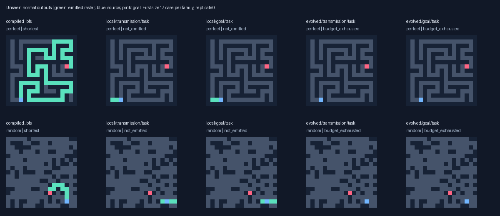
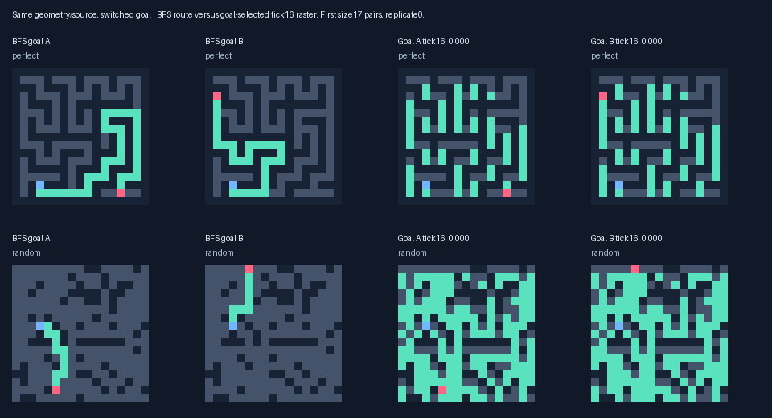

# Goal-conditioned path formation: V4

**The added goal-output pressure did not produce a general shortest-path solver.**

The multirange task archives solve 0/216 primary fresh reachable cases under goal pressure, versus 0/216 under transmission pressure and 0/216 for the frozen initial task selections. Goal-pressure task archives solve 0/174 at distance>=8. On the separate switched-goal set they solve 0/42 reachable targets. Completed routes and tick16 probe scores are reported separately.

Some goal-sensitive branched outputs evolved, but the added pressure has no demonstrated unseen advantage. The goal-selected multirange archive scores 0.0022 on unseen pairs under goal pressure, versus 0.0071 in its transmission control; local scores are 0.0033 versus 0.0035. No archive passes the both-directions criterion on any final regular pair. One local validation replicate rose from zero to0.0387 (control0.0194); its best patterns still had extra branches or failed the normal work budget. Source-connected output is common during training, while goal-specific progress is rare. This points to evolutionary credit assignment and path thinning as the next test, rather than an established solver.

## Controlled continuation

Root 2026101802, two pressures x two topologies x three replicates, 96 organisms per condition, 40 additional generations. The preregistered extension gate was **False**; it requires replicated goal-output improvement or additional correct long routes. Existing hidden communication alone does not justify the longer run.

Forks use six saved V3 causal random-origin populations and their RNG states. If missing from the next population, the learned V3 transmission archive replaces its last slot identically in both arms and remains a protected elite. This preserves a discovered precursor; no known solver or hand-built reaction program enters the lineage. New validation archives never automatically enter reproduction. Full provenance is in `forks.json`, checkpoints and lineage logs.

Capacity remains eight uint16 channels, 64 registers and 128 typed genes. Training inference caps remain 256 ticks / 4096 reads per site / 32768 dispatches per site; validation/final caps remain 1024 / 8192 / 131072. The comparator retains V3 source-transmission pressure on the new paired environments. The new pressure adds twice the bounded goal-output score to the intermediate partial field and lexicase field. Validity, optimality and no-path utility retain priority. Costs break ties only for completely correct responses.

Each stimulus pair shares a layout and source but changes the goal. All reachable training/validation targets have distance>=8 and regular pairs have divergent targets. Two training pairs rotate each generation, initially size9 and then size17; fixed validation has six pairs per replicate. Mixed disconnected pairs include one reachable and one unreachable target. Layouts are disjoint across all splits and all V1–V3 environments.

Both arms pay for ordinary inference and two fixed-tick16 probes per response, source present/removed. The unchanged observer supplies both the old hidden-transmission score and the new output score. Quality multiplies source-connected progress, connected fraction and binary output source dependence, with a branch penalty. Specificity compares progress against the other goal raster on the same geometry. The geometric mean is zero when either factor is absent. Source-only marks, detached goal markers, goal-only patterns and unchanged floods earn zero. Oracles are confined to data/evaluation. See the [protocol](../docs/GOAL_STUDY_V4.md) for exact definitions and extension thresholds.

## Final-generator repair after freezing

The original final generator failed before evaluating any candidate output: it could not find a fourth unused size9 perfect layout in4000 corner-start DFS samples. Training and validation already exclude all earlier layouts, and that small generator has limited diversity. Frozen genomes and all training logs were preserved. Only final size9 perfect mazes were switched to Wilson loop-erased random-walk spanning trees, still31 open sites and a connected tree. Larger perfect mazes and all other families keep the original generators. This changes the size9 perfect sampling distribution and is a protocol deviation, specified in `final_generation_repair.json` before any final candidate evaluation. No fitness, hyperparameter or genome was changed. The new generator has deterministic tree/independence tests.

## Validation gate

| Topology | Rep | Initial goal | Transmission control | Goal pressure | Quality | Specificity | Both directions | Pass |
|---|---:|---:|---:|---:|---:|---:|---:|---|
| local | 0 | 0.0000 | 0.0000 | 0.0000 | 0.0531 | 0.0000 | 0.000 | False |
| local | 1 | 0.0000 | 0.0000 | 0.0000 | 0.0183 | 0.0000 | 0.000 | False |
| local | 2 | 0.0000 | 0.0194 | 0.0387 | 0.0597 | 0.0579 | 0.000 | False |
| evolved | 0 | 0.0000 | 0.0052 | 0.0052 | 0.0145 | 0.0107 | 0.000 | False |
| evolved | 1 | 0.0000 | 0.0228 | 0.0184 | 0.0180 | 0.0312 | 0.000 | False |
| evolved | 2 | 0.0000 | 0.0383 | 0.0236 | 0.0041 | 0.1821 | 0.000 | False |

## Fresh completed outputs

All archives were frozen before generating 264 primary tests: 216 reachable, 48 disconnected, perfect/cyclic sizes9/17/33/65 and rectangular9/17. Endpoints are unrestricted here; long-route counts are a separate subset. The additional paired final set has 24 distinct layouts, 42 reachable and six unreachable targets, all reachable at distance>=8. Frozen controls use initial selection, without evolution. Task/goal/transmission archives are different diagnostic selections, sometimes the same genotype; archive labels are not independent replicates. No new independent resampling arm was run.

| Archive | Valid / reachable | Shortest | Distance>=8 shortest | Correct no-path /48 |
|---|---:|---:|---:|---:|
| compiled_astar | 216/216 | 216 | 174/174 | 48/48 |
| compiled_bfs | 216/216 | 216 | 174/174 | 48/48 |
| evolved/goal/frozen_goal | 4/216 | 4 | 0/174 | 0/48 |
| evolved/goal/frozen_task | 0/216 | 0 | 0/174 | 0/48 |
| evolved/goal/frozen_transmission | 0/216 | 0 | 0/174 | 0/48 |
| evolved/goal/goal | 0/216 | 0 | 0/174 | 0/48 |
| evolved/goal/task | 0/216 | 0 | 0/174 | 0/48 |
| evolved/goal/transmission | 0/216 | 0 | 0/174 | 0/48 |
| evolved/transmission/frozen_goal | 4/216 | 4 | 0/174 | 0/48 |
| evolved/transmission/frozen_task | 0/216 | 0 | 0/174 | 0/48 |
| evolved/transmission/frozen_transmission | 0/216 | 0 | 0/174 | 0/48 |
| evolved/transmission/goal | 0/216 | 0 | 0/174 | 0/48 |
| evolved/transmission/task | 0/216 | 0 | 0/174 | 0/48 |
| evolved/transmission/transmission | 0/216 | 0 | 0/174 | 0/48 |
| local/goal/frozen_goal | 0/216 | 0 | 0/174 | 0/48 |
| local/goal/frozen_task | 1/216 | 1 | 0/174 | 0/48 |
| local/goal/frozen_transmission | 0/216 | 0 | 0/174 | 0/48 |
| local/goal/goal | 0/216 | 0 | 0/174 | 0/48 |
| local/goal/task | 1/216 | 1 | 0/174 | 0/48 |
| local/goal/transmission | 0/216 | 0 | 0/174 | 0/48 |
| local/transmission/frozen_goal | 0/216 | 0 | 0/174 | 0/48 |
| local/transmission/frozen_task | 1/216 | 1 | 0/174 | 0/48 |
| local/transmission/frozen_transmission | 0/216 | 0 | 0/174 | 0/48 |
| local/transmission/goal | 0/216 | 0 | 0/174 | 0/48 |
| local/transmission/task | 1/216 | 1 | 0/174 | 0/48 |
| local/transmission/transmission | 0/216 | 0 | 0/174 | 0/48 |
| wave_bit | 216/216 | 216 | 174/174 | 48/48 |

Successful candidate rasters across archive labels span 1–1 edges; 0/12 include turns. These are repeated selected outputs, not independent discoveries. `success_shapes.json` records each case.


## Independent switched-goal tests

Goal/quality/specificity are fixed-tick probe averages over all 48 targets, including zero reward for unreachable goals. Signal averages use the 42 reachable targets. Both-directions is the fraction of 18 regular pairs meeting the preregistered quality/specificity thresholds. Hidden signal is not a route metric.

| Archive | Normal shortest /42 | No-path /6 | Goal score | Quality | Specificity | Both | Hidden signal |
|---|---:|---:|---:|---:|---:|---:|---:|
| compiled_astar | 42/42 | 6/6 | — | — | — | — | — |
| compiled_bfs | 42/42 | 6/6 | — | — | — | — | — |
| evolved/goal/frozen_goal | 0/42 | 0/6 | 0.0000 | 0.0089 | 0.0000 | 0.0000 | 0.6474 |
| evolved/goal/frozen_task | 0/42 | 0/6 | 0.0000 | 0.0205 | 0.0000 | 0.0000 | 0.6533 |
| evolved/goal/frozen_transmission | 0/42 | 0/6 | 0.0000 | 0.0000 | 0.0000 | 0.0000 | 0.5972 |
| evolved/goal/goal | 0/42 | 0/6 | 0.0022 | 0.0062 | 0.1038 | 0.0000 | 0.4965 |
| evolved/goal/task | 0/42 | 0/6 | 0.0000 | 0.0138 | 0.0000 | 0.0000 | 0.6126 |
| evolved/goal/transmission | 0/42 | 0/6 | 0.0000 | 0.0129 | 0.0000 | 0.0000 | 0.6088 |
| evolved/transmission/frozen_goal | 0/42 | 0/6 | 0.0000 | 0.0089 | 0.0000 | 0.0000 | 0.6474 |
| evolved/transmission/frozen_task | 0/42 | 0/6 | 0.0000 | 0.0205 | 0.0000 | 0.0000 | 0.6533 |
| evolved/transmission/frozen_transmission | 0/42 | 0/6 | 0.0000 | 0.0000 | 0.0000 | 0.0000 | 0.5972 |
| evolved/transmission/goal | 0/42 | 0/6 | 0.0071 | 0.0091 | 0.0686 | 0.0000 | 0.4166 |
| evolved/transmission/task | 0/42 | 0/6 | 0.0004 | 0.0052 | 0.0017 | 0.0000 | 0.6193 |
| evolved/transmission/transmission | 0/42 | 0/6 | 0.0000 | 0.0169 | 0.0000 | 0.0000 | 0.6293 |
| local/goal/frozen_goal | 0/42 | 0/6 | 0.0000 | 0.0382 | 0.0000 | 0.0000 | 0.5778 |
| local/goal/frozen_task | 0/42 | 0/6 | 0.0000 | 0.0408 | 0.0000 | 0.0000 | 0.5778 |
| local/goal/frozen_transmission | 0/42 | 0/6 | 0.0000 | 0.0382 | 0.0000 | 0.0000 | 0.5778 |
| local/goal/goal | 0/42 | 0/6 | 0.0033 | 0.0285 | 0.0071 | 0.0000 | 0.5776 |
| local/goal/task | 0/42 | 0/6 | 0.0033 | 0.0354 | 0.0071 | 0.0000 | 0.5776 |
| local/goal/transmission | 0/42 | 0/6 | 0.0000 | 0.0382 | 0.0000 | 0.0000 | 0.5778 |
| local/transmission/frozen_goal | 0/42 | 0/6 | 0.0000 | 0.0382 | 0.0000 | 0.0000 | 0.5778 |
| local/transmission/frozen_task | 0/42 | 0/6 | 0.0000 | 0.0408 | 0.0000 | 0.0000 | 0.5778 |
| local/transmission/frozen_transmission | 0/42 | 0/6 | 0.0000 | 0.0382 | 0.0000 | 0.0000 | 0.5778 |
| local/transmission/goal | 0/42 | 0/6 | 0.0035 | 0.0336 | 0.0047 | 0.0000 | 0.5778 |
| local/transmission/task | 0/42 | 0/6 | 0.0000 | 0.0352 | 0.0000 | 0.0000 | 0.5748 |
| local/transmission/transmission | 0/42 | 0/6 | 0.0000 | 0.0382 | 0.0000 | 0.0000 | 0.5778 |
| wave_bit | 42/42 | 6/6 | — | — | — | — | — |

## Where the added pressure acts

Final paired population genotype sequences are identical in 2/6 comparisons. The following diagnostics count reachable training responses, rather than just archived champions. They distinguish the output prerequisites from the full multiplicative bonus. Validation has separate raw counts in `training_factors.json`. A positive component factor need not coincide with the other factor.

| Topology / pressure | Reachable responses | Component >=3 sites | Source-dependent output | Quality >0 | Specificity >0 | Goal score >0 |
|---|---:|---:|---:|---:|---:|---:|
| evolved/goal | 43,200 | 21,649 | 16,719 | 16,167 | 228 | 218 |
| evolved/transmission | 43,200 | 21,724 | 17,052 | 16,603 | 163 | 157 |
| local/goal | 43,200 | 24,304 | 19,231 | 16,373 | 25 | 24 |
| local/transmission | 43,200 | 25,133 | 19,891 | 16,895 | 1 | 1 |

## Frozen nonlocal-read ablation

Each radius>1 read returns zero while attempted reads remain charged. Both ordinary inference and the source-present/source-removed probes use the ablated runtime. This post-freeze diagnostic changes no selected genome. Signal is averaged on reachable paired cases; goal score averages all targets.

| Archive | Normal signal | Ablated signal | Normal goal | Ablated goal | Ablated shortest /42 |
|---|---:|---:|---:|---:|---:|
| evolved/goal/goal | 0.4965 | 0.0474 | 0.0022 | 0.0000 | 0/42 |
| evolved/goal/transmission | 0.6088 | 0.2449 | 0.0000 | 0.0000 | 0/42 |
| evolved/transmission/goal | 0.4166 | 0.0468 | 0.0071 | 0.0000 | 0/42 |
| evolved/transmission/transmission | 0.6293 | 0.1529 | 0.0000 | 0.0000 | 0/42 |

Ablation cost: 1.7s, 192 normal responses, 384 probes and 999,801,061 logical work units.


## Actual cost and timing

Search plus validation/probes: **9.67 minutes**. Main run including fresh outputs and timing: **15.32 minutes** on Apple M4, Python 3.13.15. This sums the recorded training window and recovered final process, excluding the failed sampling attempt and repair-development gap. Recovered-final process peak RSS 152.1 MiB; original training high-water mark was lost on interruption (observed training RSS about120MiB). 207,336 normal training/selection responses plus 414,672 developmental probes. Candidate slots and work caps match; actual work can differ by phenotype. Logical work counts dispatches plus attempted reads, not machine instructions.

| Topology / pressure | Train responses | Validation responses | Inference work | Probe work |
|---|---:|---:|---:|---:|
| evolved/goal | 46,080 | 6,264 | 30,603,898,657 | 38,755,818,600 |
| evolved/transmission | 46,080 | 6,180 | 28,827,911,492 | 38,516,248,871 |
| local/goal | 46,080 | 5,304 | 53,005,329,394 | 35,911,661,371 |
| local/transmission | 46,080 | 5,268 | 51,844,061,955 | 36,067,829,974 |

Thirty randomized warm repetitions per fixed size17/33 perfect/cyclic case per replicate, 12 cases/arm. Latency includes input decoding, updates and full raster emission; excludes genome construction, oracles and probes. The table uses the median of case medians and the full observed repetition range. Failed outputs get no speed credit.

| Arm | Median us | Warm range us | Shortest timed responses /360 |
|---|---:|---:|---:|
| compiled_astar | 16.29 | 6.29–65.04 | 360/360 |
| compiled_bfs | 13.10 | 3.79–36.04 | 360/360 |
| evolved/goal/frozen_goal | 2720.68 | 428.21–17242.71 | 0/360 |
| evolved/goal/frozen_task | 8171.60 | 320.29–33397.25 | 0/360 |
| evolved/goal/frozen_transmission | 10220.69 | 1521.92–34647.08 | 0/360 |
| evolved/goal/goal | 1786.07 | 612.04–10828.62 | 0/360 |
| evolved/goal/task | 8097.91 | 156.25–33243.92 | 0/360 |
| evolved/goal/transmission | 9782.19 | 1547.54–38863.79 | 0/360 |
| evolved/transmission/frozen_goal | 2729.71 | 427.17–17113.29 | 0/360 |
| evolved/transmission/frozen_task | 8153.51 | 330.29–48730.38 | 0/360 |
| evolved/transmission/frozen_transmission | 10210.00 | 1559.17–80468.83 | 0/360 |
| evolved/transmission/goal | 2330.88 | 633.79–10057.38 | 0/360 |
| evolved/transmission/task | 2374.14 | 177.58–33949.62 | 0/360 |
| evolved/transmission/transmission | 9709.89 | 661.96–38498.83 | 0/360 |
| local/goal/frozen_goal | 14132.33 | 2999.04–36743.46 | 0/360 |
| local/goal/frozen_task | 13616.44 | 2981.54–35931.08 | 0/360 |
| local/goal/frozen_transmission | 14122.44 | 2995.67–36017.75 | 0/360 |
| local/goal/goal | 14123.12 | 2983.96–35965.92 | 0/360 |
| local/goal/task | 13590.24 | 2960.71–36284.71 | 0/360 |
| local/goal/transmission | 14146.23 | 3004.04–37729.96 | 0/360 |
| local/transmission/frozen_goal | 14130.89 | 3015.92–36137.04 | 0/360 |
| local/transmission/frozen_task | 13593.24 | 3005.21–36166.62 | 0/360 |
| local/transmission/frozen_transmission | 14100.06 | 2977.12–36320.83 | 0/360 |
| local/transmission/goal | 14111.60 | 3003.88–49086.38 | 0/360 |
| local/transmission/task | 12289.33 | 1946.50–36187.83 | 0/360 |
| local/transmission/transmission | 14133.53 | 2988.54–36061.58 | 0/360 |
| wave_bit | 44.69 | 11.62–209.04 | 360/360 |

Largest measured inference array payload 151,747 bytes. Bounds remain 64 bytes/site +64 KiB for inference and 80 bytes/site +64 KiB for an observer pair. Arrays exclude Python/JIT/evaluator/allocator overhead, included in RSS. Genome program payload is at most3584 bytes. A* heap payload is logical; bit-wave memory is uninstrumented. The interpreter scans each open site and gene each synchronous tick, so work scales with ticks x open sites x genome length, even when many gates disable expression. Nonlocal reads have no demonstrated efficiency advantage.

## Fixed visual examples

First size17 perfect/cyclic primary cases and first size17 paired cases from replicate0; no success filtering. The probe panels are intermediate rasters, separately labelled.





## Verification and limits

Verified 28 training source hashes, six ancestor checkpoint hashes, 31,634 new individuals/parent links, the128-gene bound and protected elite in every final population. Reassessed 7,128 primary and 1,296 paired normal rasters with the unchanged strict validator, recomputed 1,152 final goal metrics from saved probe rasters, and checked 47,998 logged fitness decompositions and 207,336 source-score arithmetic records. 264 primary and 24 paired final layouts are disjoint from each other and 4,568 unique V1–V3 layouts, as well as new train/validation. Full next-population/RNG checkpoints allow deterministic continuation; unit tests compare uninterrupted and split replay.

This is a small paired study under a fixed grammar, mutation/search design and tick16 shaping horizon. It does not test impossibility or establish statistical significance. For long distances, local causal cones and the product of several prerequisites can limit useful reward. The primary final distribution differs from the divergent-goal training distribution, so both are reported. More capacity alone is not established as a remedy.

## Next controlled experiment

Preserve these random-origin populations and the learned signalling elite. Test a **factorized curriculum** against this multiplicative objective: provide separate intermediate credit for source-dependent connected output growth and goal-dependent modulation before requiring their conjunction. Keep capacity fixed, retain complete shortest routes as the primary endpoint, record which factors co-occur, and reserve new layouts. This tests the accessibility of useful evolutionary stepping stones without inserting a known solver.

## Reproduce

```bash
.venv/bin/python -m pytest -q
.venv/bin/python -m maze_evolution.goal_recovery --run --out results/repeat_goal
.venv/bin/python -m maze_evolution.goal_diagnostics --out results/repeat_goal
.venv/bin/python -m maze_evolution.goal_audit --out results/repeat_goal
.venv/bin/python -m maze_evolution.goal_report --out results/repeat_goal
```

Choose a fresh output directory. The study freezes source/config/fork hashes and all selected genomes before constructing final tests. Raw evidence, masks and per-case timings are in `goal_conditioning/`.

After benchmarking, log packaging took 7.3s and reduced 26.33 to 17.25 MiB. Decoded bytes were verified identical before/after gzip repacking. Per-file decoded/stored hashes are in `storage.json`. No record values changed.
