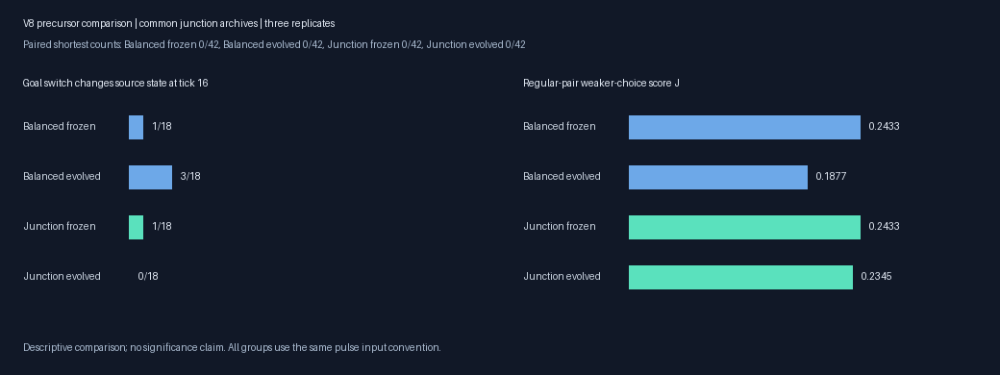
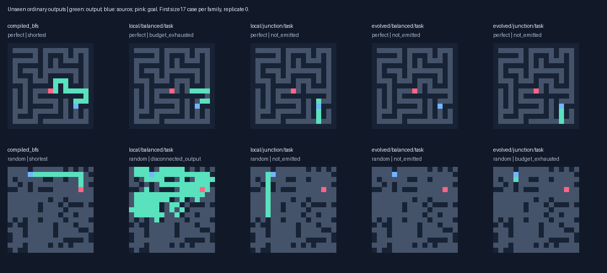
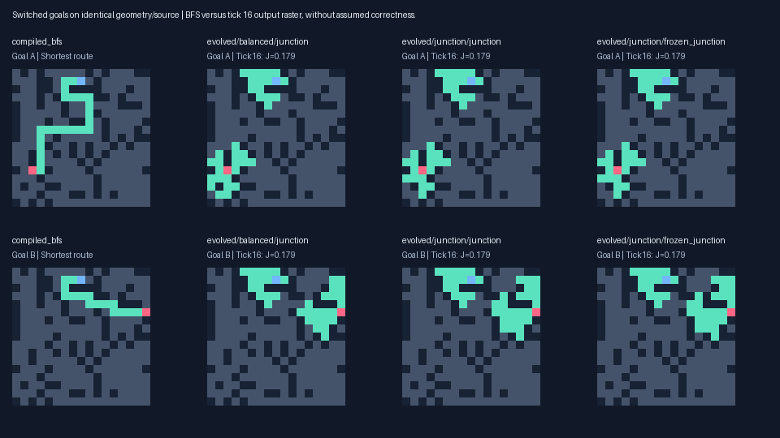
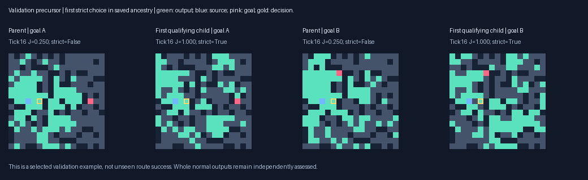

# Source-dependent junction choices: V8

Multirange task archives complete **3/216** unseen shortest paths with Junction pressure, versus **0/216** with Balanced and **1/216** frozen. Junction solves **0/174** at distance ≥8 and **0/42** paired reachable targets. Compiled BFS, A* and wavefront complete 42/42 paired and 216/216 ordinary routes. Correctness remains the primary measure; no competitive speedup is established.

The common junction archive has held-out weaker-choice score **J=0.2345** under Junction pressure, **0.1877** under Balanced and **0.2433** frozen. Strict correct choices under both switched goals are **0/18**, **0/18** and **0/18**, respectively. J includes partial source-dependent prefix credit; it is not route correctness. Three replicates support a descriptive comparison, without a significance claim.

The preregistered extension gate was **False** after [48] generations. A negative bounded experiment does not establish impossibility of random-origin discovery.



## Controlled comparison and provenance

The unchanged V6 VM uses eight uint16 channels,128 bounded typed genes, source channel0 and goal channel1 pulses, output2 and stop7. Local and evolvable-range treatments have identical capacity and budgets. BFS labels are restricted to generation/fitness; candidate inference receives only maze/source/goal inputs. The only pressure change within V8 is Balanced G_i+minG versus Junction J_i+minJ. Both maxima are 2 per case. Mixed pairs keep2G. Ordinary correctness/optimality/no-path utility precede shaping, and unfinished genomes have no cost or length penalty.

J=.25R+.75C: R measures the source-connected, source-dependent shortest prefix beyond distance1. C rewards one desired shortest exit at a source-connected junction, with wrong exits suppressed and the chosen exit off under source removal. Strict choice requires all these exit conditions; both goals must choose correctly. All tied shortest neighbors are accepted individually on cyclic grids. Lighting multiple valid alternatives still forms a branch and is penalized. A high prefix score alone cannot open the extension gate.

Both arms fork the same V7 Balanced next population/RNG and protect validation-selected task, balanced, goal and transmission variants plus protected ancestors from both V7 Balanced and Mean. Missing genotypes replace last nonprotected slots; no final performance selects parents. Rich random immigrants and neutral diversity continue. Both arms nominate the same seven leaders/niche rule; validation uses the common Balanced objective. The junction archive uses mean regular-pair minJ, then strict-both, balanced G score, validity and optimality. Matching initial archives are frozen no-evolution controls. New validation archives do not automatically breed. Full populations, RNG and lineage remain available.

The preregistration commit is `52eca603a1e71a374095a9bd7b226515cbdab3c9`; model freeze SHA256 is `68d22fb06efdace34c65b6427ec01b29275cd622ce6b327afcebc8d8a795ac9f`. Final generation follows the model freeze. Seed2026101806, independent construction seed1084; all 6896 V1–V7 layouts excluded. Primary evaluation uses264 ordinary layouts; the paired set uses24 additional layouts/48 inputs, with42 reachable goals≥8 and6 unreachable. V8 regular pairs require a shared shortest prefix ending at source distance2..8, goals≥4 edges beyond it and disjoint shortest exit sets. Even pair indices require a misleading Manhattan bearing for at least one goal; odd indices have no extra requirement. Both V8 arms share this sampling change. V8 versus V7 therefore changes environments as well as pressure. Full construction feasibility through192 generations was checked on a different seed before training.

## Completed unseen outputs

| Arm | Valid / reachable | Shortest | Distance≥8 shortest | Correct no-path /48 | False no-path |
|---|---:|---:|---:|---:|---:|
| compiled_astar | 216/216 | 216 | 174/174 | 48/48 | 0 |
| compiled_bfs | 216/216 | 216 | 174/174 | 48/48 | 0 |
| evolved/balanced/frozen_junction | 0/216 | 0 | 0/174 | 0/48 | 0 |
| evolved/balanced/frozen_task | 1/216 | 1 | 0/174 | 0/48 | 0 |
| evolved/balanced/junction | 0/216 | 0 | 0/174 | 0/48 | 0 |
| evolved/balanced/task | 0/216 | 0 | 0/174 | 16/48 | 0 |
| evolved/junction/frozen_junction | 0/216 | 0 | 0/174 | 0/48 | 0 |
| evolved/junction/frozen_task | 1/216 | 1 | 0/174 | 0/48 | 0 |
| evolved/junction/junction | 1/216 | 1 | 0/174 | 0/48 | 0 |
| evolved/junction/task | 3/216 | 3 | 0/174 | 0/48 | 0 |
| local/balanced/frozen_junction | 0/216 | 0 | 0/174 | 0/48 | 0 |
| local/balanced/frozen_task | 1/216 | 1 | 0/174 | 16/48 | 0 |
| local/balanced/junction | 0/216 | 0 | 0/174 | 0/48 | 0 |
| local/balanced/task | 0/216 | 0 | 0/174 | 32/48 | 0 |
| local/junction/frozen_junction | 0/216 | 0 | 0/174 | 0/48 | 0 |
| local/junction/frozen_task | 1/216 | 1 | 0/174 | 16/48 | 0 |
| local/junction/junction | 0/216 | 0 | 0/174 | 0/48 | 0 |
| local/junction/task | 1/216 | 1 | 0/174 | 16/48 | 0 |
| wave_bit | 216/216 | 216 | 174/174 | 48/48 | 0 |

| Task archive | Turn-required shortest | Mandatory-detour shortest | Paired shortest /42 |
|---|---:|---:|---:|
| local/balanced/task | 0/194 | 0/144 | 0/42 |
| local/junction/task | 0/194 | 0/144 | 0/42 |
| evolved/balanced/task | 0/194 | 0/144 | 0/42 |
| evolved/junction/task | 2/194 | 0/144 | 0/42 |

Selected current task/junction successes span 1–3 edges and at most 1 turns. Full successful shapes are in `success_shapes.json`; a success can be inherited or supplied by common endpoint-aware halting. It is not automatically an evolved goal-guided algorithm. Per-size/family results and all failures are in the raw summary/output records.



## Paired decisions and communication

| Arm | Weaker-choice J | Strict both /18 | Old balanced B | Mean G | Source transmission | Paired shortest /42 |
|---|---:|---:|---:|---:|---:|---:|
| evolved/balanced/frozen_junction | 0.2433 | 0/18 | 0.0134 | 0.0330 | 0.5848 | 0/42 |
| evolved/balanced/frozen_task | 0.0193 | 0/18 | 0.0000 | 0.0000 | 0.5054 | 0/42 |
| evolved/balanced/junction | 0.1877 | 0/18 | 0.0128 | 0.0256 | 0.5917 | 0/42 |
| evolved/balanced/task | 0.0074 | 0/18 | 0.0000 | 0.0005 | 0.3359 | 0/42 |
| evolved/junction/frozen_junction | 0.2433 | 0/18 | 0.0134 | 0.0330 | 0.5848 | 0/42 |
| evolved/junction/frozen_task | 0.0193 | 0/18 | 0.0000 | 0.0000 | 0.5054 | 0/42 |
| evolved/junction/junction | 0.2345 | 0/18 | 0.0190 | 0.0339 | 0.5765 | 0/42 |
| evolved/junction/task | 0.0885 | 0/18 | 0.0056 | 0.0071 | 0.5376 | 0/42 |
| local/balanced/frozen_junction | 0.2460 | 0/18 | 0.0129 | 0.0155 | 0.5589 | 0/42 |
| local/balanced/frozen_task | 0.0000 | 0/18 | 0.0000 | 0.0000 | 0.5589 | 0/42 |
| local/balanced/junction | 0.2460 | 0/18 | 0.0129 | 0.0155 | 0.5589 | 0/42 |
| local/balanced/task | 0.0139 | 0/18 | 0.0000 | 0.0101 | 0.5589 | 0/42 |
| local/junction/frozen_junction | 0.2460 | 0/18 | 0.0129 | 0.0155 | 0.5589 | 0/42 |
| local/junction/frozen_task | 0.0000 | 0/18 | 0.0000 | 0.0000 | 0.5589 | 0/42 |
| local/junction/junction | 0.2460 | 0/18 | 0.0129 | 0.0155 | 0.5589 | 0/42 |
| local/junction/task | 0.0185 | 0/18 | 0.0000 | 0.0000 | 0.5589 | 0/42 |

B=min of old G scores within each regular pair; G averages all inputs, including mixed ones. J averages regular pairs only. Denominators differ. Every regular final pair is eligible for the new decision assay, unlike V7’s post-training tree-only diagnostic.

| Multirange junction archive | Replicate | J | Strict both /6 | Mean G |
|---|---:|---:|---:|---:|
| balanced | 0 | 0.2381 | 0/6 | 0.0320 |
| balanced | 1 | 0.2417 | 0/6 | 0.0425 |
| balanced | 2 | 0.0833 | 0/6 | 0.0023 |
| junction | 0 | 0.2381 | 0/6 | 0.0322 |
| junction | 1 | 0.2417 | 0/6 | 0.0484 |
| junction | 2 | 0.2238 | 0/6 | 0.0212 |

| Training pressure/topology | Source-connected decisions | Positive choice C | Strict individual | Strict both pairs |
|---|---:|---:|---:|---:|
| local/balanced | 13663/48384 | 927 | 691 | 0/24192 |
| local/junction | 19647/48384 | 1664 | 1198 | 0/24192 |
| evolved/balanced | 23555/48384 | 710 | 553 | 27/24192 |
| evolved/junction | 25891/48384 | 1041 | 803 | 24/24192 |

These counts include repeated genomes and rotating training cases. They diagnose the selection landscape, not independent discoveries or unseen success.

| Junction archive | Connected junction /36 goals | Mean prefix R | Mean choice C | Strict individual /36 | Wrong exits lit /36 |
|---|---:|---:|---:|---:|---:|
| evolved/balanced/frozen_junction | 33/36 | 0.979 | 0.028 | 1/36 | 30/36 |
| evolved/balanced/junction | 26/36 | 0.791 | 0.028 | 1/36 | 27/36 |
| evolved/junction/frozen_junction | 33/36 | 0.979 | 0.028 | 1/36 | 30/36 |
| evolved/junction/junction | 29/36 | 0.948 | 0.042 | 1/36 | 29/36 |
| local/balanced/frozen_junction | 32/36 | 0.984 | 0.000 | 0/36 | 34/36 |
| local/balanced/junction | 32/36 | 0.984 | 0.000 | 0/36 | 34/36 |
| local/junction/frozen_junction | 32/36 | 0.984 | 0.000 | 0/36 | 34/36 |
| local/junction/junction | 32/36 | 0.984 | 0.000 | 0/36 | 34/36 |

| Junction archive | Goal changes source state at16 /18 | Goal changes junction state at16 /18 | Junction state at64 /18 |
|---|---:|---:|---:|
| local/balanced/junction | 0/18 | 0/18 | 0/18 |
| local/junction/junction | 0/18 | 0/18 | 0/18 |
| evolved/balanced/junction | 3/18 | 9/18 | 2/18 |
| evolved/junction/junction | 0/18 | 6/18 | 1/18 |
| evolved/junction/frozen_junction | 1/18 | 7/18 | 1/18 |

The final18 regular pairs contain 1 with multiple valid shortest exits and 10 with a deceptive detour at the chosen decision. For1/18, both goal inputs lie beyond16 open edges from every decision-region site. Radius1 rules cannot distinguish those local exit bits by tick16; at least one goal input is within that radius on the remaining pairs. This is a post-freeze structural opportunity diagnostic, not an accuracy adjustment. Multirange reads can shorten geometric influence chains but must demonstrate actual useful choice.

Hidden goal-dependent state at a junction is distinct from a correct exit and from a complete route. Fixed-horizon probes ignore ordinary halting, so their rasters are diagnostics. The saved probe-route audit tests hypothetical tick16 emission separately; it cannot turn a nonhalting normal organism into a solver.



## Fixed-genome interventions

| Junction archive | Native J | Goal pulse removed J | Native strict both /18 | Removed /18 |
|---|---:|---:|---:|---:|
| local/balanced/junction | 0.2460 | 0.2460 | 0/18 | 0/18 |
| local/junction/junction | 0.2460 | 0.2460 | 0/18 | 0/18 |
| evolved/balanced/junction | 0.1877 | 0.2105 | 0/18 | 0/18 |
| evolved/junction/junction | 0.2345 | 0.2345 | 0/18 | 0/18 |

| Multirange archive | Native J | Nonlocal reads removed J | Native source | Removed source | Shortest /42 |
|---|---:|---:|---:|---:|---:|
| evolved/balanced/junction | 0.1877 | 0.0705 | 0.5917 | 0.1215 | 0/42 |
| evolved/balanced/task | 0.0074 | 0.0020 | 0.3359 | 0.1289 | 0/42 |
| evolved/junction/junction | 0.2345 | 0.0746 | 0.5765 | 0.1215 | 0/42 |
| evolved/junction/task | 0.0885 | 0.0885 | 0.5376 | 0.0775 | 0/42 |

## Validation-only emergence and ancestry

A supplemental archive preserves the strongest strict-both validation variants by strict-both, J, B and G, without changing current training, extension gates or frozen final selections. This diagnostic was planned during training before inspecting final outputs. Replay each qualifying archive’s ancestry on its first qualifying validation pair. The example is selected by validation qualification and cannot establish unseen generalization.

| Condition | First qualifying birth | Parent→child row changes | Ancestry nodes | Final strict both | Normal shortest /2 |
|---|---:|---:|---:|---:|---:|
| junction/evolved/balanced/2 | 4 | 83 | 4 | 1.0 | 0/2 |
| junction/evolved/junction/1 | 7 | 3 | 2 | 1.0 | 0/2 |

Row differences are not necessarily individual mutation operations: insertion/deletion can shift subsequent rows. Parent/child replays establish the transition along that lineage; they do not isolate which changed row is necessary.

| Same validation organism | Goal pulse | Nonlocal reads ablated | J | Strict both | Shortest /2 |
|---|---:|---:|---:|---:|---:|
| junction/evolved/balanced/2 | False | False | 0.2500 | 0.0 | 0/2 |
| junction/evolved/balanced/2 | True | True | 0.2500 | 0.0 | 0/2 |
| junction/evolved/junction/1 | False | False | 0.2500 | 0.0 | 0/2 |
| junction/evolved/junction/1 | True | True | 0.0833 | 0.0 | 0/2 |



These ancestry/intervention assays add 20 independently reassessed normal outputs across 6 replayed ancestry nodes, with their full source probes and cost recorded in `diagnostics.json`. `strict_validation_archive.json` preserves the validation-only genotypes for a fresh continuation.

Removing the goal pulse retains the static goal flag. Nonlocal ablation returns zero for radius>1 reads while charging attempted reads. These post-freeze interventions reuse final layouts without reselection; they diagnose dependence, not a separately selected treatment.

## Real cost and capacity

Search with validation/probes: **13.47 minutes**. Main experiment including final accuracy/timing: **16.54 minutes**. Main-run peak RSS **208.2 MiB**, Apple M4, Python3.13.15, {'llvmlite': '0.50.0', 'numba': '0.68.0', 'numpy': '2.5.4', 'pillow': '13.0.0', 'pytest': '9.1.1'}. Training/selection charged 261,864 normal responses and 523,728 source probes, with 427,687,305,596 logical dispatch-plus-attempted-read units. These are not hardware CPU instruction counts. Conventional solvers’ VM counters are uninstrumented placeholders, not zero hardware work. Same slots/caps need not yield equal actual work because phenotypes and validation nominee overlap differ.

Full inference timing includes decoding, initialization, updates and raster emission; fitness/oracle/probe cost is outside these latency samples. JITs warm matching production signatures.30 repetitions per case, randomized solver order,12 cases/arm across3 replicates. The table gives the median of case medians and the full sample range; failed paths confer no speed advantage.

| Arm | Median case median μs | Warm range μs | Correct timed repetitions | Largest inference arrays |
|---|---:|---:|---:|---:|
| compiled_bfs | 4.98 | 2.54–20.83 | 360/360 | 46382B |
| compiled_astar | 7.15 | 3.58–32.46 | 360/360 | 69923B |
| wave_bit | 22.12 | 11.75–190.83 | 360/360 | unreported |
| local/balanced/task | 9586.67 | 2155.88–36528.75 | 0/360 | 151747B |
| local/junction/task | 9883.91 | 2554.42–48151.71 | 0/360 | 151747B |
| evolved/balanced/task | 13768.77 | 2002.21–36267.96 | 0/360 | 151747B |
| evolved/junction/task | 3076.06 | 444.67–44740.79 | 0/360 | 151747B |

Each completed open-site tick copies eight uint16 states old→new,32 bytes of logical read/write payload. This excludes partial ticks, gene/register operations and allocations; caches/compiler optimization change physical DRAM traffic. State buffers alone are32N bytes; the kernel’s explicit array ceiling is64N+65536. Host RSS includes Python/JIT/logging.

| Task archive | Completed open-site ticks | Logical copy MiB | Neighbor reads | Dispatches | Active fraction |
|---|---:|---:|---:|---:|---:|
| local/balanced/task | 28,907,532 | 882.2 | 2,586,531,109 | 3,679,028,920 | 0.740 |
| local/junction/task | 27,901,786 | 851.5 | 2,483,949,146 | 3,570,090,743 | 0.699 |
| evolved/balanced/task | 19,991,753 | 610.1 | 2,101,009,741 | 2,436,740,028 | 0.766 |
| evolved/junction/task | 14,864,978 | 453.6 | 1,790,641,081 | 1,910,554,203 | 0.742 |

Task genomes contain 114–128 genes, with conservative output/stop dependency slices of 10–61 genes. These are syntactic potential dependencies; semantic redundancy and full-state quiescence can differ. Genome length is not effective complexity.

Among 18,829 newly born children with a parent evaluated on the same training batch, 18,610 change genotype and 9,158 of those match the behavioral fingerprint of normal/probe rasters, status/steps and partial/source/goal scores (49.2%). Fitness excluding cost is higher for 1,438, lower for 6,971, equal for 10,420. This conditional subset is not an unbiased neutrality estimate; work/expression counters and hidden trajectories may differ. Preserve these variants.

The observed cost offers no advantage over conventional solvers. Larger grids increase per-tick state traffic and graph-distance propagation time; long reads only help if their causal information produces valid output. Capacity, regulation, time and new selection pressures remain testable hypotheses.

## Verification and reproduction

All 62 frozen source hashes, prior layout exclusions, 33,334 new individual lineages, protected variants and shared initial cohorts verify. Independently reassessed 5,016 ordinary, 912 paired, 768 pulse-removed and 192 nonlocal-ablated normal outputs. Replayed 48 selected normal outputs. Checked 58,686 fitness records, 263,612 junction rasters and 29 valid training claims, plus all 12 junction and12 balanced validation archive maxima. Complete next populations/RNG, immutable earlier results, all rasters and lossless compressed logs are saved. 106 tests passed before training.

Post-freeze diagnostics took 20.92s, audit 18.04s and lossless recompression 9.82s. Stored and decoded log hashes are in `storage.json`. Audit source hashes, cost breakdowns, manifests/labels, environment, protocol and archive provenance are independently inspectable.

```sh
.venv/bin/python -m pytest -q
.venv/bin/python -m maze_evolution.junction_study --out results/junction_choice_reproduction
.venv/bin/python -m maze_evolution.junction_diagnostics --out results/junction_choice_reproduction
.venv/bin/python -m maze_evolution.junction_audit --out results/junction_choice_reproduction --repack
.venv/bin/python -m maze_evolution.junction_report --out results/junction_choice_reproduction
```

Use a fresh directory; historical output directories reject overwrites. Full protocol: `docs/JUNCTION_STUDY_V8.md`. Machine-readable raw results: `results/junction_choice/`. Frozen source revisions/hashes fix this experiment; future continuations must use new modules/seeds.

## Interpretation and next experiment

This screen finds no unseen paired-choice or long-route advantage from Junction pressure. It does find two narrow validation primitives with source-dependent choices under switched goals. One arises after an instruction reorder and a scratch-register redirection cooperate. The main mean-J archive misses that second primitive because broad prefix growth can rank higher across the whole set. These observations motivate preserving useful regulatory subfunctions; they do not establish general routing.

The next controlled test should protect both validation primitives in the same initial cohorts, then compare strict paired-choice-first selection with current prefix-weighted selection. Keep normal route correctness primary, preserve neutral diversity, hold capacity/input/caps fixed and require transfer on fresh layouts. Larger capacity and longer evolution remain hypotheses to test after a reproducible transfer signal; no known solver should enter these lineages.

An exploratory [V8A confirmation](junction_confirmation.md) tested both validation variants and their roots/parents on 12 additional fresh layouts. Neither variant makes strict choices under both goals on any pair (0/12) or completes a route (0/24); no reselection follows. Two mutation groups cooperate on the original validation example: neither the instruction swap alone nor register redirection alone suffices. This is narrow regulatory cooperation without demonstrated generalization. The confirmation has its own preregistration, model freeze, seeds, costs and audit.
