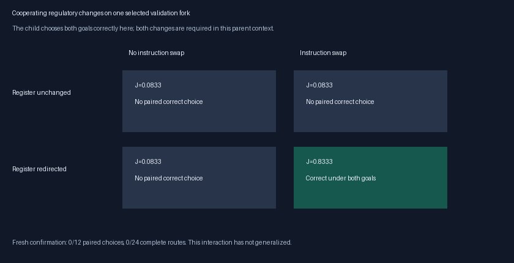

# Frozen fork-choice confirmation: V8A

Two evolved, random-origin variants make source-dependent, goal-dependent fork choices on selected validation pairs. Both lose those choices when either the goal pulse or nonlocal reads is removed. On the new confirmation corpus, **both variants make correct choices under both goals on 0/12 pairs and complete 0/24 routes**. Their roots/parents also score 0/12 and 0/24. The confirmation therefore finds no transferred solver or paired-choice advantage.

The second validation primitive requires two cooperating changes relative to its immediate parent: swapping instruction rows27/60, and redirecting row66 from scratch register63 to43. The swap moves a neighbor-count instruction and a nonlocal minimum read. Neither change group alone produces the strict paired choice on this validation example; the combined child does. This establishes a context-specific interaction between these two changes. It does not establish a general regulatory strategy or identify each individual row as necessary.

## Fresh confirmation

This exploratory confirmation was registered after V8’s primary results and ancestry inspection, before generating its own new corpus. No training or model reselection follows. Root, pre-qualification parent and final strict-choice variant are frozen from validation ancestry. Identical parent/root genotypes share aliases and one evaluation. All five distinct genotypes see the same12 new layouts/24 inputs: 9/17/33 ×tree/cyclic ×two layouts, all reachable at distance ≥8 with near-source disjoint-choice junctions and tied shortest exits allowed. Even indices require a deceptive detour. Seed2026101807; every V1–V8 layout excluded. This is a selected two-lineage confirmation, not replicated population evidence.

| Lineage | Roles | Weaker-choice J | Strict both /12 | Valid /24 | Shortest /24 |
|---|---|---:|---:|---:|---:|
| junction/evolved/balanced/2 | root | 0.2417 | 0/12 | 0/24 | 0/24 |
| junction/evolved/balanced/2 | parent | 0.2160 | 0/12 | 0/24 | 0/24 |
| junction/evolved/balanced/2 | variant | 0.1361 | 0/12 | 0/24 | 0/24 |
| junction/evolved/junction/1 | root, parent | 0.1438 | 0/12 | 0/24 | 0/24 |
| junction/evolved/junction/1 | variant | 0.1403 | 0/12 | 0/24 | 0/24 |

BFS completes 24/24 confirmation routes. The new variants’ partial-choice scores do not improve over their roots here. All rasters, branch labels and frozen model IDs/hashes are retained. V8’s primary accuracy and extension decision remain unchanged.

## Selected validation interaction

| Instruction swap | Register redirection | J | Strict both goals | Normal shortest /2 |
|---|---|---|---|
| False | False | 0.0833 | False | 0/2 |
| True | False | 0.0833 | False | 0/2 |
| False | True | 0.0833 | False | 0/2 |
| True | True | 0.8333 | True | 0/2 |

The readout is a fixed16-tick source-dependent fork-choice assay, not a correctly halted whole path. The four-cell comparison tests two groups of edits. Other cooperating changes and different contexts remain possible.

## Cost, checks and next experiment

Run took 4.07s and verification 0.17s, peak RSS137.8MiB. 124 normal candidate responses and248 source probes charged472,871,379 dispatch-plus-attempted-read units, plus24 BFS responses. The auditor independently checks124 normal outputs and junction masks, BFS correctness, model/source/input hashes and whole-layout exclusion. VM instruction/read counters do not instrument BFS hardware work.

Preserve both strict-choice variants and their ancestors. A justified next controlled experiment protects them in a common starting cohort and compares strict paired-choice-first selection with the current prefix-weighted reward, at unchanged capacity. Correct full routes stay ahead of all precursor scores. The reason is concrete: V8’s archive can prefer broad prefix growth over a correct choice on one context. Test transfer across rotating fork contexts and fresh independent mazes before spending an hour on extension. Heritable capacity/regulation/time remain open hypotheses; this cooperative validation example supports investigating them without establishing a solver.

Protocol: `docs/JUNCTION_CONFIRMATION_V8A.md`. Raw data: `results/junction_confirmation/`. Future studies must also exclude this confirmation manifest. Preserve V8’s original data.
