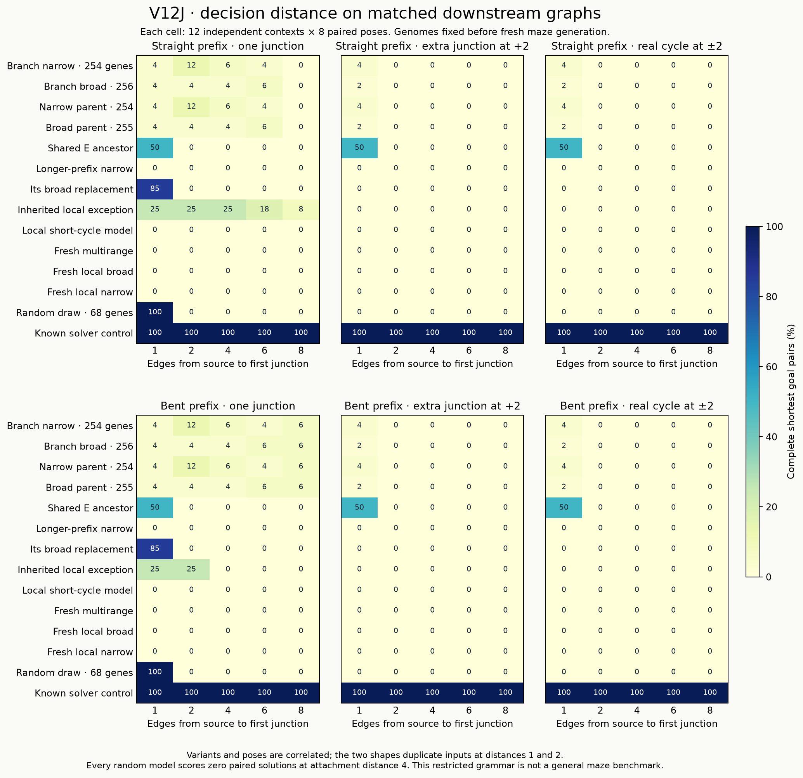

# V12J — junction distance is not a single hard ceiling

**Complete and independently audited.** The panel and
protocol were pushed in `e4ca508` before any main cases were generated. No genomes
were changed or evolved. This is an explicitly V12I-informed diagnosis of a fixed
panel on fresh matched mazes, not a new evolutionary gain.

The useful finding is more specific than either “distance is the problem” or
“more complexity will solve it.” Several preserved random-origin models complete
branched goal pairs with an **eight-edge source prefix**. An inherited local
model's paired routes reach **17 edges**. But these successes depend strongly on
shape and pose, and no random model passes the prespecified transfer screen.
On two fixed mechanism contexts, suppressing nonlocal input rescues short-route
behaviour in the carried multirange variants. Regulation of interference is now
a concrete hypothesis; general solving and a beneficial multirange mechanism
remain unestablished.

## What was controlled

The [protocol](../docs/JUNCTION_DISTANCE_V12J.md) freezes thirteen random-origin
models and one separate known solver. It includes both I Branch selections,
their immediate parents and shared ancestor, longer-prefix exceptions, fresh
models and the 68-gene unmutated random draw. No replacement of historical primary
models or alteration of populations/RNG occurs.

Twelve new independent contexts have fixed goals, goal arms, clutter and downstream
graphs. The source moves along a truncated arm, remaining an endpoint at distances
1,2,4,6,8 from the first junction. Each context includes straight/bent prefixes,
eight poses, two goal choices, a fork, a second junction at distance 2/4 down one
goal arm, genuine opposite-arm cycles at those attachment distances, matched
pruned corridors and disconnected controls. Goal arms are 6–9 edges on 25×25 boards.

The source manipulation preserves downstream cells exactly. The dead-end branch
contrast preserves open-cell count while moving the extra junction. The cycle
contrast changes both attachment distance and alternative-path length/open-cell
count; it cannot isolate signal distance alone. These orthogonal templates form
a restricted diagnostic grammar. Comparisons against G/H/I scores cannot isolate
a cause because those studies used different geometry distributions.

There are 13,440 inputs/model: 9,600 branched inputs or 4,800 goal pairs, 1,920
corridors, 1,920 no-path controls. Prefixes 1/2 are intentionally identical in the two
shape labels. Thus there are 3,840 unique paired input configurations/model;
protocol totals count both shape labels. Poses, lengths and graph variants are
correlated; 12 contexts are the independent main sampling units. Related ancestors
and descendants are not independent evolutionary replicates.

## Normal completed solutions

| Frozen model | Complete pairs /4,800 | Unique completed pairs /3,840 | Key limit |
|---|---:|---:|---|
| Shared protected E ancestor i108890 | 288 | 144 | All successes at prefix 1; only half the poses |
| Unmutated 68-gene resampling i4469 | 192 | 96 | All 12 fork contexts/all 8 poses at prefix 1; none at 2+ |
| Broad Current replacement i5708 | 164 | 82 | Forks at prefix 1 only |
| Inherited local i114696 | 145 | 97 | Forks only; straight-prefix successes reach8 |
| Narrow Branch i5140 | 74 | 50 | Sparse forks at longer prefixes; bent-prefix successes reach8 |
| Its immediate parent i5076 | 74 | 50 | Same normal outputs and recorded counters |
| Broad Branch i7406 | 50 | 38 | Sparse forks at longer prefixes; bent-prefix successes reach8 |
| Its immediate parent i7327 | 50 | 38 | Same masks/status/steps; child costs more instructions |
| Longer-prefix narrow i4596 | 0 | 0 | The I exception does not transfer to this geometry |
| Local short-cycle i5138 | 0 | 0 | No normal legal outputs |
| Fresh evolved i2653 | 0 | 0 | No normal legal outputs |
| Fresh local broad i8001 | 0 | 0 | Some individual paths, no complete goal pairs |
| Fresh local narrow founder i69 | 0 | 0 | All 1,920 corridors, no branched pairs |
| Separate intact known solver | 4,800 | 3,840 | All reachable and disconnected inputs correct |

The narrow/broad Branch models complete 58/42 fork pairs, 8/4 two-junction pairs
at attachment 2, and 8/4 cycle pairs at attachment 2. None completes an attachment 4
pair. Their shared ancestor completes 96 pairs in each of fork/two_2/cycle_2, but
none at attachment 4. The two parents reproduce their respective children's masks,
status and stopping steps on every 13,440 normal inputs. Narrow also matches every
recorded work counter; broad's extra gene increases dispatch/active counts and
array bytes without improving these outputs. This is not a claim of identical
hidden state or neutrality on untested inputs.

The local exception completes eight prefix 8 fork pairs on six contexts, all
with straight prefixes; none of these contexts works in all eight poses. The
narrow and broad multirange models each complete six prefix 8 fork pairs across
two contexts, all with bent prefixes. Their paired paths reach 15 edges. Local
straight-prefix pairs reach 17 edges. These are genuine normal shortest-path
outputs, not forced trajectory frames. They are saved-genome capabilities newly
observed here, not new J-born algorithms.

Bending the prefix breaks the inherited local model's otherwise successful
prefix 4+ behaviour; the carried multirange models show the opposite shape
preference at prefix 8. Many failures remain on matched corridors. The strongest
claim supported is **geometry- and pose-dependent competence with limited
robustness**, not a universal four-edge transmission ceiling.

The required transfer screen needs at least three contexts solved in all poses
at both 6/8 prefixes, both shapes and fork/cycle_4, plus 95% long-corridor accuracy
and no false no-path claims. No random model passes. The six-all-pose-context
near-success prerequisite also prevents attributing the Branch models' failures
to a clean distance effect: their one-edge-prefix baseline is already weak on
this grammar. The resampling model does supply a clear short-prefix contrast:
all twelve near-fork contexts succeed in all poses, and performance disappears
when the matched source prefix grows from one to two edges.

All normal legal outputs are shortest. All thirteen random-origin models give
**0/1,920 correct no-path responses**; none falsely declares a reachable case
unreachable. BFS, A*, bit wavefront and the separate intact VM control solve
all 11,520 reachable and 1,920 disconnected inputs/model. No latency benchmark or
speedup claim is made.

## Interventions: useful local dynamics and harmful nonlocal input

Mechanism targets and the first two contexts were fixed before main generation.
Each target receives the same 1,600 branched inputs under six interventions.
Counts below include the duplicate short-prefix shape labels and are conditional
on these two contexts, not estimates over all possible mazes.

| Model / intervention | Normal successful pairs | Retained | Newly completed |
|---|---:|---:|---:|
| Inherited local: goal pulse removed | 27 | 0 | 0 |
| Inherited local: static goal flag removed | 27 | 27 | 0 |
| Inherited local: endpoint-aware halt removed | 27 | 0 | 0 |
| Inherited local: nonlocal values zeroed | 27 | 27 | 0 |
| 68-gene draw: goal pulse removed | 32 | 32 | 0 |
| 68-gene draw: static goal flag removed | 32 | 0 | 0 |
| 68-gene draw: endpoint-aware halt removed | 32 | 32 | 0 |
| 68-gene draw: nonlocal values zeroed | 32 | 32 | 0 |
| Narrow Branch: nonlocal values zeroed | 0 | 0 | 128 |
| Broad Branch: nonlocal values zeroed | 0 | 0 | 128 |

For the local exception, these normal successes depend on the goal pulse and
endpoint-aware stopping under the tested interventions; flag removal preserves
every mask. This supports a pulse-dependent local process, but endpoint-aware
stopping still supplies information and must not be treated as an evolved
independent stopping algorithm. It does not establish a general wavefront solver.

The unmutated draw uses a different mechanism: static flags are necessary for
its successful pairs here, while pulse removal and source-only stopping retain
them. Both useful behaviours therefore deserve preservation.

For each Branch target, nonlocal zeroing changes a failing configuration into
one that completes all 8 poses of both probe contexts for prefix 1 fork/two_2/
cycle_2, plus prefix 2 forks. That is 128 protocol pairs, 64 unique input pairs.
No prefix 4+ or attachment 4 pair is rescued. All reads retain their original cost.
The intervention is causal evidence of harmful nonlocal input **on these cases**;
it does not establish that nonlocal information is universally harmful or that
the ablated model solves new general mazes. Normal Branch successes occur outside
these two contexts, so pulse/flag changes here cannot establish necessity for
those successes. The successful shared ancestor was outside the fixed mechanism
subset and was not added after seeing its result.

The left example is an inherited local17/17-edge paired fork in a successful
pose; bending the prefix disrupts it. The right example shows the narrow Branch
model on a different, short-prefix cycle, with normal and nonlocal-zero inputs.
These are post-evaluation illustrations from the first context, not new tests
or new model selections. Exact cases and rasters are saved with the figures.

## Fixed-horizon trajectories

The trace subset is one context, two poses, prefixes 1/4/8, both shapes and fork/
two_4/cycle_4. Nine targets receive four signal modes; all 2,592 traces reach 64 ticks.
The forced-frame evidence is deliberately separate from normal performance.
The fresh local model has nine normally failing inputs with later exact shortest
frames (12 frames total), including two paired configurations with simultaneous
shortest frames. Pulse-off local-cycle traces also contain two such paired
configurations. These are correlated observations in one context; no stopping
rule was retuned, and neither model gains a normal paired solution from them.

The strong Branch targets have no shortest frames in the forced trace subset.
Removing both pulse and static flag makes each paired full trajectory identical.
The Branch narrow trace responses are source0/36, junction6/36 and output away
from goals36/36; pulse removal retains these counts, flag removal removes them.
The local exception gives12/36 source and36/36 junction responses; pulse removal
eliminates both, flag removal preserves them. The resampling draw has zero source
and junction responses despite normal paired successes; output away from goals
changes36/36. These observations show why a particular internal response is not
a universal prerequisite for a valid path. Flag removal leaves a goal-local pulse
in some models, so full trajectories need not become identical until both signals
are removed.

## Cost, reproducibility and limitations

Apple M4 CPU, 10 cores, 16 GiB RAM; Python 3.13.15, numpy 2.5.4, numba 0.68.0,
llvmlite 0.50.0. No GPU/cloud/model API. Genome capacity and native limits stayed
fixed. Seed 2026101905; fixtures 1244. Registration `e4ca508` preceded main generation.

Main inference: 624.699 s (10.41 min) within 720 s, 277,152 calls,
371,500,676,156 charged work units. Normal 433.385 s, interventions 187.697 s,
forced traces 3.617 s. Total wall 647.136 s; peak RSS 815.02 MiB. Baseline calls and
three VM/three baseline warmups are separate from the candidate allowance.
Calibration: 2,318 calls, 2.728 candidate seconds. The separate audit takes
658.499 s wall, 627.553 s in exact candidate replays, and 1,115.88 MiB peak RSS.
It passes on the first attempt, with no frozen-source repair or post-registration
protocol deviation:279,470 exact response replays (including calibration),
319,790 independently checked terminal rasters including40,320 baseline replays,
2,664 full64-tick traces including72 calibration traces (170,496 frames),
1,296 separate observer checks,112 native/diagnostic parity checks and435 native
emission/trace matches. All165,888 main trace frames are additionally graded
geometrically. All157 source,8 registration-input,8 panel-source and3 main-corpus
hashes pass, alongside692 previous G/H/I completion entries.

The rough 388 s calibration projection underpredicted the actual 625 s. Its pooled
normal-call estimate overweighted the fast known control, which had more fixture
calls. The hard cap was respected with no extension. Future calibration should
weight per-model throughput by scheduled calls rather than pool unequal samples.

Nine new and 19 related tests pass (28 total); 204 tests collected, **not a fresh
full-suite run**. All prior G/H/I immutable source/result entries pass the audit again. The entire input corpus, masks, traces, ancestry, genome diffs
and raw counters are preserved. Exclude all 150,776 whole layouts through J
(144,120 old + 512 fixtures + 6,144 main) from future independent studies.

This study's main limitations are the restricted orthogonal grammar, 12 independent
contexts, I-informed targets, related lineages, duplicated short-prefix shape
labels, two mechanism contexts and one trace context. It neither estimates the
performance of the full genome pool nor tests an evolutionary intervention.
The absence of robust near-success in the Branch targets limits the intended
pure distance diagnosis. No method was tuned after final outputs were inspected.

## Research implication

Random-origin discovery remains viable as an experimental direction: there are
real paired branching solutions, distinct usable mechanisms, and a bounded
intervention that improves some failures. The evidence still does not show a
general solver or a computational advantage. Scaling an unchanged search would
not directly address the demonstrated fragility and interference.

The next proposal should test **robustness and regulation while preserving
useful diversity**, keeping the shared ancestor, local pulse-dependent variant,
nonlocal-zero diagnostic configurations and the 68-gene draw available as separate
controls. Verify any rescue on new independent contexts before claiming a useful
range gate; then compare one specified curriculum or regulatory change against
unchanged evolution and resampling with matched capacity and evaluation budgets.
Fresh random-origin populations must remain central. No known solver enters any
lineage. No further run has been launched by this report.
