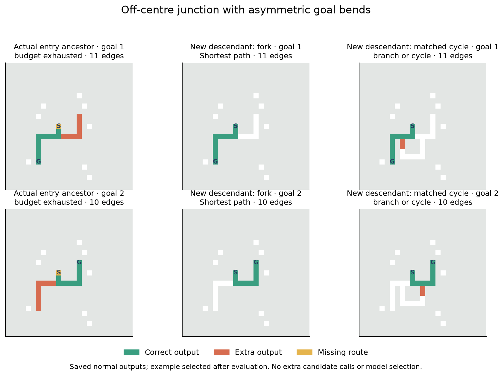

# V12L — a confirmed fork skill, with a clearer mechanism and a firm transfer limit

**The new K replicate-two random-origin lineage confirms on fresh geometry.** Its
descendant completes **192/1,728 paired tasks**, versus **0** for its actual G entry
ancestor and **24** for K's frozen initial selection. All 192 successes are forks:
twelve independently seeded templates, all eight poses, both centred and translated
junctions, straight/symmetric/asymmetric goal arms, routes up to eleven edges.
The immediate parent also completes 192; the final mutation did not create this skill.

The second result is a replicated external rescue in the older broad Branch
lineage. On the fixed mechanism subset, zeroing nonlocal values improves **112→192
pairs**, with no lost normally successful pairs or corridors. Gains span four
independent templates and all three goal forms. This and the primary lineage
confirmation pass the preregistered screen for a **separate, small heritable-exposure
calibration**. Neither result establishes a general maze solver, useful multirange
communication, evolved regulation, or speedup.

## What was frozen and tested

Protocol/source/panel/fixtures were pushed in **09422ee before main generation**.
No training, genome editing, model selection, stopping retune or forced traces
occurred in L. The panel is explicitly K-informed: all fourteen previous J/K models,
plus both new K descendants, immediate parents, actual G entry ancestors and frozen
K initial selected controls. There are 22 physical models; the identical K Context
primary genome aliases remain recorded. The separate intact solver never enters a
random-origin lineage. The five- and sixteen-edit histories are preserved.

The new corpus contains **36 independent 25×25 templates**: three goal-arm forms ×
six prefix/source forms × two tail bands. Every template has matched forks,
extra junctions, genuine longer alternative-route cycles, pruned corridors and
disconnected controls; all eight poses and both goals. Each whole graph, including
its eight isolated clutter cells, is also translated off centre without clipping.
There are 72 location contexts and 5,760 inputs per model, comprising:

- 3,456 branched inputs / **1,728 paired tasks**;
- 1,152 corridor inputs;
- 1,152 disconnected inputs.

The 36 templates are the independent units. Locations, poses and graph variants
are correlated. Eight-edge prefixes and source bends are explicitly included;
source shape and distance are not fully factorial. This remains a constrained
graph grammar, not an ordinary-maze generalization benchmark. Changing board size,
geometry and corpus means a direct K-to-L count change has no single-variable
causal interpretation.

All **163,928** earlier whole layouts and **3,456** software-fixture layouts were
excluded before main generation. L adds 3,456 new main layouts. Exclude
**170,840 whole layouts** next, including unqueried fixture poses.

## The new lineage: actual ancestry matters

Complete pairs below have denominator 1,728; corridors have denominator 1,152.

| Fixed model | Complete pairs | Fork templates complete in all 16 poses/locations | Corridors |
|---|---:|---:|---:|
| K2 G entry i8103 | 0 | 0 | 0 |
| K2 frozen initial selection i32792 | 24 | 0 | 1,064 |
| K2 immediate parent i1040 | 192 | 12 | 1,152 |
| K2 descendant i1089 | **192** | **12** | **1,152** |
| K1 G entry i2826 | 16 | 0 | 60 |
| K1 frozen initial selection i8074 | 0 | 0 | 16 |
| K1 immediate parent i408 | 0 | 0 | 8 |
| K1 descendant i458 | 12 | 0 | 52 |

K2 i1089 has 256 genes, was born at K generation 16, and is sixteen single edits
from `fork/carry/evolved/branch/evolution/2/i8103`. It completes **every** one- or
two-edge-prefix fork pair in this corpus: 12 templates × 2 locations × 8 poses.
It completes zero pairs with four/eight-edge prefixes, and zero extra-junction or
cycle pairs. Some individual nonfork outputs are shortest; neither goal pair is
complete there. Its 1,728 legal outputs are all shortest, including all corridors.
All 24 pairs and all 1,064 corridors of the frozen selected control are retained.

The immediate parent has identical normal masks, statuses and emission steps on
all 5,760 inputs. The descendant saves 4,404,576 local reads in total and uses fewer reads/active instructions on
every input; dispatch counts and array size match. Thus the last replacement edit
has an observed work effect, but **no new correctness effect here**. Hidden states
were not recorded. L does not identify which earlier edit established the skill.

K1 i458, born generation 7 after five edits from G i2826, improves on its immediate
parent but is a net regression from its entry ancestor: eight newly completed
pairs, twelve lost, four retained; twelve new corridors and twenty lost. Its twelve
pairs are two poses at both locations of one short straight-goal template, across
all three graphs, with six-edge routes. None of its successful normal pairs lies
in the predeclared long-tail mechanism subset. Those interventions cannot diagnose
necessity for these twelve successes. This is not a second robust replication of
the K2 improvement.

This illustration is retrospective, selected from saved outputs with no additional
candidate calls. The actual entry ancestor exhausts its per-response budget; the
descendant emits both eleven/ten-edge fork routes correctly but leaves an extra
branch on the matched cycle. All receive the same runtime limits.

## Mechanisms on identical, predeclared cases

Every model receives normal, pulse-off, static-goal-flag-off, endpoint-check-off
(source-only stopping), and nonlocal-value-zero conditions. Four interventions use
nine fixed **long-tail** templates: three goal shapes × prefix-one straight,
prefix-two straight and prefix-eight bent. Both locations, all poses and all graph
families/controls are included: **1,440 inputs**: 864 branched inputs / **432 branch pairs**, 288
corridor inputs and 288 disconnected inputs per condition. Normal counts in this
section are from that same subset, not the larger normal corpus. Ablated reads
remain charged; changed trajectories can still change total work.

| Model | Normal pairs | Pulse off | Goal flag off | Endpoint check off | Nonlocal zero |
|---|---:|---:|---:|---:|---:|
| K2 descendant | 96 | 96 | 0 | 96 | 96 |
| K2 immediate parent | 96 | 96 | 0 | 96 | 96 |
| Older broad Branch | 112 | 112 | 0 | 112 | **192** |
| Older narrow Branch | 128 | 128 | 0 | 128 | 192 |
| Local longer-prefix exception | 12 | 0 | 12 | 0 | 12 |
| Unmutated 68-gene draw | 48 | 48 | 0 | 48 | 48 |

For K2, pulse removal, endpoint-check removal and nonlocal zeroing preserve **all
1,440 output masks**. Goal-flag removal changes every mask and loses all 96 normal
pairs and all 288 normal corridors. These results support static-goal-flag
necessity for those successful probe outputs; pulse and nonlocal values are not
necessary on this subset. They do not prove a full internal algorithm or behavior
on unprobed cases. Pulse removal and nonlocal zeroing change work despite unchanged
masks. The different local exception loses its twelve probe pairs under pulse
removal or endpoint-check removal, while flag removal preserves masks.

For old broad Branch, nonlocal zeroing gains eighty pairs across four templates,
covering straight, symmetric-turning and asymmetric-turning goals, with **zero
lost pairs and zero lost corridors**. Corridor correctness rises 204→288. Its
immediate parent reproduces the rescue; these are related models, not independent
evolutionary replicates. Narrow Branch gains 64 pairs and corridors 200→288, but
only on two straight-goal templates, so it fails the broader rescue screen.
Neither Branch model has any normal far-prefix pair in this mechanism subset:
far-retention is **vacuous**, not demonstrated. Prefix-four successes elsewhere in
the main corpus were not in this fixed intervention subset.

Both preregistered primary conditions pass: K2 normal lineage confirmation and
broad Branch harmful-exposure rescue. This is evidence that disabling an input
can help a particular preserved lineage. It does not show that a genome-owned gate
has evolved, that nonlocal information is beneficial, or that K2 needs a gate.

## Preserved controls and remaining limits

| Other normal model | Pairs / 1,728 | Corridors / 1,152 | Longest completed paired route |
|---|---:|---:|---:|
| Old narrow Branch (and parent) | 324 | 840 | 11 edges |
| Old broad Branch (and parent) | 288 | 852 | 11 |
| Longer-prefix nominee | 0 | 160 | — |
| Its broad-validation replacement | 100 | 1,060 | 10 |
| Local longer-prefix exception | 34 | 520 | 12 |
| Local cycle exception | 0 | 48 | — |
| Fresh evolved control | 16 | 96 | 6 |
| Fresh local control | 0 | 72 | — |
| Earlier fresh local control | 0 | 1,152 | — |
| Unmutated 68-gene draw | 96 | 1,152 | 10 |
| Shared ancestor | 24 | 88 | 10 |

Old narrow/broad Branch each completes eighty two-junction and eighty cycle pairs;
those are different capabilities from K2's fork-only result. Narrow Branch and
its parent each complete four prefix-four pairs; the replacement completes four,
and the local exception eight. **Every random-origin model completes zero
eight-edge-prefix pairs** in L. This does not erase the preserved J exceptions;
it shows their transfer limit on new geometry. No post-hoc reselection replaces
these fixed comparisons.

The unmutated 68-gene draw completes all prefix-one forks across six templates,
all poses/locations, and all corridors. K2 additionally completes prefix-two forks,
but this selected fixed comparison does not establish that large capacity or
evolution consistently beats random sampling. Fresh-origin discovery remains open;
L performs no fresh evolutionary search.

Every random-origin model gets **0/1,152** disconnected controls, with no false
reachable no-path claims in normal inference. Every legal normal output is
shortest. BFS, A*, bit-wavefront and the separate intact VM each solve **4,608/4,608
reachable and 1,152/1,152 disconnected** inputs. No latency benchmark was conducted.

A separately labelled descriptive check of saved outputs finds exact translated
masks in all **2,880 centred/off-centre comparisons per model**, including failures.
Thus the tested ±2 translations do not explain the failures; the location copies
are not extra independent successes. This does not test arbitrary translations,
boundaries or general geometry.

## Cost, audit and reproducibility

Local Apple M4 CPU, ten cores, 16 GiB; Python 3.13.15, NumPy 2.5.4, Numba 0.68.0,
llvmlite 0.50.0, pytest 9.1.1. Main seed 2026101907, fixtures 1264. No cloud,
LLM/model calls or paid compute. Actual-size profiling covered every model/mode,
all geometry strata and both positions at pose zero. Projection 452.62 candidate
seconds; actual **448.482 seconds / 720 cap**, **253,440 calls**, **267,047,037,936
work units**. Main wall 457.149 seconds; peak RSS 662.16 MiB. Warm-up separately
records five candidate and three baseline calls. Final baselines add 17,280 calls.

Fixture calibration separately uses 61.254 candidate seconds, 34,848 calls,
63.653 seconds wall, including 1,584 native/adapter parity comparisons (two calls
each). All fixture responses and all unqueried poses are saved and excluded.

The independent audit **passes on its first attempt**: **288,288 exact candidate
replays**, **303,984 independently graded rasters**, all 17,280 baseline replays,
1,584 native/adapter parity comparisons, 21 ancestral mutations, and all 11,520
fixture/main cases regenerated and graph-checked. It verifies 166 frozen source,
nine registered input and nineteen panel-source hashes, plus **1,187 unchanged
prior G/H/I/J/K completion entries**. Audit wall time is **533.00 seconds**;
peak RSS **1044.23 MiB**, separately from the main budget.

Eight new and seventeen related focused tests pass; **220 tests collected**, not
a fresh full-suite run. No scientific source was changed after registration.
Raw masks, counters, concrete mutations, ancestry aliases, seed manifests and all
older populations/RNG checkpoints remain preserved. The figures and detailed
translation/retention summary are explicitly post-registration analyses of saved
outputs, with no new candidate evaluations.

## Next step

Proceed to a **calibration of heritable nonlocal exposure**, not another unchanged
long evolution run. Use broad Branch as a positive rescue reference, K2 as a skill
that should be retained, and the local/68-gene exceptions as controls. Compare the
same minimal gate under active versus neutral inheritance, fixed exposure,
fixed-zero and local controls; charge reads consistently and match storage,
mutation opportunity and case budgets. All-off is a valid suppression outcome,
not a multirange breakthrough. Require measurable fitness/reproductive effects
before a bounded pilot. Keep fresh random-origin founders on new adjacent/two-edge
paired elementary tasks so pressure can actually activate, with retained RNG and
diversity. The detailed proposal is [here](lineage_confirmation/next_experiment.md);
it has not been launched or preregistered.
