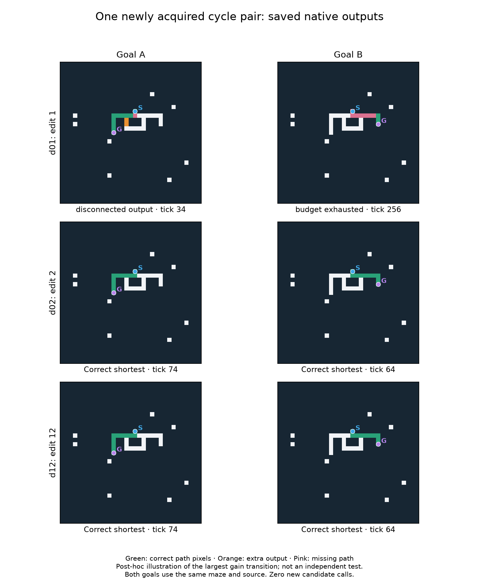

# V12U — one historical mutation accounts for the major solving gain

The 12-edit map identifies a sharp transition in the preserved random-origin
lineage. Edit 2 changes one instruction destination and increases complete
positive-prefix goal-switch pairs from **0/960 to 238/960** on new mazes. The
improvement appears in all eight sampled structural contexts. Ordinary-maze
shortest outputs rise from 21/384 to 56/384 and corridor outputs from 38/768 to 768/768.
Later edits add no new complete pairs on these cases; edit 8 loses 14 positive pairs
and 48 corridors. These are newly measured effects of historical edits, not new
evolution or a new selected primary.

All 19 genomes were frozen before final generation. The 13 lineage programs are
exact historical checkpoints; six preserved comparators include the separate
intact known solver. No candidate was bred, edited, reselected or given an oracle.
The registered protocol was pushed in `3c05aaf` before final generation.


## What changed along the lineage

A complete pair requires correct shortest rasters for **both goals on the same
layout and source**. Positive-prefix pairs place the source before the first
junction, so they are more informative than starting at that junction. We count
whole output paths, not a promising branch choice or a correct transient frame.

| Exact checkpoint | Genes | All pairs /1,152 | Positive-prefix pairs /960 | Corridors /768 | Ordinary shortest /384 |
|---|---:|---:|---:|---:|---:|
| Root and edit 1 |254 /253|10|0|38|21|
| Edits 2–7 |253 /256|420|238|768|56|
| Edits 8–12 |256 /255|392|224|720|56|
| Fresh 2 descendant |160|128|64|768|8|
| Fresh 2 exact immigrant root |119|0|0|0|0|
| Carried 1 descendant |255|228|126|683|10|
| Carried 1 broad root |256|0|0|56|54|
| Unmutated random 68 |68|128|64|768|0|
| Intact known solver |30|1,152|960|768|384|

Edit 2 gains 238 positive pairs without losing any positive pair. Its successes
include 120 fork, 62 two-junction and 56 genuine alternative-cycle pairs. Context totals
are 32, 32, 28, 26, 32, 32, 28, 28. There are 23 positive-prefix context/variant groups that
work in all 8 poses. The longest completed pair has 14/13-edge routes, in 6 poses of
one hook context. All successes remain at shared prefixes 1 or 2; the whole carried 0
lineage completes **zero pairs at prefixes 4 or 8**, including the bent-prefix tests.
Long tails therefore still should not be confused with long-distance branch routing.

Across all pairs, edit 2 gains 410 and loses none; three individually correct
branched outputs are nevertheless lost, so even this large gain is not absolute
behavioral dominance. Ordinary trees improve 12→36/192 and ordinary cyclic mazes
9→20/192, with no ordinary success lost at this transition.

Edit 8 loses 14 positive pairs: 8 fork and 6 two-junction, distributed across both
both-bent contexts and both hook contexts. It also loses 14 prefix 0 pairs and 48
corridor outputs. No new complete pair or shortest individual output compensates
on this corpus. Its effect is conditional on the edit 7 parent; this does not
prove that its reversal alone will repair every later background.

Several other edits alter failed masks, stopping times or work without changing
correctness. Edit 3 changes 82 masks and 162 stopping ticks; edits 9 and 10 each change 224
masks/ticks. Seven transitions (1, 4, 5, 6, 7, 11, 12) change no native mask, status or
stopping tick here, though work can change. They are behaviorally neutral on this
assay, not proven universally redundant genes. Exact event rows and all response
comparisons are in [the data tables](lineage_mapping/data_tables.md).

## The specific change and what it suggests

Edit 2, born at historical generation 22, changes instruction 103 (zero-based):

```text
before: scratch44 = minimum positive neighboring old-channel3 value
 after: scratch32 = minimum positive neighboring old-channel3 value
```

The `REMOTE_MIN` opcode name and stored radius do not make this a long-range
experiment: common **local topology** forces the actual lookup to radius 1 in
both programs. The program stays 253 genes long. The measured gain therefore
requires neither an increase in capacity nor a range change at this transition.
It occurs within an already large, historically evolved random-origin background.

Post-hoc static inspection gives a more precise hypothesis. Scratch registers
reset to zero at every site/tick. With the destination changed, scratch 44 remains
zero before an unconditional store into persistent channel 4 at instruction 108.
That is the last channel 4 store in the program. The new scratch 32 value has only
one subsequent reader, a channel 3 store that is itself overwritten before the
tick commits. Thus the edit suppresses the old signal into channel 4, rather than
adding a retained signal through scratch 32. These statements are checked against
the exact saved program in [static_interpretation.json](lineage_mapping/static_interpretation.json).
They are static data-flow deductions, **not** a newly run channel 4 intervention
or a complete derivation of the solver's algorithm.

This is stronger evidence for a useful historical genetic transition, and a
concrete candidate mechanism, than the earlier endpoint-only comparison. It does
not establish that the edit works alone in the original root or a different
lineage. The preceding deletion may interact despite appearing neutral by itself;
that combination was not tested here.

## Goal information, output feedback and stopping

The predeclared diagnostic subset contains 96 positive-prefix pairs from the first
straight and first one-bent contexts, across prefixes 1/2/4 and fork/cycle variants.
Every genotype receives all scheduled interventions, irrespective of native success.
Edits 2–12 each complete 48 of these normal pairs. Removing the initial goal pulse
retains 48/48. Removing the static goal flag, reading zero in place of the output
channel, or disabling halt requests retains **0/48** in each case. These conditions
also create no new correct pair in this subset. Root and edit 1 have no native
subset success on which to assess necessity.

The carried strategy therefore requires the tested static-goal, feedback and
stopping mechanisms for these particular successes. Later edits do not change
that measured signature. We cannot assign all three requirements to instruction 103
itself or assume they characterize every successful task. Disabling halt requests
still permits quiescence and applies the unchanged runtime caps; no forced trace
was counted as native inference.

Fresh 2 differs: its 16 normal subset successes survive output-feedback removal,
although flag and halt removal destroy them. Carried 1 retains 16/25 normal successes
without the static flag, 25/25 without the pulse, and 0/25 without feedback or halt
requests. Distinct strategies remain worth preserving.



The illustrated pair is selected post-hoc from the largest-gain transition,
not extra evidence from a new test. Both goals have the same maze/source. Edit 2
emits 10/9-edge shortest paths instead of the 20/19-edge alternatives, at native
ticks 74/64. Its parent fails both goals. All plotted masks are saved normal outputs;
the illustration makes zero candidate calls.

## What remains unresolved

The broader controls are useful restraints on interpretation. The fresh 2 descendant
and unmutated 68-gene draw both complete the same 64 positive fork pairs, all 8 poses
of each of the eight prefix 1 contexts; neither completes a positive extra-junction
pair here. Fresh 2 has 8 ordinary successes versus zero for the draw, but this study
does not demonstrate a consistent advantage of evolution or larger genomes.

Carried 1 preserves different capabilities: 58 positive pairs at prefixes 4 or 8,
including two bent-prefix poses, and four long-prefix cycle pairs across the two
straight contexts. Those four cycles use the same single pose, with prefix 4/8
variants correlated within each context. Three pairs in one hook context have
20/19-edge shortest routes (two fork poses, one two-junction pose). No positive
carried 1 context/variant works in all 8 poses. Its ordinary performance declines
from its root's 54/384 to 10/384. This specialist must not be discarded because
another genome has a larger aggregate count.

All 18 random-origin models give 0/768 correct explicit no-path responses. None falsely
reports no path on a reachable queried case, and no legal-but-nonshortest normal
output occurs. BFS, A*, bit-wave and intact control solve all 3,456 reachable inputs
and all 768 disconnected inputs per control. There is **no general solver, causal
multirange benefit or speedup claim**. No latency benchmark was run.

The corpus has eight sampled structural contexts, two per shape. Poses, goals,
prefixes and graph variants within a context are correlated, and shape/tail lengths
are not independently crossed. This is one T-informed lineage, not twelve
independent evolutionary discoveries or an unbiased population-policy comparison.
The larger count of correct outputs should not be presented as hundreds of
independent replications.

## Reproducibility and cost

Seed 2026101916; fixtures 1354. New final data exclude all 225,592 whole layouts through
T and all 2,784 Ufixture layouts. Final generation retains 8,448 inputs even though
the fixed query subset contains 4,224/model; all 5,056 new whole layouts are excluded
from future studies, including unqueried variants. Cumulative exclusions: 233,432.
Source, masks, counters, exact genomes/edits, all ancestors and old RNG/populations
remain preserved. Runtime and per-site limits are unchanged.

Main execution: 92,544 candidate calls, 239.22 candidate seconds of 720 allowed,
138,647,236,543 work units, 243.75 seconds wall, 475.95 MiB peak RSS. Calibration is
separate: 12,784 calls, 30.89 candidate seconds of 180 allowed, 31.51 seconds wall,
253.42 MiB peak RSS. Warmups are logged separately. Measured compute supports budget
accounting only; unequal successful-output latency was not benchmarked.

Eight new and 32 related tests pass (40 total); this is not a fresh full-suite run.
The audit passes 105,328 exact candidate replays, 13,560 baseline replays,
118,888 independent raster grades, 5,624 native/adapter parity checks and all
4,937 prior completion hash entries. It verifies 210 source and 10 input hashes,
all 12 historical edits and corpus regeneration. Audit wall time is 284.39 seconds,
with 1,037.22 MiB peak RSS. Details are in [audit.json](lineage_mapping/audit.json). The
registered source and protocol were not repaired or altered after final generation.
Full candidate/baseline replay, independent raster grading and graph/oracle checks
precede the completion seal.

The next proposed step is a bounded causal dissection of edit 2 and the edit 8
regression, on another new corpus, before choosing an evolutionary change.
See [next_experiment.md](lineage_mapping/next_experiment.md). It is not launched.
