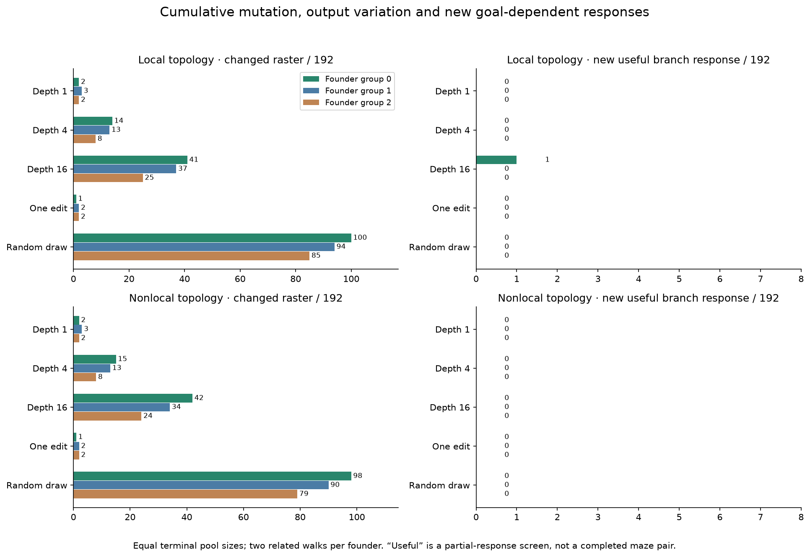
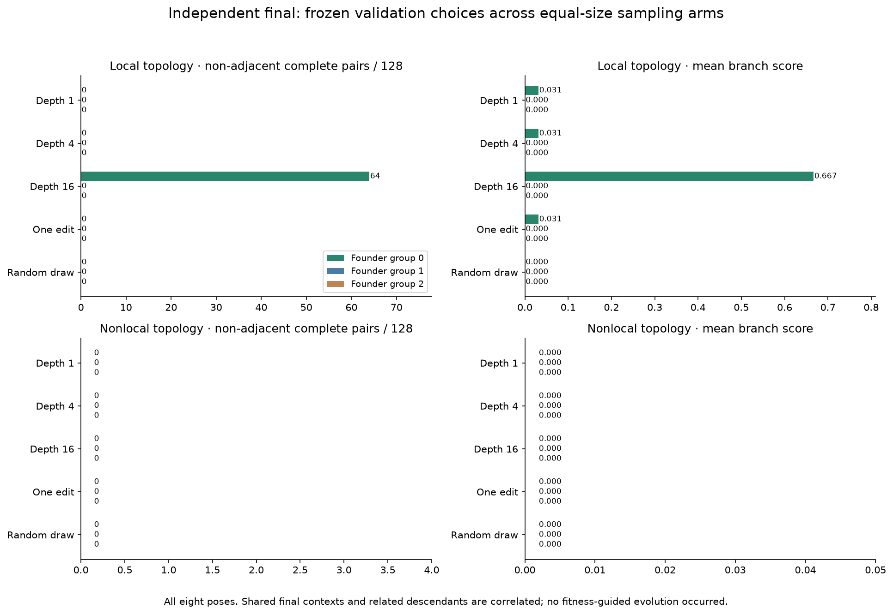

# V12O cumulative mutation produces a rare new short-route solver

**A random-origin lineage acquires a real, transferable short-route capability
by the sixteenth sampled edit.** Its frozen local descendant completes 64 of 128
non-adjacent goal pairs on untouched final layouts, plus all 32 adjacent pairs and
all 320 matched corridors. Its original founder and its depth-1/depth-4 checkpoints
complete no pairs on those same cases. Both goals must produce correct shortest
paths for a pair to count.

This is a positive result for exploring cumulative random variation. It is also
narrow: only one of 576 deep walks produces the new interior branch response in
discovery, and the capability fails the tested shared-prefix forks. The
preregistered population-level supply gate fails in every group. **No evolutionary
pilot was launched, and general maze solving, useful multirange computation and
competitive speed remain unestablished.**

The illustration shows a three-edge route to either goal on the same layout.
It was chosen retrospectively from saved final rasters for explanation, not for
model selection, a new test or a mechanism claim.

## What was tested

V12N found that most one-edit mutations changed internal work but few changed
output masks. Its calibration also omitted quarter-turn poses where an unchanged
founder could respond weakly. V12O therefore asks whether cumulative mutation
supplies new goal-dependent behavior when every scientific stage covers all eight
rotations/reflections. Both changes are explicit; a difference between N and O
cannot be attributed solely to mutation depth.

Each of the three original M groups retains all 96 random founders. From each
founder we sample two independent 16-edit walks, without inspecting performance
between edits. We evaluate depths 1, 4 and 16, and compare them with two separately
sampled one-edit children and two new random genomes. Each of the five terminal
arms has 192 identities per group. The original founders are common reference
controls, not an equal-size terminal arm. The random-draw reference is only a
matched slot; it is not that random genome's ancestor.

This gives 576 walks, 9,792 mutation events including the independent one-edit
controls, 576 random draws, 3,168 evaluated identities and 6,246 distinct physical
local/nonlocal configurations. All sixteen intermediate genomes per walk, concrete
edit events and replayable RNG states are preserved. No reproduction or
fitness-guided evolutionary trajectory occurs. No known solver enters a lineage.

The existing all-on exposure runtime, goal pulse, instruction language and limits
remain fixed: 256 genes, 256 ticks, 4,096 reads/site, 32,768 instructions/site and
65,536 cells. Stored exposure bits remain inert. Local topology redirects remote
reads to radius one; nonlocal topology uses the genome's existing ranges. The
internal label `evolved` denotes that nonlocal topology, not evolution during O.
This comparison is not the same intervention as zeroing nonlocal reads.

Source, pools, events/RNG, fixtures and protocol were frozen and pushed in
**f08484c before any candidate inference**. All discovery/validation evidence and
choices were frozen and pushed in **21d5bfb before final generation**. Main seed:
2026101910; fixture seed:1294. No frozen source repair or protocol deviation occurred.

## Equal opportunities, independent stages

The corpus uses the established 9×9 tree grammar: adjacent goals, two-edge arms,
two-edge routes with a one-edge shared prefix, three-edge arms and three-edge
routes with a one-edge shared prefix,
each in straight/turning forms. Six isolated clutter cells distinguish seeded
whole layouts. Each paired layout has matched pruned corridors and two
disconnected open goals. Route forms repeat; new clutter contexts are not new
independent decision topologies. There are no alternative-route cycles in O.

| Stage | Seeded contexts | Queried poses | Inputs/model | Paired tasks |
|---|---:|---|---:|---:|
| Software fixtures/profile |10|Pose 0|60|10|
| Discovery |10|All 8|480|80|
| Validation |10|All 8|480|80|
| Independent final |20|All 8|960|160|

Final counts per model are 32 adjacent and 128 non-adjacent pairs, 320 corridors
and 320 disconnected inputs. Ninety-six pairs have exclusive interior arm cells
eligible for the partial-response score. Groups share cases; poses, goals,
matched variants, depths and walks from the same founder are correlated.

Every terminal arm receives 552,960 logical discovery evaluations across three
groups and two topologies. Exact aliases share physical inference; physical calls
and work are not forced to be identical. Discovery uses 2,998,080 physical calls,
including common founder controls. The same rank nominates two candidates per
arm/group/topology, and independent validation selects one. Validation uses
42,720 physical calls for 89 configurations; its 57,600 logical slot evaluations
include nominee reference founders. The frozen final panel contains 62 physical
configurations: selected candidates, their reference founders, earlier queried
walk checkpoints, protected M anchors and a separate intact known control.

The rank prioritizes non-adjacent complete pairs, then a new useful response
relative to the reference, the positive branch score, strict two-sided response,
all complete pairs, corridors and no-path accuracy, followed by fixed tie-breaks.
The branch score excludes both goal cells and shared route cells. It measures
appropriate output change on the two exclusive interior arms and multiplies the
positive contrast by the weaker complete-raster path F1. Ordinary emitted rasters
alone count; hidden or forced intermediate states are not solutions.

## More output variation, one new branch-response lineage

The number of terminal masks differing from the reference grows with depth.
Counts below are the three founder groups, each out of 192 terminal candidates.
Returned masks include unsuccessful or non-emitted outcomes; a changed mask alone
is not useful solving behavior.

| Sampling arm | Local changed masks | Nonlocal changed masks | New useful branch responses |
|---|---|---|---|
| Walk depth 1 |2 / 3 / 2|2 / 3 / 2|0 everywhere|
| Walk depth 4 |14 / 13 / 8|15 / 13 / 8|0 everywhere|
| Walk depth 16 |41 / 37 / 25|42 / 34 / 24|1 in group 0/local; 0 elsewhere|
| Independent one edit |1 / 2 / 2|1 / 2 / 2|0 everywhere|
| Independent random draw |100 / 94 / 85|98 / 90 / 79|0 everywhere|

All depth-16 candidates change computation counters relative to their reference.
Random draws produce more changed outputs than mutation walks but no new useful
interior response on discovery. Inherited positive responses are not counted as
new discoveries. Some descendants lose corridor or pair skills; all original
founders remain preserved.

Median gene counts across groups are 96 at depth 1, 97 at depth 4 and 105 at depth
16, versus 96 in each control arm. The deepest genomes range from 64 to 169 genes;
none approaches the 256-gene ceiling. This experiment tests cumulative edits, not
the necessity or sufficiency of much larger capacity.

The discovery gate requires at least four useful candidates from at least two
reference founders and two behavioral signatures, with at least two more useful
candidates than each of depth 1, independent one-edit and resampling controls.
**Every cohort fails.** Group 0/local/depth 16 has one candidate, one founder and
one behavior. Its final-transfer gate passes, but its combined gate still fails.
No depth/topology qualifies in the required two of three groups.

## The confirmed gain and its limits

The selected target is `mutation_depth/r0/f71/walk0/d16`, 137 genes, descended
from the 128-gene M random founder `exposure/fresh/0/founder71`. It is not the
previously preserved founder 81 whose small responses drove several earlier
selections.

| Same lineage on untouched final | Adjacent pairs /32 | Non-adjacent pairs /128 | Corridors /320 | Correct no-path /320 |
|---|---:|---:|---:|---:|
| Original founder |0|0|32|0|
| Walk depth 1 |0|0|32|0|
| Walk depth 4 |0|0|32|0|
| Walk depth 16 |32|64|320|0|

All 960 final masks at depths 1 and 4 match the founder's masks; computation
counters differ. Only depths 1, 4 and 16 were queried. The capability appears
**by depth 16 and is absent at depth 4**. We cannot identify its first causal edit,
claim that all sixteen edits were necessary, or infer a smooth learning curve.
The immediate depth-15 parent was saved but not evaluated in O.

The 64 new non-adjacent pairs consist of 32 two-edge-arm and 32 three-edge-arm
pairs. They cover both straight and turning forms, eight clutter-seeded contexts
of four route-shape types, all eight poses each. The target emits 512 correct
shortest reachable outputs out of 640, including the 320 corridors. Its mean
interior response score is 2/3, with 64 strict two-sided responses and no lost
positive pairs relative to its founder.

It completes zero pairs in either shared-prefix fork class (one shared edge,
with total route lengths of two or three edges). Successful choices
are made at the source; the tested shared-prefix forks also change source degree,
branch structure and tail geometry. This is a useful boundary observation, not an
isolated causal diagnosis of prefix length. No larger, cyclic or ordinary maze
claim follows from these small tree forms.

All other frozen terminal-arm choices complete zero non-adjacent pairs. Group 0
local depth-1, depth-4 and one-edit choices each retain 8 adjacent pairs and 72
corridors; their small response matches founder 81. Group 0 nonlocal mutation
choices retain 12 adjacent pairs and 10 corridors. The group 2 unmutated random
selection completes all 32 adjacent pairs under both topologies and 64 corridors.
Preserve it as a useful control; the result does not establish a consistent
mutation advantage over resampling.

Two additional depth-16 lineages provide a distinct, secondary signal. Group 1
`mutation_depth/r1/f53/walk0/d16` completes all 320 corridors and identifies all
320 disconnected inputs under both topologies, versus zero of each for its
founder. Group 2 `mutation_depth/r2/f69/walk1/d16` also completes all 320 corridors
and all 320 disconnected inputs. Its founder already identifies those disconnected
inputs but incorrectly claims no path on 432 reachable inputs and completes only
80 corridors; the descendant makes no false no-path claim. The disconnected goals are isolated clutter cells, a limited no-path test. These descendants
still complete zero pairs. They demonstrate narrower reachability/corridor gains
on this grammar, not goal-selective branch routing or general no-path recognition.
All thirty selected arm/topology/group choices make zero false no-path claims.

On discovery data, the same group-0 target has 32 non-adjacent pairs and 160
corridors locally, versus zero of each with nonlocal ranges. This is inspected
selection evidence, not an independent final intervention. The nonlocal final
choice is a different genome. No pulse, flag, endpoint or nonlocal mechanism
ablation was added after seeing final outcomes.

## Cost, verification and preservation

Main discovery, validation and confirmation together consume **349.14 candidate
seconds (5.82 minutes)** under the shared 720-second cap: 3,100,320 physical calls
and 203,251,399,805 charged work units. The final carries forward the exact saved
budget; it does not reset it. Main recorded wall time is 414.93 seconds, including
stage generation/warmup, with peak RSS 1,249.61 MiB. Profiling is separate:
374,760 calls, 42.45 candidate seconds and 48.41 wall seconds. Preparation takes
9.58 seconds without candidate inference. Each execution stage records its warmup
calls separately. Equal evaluation allowances do not imply equal internal work.

Execution is local on Apple M4, 10 CPU cores, 16 GiB RAM; Python 3.13.15,
NumPy 2.5.4, Numba 0.68.0 and llvmlite 0.50.0. BFS, A*, bit-wavefront and the
separate intact VM each solve all 640 reachable and 320 disconnected final inputs.
There is no repeated warm latency benchmark in O; aggregate experiment timing
cannot establish a solver speedup.

The independent audit **passes on its first attempt** in 495.57 wall
seconds, with 1,454.14 MiB peak RSS. It verifies 3,475,080 exact candidate replays,
3,477,960 independently graded rasters, 2,880 baseline replays, all 9,792 mutation
steps, 576 walks and 576 random draws, 6,397 model summaries, 5,760 nominee ranks
and all thirty validation choices. It also checks 181 source and twelve input
hashes, every generated graph case, cap continuity, both gates and all 1,883 prior
completion hash entries. See [the verification packet](mutation_depth/verification.json).

Twenty-two distinct focused tests are covered: eleven new O tests and eleven
related N tests. The repository collects 252 tests; this is not a fresh full-suite
run. Post-registration diagnosis and plotting read saved data only and add no
candidate calls or selection feedback.

Exclude **all 178,232 whole layouts** through O from future independent studies:
177,032 through N plus 240 fixture, 240 discovery, 240 validation and 480 final
layouts. `mutation_depth_data.exclusions()` returns through N only; append all four
O `mazes.json.gz` manifests, including every fixture pose. All earlier completion
packets, populations/RNG, anchors, raw masks and useful controls remain intact.

## What this changes about the next experiment

We now have a concrete new lineage whose ordinary output gains a short-route
skill after cumulative random mutation. The prior concern that edits rarely
change outputs remains relevant, but it is no longer the whole result. There is
a productive object to study: locate the first transition among its saved
intermediate genomes, and test whether its decision-at-source behavior can
transfer when source position, prefix and downstream geometry are controlled.

The failed broad supply gate remains closed. A 60–90-minute evolution extension
would not answer the immediate mechanism question and is not authorized by this
result. The proposed next step is a bounded, prospectively frozen lineage and
transfer study, with normal successes established before mechanism interventions,
and the two reachability descendants and unmutated controls preserved. See
[the unlaunched proposal](mutation_depth/next_experiment.md) and
[the completed handoff](../docs/MUTATION_DEPTH_PROGRESS.md).
