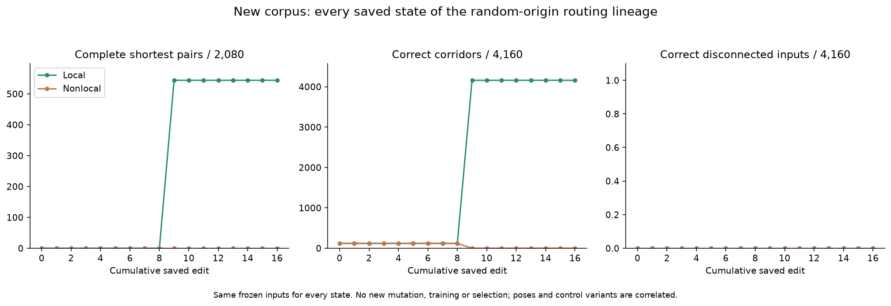
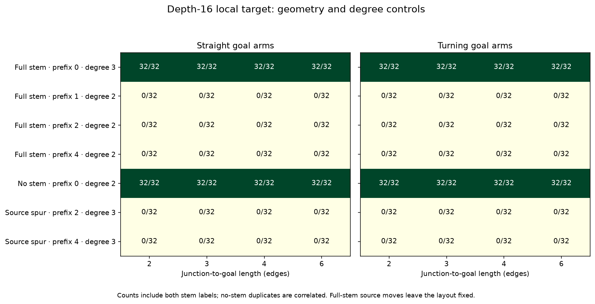
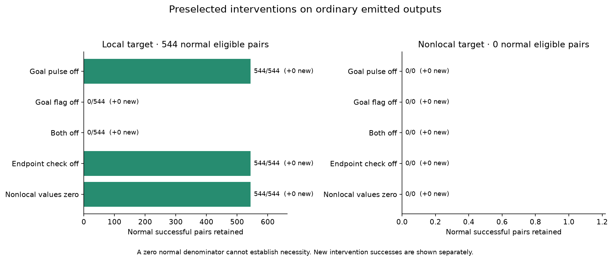

# V12P identifies the mutation and the emerging goal wave

**The first useful transition occurs at edit 9. A random instruction insertion
creates local feedback, and the resulting emitted rasters behave exactly like a
wave spreading outward from the goal until it reaches the source.** On new
matched cases, the local lineage jumps from zero to 544 complete shortest-pair
evaluations and from 120 to all 4,160 corridors. Steps 9 through 16 retain those
results. The independent audit passes.

This is a more specific result than a collection of short-route successes. We
have evidence for a goal-dependent propagation primitive. The remaining obstacle
is isolating a path: when the wave encounters an internal junction, its output
spills into extra branches. It succeeds with the source at the first junction,
even with six-edge arms, but fails when the source moves one edge back on the
same open layout. The degree controls show that source degree alone does not
explain the boundary. General shortest-path solving and a speed advantage remain
unestablished.

## What changed at step 9

The fixed panel contains all seventeen states of the original O
`mutation_depth/r0/f71/walk0` lineage, including the random M founder. It was
frozen before generating the new corpus. No mutation, breeding, model repair or
reselection occurred in P. The lineage was selected because of O's result, so
this is conditional confirmation, not an unbiased estimate of discovery rate.

| Local state on the same final corpus | Complete pairs /2,080 | Corridors /4,160 | Correct no-path /4,160 |
|---|---:|---:|---:|
| Founder through depth 8 |0|120|0|
| Depth 9 |544|4,160|0|
| Depth 10 through 16 |544|4,160|0|

Within each of those two ranges, every saved normal mask, status and stopping
step is identical across all 12,480 inputs. Internal states were not recorded;
work counters are not identical. For example, depth 9 uses 624,400,792 charged
work units on the corpus versus 667,128,216 at depth 16. That is not a repeated
latency benchmark or a reason to discard the later states' unmeasured diversity.

The decisive adjacent-state change is an insertion at zero-based instruction
index 112, increasing length 130→131:

`R36 = max(0, R49 − R44)`

A posthoc static data-flow check shows that R44 is never assigned and resets to
zero at each site. Before the insertion executes, R49 holds R55, which was loaded
from the minimum positive neighboring value in channel 2. The final store to
channel 1 uses R36. In both depth 9 and depth 16, the resulting complete-tick update
is therefore: **channel 1 receives the minimum positive previous channel-2 value
at the four cardinal neighbors**, or zero when none is positive. The effective
radius is one in local mode and eight with the stored nonlocal range. This is
feedback from the output channel into another internal channel.

The adjacent-state comparison attributes the observed gain to this insertion in
its actual depth-8 background. It does not establish that transplanting it into
the original founder would work, that the preceding eight edits were necessary,
or that the rest of the 131-gene program is minimal. No targeted reversion or
transplant was performed. The static certificate is saved separately from the
preregistered analysis.

## What the emitted outputs tell us

A posthoc hypothesis was checked against every saved normal output at depths 9
and 16. For a reachable input, define the set of open positions whose graph
distance from the goal is no larger than the shortest source-to-goal distance.
**Every reachable raster matches that entire set exactly**:8,320/8,320 per state.
All 4,160 disconnected rasters match the goal's isolated component, but they are
not emitted as correct no-path responses. An independent deque traversal verifies
all 24,960 saved rasters across both states without candidate inference.

This explains the geometry boundary. On a simple arm, the growing set is a path
until it reaches the first junction. If the source is there, the output is
correct. If the source lies beyond the junction, the growing set also enters
other branches before reaching it. Those extra pixels make the raster invalid.
This is an output-equivalence diagnosis supported by the feedback instruction;
we did not observe an internal BFS implementation or feed oracle distances into
candidate inference.

The illustration is retrospectively selected from saved final outputs. It adds
no test or selection evidence.

## Matched transfer results

The new core corpus varies arm lengths 2/3/4/6, straight/turning arms and
straight/bent upstream stems on 19×19 boards. For each full stem, the source moves
to prefixes 0/1/2/4 while the open layout, goals and downstream geometry remain
fixed. Separate controls remove the upstream stem at prefix 0, or add a dead spur
at prefixes 2/4. Those controls test whether degree alone explains the effect;
they do change local geometry and are not a perfect intervention on an abstract
degree variable.

| Local depth-16 core condition | Source degree | Complete pairs |
|---|---:|---:|
| Full stem, source at junction |3|256/256|
| Full stem, prefix 1 |2|0/256|
| Full stem, prefix 2 |2|0/256|
| Full stem, prefix 4 |2|0/256|
| No upstream stem, source at junction |2|256/256|
| Extra source spur, prefix 2 |3|0/256|
| Extra source spur, prefix 4 |3|0/256|

Success covers every tested arm length, both goal shapes, both stem labels and
all eight poses. Making a remote source degree three does not rescue it, while a
degree-two source at the choice still succeeds. Prefix bends do not rescue the
four-edge-prefix failures. The matched full-layout contrasts for prefixes1/2/4
versus0 are each −100 percentage points in every one of sixteen core templates.
Their registered template bootstrap intervals consequently collapse to the same
value. These are conditional descriptions of this small fixed grammar; they do
not imply population certainty or independent evidence from each pose.

The stress set uses arm lengths4/6 with matched fork, extra-junction and genuine
alternative-cycle graphs. The target solves32/32 prefix-zero forks and zero
other stress pairs:0/96 extra-junction,0/96 cycle, and0/64 positive-prefix forks.
Cycle alternatives are twelve edges longer than the shortest routes. There are
32 additional individually correct paired outputs without completing the other
goal in their pair; those do not count as paired solutions.

The headline544/2080 counts follow the registered labels. No-stem cases duplicate
across stem labels. Collapsing identical cells/source/ordered-goals leaves
**416/1,952 distinct paired inputs**. The independent seeded units are twenty
templates, sixteen core and four stress; geometries repeat with new clutter.
Poses, goals, controls and lineage states remain correlated. This is not an
ordinary or general-maze benchmark. The board-size change also prevents treating
O-to-P differences as a pure distance intervention.

## Preselected mechanism interventions

The target, depth15 parent, founder, depth4 and intact control were preselected
under both topologies. Normal evaluation for every model preceded all probes.
For the local target, all544 normal successful pairs lie in the registered
mechanism subset:

| Intervention | Normal successful pairs retained | Newly successful pairs |
|---|---:|---:|
| Remove initial goal pulse |544/544|0|
| Remove static goal flag |0/544|0|
| Remove both |0/544|0|
| Remove goal-endpoint emission check |544/544|0|
| Zero nonlocal values |544/544|0|

The static goal flag is necessary for these tested successes. The initial pulse
and the extra endpoint check are not necessary under the retained runtime and
other signals. This does not identify every instruction that uses the flag.
Zeroing nonlocal values is inert in local mode because remote operations have
already been redirected to radius one.

The same depth-16 program with its ordinary nonlocal ranges completes zero pairs
and zero corridors. Zeroing nonlocal values does not rescue any pair either.
Removing a radius-eight value is different from replacing it with a useful
radius-one neighbor value. There is no beneficial multirange result here. The
nonlocal normal-success denominator is zero, so its probes cannot establish
necessity for successful nonlocal solving.

All models, probe outcomes and failures are saved, including the intact control.
No forced trajectory or posthoc stop retuning contributes a solution.

## Other random-origin controls

The two O corridor/reachability descendants retain all4,160 corridors and all
4,160 correct disconnected reports under both topologies, with zero false
no-path claims and zero pairs. Group1's founder and depths1/4 have zero corridors
and zero correct no-path reports. Group2's founder and depths1/4 have1,040
corridors and4,160 correct no-path reports, but also4,768 false no-path claims on
reachable inputs. These contrasts replicate the narrower improvement observed
in O. The disconnected goals are isolated clutter cells, not a general
unreachability test.

The O unmutated adjacent-pair control solves zero pairs and zero corridors here;
P has no adjacent-goal band, so this is a new-domain result, not loss of its saved
O skill. M component-growing anchors solve corridors but no pairs. Every original
genome, population, mutation and RNG checkpoint remains preserved. No known
solver entered any random-origin lineage.

## Registration, cost and audit

Protocol/source/panel/fixtures were frozen and pushed in **af823aa before any
panel inference**. The passing profile and16,120 exact native-runtime parity
checks were pushed in **fa9945b before final generation**. Main seed2026101911;
fixture seed1304. The panel has62 physical configurations and aliases;ten receive
five interventions in addition to normal evaluation. There is no final selection.

Fixtures contain10 templates,6,240 saved inputs and1,232 whole layouts. Main data
has20 templates,12,480 inputs,2,080 pairs,4,160 corridors and4,160 disconnected
inputs. Full orientation coverage is used scientifically; pose-zero fixtures
provide profiling. Graph labels, source degrees, same-layout controls, cycle
rank, shortest routes and longer alternatives are independently checked.

Main inference uses **116.32 seconds** of the shared720-second cap,904,960 calls
and67,248,915,826 work units. It contains773,760 normal calls and131,200 probe
calls. Recorded wall time is143.02 seconds, including generation and warmup;
peak RSS is846.08MiB. Profiling is separate:72,680 calls including native parity,
12.73 candidate seconds,15.96 wall seconds. It projected148.17 candidate seconds
for main evaluation. Warmups are separately recorded. Execution is local on the
same Apple M4 environment as O; Python3.13.15,NumPy2.5.4,Numba0.68.0.

BFS,A*,bit-wavefront and both intact-VM topology controls solve all8,320 reachable
and4,160 disconnected inputs. No repeated warm latency benchmark was run, and
aggregate experimental time is not a solver speed comparison.

The audit **passes on its first attempt**,175.99 wall seconds,1,078.00MiB peak
RSS. It verifies977,640 exact candidate replays,1,015,080 independently graded
rasters,37,440 baseline replays,16,120 native parity cases and10,800 comparisons
against the separately preserved V6 intervention adapter. All48 relevant mutation
events,112 model/mode summaries,186 source hashes,11 input hashes,graph cases,
budgets,transitions and2,140 prior completion entries pass. No frozen source
repair or protocol deviation occurred. Posthoc wave/static diagnostics are
explicitly separate and use saved data only.

Twenty-two focused tests pass (eleven new,eleven related O);263 repository tests
collected,not a fresh full suite. Before registration, one test incorrectly
expected an eight-edge alternative-route difference. It was corrected to twelve
without changing fixture geometry and before any candidate inference.

Exclude **all181,928 whole layouts** through P:178,232 through O plus1,232
fixtures and2,464 final layouts. `mutation_transition_data.exclusions()` returns
through O only; future independent studies must add BOTH P maze manifests.

## Research decision

Random-origin discovery remains viable as a research direction: we now have a
specific feedback change, independent transfer to longer arms and a coherent
explanation of both success and failure. The result does not establish that more
capacity or an unchanged long search will produce a general solver. The missing
behavior is now more precise: prevent output from filling extra branches while
retaining the goal-driven propagation that already works.

The next proposal is a bounded, controlled shared-prefix curriculum experiment,
with the same initial genome pool and evaluation allowances across pressure
arms, protected source-choice/corridor skills, a separate fresh-random track and
resampling/frozen controls. This tests evolvability of path isolation; it does
not turn O's failed broad supply gate into a pass. No60–90-minute run follows
automatically. See the [unlaunched proposal](mutation_transition/next_experiment.md)
and [handoff](../docs/MUTATION_TRANSITION_PROGRESS.md).
