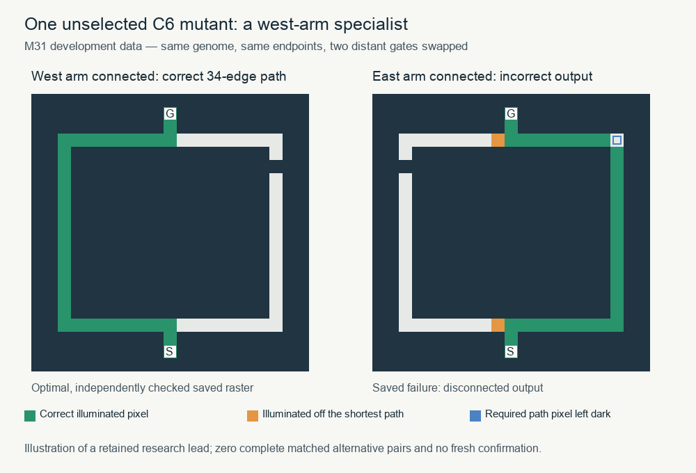

# M31: no integrated gain, with two limited leads

The registered C2-targeting comparison is negative: all nine fixed PRIMARY
scores are zero, and no frozen nominee adds a new complete ordinary eight-plus-edge
two-pose base. All three audits PASS. Targeting C2 has no descriptive advantage
under this protocol.

There are two limited leads. A frozen C6 nominee solves **one new fresh 11-edge
ordinary-maze pose**, with its partner pose failing. A separate **unselected C6
mutant** solves 48 controlled development presentations with 18–34-edge paths;
its matched failures have two extra pixels and one missing pixel. That second
variant has severe old-skill/no-path losses and no independent confirmation.
Neither result replaces the registered zero endpoint. Both are preserved for
future work. This is conditional capability evidence, not a general solver or
speed result.

The user authorized M30's proposed finite assay. Source, exact pool, used panel,
selection rules and protocol were published at **266bcba**
before scientific execution. All 27 role choices and development evidence were
committed/pushed at **81c7a87** before fresh generation. No final
re-selection or additional evolution was run. All older histories remain intact.

## What changed and what was controlled

The parents are the exact M30 recipient, donor and regulated random-origin
genomes. They share inherited propagation dynamics; these are related forks,
not three fresh origins. Each has 512 matched seeded opportunities per arm.
Ordinary uses the unmodified M19 grammar; output and C6 consume its initial
writer draw then constrain that writer to C2 or C6. The seven old mutation modes,
bounded fallbacks, existing ten-channel M18 VM, caps and stopping rules remain.
No BFS, oracle or hand-written solver enters variation/inference. Writer copies
can change multiple nodes; one opportunity is not one scalar edit. No M31 mating,
larger state space or sustained generation sequence was introduced.

There are 4,608 proposals and 211 reference aliases, yielding 2,959 physical development
models after genotype/query deduplication. All 208 noncontrol historical aliases
are the declared portfolio; three intact controls are external checks only.
The offspring have one M31 variation opportunity, separated from all inherited
M25/M28 ancestry. Exact ancestry identifiers/hashes and roots/entries are retained.

Each arm receives **1,536 opportunities × 811 cases = 1,245,696 nominal queries**.
Physical inference is deduplicated, including across arms and references.
Different scopes/lengths change random consumption, kinds, dead-code exposure
and cost. Equal opportunities/nominal cases do not imply equal CPU or isolated
causality of a particular primitive. All capacity fallbacks/no-ops are counted.

Development reuses all 454 M28 development inputs and all 357 M30 inputs, namespaced
by panel, with no new development mazes. This includes all 288 controlled poses
and 69 older mechanism cases. The 48 controlled swaps contain repeated symmetries;
they are not 48 independent random maze samples. Retention compares same-case
parent/root/entry complete paired tasks, corridors, ordinary bases and no-path.
Gate-pass also requires changed genotype, nonempty A0-disconnection90% and zero
false reachable no-path. No reward for making a reachable raster empty.

## Every proposal in development

| Scope arm | Opportunities | Changed genotypes | Any complete controlled swap | Any raw novel ordinary8+ | Gate passes |
|---|---:|---:|---:|---:|---:|
| ordinary | 1536 | 1486 | 0 | 0 | 0 |
| output | 1536 | 1500 | 0 | 0 | 0 |
| C6 | 1536 | 1486 | 0 | 0 | 0 |

These are proposal identities, including repeated genotypes and related parents.
Novelty is against the 208 declared reference aliases on the SAME cases, before
retention gates. Development totals cannot be subtracted from fresh totals to
infer acquisition. Full event/kind/writer/allocation distributions are retained
in `saved_diagnostics.json`; the complete pool and RNG hashes reconstruct exactly.

### The gates already fail on the starting parents

No development proposal passes domain retention90%; 4,472 have a changed genotype,
3,912 pass A0-disconnection retention, and4,417 avoid false reachable no-path.
The zero domain-retention count needs context: exact no-op witnesses show that
**all three parents already fail ancestral retention before M31**. For example,
the recipient retains only5/22 ancestral complete pairs and8/34 ancestral corridor
inputs on this mixed development panel. These are specialist backgrounds chosen
for the mechanism question, not the strongest overall founder pool.

Thus the strict gate asks for recovery of older skills as well as preservation
of current parental skills. Also, the minimum retention fraction is already zero
for some parents, making it less informative for ranking further losses. Those
are selection/design limitations, not grounds for changing the registered result.
The raw complete-target count is still zero before these gates. Exact parent-only
secondary gates and all individual gains/losses remain separately reported.

### The unselected long-path specialist

The ALL-proposal saved-record scan found exactly one candidate with any correct
individual controlled output: **`m31/regulated/C6/draw0246`**. No ordinary/output-arm
proposal does so. It solves48 presentations/36 distinct full stimuli:16 each with
18,26 and34 edges, across the three grid sizes and both gate heights. Every one of
these48 inputs is outside the SAME-case collective success of the208 declared
historical references. Its exact genetic parent fails these inputs. The archived
portfolio does cover96 other controlled presentations; this is a declared-portfolio
comparison, not a claim that every historical genotype has been tested here.

All48 successful saved rasters pass a separate scalar check of walls, endpoint
presence, degree, connectedness and shortest length. The genotype is one generic
replacement of C6 node14: the inherited private terminal SELECT becomes a
saturating subtraction, `max(0, 1 − r25)`. In that inherited private DAG, r25 is a
gated eastern C3 read. The rest of the regulated writer remains inherited. This
changes the conditional spatial readout; it stores no maze-specific path.
Its successful full paths all use the spatially western arm.

For24 matched counterpart presentations (12 distinct full stimuli), the saved
raster has **exactly two off-path pixels and one missing path pixel**, every time.
It illuminates most of the eastern correct route in the illustration, so it would
be too strong to describe the entire behavior as blindly choosing the west arm.
The observed limitation is orientation-sensitive correctness at the local
junctions/turns. Three oracle-relative raster errors are **not three genetic edits**
or proof a repair is easy. No output was repaired or fed back into inference.



The price is substantial: it loses all20 parental complete pairs,31/34 parental
corridor inputs, all4 parental complete ordinary bases and all139 correct
no-path responses. On those139 unreachable development inputs it reaches
50 read-budget and89 step-budget stops. It solves zero complete alternative pairs
and zero complete ordinary bases. It was not selected by any fixed role and has
**no fresh confirmation or passive trace**. Its84 correct reachable development
responses rank below the selected candidates' totals. This is a preserved
stepping stone, not a promoted primary result or a demonstrated general branch
choice algorithm. The ALL-native development audit already replays its rows.
`witness_review.json` and `witness_counterpart_note.json` document every success,
partner and error; `witness_render.json` is the exact illustration source.

## Independent confirmation of the fixed primary choices

Fresh confirmation contains 2,128 queried inputs: 1,680 standard plus 448 externally
stratified ordinary inputs, perfect/tree and cyclic random, with whole-layout
exclusion of all prior and generated/rejected/unqueried inputs. It has
480 ordinary bases, 437 eight-plus
and 174 sixteen-plus bases. Ordinary capability requires
both fixed poses of a base. All 27 frozen roles and 211 reference aliases have
outcomes on the same cases. The 27 roles collapse to11 candidate identities/eight
genotypes:222 aliases/201 physical models,427,728 actual and472,416 nominal queries.

PRIMARY is the fixed INTEGRATED role in each source/arm. Its score is new complete
ordinary8+ bases beyond the declared historical portfolio and genetic parent/
root/entry, zero if any gate fails. The exploratory/retention roles cannot replace
it. New individual poses and recombined known portfolio skills are separate.

| Source | Scope | Frozen draw | Dev complete swaps | Fresh raw novel8+ | Gated PRIMARY | Gate | Correct no-path | False no-path |
|---|---|---|---:|---:|---:|---|---:|---:|
| recipient | ordinary | draw0135 | 0/48 | 0 | 0 | False | 168 | 0 |
| recipient | output | draw0118 | 0/48 | 0 | 0 | False | 168 | 0 |
| recipient | C6 | draw0508 | 0/48 | 0 | 0 | False | 168 | 0 |
| donor | ordinary | draw0129 | 0/48 | 0 | 0 | False | 168 | 0 |
| donor | output | draw0129 | 0/48 | 0 | 0 | False | 168 | 0 |
| donor | C6 | draw0297 | 0/48 | 0 | 0 | False | 168 | 0 |
| regulated | ordinary | draw0236 | 0/48 | 0 | 0 | False | 168 | 0 |
| regulated | output | draw0488 | 0/48 | 0 | 0 | False | 168 | 0 |
| regulated | C6 | draw0068 | 0/48 | 0 | 0 | False | 168 | 0 |

The prespecified descriptive comparisons are:

```json
{
  "output_vs_C6": {
    "descriptive_support": false,
    "pairs": [
      {
        "control": 0,
        "difference": 0,
        "output": 0,
        "source": "recipient"
      },
      {
        "control": 0,
        "difference": 0,
        "output": 0,
        "source": "donor"
      },
      {
        "control": 0,
        "difference": 0,
        "output": 0,
        "source": "regulated"
      }
    ],
    "positive_pairs": 0,
    "sum_difference": 0
  },
  "output_vs_ordinary": {
    "descriptive_support": false,
    "pairs": [
      {
        "control": 0,
        "difference": 0,
        "output": 0,
        "source": "recipient"
      },
      {
        "control": 0,
        "difference": 0,
        "output": 0,
        "source": "donor"
      },
      {
        "control": 0,
        "difference": 0,
        "output": 0,
        "source": "regulated"
      }
    ],
    "positive_pairs": 0,
    "sum_difference": 0
  }
}
```

Each comparison requires positive differences in 2/3 source backgrounds AND a
positive sum; both comparisons are required for combined support. This is a
descriptive pilot rule, not a significance test. Raw novel bases, collective
single-input novelty, losses, exact parent/root/entry comparisons, every secondary
role, ordinary family/length strata and no-path outcomes remain in `summary.json`
and `saved_diagnostics.json`. Historical genotype and final mask/status profile
matches are explicit; a different genotype with the same output profile is not
automatically a new solving mechanism. Profile equality does not imply equal work.

### One fresh ordinary pose, and a separate known-portfolio recovery

The fixed donor/C6 PRIMARY nominee **`m31/donor/C6/draw0297`** correctly solves one
fresh15×15 perfect-maze input with an11-edge shortest path that none of the208
historical reference aliases solves. Its actual parent emits disconnected output
there. The reflected counterpart exhausts the read budget. A separate scalar
saved-raster review verifies the correct response. This is a new individual
ordinary response on an independent panel; it is not a new complete two-pose
base. It passes a secondary actual-parent-only domain/no-path gate but fails
the registered ancestral gate. It also loses44 individually correct parental
responses while gaining208, so domain gates must not be confused with retaining
every correct input. Its maximum correct ordinary path is17 edges, but the
**new** individual case is11 edges; those numbers must not be conflated.

A different, secondary exploratory nominee, **`m31/donor/C6/draw0013`**, passes
the registered domain/no-path gate on fresh data and solves29 complete ordinary
bases. Its entire final mask/status profile matches the historical A0 anchor,
although the genotype differs and work need not match. It adds no individual
response beyond the declared portfolio; it gains380 and loses70 correct
individual parental responses. This is a useful recovery of a known phenotype,
not a novel general-solving mechanism. The corresponding C6 edit implements
`C6_next = C2` from the same site's previous tick;759,120 completed-tick site values
match that equation on the trace panel. It introduces delayed local feedback.

## Does output reversibility actually appear?

All distinct frozen nominees plus exact three parents and intact connected
control were traced on all 288 controlled development presentations AFTER choice
freeze. 12 physical models/15 identities,
3,456 passive calls. Every native response/work
field matches the corresponding development call; all stored history bytes replay.
There was no trace-based re-selection or forced continuation.

Of 11 changed nominee identities, **0 erase at least one wrong
pixel**, while **0 produce any correct controlled reachable output**.
These counts alone cannot demonstrate acquisition or robust retention. The full
trace summary distinguishes wrong-pixel removal, silence, actual correctness and
common-window preservation of the inherited propagation core. Wrong pixels mean
outside the UNION of all shortest paths, so an equally short alternative is not
penalized. Common windows end at the earlier normal stop. Absence later is censored.
The trace panel is USED development, not independent evidence of generalization.

## Verification, costs and preservation

| Stage | Actual calls | Counted work | Candidate seconds | Worker CPU seconds | Stage wall seconds | Peak sampled GiB RSS | ALL-replay audit wall seconds |
|---|---:|---:|---:|---:|---:|---:|---:|
| development | 2,399,749 | 1,027,310,371,462 | 3457.78 | 3556.70 | 407.52 | 3.256 | 434.06 |
| trace | 3,456 | 1,838,717,460 | 4.15 | 9.02 | 24.13 | 2.285 | 18.61 |
| final | 427,728 | 195,742,335,630 | 668.46 | 689.35 | 103.63 | 3.173 | 95.88 |

All-native development and final audits replay every call/grade/work count,
pool/operator/RNG and task; development also replays exact nomination and old
source rows. The trace audit replays ALL histories and matches every passive row
to development native fields. Fresh generation reproduces exactly, including
all rejected/unqueried observed layouts. Conventional BFS/A*/bitwave control
checks total 8,817; all intact
and conventional controls are correct. Shared production VM/passive tracing plus
independent raster grading is not a second independent full VM proof.

Native timing includes decoding, updates and final raster emission, excluding
construction/grading/serialization. Trace timings also pay for history storage.
Worker CPU excludes some parent scheduling/storage work and is not complete
end-to-end host CPU. These are measured research costs, not warmed repeated
latency benchmarks. Incorrect outputs earn no speed comparison. Workflow calendar
wall was 1114.71s, with phase logs retained.

Seven focused tests PASS on their first run (and final repeat), not a full-suite
claim. Durable discarded-case preflight ran 840 native calls plus 16 traces on four
already excluded inputs, matching native/passive rows and replaying nomination.
Every scientific stage has zero uncertain attempts. All three audit packets PASS.
There were no scientific failures, repairs, guard bypasses or failed-workflow resumes.
Registered local limits are 10 workers, 1,800s development/900s final/1200s trace,
2400s per audit,5M calls/1e14 work per stage,8GiB sampled RSS,6GiB TOTAL storage
including preparation/logs/backups,16GiB free disk. No bound was extended.

All 428 M30 completion hashes and 18 local records verify unchanged. Original
development, trace and final journals remain local. SQLite-API backups under
writer locks have status **verified**, with integrity and ALL-table checks
including settings, tasks, stages, states and the single-column layout table.
The ledger contains 4,016,356 hashes: 3,998,924
inherited plus 17,432 new generated/rejected/unqueried hashes.
Reference manifests still require immutable bases. Raw SQLite is never in Git.
At preservation: 0.253 GiB phase storage and
40.53 GiB disk free. Report review and completion seal
are written once, with compact evidence/copied logs published and mutable AGENTS
handoff updated. No later phase is running.

## Interpretation and next recommendation

The direct claim tested here is not supported: concentrating one mutation
opportunity in C2 did not produce retained, novel two-pose ordinary solving, and
it did not outperform ordinary/C6 controls under the declared endpoint. These
three specialist backgrounds and one-step neighborhoods do not establish a
hard capacity limit or the futility of random-origin discovery.

The frozen C2 nominees all make the same effective change: delete the first XOR
node and substitute physical C3. Their non-source readout becomes
`C2_next = 0 if C1==0 else sat(C2+C3)`; the source uses C1. All 2,277,360 completed
site checks on their controlled traces verify this equation. It is still
nonnegative accumulation. None of the 11 frozen changed identities (eight genotypes) erases wrong
pixels or solves a controlled reachable input. Ten preserve the inherited six-channel
core in every common native window; one exploratory ordinary variant changes it.
This shows what selection retained here. **Unselected proposals were not traced**,
so absence of erasure in the nominees cannot establish that none of 4,608 proposals
could erase, or that the existing grammar cannot express it.

The rare C6 specialist is the useful new lead: a generic heritable edit produces
long complete paths on a restricted family, with a consistent and localized
counterpart failure. The fresh11-edge single-pose result separately demonstrates
a small acquired response beyond the tested portfolio. They are different
variants with different losses, and neither is a robust integrated solver.
M30's working waves remain valuable; this experiment does not justify expanding
to20 states or inserting a known solver. The same VM's intact controls solve all
queried cases, so the present domain fits its expressible capacity.

I recommend a separately registered **short multi-step repair/evolution study**,
with independent measurement of the preserved rare source and a final untouched
panel. Keep strong preserved random-origin anchors and actual parents alongside
the directional specialist. Protect a bounded behavioral-diversity niche for
one-sided successes while generic edits co-adapt the output, C6 and timing
interface. The registered aggregate nomination criteria missed this behavioral
specialist; no multigeneration survival, reproduction or lineage elimination was
observed here. That does not prove a particular new selection policy will succeed. Intermediate search should distinguish actual-parent retention from
ancestral recovery; final reports must still show all old-skill/no-path losses
and the declared strict endpoint. Correct complete paths must remain the target;
silence or fewer wrong pixels alone is not progress.

A 15–30 minute search allowance would test **sequential depth**, which thousands of
independent one-step siblings do not supply. Preserve population/RNG history and
use the existing bounded grammar/VM, with no hand-edited repair, mating, solver
injection or cloud. Freeze candidates before independent confirmation. The
three-pixel counterpart errors are a measurable target, not a guarantee of
local genetic accessibility or broader transfer. This is only the next proposal:
no M32 or additional evolution has been launched or authorized here.
