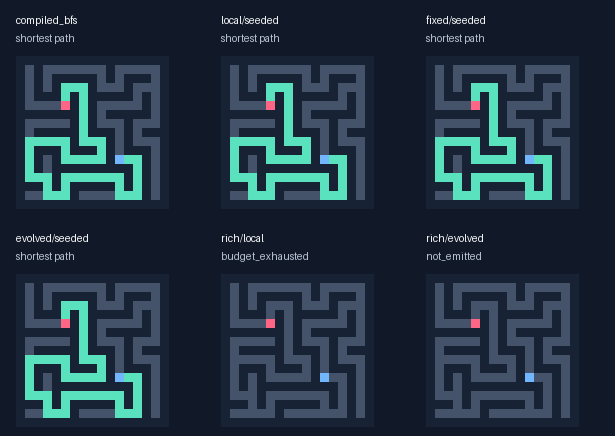
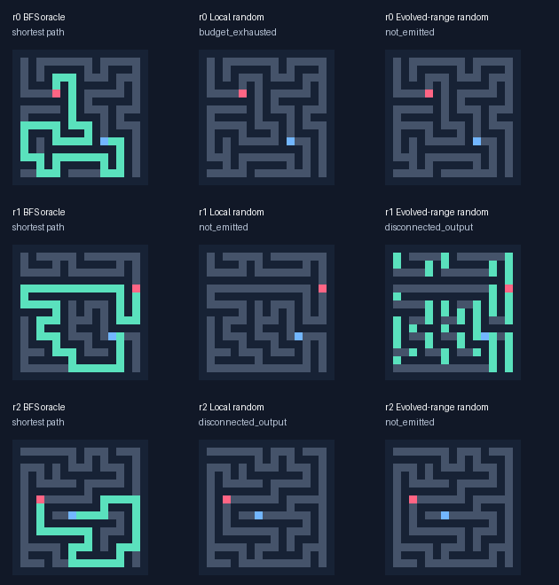

# Range and regulation study

Random-origin discovery remains an active research track. This study tests a specific larger regulatory substrate and search policy; a failure here does not establish that emergence is impossible or that additional capacity/time cannot help.

Run 2026-10-17T23:57:41.616560-04:00; Apple M4, Python 3.13.15; elapsed 740.3s. 3 independent evolutionary seeds.

## Post-run readout

The larger random-origin search retained complex genomes and improved some
partial-connectivity responses. Local evolution solved 2/216 fresh reachable
cases; evolvable-range evolution solved 1/216. All successes had source–goal
distance one, and independent sampling matched or exceeded those counts.
Neither rich arm solved any of the 165 distance>=8 cases. This does not yet
demonstrate transferable route construction or an advantage from selection.

All three seeded topologies solved 211/216, using zero nonlocal reads. The
same frozen local seed solved 189/216 under the old inference caps and
211/216 under the new caps: that gain is a budget effect. No multi-distance
accuracy advantage or speed advantage over compiled BFS was demonstrated.

Random-origin discovery continues from the saved populations. A useful next
controlled experiment holds this expanded capacity fixed and compares the
current pressure with training objectives for **source-dependent hidden signal
propagation**, while preserving exact complete-route correctness as the primary
final measure. That can test whether useful interacting precursors survive
long enough to support route construction. It must retain random ancestry,
include the current-fitness branch and use a new final test set. Extra code,
runtime and state alone are not being treated as proof of useful complexity.

## Controlled topology comparison

24 organisms × 30 generations, random and locally wavefront-seeded origins. All topologies share the V2 runtime, grammar, initial genotype lists, mazes and limits. Local primitives stay radius 1. Only REMOTE/REMOTE_MIN sample other ranges: local always 1; fixed cycles 1/2/4/8 by tick; evolved uses a heritable per-gene range. Gates control expression in every arm.

| Arm | Shortest / reachable | Correct no-path | Budget failures | Nonlocal reads |
| --- | ---: | ---: | ---: | ---: |
| evolved/random/evolution | 0/216 | 0/48 | 0 | 6,807,781 |
| evolved/random/frozen | 0/216 | 0/48 | 0 | 4,184,334 |
| evolved/random/resample | 0/216 | 0/48 | 88 | 164,980,237 |
| evolved/seeded/evolution | 211/216 | 48/48 | 5 | 0 |
| evolved/seeded/frozen | 211/216 | 48/48 | 5 | 0 |
| evolved/seeded/resample | 211/216 | 48/48 | 5 | 0 |
| fixed/random/evolution | 0/216 | 0/48 | 0 | 3,746,010 |
| fixed/random/frozen | 0/216 | 0/48 | 0 | 3,746,010 |
| fixed/random/resample | 0/216 | 0/48 | 0 | 5,427,976 |
| fixed/seeded/evolution | 211/216 | 48/48 | 5 | 0 |
| fixed/seeded/frozen | 211/216 | 48/48 | 5 | 0 |
| fixed/seeded/resample | 211/216 | 48/48 | 5 | 0 |
| local/random/evolution | 1/216 | 0/48 | 0 | 0 |
| local/random/frozen | 0/216 | 0/48 | 0 | 0 |
| local/random/resample | 0/216 | 0/48 | 88 | 0 |
| local/seeded/evolution | 211/216 | 48/48 | 5 | 0 |
| local/seeded/frozen | 211/216 | 48/48 | 5 | 0 |
| local/seeded/resample | 211/216 | 48/48 | 5 | 0 |

## Larger random-origin track

96 organisms × 120 generations per run, local and evolvable ranges, with eight uint16 state channels, 64 local registers and up to 128 genes (3,584 binary bytes). Random initial genomes have 64–128 instructions; none are derived from the wavefront seed. The model, curriculum and search policy change together here: this is an exploratory bundle, not an isolated causal test of genome length.

| Arm | Shortest / reachable | Shortest with distance ≥8 | Correct no-path | Nonlocal reads |
| --- | ---: | ---: | ---: | ---: |
| evolved/random/evolution | 1/216 | 0/165 | 0/48 | 25,089,304 |
| evolved/random/frozen | 0/216 | 0/165 | 0/48 | 59,680,849 |
| evolved/random/resample | 2/216 | 0/165 | 0/48 | 92,698,499 |
| local/random/evolution | 2/216 | 0/165 | 16/48 | 0 |
| local/random/frozen | 0/216 | 0/165 | 16/48 | 0 |
| local/random/resample | 2/216 | 0/165 | 16/48 | 0 |

## Range dependence and budget diagnostic

Ablations zero nonlocal reads at frozen genotypes; they still charge the reads. They do not retrain or repair the output. Availability, actual range use and accuracy benefit are distinct claims.

| Frozen evolved arm | Normal shortest | Nonlocal ablated shortest |
| --- | ---: | ---: |
| control/evolved/random/evolution | 0/216 | 0/216 |
| control/evolved/seeded/evolution | 211/216 | 211/216 |
| control/fixed/random/evolution | 0/216 | 0/216 |
| control/fixed/seeded/evolution | 211/216 | 211/216 |
| rich/evolved/random/evolution | 1/216 | 1/216 |

The same frozen local seed under old limits solves 189/216; under V2 test limits, 211/216. This isolates additional inference budget from a topology/evolution claim. It does not replicate the old runtime’s exact overhead or stopping rule.

## What the saved phenotypes actually do

- rich/evolved/random/evolution: {'source_only': 61}.
- rich/evolved/random/frozen: {'source_only': 176, 'all_open': 8}.
- rich/evolved/random/resample: {'all_open': 1}.
- rich/local/random/evolution: {'empty': 88, 'source_only': 41}.
- rich/local/random/frozen: {'empty': 88, 'source_only': 88}.
- rich/local/random/resample: {'empty': 88}.

| Evolution condition | Champion genes | New genotype from initial pool? |
| --- | ---: | --- |
| control/evolved/random/evolution/0 | 91 | True |
| control/evolved/random/evolution/1 | 49 | False |
| control/evolved/random/evolution/2 | 28 | False |
| control/evolved/seeded/evolution/0 | 29 | True |
| control/evolved/seeded/evolution/1 | 30 | False |
| control/evolved/seeded/evolution/2 | 30 | False |
| control/fixed/random/evolution/0 | 63 | False |
| control/fixed/random/evolution/1 | 49 | False |
| control/fixed/random/evolution/2 | 28 | False |
| control/fixed/seeded/evolution/0 | 29 | True |
| control/fixed/seeded/evolution/1 | 30 | False |
| control/fixed/seeded/evolution/2 | 30 | False |
| control/local/random/evolution/0 | 63 | False |
| control/local/random/evolution/1 | 49 | False |
| control/local/random/evolution/2 | 86 | True |
| control/local/seeded/evolution/0 | 29 | True |
| control/local/seeded/evolution/1 | 30 | False |
| control/local/seeded/evolution/2 | 30 | False |
| rich/evolved/random/evolution/0 | 128 | True |
| rich/evolved/random/evolution/1 | 128 | True |
| rich/evolved/random/evolution/2 | 127 | True |
| rich/local/random/evolution/0 | 96 | False |
| rich/local/random/evolution/1 | 96 | True |
| rich/local/random/evolution/2 | 101 | True |

## Cost and timing

| Arm | Median of correct 17x17 instance medians (µs) | Correct timed instances |
| --- | ---: | ---: |
| compiled_astar | 5.75 | 6 |
| compiled_bfs | 3.30 | 6 |
| control/evolved/random/evolution | n/a | 0 |
| control/evolved/random/frozen | n/a | 0 |
| control/evolved/random/resample | n/a | 0 |
| control/evolved/seeded/evolution | 1002.41 | 6 |
| control/evolved/seeded/frozen | 1000.95 | 6 |
| control/evolved/seeded/resample | 968.76 | 6 |
| control/fixed/random/evolution | n/a | 0 |
| control/fixed/random/frozen | n/a | 0 |
| control/fixed/random/resample | n/a | 0 |
| control/fixed/seeded/evolution | 1002.06 | 6 |
| control/fixed/seeded/frozen | 1002.73 | 6 |
| control/fixed/seeded/resample | 969.48 | 6 |
| control/local/random/evolution | n/a | 0 |
| control/local/random/frozen | n/a | 0 |
| control/local/random/resample | n/a | 0 |
| control/local/seeded/evolution | 1001.70 | 6 |
| control/local/seeded/frozen | 1001.80 | 6 |
| control/local/seeded/resample | 969.26 | 6 |
| rich/evolved/random/evolution | n/a | 0 |
| rich/evolved/random/frozen | n/a | 0 |
| rich/evolved/random/resample | n/a | 0 |
| rich/local/random/evolution | n/a | 0 |
| rich/local/random/frozen | n/a | 0 |
| rich/local/random/resample | n/a | 0 |
| wave_bit | 24.44 | 6 |

Timing uses 30 warm repetitions on selected fresh 17x17/33x33 perfect and random instances, randomized solver order and common raw-byte input/binary-raster output. Oracle, validation, JIT and one-time genome encoding are excluded. Every repetition is independently checked. Failed outputs do not count as fast solutions; no competitive performance claim follows from this pilot.

Largest accounted array payload: 151,747 bytes. Whole-run maximum RSS 137.5 MiB includes JIT, the evaluator, mazes and result buffers. Array bounds are not full allocator/process peaks per solver. Expression gates skip operand reads and primitive execution, but every gene dispatch is charged and every site still incurs scanning/register-reset work. These proxies are not energy.

## Protocol and limits

Training limits: `{'instructions_per_site': 32768, 'max_cells': 65536, 'max_steps': 256, 'reads_per_site': 4096}`. Test/validation limits: `{'instructions_per_site': 131072, 'max_cells': 65536, 'max_steps': 1024, 'reads_per_site': 8192}`. Each limit is shared by topologies and search methods. Work on an interrupted tick is charged, but its partial next state is discarded. Range reads cannot wrap across rows; nonlocal sensing can cross intervening walls, while wall sites remain zero and final path legality always uses adjacent open grid cells.

A source-local channel-7 request with both output endpoints lit proposes emission; alternatively, four unchanged full-state ticks settle a response. All four fixed range phases must be quiet. The evaluator independently rejects malformed or illegal settled outputs. This removes V1’s implicit halt as soon as both endpoints lit, which excluded strategies that first illuminate broadly and later prune.

Fitness preserves V1’s legality/optimality/no-path/partial priorities and shaping. The cost tie-break now applies only to fully correct batches, so unfinished programs are not immediately selected for cheap shrinkage. Validation uses new 9x9/17x17 cases. Test data never influences fitness or champion selection.

The controlled cohort uses elitism and tournament mutation. The rich cohort uses behavioural niches (output density, partial progress, gene-length bin, expression fraction, lifetime and range use), up to one third diversity elites, 10% fresh random immigrants, and 90% epsilon-lexicase/10% uniform-parent mutation. Epsilon is 0.02 for partial scores only; complete-solution priority is exact. Mutation uses 1–6 bounded edits, including block duplication; there is no crossover or generated Python. Rich training progresses at fixed generation boundaries: 0–39 use sizes 5/9; 40–79 use 9/17; 80+ use 17. A disconnected example appears every fourth batch. Population, program, state, tick and work ceilings remain hard.

Resampling controls evaluate the same number of training genomes/cases per generation, without inheritance: fresh random programs, or independent 1–6-edit seed perturbations. Frozen controls are the initial validation-selected champions. Validation attention, actual dispatched work and elapsed CPU cost can differ and are logged; these are training-sample-matched controls, not exactly matched CPU-time experiments.

All champions were frozen (SHA256 `2eb9001a7e4c25904e87ce8df29c5ea609b7de2e65c83341d42f2cee3a5d0649`) before generating 264 final cases with 264 distinct input/endpoint hashes. Every final case is disjoint from all training, validation and first-experiment input/endpoint hashes. Deterministic V1 snake/comb shapes are excluded from this fresh test. Source hashes, dependencies, complete lineage and fitness logs, output bitmasks and all timing samples are retained.

## Continuation and next test

Random discovery is not abandoned. JSON checkpoints contain the next population, exact RNG state, generation, frozen control and validation champion. The `regulatory_search.search(..., resume=checkpoint)` interface resumes to a higher absolute generation target; deterministic replay is tested. A continuation must use a fresh final test set, and its earlier test results must not become selection feedback. Checkpoints are data, not executable pickles.

The rich cohort changes capacity, training schedule and diversity together. Any improvement motivates separating those factors in matched ablations. A small set of successes, especially at short source–goal distances or with all-open masks, does not demonstrate a transferable general solver. More time/complexity remains a hypothesis to test, not a guarantee.

## Visual sample

First fresh 17x17 perfect maze in replicate 0. Green = emitted pixels, blue = source, red = goal. This sample is not selected by correctness.



```bash
.venv/bin/python -m maze_evolution.range_study --out results/repeat_ranges --seed 2026101751 --replicates 3 --control-population 24 --control-generations 30 --rich-population 96 --rich-generations 120 --samples 8 --benchmark-repeats 30
```

## Integrity and developmental audit

All saved source/champion hashes match. Lineage covers 141,916 genomes; logs contain 164,160 population evaluations and 724,176 maze responses during search/validation. All 8,712 final rasters were decoded and independently revalidated against fresh oracle instances. The 264 final cases have distinct input/endpoint hashes and are disjoint from all new training/validation and V1 cases. Paired topology/method conditions have exactly the same initial genotype lists.

| Rich evolution condition | Genome genes | Potential output/stop dataflow genes |
| --- | ---: | ---: |
| rich/evolved/random/evolution/0 | 128 | 30 |
| rich/evolved/random/evolution/1 | 128 | 37 |
| rich/evolved/random/evolution/2 | 127 | 49 |
| rich/local/random/evolution/0 | 96 | 22 |
| rich/local/random/evolution/1 | 96 | 21 |
| rich/local/random/evolution/2 | 101 | 40 |

The dataflow slice is a conservative static dependency count, not a measure of functional algorithm complexity. Hidden state outside it can still affect quiescent termination. More instructions, expression and longer lifetimes do not by themselves establish useful computation. `verification.json` retains the complete audit and status distributions.

All random-evolution replicates below use the first 17x17 perfect test case for that replicate; none is selected for success.



The final suite passes all 63 tests, including checkpoint-resume equality. Compressed logs were repacked losslessly for repository storage; `storage.json` records uncompressed SHA256 identities and byte counts. The execution-source and frozen-champion hashes remain unchanged.
