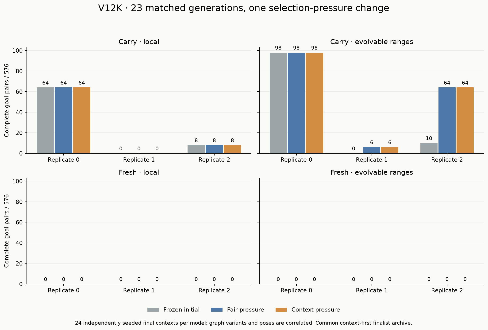
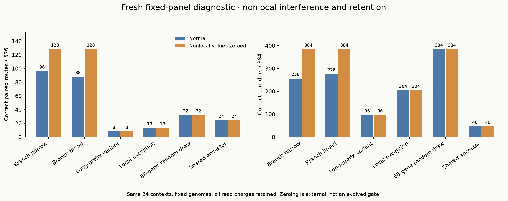
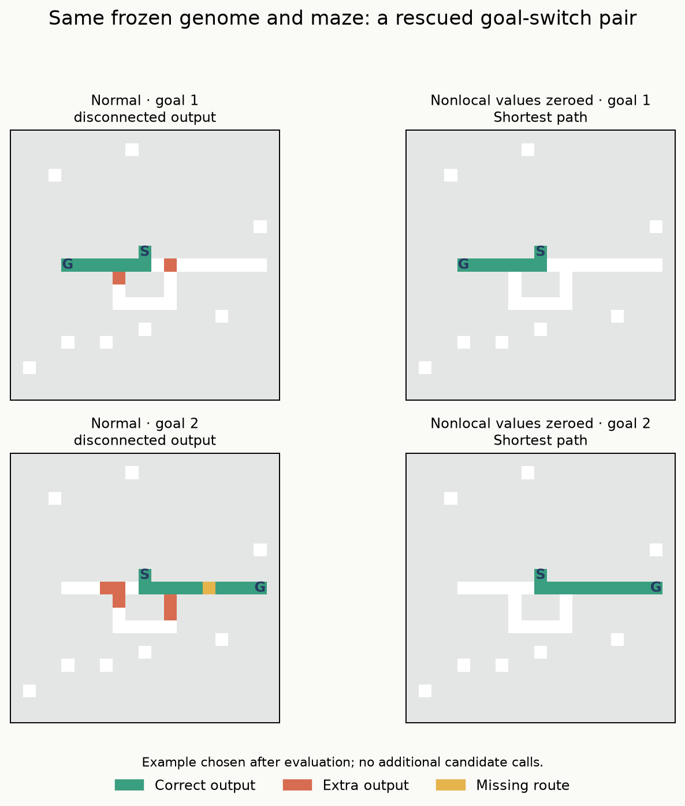

# V12K — robustness pressure and independent nonlocal rescue

The 12-minute pilot produced a useful new **random-origin descendant**, but the
context-consistency pressure did not outperform pair-count pressure. Both policies
selected an identical new carried multirange descendant that completes **64/576
unseen goal-switch pairs**, versus **10/576** for its frozen initial selection.
Its eight successful fork contexts work in all eight poses, with straight and
turning goal arms and routes reaching eleven edges. All have source prefixes one
or two. It completes no extra-junction or cycle pairs and no prefix-four/eight
pairs. This is a restricted reusable skill, not a general maze solver.

The other positive finding is a fresh replication of **harmful nonlocal input**:
external zeroing raises the broad Branch control from 88 to 128 pairs on a separate
corpus, improving four independent contexts across both goal-arm shapes. This
passes the frozen rescue screen. Its immediate parent also passes, but those two
related genomes are not independent evolutionary replications. The narrow control
improves 96→128 on only two straight-goal contexts and fails the broader screen.
No net benefit of multirange input, new evolved regulation, or speedup is established.

All four evolution cohorts fail the prespecified expansion gate. **Do not extend
this run or launch an unchanged 60–90-minute continuation.** Keep the fresh-random
track, preserved populations and useful old variants. The next experiment should
make the regulatory hypothesis testable, and first check that its proposed
selection contrast actually changes choices in the relevant populations.

Status: **complete and audited**. Both exact replay and supplemental integrity
audits pass; all old states and new evidence are preserved.

## What was controlled

Preregistration and initial states were pushed in **b1eee27** before diagnostic or
search generation. All selections and next populations/RNG were pushed in
**3ff220c** before final generation. Seed 2026101906; scientific fixtures 1254.
No frozen-source change, genome injection or final-data reselection occurred.

Thirty conditions used 96 organisms, 256-gene capacity, single-edit mutation,
24 elites, 72 births and the existing V6 pulse runtime. There were carry/fresh ×
local/evolved-range × Pair/Context × three replicates, plus six fresh resampling
controls. Carried states are new copies of G Branch's completed generation-113
states, with the same protected anchors and condition-specific I nominees added
to both policies. G itself remains closed. Fresh founders are new random draws;
no known solver enters any lineage. The separate known VM is a correctness control.

Context pressure adds one leading “all queried poses complete” field to the
pair-count ranking and lexicase criteria. Both arms use the same common validation
archives, including context, pair, corridor and far-prefix skills. The Pair
comparator implements the J proposal; it is not G Current's earlier valid-first
breeding policy. Cross-study score changes do not identify this intervention.

Each training batch has **two independent contexts**, one per goal-arm shape,
four poses and two goals per context, plus matched corridors: twenty inputs per
organism. One graph family is queried per batch; families and prefix schedules
cross over generations. Validation has four contexts per replicate, all eight
poses and all three graph families, 208 inputs/individual. This validation is
still narrow in independent-context count; the final corpus checks transfer.
All generated poses and control layouts, including unqueried ones, are retained
and excluded from subsequent independent experiments.

The final corpus has 24 independent 21×21 contexts: straight/turning goal arms ×
source prefixes 1, 2, 4 straight/bent, 8 straight/bent × short/long goal tails.
Each has eight poses, two goals, matched fork/extra-junction/true alternative-cycle
versions, two corridors and disconnected controls. Per model: **576 branched
pairs, 384 corridors and 384 disconnected inputs**, 1,920 total inputs. Graphs and
poses within a context are correlated. Prefix strata use separately drawn geometry;
this study does not isolate distance as a single causal variable.

## Primary final results

Each entry lists replicates 0, 1, 2; denominator **576 pairs per replicate**.
The primary is the common context-first validation archive in every arm.

| Origin / ranges | Frozen initial | Pair pressure | Context pressure | Fresh resampling |
|---|---:|---:|---:|---:|
| Carry / local | 64, 0, 8 | 64, 0, 8 | 64, 0, 8 | — |
| Carry / evolved | 98, 0, 10 | 98, 6, 64 | 98, 6, 64 | — |
| Fresh / local | 0, 0, 0 | 0, 0, 0 | 0, 0, 0 | 0, 0, 0 |
| Fresh / evolved | 0, 0, 0 | 0, 0, 0 | 0, 0, 0 | 0, 0, 0 |

The new 64-pair model is
`robustness/carry/evolved/pair/evolution/2/i1089`, 256 genes, born and selected at
K generation 16. Its Context alias has the identical genotype and outcomes. It
is sixteen single-edit steps from saved G organism
`fork/carry/evolved/branch/evolution/2/i8103`. That entry ancestor had **0/208
correct validation outputs** on K's new validation cases. The descendant completes
sixteen validation pairs and 64 final pairs. Its final successes are precisely
forks at prefixes one and two, both goal shapes and both tail bands, all eight
poses per context. It retains **384/384 corridors**, versus 356 for the frozen
initial selection.

This is evidence of a newly selected useful descendant in a random-origin lineage.
The entry ancestor was not one of the preregistered final controls, so the 10→64
final contrast is against the frozen **selected** initial model, not a direct
ancestor-on-holdout comparison. We do not add an ancestor probe after seeing these
results. Its pulse/flag/nonlocal dependencies have not been tested in K.

A second new carried-evolved model, replicate one `i458`, has 256 genes, five
mutation steps from G `i2826`, birth seven and selection eight. It completes six
pairs: two poses of one prefix-two straight-goal context under all three graphs.
No context works in all eight poses. Corridors rise from 8 to 26. This is a small,
geometry-dependent result, not broad robustness.

The paired evolutionary trajectories remain genotype-for-genotype identical in
**ten of twelve comparisons**, including every fresh and carried-evolved replicate.
Only carry/local replicate zero (from generation eight) and replicate two (from
generation zero) diverge. Even there the primary final counts match. Recorded
maximal training-genotype sets under the two ranks never differ; lower-ranked
selection/lexicase can still change reproduction. The intervention therefore had
weak practical activation. These are not twelve independent negative treatment
responses.

The common pair-first secondary archive selects different carry/local replicate-zero
models in the two policies; both finish with 46 pairs, zero all-pose groups and
362 corridors, below the primary's 64 pairs/eight groups/384 corridors. We retain
these secondary results rather than substituting whichever selection scores best
on final data. Fresh primary and resampling models complete no branched pairs.
Moreover, saved best-fitness histories show **zero complete training pairs in every
fresh condition throughout all 23 generations**; with pair-first ordering this
means no evaluated fresh candidate completed a queried pair. The consistency
field could not distinguish them. All fresh finalists solve the corridor controls,
but the paired-branch search was still on its common partial-credit plateau.
K's panel-based near-skill calibration did not establish a paired-solving gradient
for new random founders. This 23-generation result does not close random-origin
discovery; a future fresh-track calibration should start with genuinely elementary
paired tasks and verify informative selection before scaling.

No replicate passes the conjunctive expansion gate: at least two extra all-pose
groups and sixteen extra pairs over **both** Pair and frozen initial, ≥95% corridor
retention, exact retention of their far-prefix pairs, and no extra false no-path.
Two of three replicates were required. All four cohorts pass zero of three.

## Independent fixed-panel rescue

The diagnostic used another 24 contexts, before search, with all fourteen retained
J-informed identities in normal and externally nonlocal-zero configurations. Every
nonlocal read remained charged. No diagnostic result changed the frozen search.

| Fixed model | Normal pairs | Nonlocal-zero pairs | Normal → zero corridors | Screen |
|---|---:|---:|---:|---|
| Branch narrow | 96 | 128 | 256 → 384 | Fails: two contexts, straight goals only |
| Branch broad | 88 | 128 | 276 → 384 | Passes: four contexts, both goal shapes |
| Narrow immediate parent | 96 | 128 | 256 → 384 | Same failure |
| Broad immediate parent | 88 | 128 | 276 → 384 | Same pass; related control |
| Longer-prefix variant | 8 | 8 | 96 → 96 | No rescue |
| Inherited local exception | 13 | 13 | 204 → 204 | No rescue |
| 68-gene random draw | 32 | 32 | 384 → 384 | No rescue |
| Shared ancestor | 24 | 24 | 46 → 46 | No rescue |

The broad model gains 24 pairs on a long-tail prefix-one straight-goal context,
eight on a long-tail prefix-two straight-goal context, and four each on two
prefix-two turning-goal contexts. Six context/family groups become all-pose
successes. The narrow model gains only the first two contexts. Neither completes
a prefix-four/eight pair in either diagnostic configuration. “No far-skill loss”
is consequently vacuous for these Branch targets on this corpus; it does not
prove a future gate can retain long-prefix capabilities. The preserved longer-prefix
and local controls keep their eight and three far-prefix pairs respectively.

The final normal-only corpus separately gives the old narrow and broad controls
98 and 90 pairs, including two rare far-prefix pairs each. There is **no zeroing
assay on those final cases**. Do not transfer the diagnostic retention conclusion
to them. The new K descendant was not added to the already frozen diagnostic.

## Correctness, compute and limits

All selected/random-origin physical models give zero correct no-path responses
on 384 disconnected final inputs each, with no false reachable no-path claims.
All legal final outputs are shortest. BFS, A*, bit-wavefront and intact VM each
solve all **1,536 reachable plus 384 disconnected** final inputs. The same control
correctness holds on the diagnostic. No new latency benchmark was run; these
experiments establish no speedup or general solver.

Search closes after **23 matched generations, 688.973 seconds wall** (11.48 min),
including 119.447 seconds initial validation. Candidate inference takes 599.375
seconds, 1,639,296 physical calls and 354,415,967,905 work units. Each condition
has 66,624 logical calls (1,998,720 overall); identical initial screens are physically
shared across arms, subsequent calls are not. Peak search RSS is 978.25 MiB.
Validation construction takes 1.274 seconds separately; production-signature
warming is separately recorded. No partial round or cap extension occurred.

Diagnostic: 53,760 calls, 93.345 candidate seconds/180 cap, 95.251 seconds wall.
Final: 37 physical models behind the panel and 120 selection aliases, 71,040 calls,
67.274 candidate seconds/360 cap, 69.935 seconds wall. These phases have separate
registered budgets. Calibration: 10,880 calls and 8.394 candidate seconds, plus
explicit warmups. The diagnostic projection was 47.390 seconds from smaller
13×13 fixtures; actual 21×21 work took almost twice that. Class weighting fixed
one earlier issue but did not remove board-size/geometry effects. Future profiling
should include the actual assay board sizes and strata before registration.

The complete frozen audit passes **on its first attempt**: 1,774,976 exact
candidate replays, 1,786,496 independently graded rasters, 67,752 fitness records,
34,776 mutation-event replays, all 49,680 births and all thirty next population/RNG
states. It verifies 16,480 graph inputs, 11,520 baseline replays, 162 frozen source
hashes, eleven registration-input hashes and all 889 prior G/H/I/J completion
entries. Audit wall time is 908.199 seconds (15.14 min), peak RSS
1941.23 MiB, separate from all experiment caps. No frozen
source repair or post-registration protocol deviation occurred. The supplemental
integrity audit takes 12.285 seconds and also passes; its additional checker is
explicitly post-registration and changes no candidate/protocol code.

Supplemental checks regenerate 15,840 main cases and verify 133,760 panel response
identities, all 23 matched rounds and all 120 selection aliases.
Twenty-nine focused tests pass (eight K + nine J + twelve G); this is not a fresh
full-suite run; 212 tests are collected.

Exclude **163,928 unique whole layouts** in the next independent experiment:
150,776 through J, 384 K scientific fixtures, 3,264 additional retained unit-geometry
layouts, 1,152 diagnostic, 7,200 search/validation and 1,152 final. Include all poses
and unqueried controls. The K exclusions helper itself returns only through J;
add both K fixture manifests and diagnostic/search/final manifests explicitly.

## What this changes

The useful signal is stronger than “random rules never learn”: a carried random-origin
lineage produced a new short-prefix fork skill spanning bends, poses and longer
goal tails. It is much weaker than “more compute will grow a general solver.” The
new descendant fails the graph changes needed to move beyond that skill, fresh
primaries remain at zero pairs, and most trajectories did not experience a
meaningful difference between the two pressure rules.

I would preserve this descendant, its entry ancestor, immediate parent and earlier
selections alongside the old pulse-based/local/flag-based/resampling diversity.
A next bounded experiment can test a **heritable nonlocal exposure gate**, with a
matched fixed-exposure representation and explicit mutation/capacity costs. It
needs a fresh frozen-parent confirmation and fixed-zero control, both carried and
fresh random origins, actual-size profiling, and a measured activation gate before
spending another hour. External-zero rescue motivates that test; it is not the
answer to it. Details in `robustness_pressure/next_experiment.md` (proposal only).
