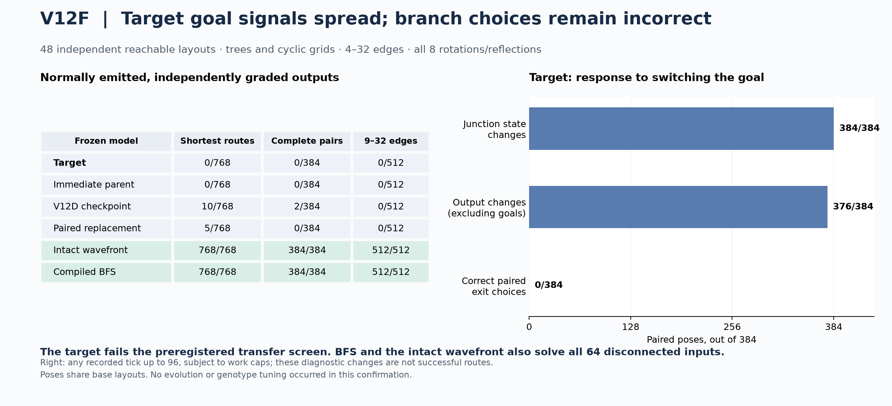
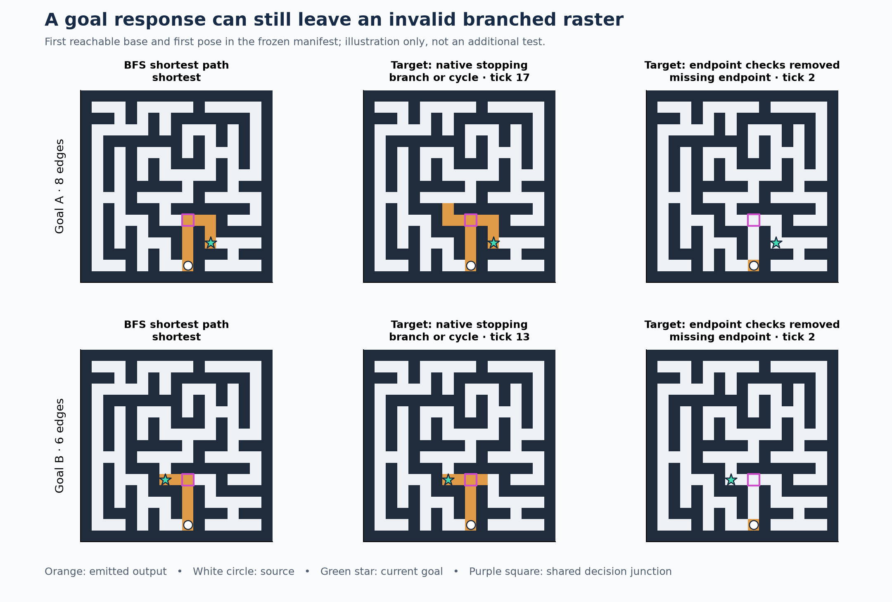

# V12F — longer-route confirmation, completed October 19, 2026

**The preserved longer-route target fails the independent transfer screen.** It
produces no legal or shortest route on 768 fresh reachable inputs and no complete
goal pair on 384 paired poses. Its goal pulse changes propagation throughout the
maze, including the decision junction, but no measured paired response selects
both correct exits. The earlier 9/24/25-edge successes remain real; a new,
explicitly post-hoc geometry check shows that all three lie inside winding
corridors with **no internal branch junctions**. Long distance and many turns did
not establish branch-solving competence.

This is informative negative evidence about one preserved lineage. It does not
rule out random-origin discovery or establish that a different capacity,
regulatory system or selection regime cannot evolve a solver. It does remove
these particular long successes as a sufficient reason to scale the unchanged
search recipe. No new evolution was performed.

## Frozen design and independent cases

[Protocol](../docs/ROUTE_CONFIRMATION_V12F.md), exact genomes, input/source hashes
and construction fixtures were committed and pushed in **9298bd0 before any new
confirmation layout or candidate response**. Study seed: **2026101901**.
Construction-only preflight seed: **1204**; no research genome was evaluated
in that preflight.

The four frozen random-origin models are:

| Role | Saved individual | Birth generation | Genes |
|---|---|---:|---:|
| Target | `foundation_study/local/fresh/evolution/1/i72095` | 858 | 256 |
| Immediate parent | `foundation_study/local/fresh/evolution/1/i72029` | 857 | 256 |
| Original V12D checkpoint | `foundation_study/local/fresh/evolution/1/i66411` | 790 | 255 |
| Final V12E Paired primary | `foundation_pair_paired/local/fresh/evolution/1/i103154` | 1227 | 256 |

Target digest: `aff6fc1a635d3c279d26`. It descends from the preserved random
immigrant lineage, never from an inserted solver. The recorded birth mutation
swaps rows 125 and 137; exact parent-to-child reproduction passes. Normal
responses of target and parent match on all 832 inputs: raster, status, tick,
read/dispatch and active-instruction counts. This observed equivalence does
not establish equality of their unrecorded hidden trajectories or all possible
future behavior.

The corpus has **48 independent reachable base layouts**, with eight correlated
rotations/reflections each, two goals per pose: **384 pairs /768 inputs**.
There are equal numbers of Wilson trees and cyclic obstacle grids; bands
4–8, 9–16 and 17–32 edges; rim-source and wholly interior endpoint strata; and
ordinary versus misleading junction bearings. Both routes must require turns,
and every pair requires different shortest exits after a shared prefix.
Source-component cycles and all permissible shortest exits are independently
verified. Four further disconnected bases give 64 inputs.

These are deliberately decision-rich tasks, sampled from new generators.
They are not the ordinary-maze distribution used in V12E. Therefore the
between-version numerical change is not a clean estimate of the effect of
branching alone. The paired-label constraint and the post-hoc corridor geometry
together support the narrower bottleneck interpretation.

All **124,392** previous whole layouts were excluded, together with 200 new
fixture layouts. The final corpus reserves another 416 whole layouts. Any
subsequent independent study must exclude **125,008** whole layouts, including
all poses and fixtures. The initial generation had one rejected layout/endpoint
attempt; there was no sampling repair or outcome-dependent dataset change.

## Normal output results

Legality requires an actually emitted, connected, unbranched source-to-goal
raster. Shortestness is checked separately. A complete pair requires both
normally emitted outputs to be shortest. The frozen exploratory screen requires
longer paired transfer on several independent bases in **each** family,
including orientation robustness, interior endpoints and misleading bearings.
The target fails every screen component in both families.

| Model | Legal routes /768 | Shortest routes /768 | Complete pairs /384 | Shortest at 9–32 edges /512 | Correct no-path /64 |
|---|---:|---:|---:|---:|---:|
| Target | 0 | 0 | 0 | 0 | 0 |
| Immediate parent | 0 | 0 | 0 | 0 | 0 |
| V12D checkpoint | 10 | 10 | 2 | 0 | 0 |
| Paired replacement | 5 | 5 | 0 | 0 | 0 |
| Intact wavefront | 768 | 768 | 384 | 512 | 64 |
| Compiled BFS | 768 | 768 | 384 | 512 | 64 |

All four random-origin models make zero false no-path claims on reachable
inputs. They also fail every disconnected input; abstaining or exhausting a
budget does not count as detecting no path.

Per family and distance band, the entries below are **individual shortest
outputs /128; complete pairs /64**. Each cell represents eight independent
bases and their eight poses.

| Family and distance | Target | Parent | Checkpoint | Replacement |
|---|---|---|---|---|
| Tree, 4–8 | 0; 0 | 0; 0 | 6; 0 | 2; 0 |
| Tree, 9–16 | 0; 0 | 0; 0 | 0; 0 | 0; 0 |
| Tree, 17–32 | 0; 0 | 0; 0 | 0; 0 | 0; 0 |
| Cyclic, 4–8 | 0; 0 | 0; 0 | 4; 2 | 3; 0 |
| Cyclic, 9–16 | 0; 0 | 0; 0 | 0; 0 | 0; 0 |
| Cyclic, 17–32 | 0; 0 | 0; 0 | 0; 0 | 0; 0 |

The checkpoint's two paired successes are **two poses of one cyclic base**,
with a rim source and no misleading bearing. It does not solve that base in all
eight poses. These are limited surviving short-route skills, not two independent
discoveries or longer generalization. Intact wavefront and BFS solve every cell
of this table, including every paired pose.

## What the mechanism controls show

The target emits on all 768 reachable inputs, at ticks 9–91. Of these,
**712 rasters fail for a branch/cycle and 56 for disconnected output**.
Its 64 disconnected inputs exhaust the read budget. The runtime's endpoint
check confirms that both endpoints are lit; it does not certify the route.

The target was also tested on all 832 inputs with pulse removal, flag removal,
both removed, and an explicit source-only stopping policy. Every intervention
still gives zero legal routes and zero correct no-path responses.

| Intervention or saved-data comparison | Observation | Interpretation within this corpus |
|---|---|---|
| Remove goal pulse; retain static flag | All 832 normal calls exhaust the read cap; switched-goal forced trajectories have no source, junction or output response | The pulse supplies the measured goal signal |
| Remove static flag; retain pulse | Every normal raster/status/tick/work count and all 768 full reachable trajectories are unchanged | Static goal access has no measured effect here |
| Remove pulse and flag | Trajectories are identical between goals for all 384 pairs; also match pulse-off trajectories | The goal-blind control behaves as expected |
| Remove endpoint checks from stopping | All 832 responses emit at tick 2, all missing the goal | Native endpoint checks provide essential waiting for this target |
| Disable endpoint AND quiet stopping; observe up to tick 96 | Zero legal path geometries in 266,312 saved frames across four input variants | Changing the emission time alone does not recover a solution in the measured window |

The last row is a **geometry-only diagnostic**. Forced-time snapshots are never
counted as normally emitted routes. Work caps remain active; only 384/768
trajectories in each variant reach all 96 ticks. Others end earlier at their
read cap. These results make no claim about unlimited-time behavior.

With the pulse present, switching the goal changes source state in **360/384**
pairs, junction state in **384/384**, and output away from the two goal sites in
**376/384**, at some recorded tick. Yet **0/384** pairs ever make both correct
strict exit choices at the same recorded tick; the count is also zero before
the earlier normal stopping time. Strict choice requires a shortest source
connection into the junction, exactly one permitted exit and every other exit
off. All four stimulus variants have zero paired choices. The exact fixed-tick
8/16/32/64/96 results and all per-pair time indices are saved.

This separates communication from routing: the goal's influence reaches the
right place, but the output does not use it to suppress the wrong branch.
Neither adding a later stop nor crediting a goal-sensitive state is supported
as a sufficient remedy by this packet.

The figure uses the first reachable base and pose in the frozen manifest,
not a newly selected evaluation case. It is an illustration of saved outputs.
The goal switch changes the target's emitted shape, but the unwanted exit
remains active in each response.

## Reinterpreting the earlier long successes

A **post-hoc saved-data analysis**, with no new candidate calls, examines the
three already inspected V12E target successes. Their source and goal both have
degree two, and every internal route vertex has degree two. Thus all three
routes—9, 24 and 25 edges, with 2, 5 and 12 turns—stay inside unbranched winding
corridors. The mazes contain branches elsewhere; the successful route segments
do not cross an internal decision junction.

Those outputs establish real, pulse-dependent corridor competence under native
endpoint-aware stopping. They do not establish goal-directed branch selection.
The V12F result strengthens that interpretation on a deliberately branching
corpus, while leaving the separate generator change as a limitation. Preserve
the lineage and its signal propagation rather than treating it as either a
complete solver or worthless variation. The saved immediate parent remains a
useful control, since the target's last recorded mutation did not change the
measured normal responses here.

## Cost, correctness audit and reproducibility

The complete confirmation takes **137.13 seconds wall time**, including setup,
construction, grading and trajectory storage. Charged candidate inference is
**123.65 seconds /2.06 minutes**, well below the fixed 600-second cap:
**10,560 responses and 73,688,626,896 VM dispatch-plus-read units**. This includes
intact-wavefront calls and all controlled/forced responses. There is no search
cost, training extension or new population. Main-process peak RSS is
**589.25 MiB**, including manifests and diagnostic handling. Maximum target
substrate array payload is 45,571 bytes; bounded trajectory capture adds at most
1,672,704 bytes per call. Total decoded trajectory payload is 2,327,516,288 bytes,
losslessly compressed in the saved packet. These diagnostic storage costs are
separate from ordinary candidate inference memory.

The independent audit takes **191.35 seconds /3.19 minutes**, with 634.97 MiB
peak RSS, separately charged and reported. It verifies:

- All **139 source and 36 input hashes**, all layout exclusions, all **616**
  fixture/final pair labels and D4 transforms, true source-component cycle rank,
  shortest distances and minimum turns using an independent graph procedure.
- Target-parent mutation reproduction and frozen model identities.
- All **8,320** normal/reference/controlled rasters and exact response replays;
  **4,160** additional native-runtime versus diagnostic-adapter comparisons.
- All **3,072** complete saved trajectory replays and forced final rasters;
  **1,536** comparisons with the established observer; and **1,536** native
  emission-tick mask matches in the corresponding forced trajectories.
- Independent geometric grading of all **266,312** saved frames, response/work
  accounting and the inference allowance.

Eight new preflight runtime/data tests and five existing focused tests pass.
Two later saved-data analysis regression tests also pass. With the previous
153-test coverage, 163 tests are covered; **this was not a fresh full-suite
163-test run**. The new runtime is separate; no old runtime, search packet or
population/RNG checkpoint was altered. No protocol deviation or model tuning
followed final inspection. The later corridor analysis is explicitly post-hoc.

The prespecified success-conditioned timing procedure has **no eligible target
case**. No target-versus-BFS latency ratio is reported. Invalid outputs and raw
iteration speed cannot support a speedup claim. Conventional BFS does not expose
VM dispatch/read counters; aggregate placeholder zeros for that reference must
not be interpreted as zero computational work.

## Research decision

The stronger general-maze claim remains unestablished. This confirmation is
strong negative evidence for the preserved target's transfer to these branching
tasks, and positive evidence that the apparatus can distinguish distant signal
propagation from useful exit selection. More time for the unchanged target's
inference is not the first intervention suggested by the saved trajectories.
More evolutionary compute under a new, appropriate pressure remains open.

The next justified step is a small **branch-suppression learning test**, with
random-origin populations and their useful corridor/short-route diversity kept
intact. First verify the proposed minimal fork tasks with separate known
controls; then preregister one matched curriculum/pressure change, keeping
capacity, runtime, mutation and archive protection common. A bounded pilot
should demonstrate repeatable correct paired branch behavior on validation
before expanding to 60–90 minutes. Training and final layouts must be newly
seeded and exclude this packet; none of these inspected cases should be used
to tune that comparison. The separate short-route checkpoint skill deserves
retention, not automatic promotion based on this final test.

This follow-up is a recommendation, **not launched or a completed
preregistration**. See [next-experiment note](route_confirmation/next_experiment.md).

## Evidence map

- [Frozen protocol](../docs/ROUTE_CONFIRMATION_V12F.md), [freeze manifest](route_confirmation/freeze.json), [exact models](route_confirmation/models.json).
- [Primary and stratified analysis](route_confirmation/analysis.json), [independent verification](route_confirmation/verification.json).
- [Raw normal/controlled outputs](route_confirmation/confirmation/normal.jsonl.gz), [raw trajectories](route_confirmation/confirmation/trajectories.jsonl.gz), [paired trajectory metrics](route_confirmation/pair_trajectory_metrics.jsonl.gz).
- [Layout ledger](route_confirmation/confirmation/layout_ledger.json), [execution and environment](route_confirmation/confirmation/execution.json), [software checks](route_confirmation/software_checks.json).
- [Post-hoc saved-data explanation](route_confirmation/saved_diagnostics.json), [completed progress/handoff](../docs/ROUTE_CONFIRMATION_PROGRESS.md).
