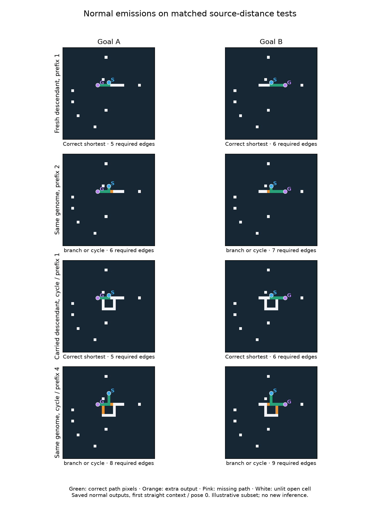

# V12T: acquired routing mechanisms and structural transfer

Complete and independently audited. This fixed-panel study confirms that both
selected fresh descendants acquired goal-dependent branching abilities absent
from their exact random immigrant roots. It also finds a preserved specialist
that completes paired 20-edge routes in particular orientations. These are real,
limited capabilities; no random-origin model passes the registered transfer
screen or handles the non-isolated disconnected cases.

The simple finite-pruning explanation from S is incomplete. Prospective matches
fall to 54–61% of branched normal rasters. Different lineages use different goal
inputs and output feedback; all five depend on their native halt request for
the tested successes. This points to coordination of propagation, selective
output and emission timing, rather than a single universal pruning mechanism.

## What was frozen and tested

Registration/panel/source pushed in907f96d before final generation. No new
evolution, candidate editing, breeding, selection or final-based replacement.
The 12 identities are five S-informed descendants, their five distinct roots,
the preserved 68-gene random resampling control and separate intact VM control.
All use the same local M runtime and existing 256 tick/work limits. All 787 saved
ancestral birth events are reconstructed, including both parents of splices.

Four independently seeded 33 × 33 structural contexts cover straight arms, both
arms bending, one bending, and outward hooks. Within each, arms stay fixed while
source prefix varies 0/1/2/4/6/8 straight or 4/6/8 bent, and graphs vary fork,
second junction at distance 1/2, or true alternative cycle at distance 2/3.
Both goals and all 8 rotations/reflections are tested. Four contexts are the
structural sampling units: thousands of poses/variants are not independent
replicates. Shape and tail length are confounded between contexts; source
distance and bend contrasts within a context retain downstream geometry.

Per model:2880 branched inputs/1440 pairs (1280 positive-prefix pairs),576 matched
corridors,512 non-isolated structured disconnected inputs,384 ordinary reachable
inputs and 128 ordinary partition-disconnected inputs. Ordinary inputs are 48 new
9 × 9 bases (24 Wilson,24 random) plus 16 disconnected bases, all 8 poses. No direct S/T
score change can be attributed to evolution: genomes are fixed and test cases
and grammar differ. New clutter prevents exact-layout reuse but does not itself
establish structural novelty. New hook shapes provide a specific transfer test.

## Exact roots versus descendants

A complete pair means two different goals on the SAME layout both receive
correct normal shortest-path rasters. All root-positive counts below are zero
on this corpus; roots can still solve source-at-junction or ordinary tasks.

| Descendant | Exact root positive pairs /1280 | Descendant /1280 | Positive two-junction pairs | Positive cycle pairs | Longest paired route, edges |
|---|---|---:|---:|---:|---:|
| fresh 0 | fresh 0 root: 0 | 8 | 0 | 0 | 13 |
| fresh 2 | fresh 2 root: 0 | 32 | 0 | 0 | 13 |
| carried 0 | narrow root: 0 | 168 | 84 | 28 | 14 |
| carried 1 | broad root: 0 | 116 | 38 | 2 | 20 |
| spliced | narrow root, broad root, shared root: 0 | 96 | 32 | 0 | 14 |

Fresh 0 grows from 96 to 163 genes over 96 mutations; fresh 2 from 119 to 160 over 75.
Fresh 0's root already solves 576/576 corridors, so its acquired ability is branch
choice, not the origin of all routing. Fresh 2's exact root solves no pairs or
corridors here. Fresh 2 completes all four prefix 1 fork contexts in all 8 poses,
including 13-edge hook routes. Fresh 0 succeeds in two poses per context, with no
positive-prefix context correct in all 8 poses. Both fail positive extra junctions.
Increased program length accompanies these histories; this is not a causal
capacity test and does not establish that larger genomes are necessary.

The 68-gene historically selected, unmutated random draw also completes 32/1280
positive pairs, matching fresh 2's paired count, though ordinary scores differ.
It is a capable selected random draw, not an average unselected genome. The
root comparison now establishes acquisition along these selected lineages;
it does not establish a replicated evolutionary-policy advantage over random
resampling or identify the causative edit.

Carried 0 is 12 mutations from narrow-Branch. It gains 289 all-prefix pairs and loses 3
versus its root, including 168 newpositive pairs. Carried 1 is 124 mutations from
broad-Branch and gains 203 all-prefix pairs,116 positive. Its 68 positive pairs at
prefix ≥ 4 include 28 extra-junction/cycle pairs. Five paired 20/20-edge successes
occur in the ONE hook context: two straight-prefix fork poses, two second-
junction poses and one bent-prefix fork pose. Its two positive cycle pairs
are one orientation of the straight context at prefixes 4 and 8 (shortest 8/9
and 12/13 edges; alternatives 20/21 and 24/25). No positive-prefix group works in
all 8 poses for this specialist. Preserve it despite its lower aggregate score.

Spliced 0 has 96 positive pairs, including 32 two-junction pairs but no positive cycle
pairs. It gains 204 all-prefix pairs and loses 2 relative to its three-root success
union. Its ancestry includes 249 splices AND mutations; this comparison cannot
credit a particular splice or demonstrate functional-module composition.

The registered long-prefix transfer screen fails for every random-origin model:
none has even one prefix ≥ 4 group correct in all 8 poses. Ordinary and corridor
skill loss remains visible rather than being hidden by branch-score gains.
Context bootstrap intervals are conditional descriptions of four contexts and
these selected lineages. Some are degenerate because all four context deltas
are equal; that does not imply certainty about new geometries or discoveries.

## What the interventions establish

All six interventions were fixed in advance, applied to the five descendants
and intact control on 1280 inputs/model: four contexts, prefixes 1/2/4 straight and
4 bent, all graphs/poses/goals. Roots receive normal tests only. The table counts
retained normal-successful PAIRS, not individual inputs; every denominator is
the model's genuine normal successes on this subset.

| Model | Pulse off | Static flag off | Both off | Output feedback off | Goal endpoint check off | Halt request off |
|---|---:|---:|---:|---:|---:|---:|
| fresh 0 | 0/8 | 8/8 | 0/8 | 0/8 | 8/8 | 0/8 |
| fresh 2 | 32/32 | 0/32 | 0/32 | 32/32 | 32/32 | 0/32 |
| carried 0 | 168/168 | 0/168 | 0/168 | 0/168 | 168/168 | 0/168 |
| carried 1 | 78/78 | 36/78 | 0/78 | 0/78 | 78/78 | 0/78 |
| spliced | 96/96 | 24/96 | 0/96 | 0/96 | 96/96 | 0/96 |

Fresh 0 needs the initial pulse for these successes; fresh 2 instead needs the
static goal flag and retains all 32 pairs with output feedback suppressed.
Carried 0 needs static flags and output feedback. Carried 1 and spliced 0 retain
some successes with either goal input available, but none when both are removed.
Flag removal also produces four new carried 1 pairs; loss and gain are separate.
Feedback ablation zeroes channel 2 reads only, preserving stores, final emission
and endpoint checks. Its effect is not simply deleting the output raster.

Disabling the goal-output endpoint check retains every tested normal success.
Disabling the source halt request loses all of them under the remaining normal
quiescence rules. Thus these outputs are tied to emission timing; they need not
be stable attractors to be legitimate algorithms. This does not mean endpoint
checking is useless generally, nor that every earlier hypothesis about pulse or
feedback dependence applies across lineages.

## Fixed-pruning hypothesis and bounded trajectories

The S-informed predictor uses an evaluator-only goal-distance ball of radius
equal to source-goal distance, then a fixed number of endpoint-protected leaf
deletion rounds. Its parameters were frozen before T; no fitting on T selects
a replacement algorithm. Exact raster matches include failures.

| Model | Pruning rounds fixed from S | Branched normal-raster matches |
|---|---:|---:|
| fresh 2 | 1 | 1760/2880 (61.11%) |
| spliced | 2 | 1664/2880 (57.78%) |
| carried 0 | 3 | 1562/2880 (54.24%) |

The lower prospective fit and fresh 2's feedback independence refute treating
this observer as a complete causal account. It remains a partial descriptive
approximation. Oracle distances never enter candidate inference or reproduction.

All 2304 forced traces reach 64 ticks,147456 frames, retaining native work caps.
The goal inputs are toggled only as preregistered; both-off paired states are
identical throughout. Of five random-origin descendants, only carried 1 has
normal-failed tasks with later correct geometry: five individual tasks in the
fixed 128-input trace subset. Other four have zero such cases. Carried 1 has
three pairs with simultaneous shortest geometry at some forced tick; this is
diagnostic geometry, not successful native inference or a retuned stopping rule.
Correct frames are frequently transient and the two goals need not be correct
at the same global tick, even when both native outputs are valid. Longer time
alone is therefore not a supported general remedy. This horizon/subset cannot
rule out all longer-time phenomena. All exact states remain saved.

## Ordinary transfer and retained skills

| Model | Wilson shortest /192 | Random shortest /192 | Corridors /576 | Correct non-isolated no-path /640 |
|---|---:|---:|---:|---:|
| fresh 0 | 2 | 2 | 576 | 0 |
| fresh 2 | 8 | 16 | 576 | 0 |
| carried 0 | 16 | 24 | 540 | 0 |
| carried 1 | 8 | 18 | 535 | 0 |
| spliced | 8 | 16 | 576 | 0 |
| fresh 0 root | 0 | 0 | 576 | 0 |
| fresh 2 root | 0 | 0 | 0 | 0 |
| narrow root | 12 | 26 | 30 | 0 |
| broad root | 34 | 26 | 28 | 0 |
| shared root | 22 | 27 | 36 | 0 |
| random 68 | 0 | 0 | 576 | 0 |
| intact | 192 | 192 | 576 | 640 |

All 11 random-origin models fail all 640 non-isolated disconnected cases; none
falsely reports no-path on a reachable input. Best ordinary score is the frozen
broad root 60/384, while its descendant scores 26. Carried 0 scores 40 versus its
root 38. These tradeoffs argue against replacing the preserved diversity with
the best branch specialist. S's 74/384 was a different selected model/corpus;
this study neither repeats that benchmark nor establishes a temporal decline.
BFS, A*, bitwave and intact VM each solve 3840/3840 reachable and 640/640 disconnected
inputs. No latency benchmark, multirange advantage or speedup is claimed.

## Feasibility, cost and audit

The first geometry fixture failed before any candidate call: a cycle attachment
at distance 1 made its alternate raster chorded, and a length assertion omitted
attachment distance. All 4480 rejected inputs remain preserved and excluded.
Correction precedes calibration/registration. The first draft profile projected
1990.23 seconds, failing feasibility. Before registration, normal cost was
separated from diagnostic parity, interventions were limited to descendants and
intact, and a fixed timing-only 8 then 4 context rule selected 4 contexts:621.25 versus
394.29 seconds with 2 xsafety against a 600 second planning allowance. Hard cap 720
remained unchanged. Original draft source, rejected data, failed profile and
all recalibration outputs are preserved. No score-dependent sizing and no
post-registration scientific-source repair occurred.

Main inference:102,144 calls,
194.93/720 candidate seconds,
108,892,706,169 charged work units;
202.67 s wall,
462.50 MiB peak RSS. The separate cost pilot,
including refinement, uses 31,968 calls and
77.04/180 candidate seconds. Warmups are separately
recorded. Equal caps do not imply equal work; diagnostic setup is not a latency
comparison with native inference or conventional solvers.

Audit passes: 134,112 exact candidate replays,
149,232 independently graded response rasters,
15,120 baseline replays,
26,880 independently constructed predictor masks,
14,400 legacy-adapter checks,
all 787 ancestral events, all 4677 prior completion hash entries,
206 source/23 input hashes. All trace states
are exactly replayed and frame summaries recomputed. New feedback/halting modes
have synthetic semantic tests and normal native parity, not a separately coded
full interpreter. Audit wall 357.09 s,
1375.33 MiB peak RSS. Eleven new plus 29 related tests pass;
this is not a fresh full-suite run. All 225592 whole layouts through T must be
excluded next, including rejected/corrected fixtures and every final pose.

## Next research decision

Do not launch another unchanged long evolution run or inject the explanatory
predictor. First map the preserved 12-edit carried 0 lineage on a NEW matched
corpus, with its exact root, every intermediate and final descendant fixed
before generation. Locate which inherited changes alter branch suppression and
native stopping, and preserve the longer-prefix specialist and fresh 2 as separate
comparators. Any later edit-reversion study needs its own frozen design and new
data; these final inputs cannot select edits.

This is more informative than immediately increasing time or raw capacity:
goal-dependent branch selection has now been acquired demonstrably, propagation
already spans 13–20 edge routes in some contexts, yet selective output and correct
stopping do not transfer reliably as source/junction arrangement changes. A
subsequent controlled evolution can target the identified limitation while
retaining corridor, ordinary and rare long-prefix skills. Fresh random-origin
populations remain central; all original populations/RNG are preserved. Larger
semantic recombination modules remain a future representation hypothesis.
