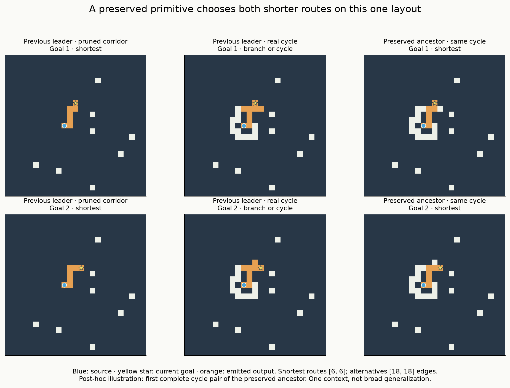

# V12H — corridor competence transfers; robust branching does not

The fixed-panel confirmation is complete. **The previous V12G leader fails every
branched input in the new corpus, despite solving 690/768 matched corridors.**
One older random-origin local variant completes both goals on some short forks,
two-junction trees and a genuine unequal-route cycle. Every model fails the
preregistered longer paired-transfer screen. These results preserve a useful
primitive while substantially weakening the case that G had produced a broadly
transferable routing algorithm.

All models, protocol, calibration and sources were frozen and pushed in
**e5e30e8** before final generation. There was no breeding, genome editing,
reselection or budget extension. The separate validation-breadth study remains
unlaunched. [Protocol](../docs/ROUTING_TRANSFER_V12H.md),
[completed handoff](../docs/ROUTING_TRANSFER_PROGRESS.md),
[next proposal](routing_transfer/next_experiment.md).

## The comparison

We retained every G primary pair selection and its initial frozen control:
60 aliases representing 33 physical genome/topology combinations. This includes
continued and fresh random origins, local and evolved ranges, both pressures,
three replicates and fresh random resampling. Intact and damaged known controls
are separate, for 35 physical models. No known solver entered a random lineage.

The final corpus contains **48 independent contexts**, 24 each with 5–9- and
10–18-edge shortest routes. Each has two goals, eight poses and three matched
graphs: a fork, that fork with another dead-end branch, and a true cycle offering
a longer source-to-goal route. The endpoints, unique shortest paths, 25×25 board
and eight isolated clutter cells stay fixed within each matched context. The
alternative route is legal and 2–12 edges longer, independently verified. These
are correlated graph variants and poses, not 144 independent contexts.

Each model sees 2,304 branched inputs / 1,152 pairs, 768 pruned corridor inputs,
and 128 disconnected controls: **3,200 inputs total**. Corridors are separate
layouts, not switched-goal pairs. BFS, A*, bit-wavefront and the intact VM each
solve all **3,072 reachable and 128 disconnected** inputs.

H also differs from G in source-prefix length (4–8 edges here, at most three in
G), board size and the sampling constraints needed to construct real cycles.
Consequently, G-to-H failure does not isolate prefix length or added junctions
as its cause. The within-H comparisons do isolate adding off-route branches to
the same paths and endpoints. The grammar remains much narrower than ordinary
maze solving. Clutter and recurring local shapes are additional scope limits.

## What survives

Only one physical random-origin model completes a paired task:
**`foundation_pair_paired/local/fresh/evolution/1/i109169`**, a 256-gene variant
born at generation 1299 in V12E. It was already in G's frozen controls and remains
the carried-local Current primary. It is not a new discovery from G training.

| This preserved variant | Shortest individual outputs /768 | Complete pairs /384 | Contexts with a complete pose /48 | All-eight-pose contexts |
|---|---:|---:|---:|---:|
| One-junction fork | 86 | 17 | 6 | 0 |
| Two-junction tree | 69 | 15 | 5 | 0 |
| Genuine alternate-route cycle | 13 | 3 | 1 | 0 |

All completed pairs have 5–6-edge routes. The three cycle pairs are three poses
of **one** six/six-edge context, with 18/18-edge alternative routes. Its 13
individual correct cycle outputs are also short. It produces seven individual
10–18-edge fork routes and five two-junction routes, but never both goals of a
long pair. All other physical random-origin models complete zero pairs here.
No model passes the screen, and no origin/range cohort meets the two-of-three
replicate criterion.

The previous G leader, `fork/carry/evolved/branch/evolution/0/i4549`, gives
**0/2,304 legal or shortest branched outputs**, not merely zero pairs. It retains
every short corridor (384/384) and 306/384 longer corridors. On all 1,152 short
branched inputs its emitted raster has a branch/cycle defect, rather than hitting
a resource cap. More search time is not yet an established remedy for this
particular mismatch between path growth and branch suppression.

The 68-gene random-resampling variant that performed well on G solves all
768 H corridors but zero branched outputs. This makes corridor success a poor
stand-in for useful route selection on the current task distribution.

The illustration uses the first saved successful cycle pair of the preserved
ancestor. It is a post-hoc display of an already tested model and case, not a
new holdout or a replacement primary selection. The orange paths correctly
choose both shorter routes on this layout; the previous leader activates an
extra branch under either goal.

## Full primary cohort results

Counts below sum three replicates. Pair columns each have denominator **1,152**;
corridors **2,304** and no-path **384**. All nonzero pair counts come from the
same inherited local replicate1, shared by Current and frozen aliases. Do not
count those aliases as two independent discoveries.

| Origin / range / selection | Fork pairs | Two-junction pairs | Cycle pairs | Shortest corridors | Correct no-path |
|---|---:|---:|---:|---:|---:|
| Carry / local / frozen | 17 | 15 | 3 | 428 | 0 |
| Carry / local / Current | 17 | 15 | 3 | 1,188 | 128 |
| Carry / local / Branch | 0 | 0 | 0 | 14 | 0 |
| Carry / evolved / frozen | 0 | 0 | 0 | 986 | 16 |
| Carry / evolved / Current | 0 | 0 | 0 | 1,389 | 16 |
| Carry / evolved / Branch | 0 | 0 | 0 | 1,458 | 0 |
| Fresh / local / frozen | 0 | 0 | 0 | 1,536 | 0 |
| Fresh / local / Current | 0 | 0 | 0 | 1,068 | 0 |
| Fresh / local / Branch | 0 | 0 | 0 | 1,537 | 0 |
| Fresh / local / resampling | 0 | 0 | 0 | 344 | 0 |
| Fresh / evolved / frozen | 0 | 0 | 0 | 1,536 | 0 |
| Fresh / evolved / Current | 0 | 0 | 0 | 1,816 | 0 |
| Fresh / evolved / Branch | 0 | 0 | 0 | 1,688 | 0 |
| Fresh / evolved / resampling | 0 | 0 | 0 | 772 | 32 |

There are no false no-path claims on reachable normal inputs in this panel.
No random-origin normal output is legal-but-longer; incorrect cases are invalid
rasters or failures to emit a valid route. The intact known control demonstrates
that the present VM and resource limits can express correct solving on the entire
corpus. The negative result therefore does not establish a capacity ceiling.

## What the mechanism tests establish

The four mechanism targets were fixed before H: the G leader, fresh local and
evolved Branch replicate1 selections, and the successful G evolved resampling
draw. They all have zero normal H complete pairs. We evaluated six interventions
on every H branched input, not only successes, and recorded forced trajectories
on the first context in each band, all three graph variants and all poses.

For the G leader, **static goal flags drive the measured goal-dependent response**.
Switching goals changes source state in 48/48 probed pairs, junction state in
36/48, and output away from the two goal pixels in 48/48. These counts remain
with the pulse removed. Removing the static flag reduces all three measured
responses to zero, although the remaining pulse still distinguishes the goal
sites themselves. Removing both inputs makes the complete forced trajectories
identical across goals, as required.

This communication does not become useful paired routing: the leader makes
zero strict-both choices and has zero legal-path frames in its recorded probes.
Removing endpoint checks leaves **all 2,304 normal reactions exactly unchanged**,
including masks, status, ticks and work. Its failure here is therefore not
explained by the common endpoint check alone. Pulse removal preserves all masks
but changes work; do not call those full reactions identical. Nonlocal zeroing
preserves 1,970 masks, changes others, and still yields no correct route.

The resampling variant likewise has goal-flag-dependent measured responses and
keeps every reaction unchanged under pulse removal, endpoint-check removal or
nonlocal zeroing. The fresh evolved variant retains its masks when either the
pulse or flag is removed separately, but changes when both are removed; removing
endpoint checks makes it emit without reaching the goal. These are distinct
phenotypes, not evidence of a shared general algorithm.

Across all four targets and modes, there are **98,304 recorded frames**, with all
1,536 traces reaching the fixed 64-tick horizon. No pair ever makes a strict-both
choice or completes both shortest routes, even at different recorded times.
The fresh local target briefly forms shortest geometry in 13 normal-input forced
frames, 36 pulse-off frames and two both-off frames. The 13 normal-input frames
occur on four inputs after the native run had already emitted an incorrect
output. These forced frames are not completed solutions. No stopping rule was
retuned from them. The source/goal information removal invariance checks all pass.

Because these four targets fail normal H pairs, their ablations do **not** identify
which inputs were necessary for their earlier G successes. The successful
inherited local H variant was in the full panel but not the prespecified mechanism
subset. We did not add a post-test probe of that newly highlighted model. Its
mechanism remains open.

## Cost, reproducibility and audit

The full study uses **152.76 seconds of candidate inference** under the fixed
600-second summed-call cap; total execution is 164.60 seconds. Peak RSS is
596.84 MiB on Apple M4. The 201,083 charged calls comprise 112,000 normal,
82,944 intervention, 1,536 forced-probe, 840 native/adapter parity, and 3,763
timing calls. They consume **89,746,284,052 read-plus-dispatch units**.
Construction, grading, compression, JIT warmup and audit are separate.

The 71 prespecified successful case/model timing samples use three warmups and
five batches of ten full calls, with matching production signatures. Their
median candidate/BFS ratio is **112.91× slower** (range 11.42–304.01×). Family
medians are 94.95× for forks, 134.76× for two-junction trees and 202.63× for the
four eligible cycle timing cases. Genome setup is excluded; maze decoding,
updates and output emission are included. This is conditional timing of selected
successful outputs, not a broad speed estimate. No speed advantage is established.

The successful audit takes **166.61 seconds**, peak 612.88 MiB RSS. It verifies
149 frozen source and 41 input hashes, every fixture/final graph and decision
label, all 194,944 normal/intervention candidate replays, 1,536 complete trajectory
replays, 768 independent observer checks, 420 native-adapter comparisons, all
9,600 final baseline rasters, calibration and timing replays. It independently
grades 208,740 saved rasters and all 98,304 trajectory geometries. All 60 selection
aliases match their G genomes/topologies. Resource counts reconcile exactly.

An initial audit reached the end of these checks but failed while serializing a
NumPy integer in a trajectory count. The original frozen source is retained.
`tools/audit_routing_transfer.py` converts only that diagnostic count to a Python
integer, and the entire audit was rerun successfully. The failed log and partial
temporary packet are preserved; its approximate additional wall time is 166.68
seconds. No experiment result changed. A regression test reproduces and checks
the repair. [Repair record](routing_transfer/audit_serialization_repair.json).

Nine new protocol tests plus eight existing adapter tests pass together; the new
audit regression passes separately. There are 185 collected tests, with the
previous 175 covered historically. This is **not a fresh full 185-test run**.
All 138,712 whole layouts through H must be excluded in the next independent
study, including software fixtures, every pose and all matched controls.

## Research implication

The positive evidence is a small, preserved, random-origin route primitive that
can sometimes choose between genuinely competing paths. The negative evidence is
that the previous standout and the new evolutionary selections do not transfer
reliably, despite readily propagating along corridors and, in some cases,
transmitting goal information. General solving, a causal multirange advantage
and competitive performance remain unestablished.

The next useful investment is the deferred **validation-coverage comparison on
a frozen existing genome pool**, with equal evaluation budgets, independent
validation draws and a separate untouched final set. It should explicitly cover
source-prefix and goal-tail distances and both tree/cycle decisions. If broader
selection preserves useful routing across replicates, a larger matched evolution
run becomes better justified. Random-origin discovery remains active; H is a
reason to improve the test and selection environment before another unchanged
hour of search, not a reason to discard the preserved populations.
