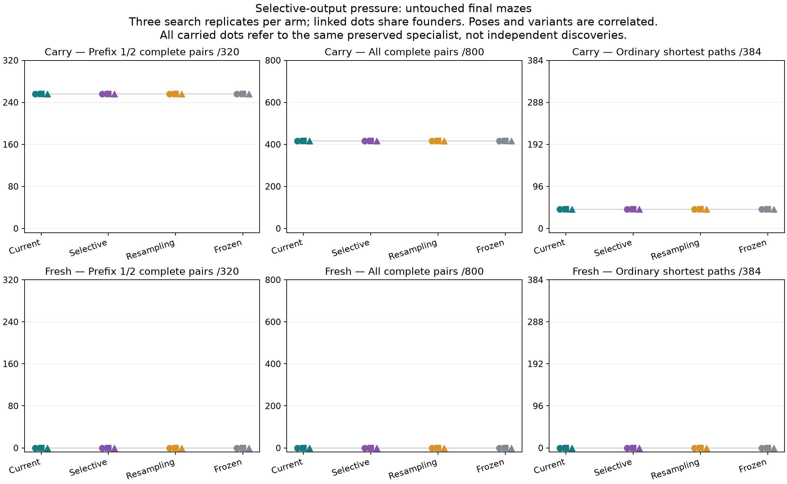
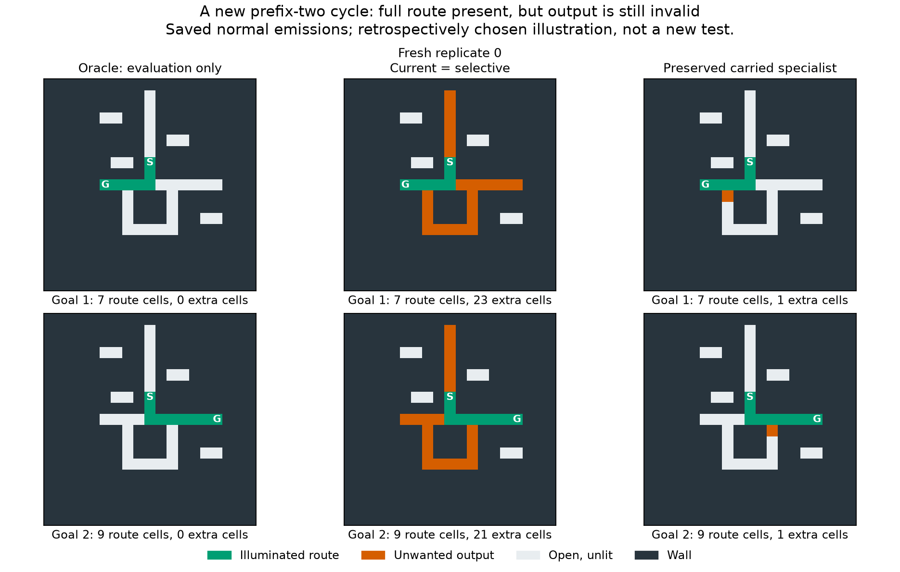

# V13B: controlled selective-output pressure

**The revised pressure does not improve upstream branch solving in this bounded
pilot.** All carried arms select the same pre-existing protected specialist;
all fresh primary choices complete zero branch pairs. Neither mutation arm
qualifies for a longer run. Random-origin discovery remains open, but this
experiment provides no reason to scale this objective unchanged.

Search, untouched confirmation and full replay audit are complete.

## Untouched final results

Each entry below is the result in replicates 0/1/2; pair correctness requires
both goals to receive a normally emitted shortest-path raster.

| Origin / arm | Prefix 1/2 pairs /320 | All pairs /800 | Ordinary shortest /384 | Corridors /1,600 |
|---|---|---|---|---|
| Carry: current, selective, resampling, frozen | 256 / 256 / 256 | 416 / 416 / 416 | 44 / 44 / 44 | 1,584 / 1,584 / 1,584 |
| Fresh current | 0 / 0 / 0 | 0 / 0 / 0 | 0 / 0 / 0 | 1,600 / 1,200 / 0 |
| Fresh selective | 0 / 0 / 0 | 0 / 0 / 0 | 0 / 0 / 0 | 1,600 / 1,600 / 0 |
| Fresh resampling | 0 / 0 / 0 | 0 / 0 / 0 | 0 / 0 / 0 | 1,600 / 0 / 584 |
| Fresh frozen | 0 / 0 / 0 | 0 / 0 / 0 | 0 / 0 / 0 | 1,600 / 0 / 0 |

All twelve carried primary aliases identify **the same unchanged genome**,
`carry/0/mutation/i3776`, present among their shared protected anchors. Its
416 pairs comprise 160 source-at-junction pairs, 160 prefix-one pairs and
96 prefix-two pairs; none has prefix four or eight. Its upstream successes
include 32 genuine-cycle pairs. These are preserved abilities measured on
new cases, not twelve independent discoveries or a B evolutionary gain.
Do not interpret its 44 ordinary successes as an improvement over a different
study's differently selected genome or corpus. Its ordinary successes are short:
16 one-edge, eight two-edge, eight three-edge, six five-edge and six six-edge
paths; none is longer than six edges.

Longer-prefix skills remain preserved outside that primary ranking. Protected
anchor `carry/1/mutation/i18358` solves 344/800 pairs, including 46/160 prefix-four
and 30/160 prefix-eight pairs, and 38/384 ordinary paths. The older anchor
`foundation_pair_current/local/fresh/evolution/1/i114696` solves four prefix-four
pairs. These are separate, unchanged historical variants; neither is replaced
or credited as a B discovery. The primary table therefore does not describe the
full retained repertoire.

Fresh selective replicate 1 exceeds current by 400 corridor outputs. Its
103-gene selection, `selectivity_v13b/fresh/1/selective/i731`, was drawn as a
random immigrant at generation 15 and has **zero mutation steps**. The current
replicate's 124-gene selection has ten mutation steps. Neither solves any
branch pair. The other fresh mutation primaries have 2–7 pilot mutation steps;
their changed genotypes do not yield new primary branch success here.

Every primary scores 0/1,728 on disconnected inputs, with zero false reachable
no-path claims. Separate compiled BFS, A*, bit-wavefront and intact VM controls
solve all 3,584 reachable and 1,728 disconnected inputs. This study does not add
a latency benchmark or establish a speed or multirange advantage.

## What failed, and what remains uncertain

The preregistered gate fails in **0/3 passing replicates for each mutation arm
in both origins**, on both validation and final. No new prefix-one/two pair
appears beyond the frozen reference. Carried validation stays at 64/80 upstream
pairs and 104/120 total pairs; fresh validation stays at zero paired successes.
Actual successful-case retention is checked, not inferred from aggregate totals.

Post-hoc inspection of saved normal rasters explains the continued boundary:
all three fresh selective primaries contain the complete oracle path **plus
unwanted cells on every one of the 640 prefix-one/two inputs**. Current replicates
0 and 2 do the same; current replicate 1 emits such excess on 320 inputs and
fails to emit on the remaining 320. Among emitted full-route failures, selective
has the same total excess-cell counts as current in replicates 0 and 2. It has
not acquired the desired selective suppression. These diagnostics add zero
candidate calls and do not change selection or the registered endpoints.
The preserved specialist's 96 failed prefix-two individual outputs each contain
exactly one extra cell; its existing successes remain intact.

This retrospective example is the lexicographically first pose-zero prefix-two
cycle failure of the frozen carried primary, shown with both goals. Fresh
replicate 0 current and selective masks are identical on these cases. The exact
case IDs, masks and selection rule are saved in `selectivity_pressure/illustration.json`.
This illustration is explanatory, not another independent test.

The pilot is limited: 30 matched generations, one full 16-round schedule cycle
and most of a second. Only the scheduled generation-16 nomination screen fits:
**two nominees per condition**, following the full common founder screen.
Generations 17–30 and their RNG/offspring remain preserved, but no post-cap
nomination is added. Thirty generations with sparse nomination cannot rule out
later discovery, useful unselected descendants, a different objective, or a
representation that permits more accessible coordinated changes. The three
search replicates also do not create independent ancestry for shared anchors.

The synthetic score distinction and known-solver repair check pass, but neither
establishes that random-origin spreaders have an accessible path of small,
heritable improvements toward selective emission. That is now the more useful
question to test before another large evolutionary run.

## Registered comparison

Twenty-four conditions compare current versus selective partial fitness, random
resampling and unchanged founders, separately for continued and fresh random
origins, with three matched replicates and 96 organisms each. Continued states
fork the exact V12Z current-mutation populations and RNG at generation 128;
original states remain intact. Their 20 historical random-origin anchors remain
protected. Fresh pools protect at most three of their own common initial
validation selections. No known solver enters a lineage.

Only the partial fitness supplied to the common ranking and lexicase changes.
The selective score explicitly distinguishes one-, two- and four-cell excess
stubs that current fitness ties. An output containing the full route plus excess
cells scores above an incomplete route within this shaping score, but remains
invalid and below every exact shortest output. This is a deliberate path-retention
tradeoff; the evaluator never cleans the raster or supplies an oracle to inference.
Validation archives use the same real-success ordering and original partial
score in both arms. Capacity, local runtime, single-edit mutation, survivor count
and training schedule remain fixed across the contrast.

Main search is capped at 720 candidate seconds, 900 wall seconds and 128 matched
generations. It stops before a round that cannot safely fit. A failed efficacy
gate closes this pilot; it never authorizes an automatic longer run.

## Data and independence

Training uses 12 inputs per round, matching source-at-junction and upstream
prefix-one/two tasks with paired goals, corridors and disconnected controls.
Every 16 rounds covers all eight poses at both upstream distances. Validation
uses six independently seeded contexts and 340 queried inputs. Its four paired
poses are a timing tradeoff fixed before registration. All 1,440 generated
validation inputs, including unqueried poses, are excluded later.

Final confirmation uses 12 new structured contexts, eight poses, prefixes
0/1/2/4/8, forks, second junctions, genuine alternative cycles, and a separate
ordinary-maze sample. Each model receives 5,312 inputs: 800 two-goal pairs,
1,600 corridors, 384 ordinary reachable mazes and 1,728 disconnected inputs.
The contexts are seeded draws; their poses, prefixes and graph variants correlate.
These are new layouts in the existing grammar, not novel-topology transfer.
All selected genomes are committed and pushed before final generation.

## Preflight and provenance

Registration: `2f7a379`, pushed before scientific validation or training.
Seeds: 2026102007; fixture/schedule seeds 1454/1455. Local Apple M4; exact Python
and dependency versions are in `selectivity_pressure/preregistration.json`.

The original conservative timing estimate failed: 660 validation queries and
twice the slowest-pool rate projected 1,621.46 seconds for initial screening plus
16 generations. Its source and profile remain in `preflight_attempt0`. Before
registration, validation was reduced to 340 queries and the balanced-pool estimate
changed to 1.5 times the sum of the six measured rates. The revised projection
was 569.00 seconds, without new candidate calls or fitness-based model choices.
The final test retains all eight poses.

Synthetic checks and a separate known-solver output-store repair control pass.
The known control checks the existing instruction set and scoring, not whether
random-origin populations can discover suppression. The discarded three-round
rehearsal replays 82,944 responses and 1,620 mutations exactly. Calibration plus
rehearsal cost 99.28 candidate seconds under the separate 180-second cap; no
rehearsal population continues into search.

## Compute, preservation and verification

The search ends normally at the registered candidate reserve after **30 matched
generations**. It uses 616.98/720 candidate seconds (10.28 minutes), 772.65/900 wall
seconds (12.88 minutes), 1,041,600 physical calls and 360,221,234,231 work units.
Peak search RSS is 385.27 MiB. The approximately 104-second reserve is fixed by
the preflight planning rule; its unused allowance is not extended.

Initial screening costs 195,840 physical calls and 107.78 candidate seconds.
Training costs 829,440 calls and 499.81 seconds; nomination validation costs
16,320 calls and 9.39 seconds. Each condition gets 34,560 training calls plus
680 nomination calls. Reused common founder scores give each condition the
same 67,880 logical evaluations, 1,629,120 total. Equal counts do not imply
identical runtime or charged work; condition-level counters are saved.

All 28,080 births, 16,200 single-edit mutations, archives, population states,
locus identities and RNG states are saved. Selections and full search records
were pushed in **15fe975 before final generation**. Final evaluates 32 physical
models behind 93 aliases: 169,984 calls, 163.78/600 candidate seconds, 171.72 wall
seconds, 95,888,158,888 work units and 293.70 MiB RSS. Baselines add 15,936 calls.
Calibration/rehearsal and warmups are separately recorded; audit is additional.

Nine new protocol tests plus six related retention tests pass; two replay-output
isolation tests pass separately. This is **not a fresh full-suite run**.
The audit passes on its first attempt in 994.85 seconds
(16.58 minutes), with 759.42 MiB RSS.
It verifies 1,228,048 exact candidate replays and independent raster grades plus
82,944 of each in the discarded rehearsal: **1,310,992 total**. All 28,080 births,
16,200 mutations, 24 population/RNG trajectories, 15,936 baseline outputs and
final choices/metrics replay. All 249 source hashes, 23 registered input hashes
and 8,164 prior completion entries verify. No frozen-source repair or
post-registration protocol deviation occurs. Replay uses the
same native inference engine and reproduction functions; raster grading and the
selectivity score are independently recomputed. This is not a second,
independently implemented VM.

Exclude **279,824 whole layouts** through this experiment, including every
unqueried pose and all fixtures. No source repair or post-registration protocol
change has occurred. Future re-audits must use
`tools/replay_selectivity_pressure_audit.py`, which writes new packets outside
sealed results. Preserve original populations and useful diversity; do not
resume this closed cap or train/reselect on inspected final cases.

The [next proposal](selectivity_pressure/next_experiment.md) is a bounded
mutation-accessibility assay on frozen random-origin genomes, not another
unchanged long search. No new study or sexual run is launched.
