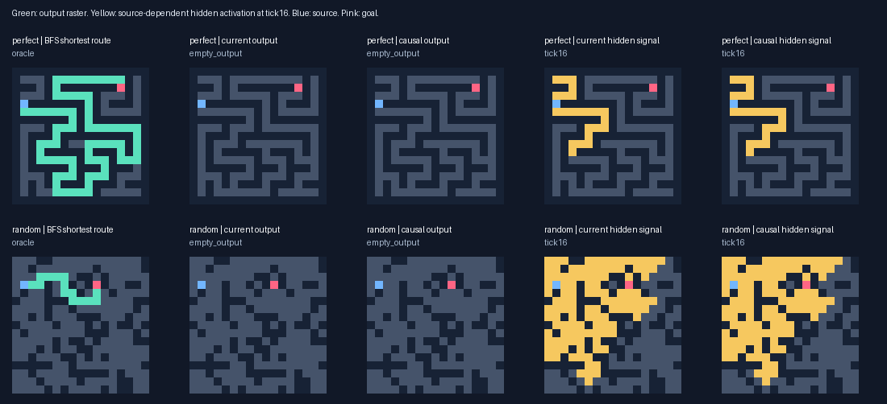
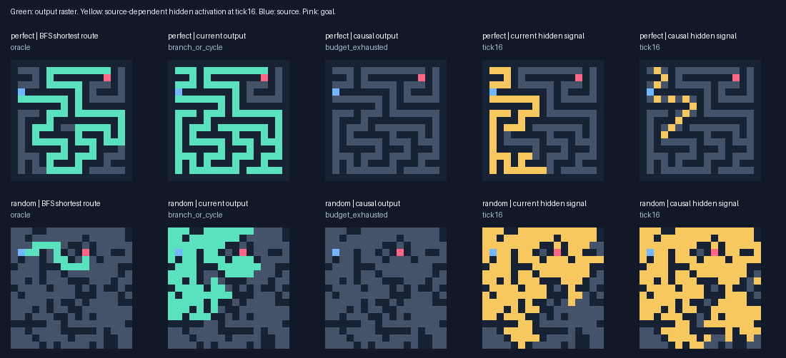

# Source-dependent signal pressure: V3

This continuation tests selection pressure while holding V2 genome capacity and inference fixed. Hidden transmission is a precursor diagnostic; complete shortest paths remain the primary endpoint.

## Findings

**A signalling precursor improved, but a general shortest-path solver did not emerge.** On 174 unseen reachable cases with endpoint distance>=8, mean source-dependent transmission is 0.5090 under causal pressure, 0.4185 under the current objective, and 0.2480 in the shared frozen initial archive. Causal pressure leads in 2/3 held-out replicates; all three led on validation. This is a small paired study, not evidence of statistical significance.

Final multirange task archives solve 2/216 shortest routes under causal pressure and 2/216 under the current objective, versus 4/216 for their frozen initial task selections. Both final task archives solve 0/174 long-route cases; compiled BFS/A* solve all 216 reachable and all 48 disconnected cases. No evolutionary path-accuracy advantage or competitive speedup is established.

The causal transmission archive also leaks more source-dependent activation into other open components: mean leakage 0.1250, versus 0.0497 for current. The reported signal score already subtracts this penalty. Fast broadcasts across walls can carry information without encoding a legal path.

The next controlled test should preserve these random-origin signalling lineages and test **goal-conditioned path thinning**: switch goal stimuli and reward source-connected, unbranched partial outputs that change appropriately, with completed shortest paths still first. Compare against unchanged transmission pressure at fixed capacity and use another fresh final test set. No known solver should be inserted into the random lineage.

## Experiment

Root 2026101801; six saved random-origin populations (96 organisms each), paired current/causal objectives. Screen 32 additional generations; extension decision **True**. Actual additional generations: [160]. No solver seed was introduced. Old objective scores were discarded at the fork.

Search including probes/validation: **60.45 minutes**; whole run including fresh tests/timing: 64.22 minutes. Peak process RSS 136.2 MiB. 802,758 ordinary responses plus 1,605,516 developmental probes. Charged dispatches + attempted reads: inference 1,054,862,154,167, probes 951,649,063,272. These are logical work counts, not CPU instructions.

Current fitness retains V2 validity/optimality/no-path utility/partial ordering. Causal adds the bounded source-dependent hidden signal score to partial only, including the lexicase partial field. Both arms use identical probe protocols and validation nomination rules. Compute is matched by candidate slots and caps; actual work varies with evolved behaviour. Transmission archives are diagnostic selections and never automatically inserted into reproduction.

Probes compare ordinary and source-removed input at exactly tick16 with stopping disabled; channels2/7 (output/stop) excluded. Score averages affected fractions in graph-distance bands >=2/4/8 and subtracts leakage into other open components. Constants and source-only marks earn zero. Interrupted probes earn zero. No oracle/distance enters candidate inference or probes. A flood can earn full transmission score while producing no legal route.

## Validation-only extension decision

| Topology | Replicate | Initial transmission | Current | Causal | Signal criterion |
|---|---:|---:|---:|---:|---|
| local | 0 | 0.171 | 0.470 | 0.470 | False |
| local | 1 | 0.603 | 0.669 | 0.669 | False |
| local | 2 | 0.307 | 0.307 | 0.307 | False |
| evolved | 0 | 0.470 | 0.470 | 0.619 | True |
| evolved | 1 | 0.458 | 0.669 | 0.788 | True |
| evolved | 2 | 0.258 | 0.679 | 0.708 | False |

Signal trigger topologies: ['evolved']; valid-route trigger topologies: []. See the preregistered thresholds in [the protocol](../docs/SIGNAL_PRESSURE_V3.md). The trigger uses validation, so final tests remain a separate assessment.

## Unseen complete outputs

All selected genomes were frozen before generating 264 fresh tasks. Each arm sees 216 reachable and 48 disconnected cases. Task archives use their own fitness; transmission archives maximize the validation precursor score. Frozen controls are selected from the same initial population under the corresponding criteria.

| Arm | Valid | Shortest | Shortest, distance>=8 | Correct no-path | Budget failures |
|---|---:|---:|---:|---:|---:|
| compiled_astar | 216/216 | 216/216 | 174/174 | 48/48 | 0 |
| compiled_bfs | 216/216 | 216/216 | 174/174 | 48/48 | 0 |
| evolved/causal/frozen_task | 4/216 | 4/216 | 0/174 | 1/48 | 129 |
| evolved/causal/frozen_transmission | 0/216 | 0/216 | 0/174 | 1/48 | 91 |
| evolved/causal/task | 2/216 | 2/216 | 0/174 | 3/48 | 99 |
| evolved/causal/transmission | 0/216 | 0/216 | 0/174 | 1/48 | 152 |
| evolved/current/frozen_task | 4/216 | 4/216 | 0/174 | 1/48 | 127 |
| evolved/current/frozen_transmission | 0/216 | 0/216 | 0/174 | 1/48 | 91 |
| evolved/current/task | 2/216 | 2/216 | 0/174 | 1/48 | 86 |
| evolved/current/transmission | 0/216 | 0/216 | 0/174 | 1/48 | 23 |
| local/causal/frozen_task | 0/216 | 0/216 | 0/174 | 0/48 | 54 |
| local/causal/frozen_transmission | 0/216 | 0/216 | 0/174 | 0/48 | 69 |
| local/causal/task | 0/216 | 0/216 | 0/174 | 3/48 | 81 |
| local/causal/transmission | 0/216 | 0/216 | 0/174 | 12/48 | 123 |
| local/current/frozen_task | 0/216 | 0/216 | 0/174 | 0/48 | 32 |
| local/current/frozen_transmission | 0/216 | 0/216 | 0/174 | 0/48 | 69 |
| local/current/task | 2/216 | 2/216 | 0/174 | 0/48 | 82 |
| local/current/transmission | 0/216 | 0/216 | 0/174 | 16/48 | 62 |
| wave_bit | 216/216 | 216/216 | 174/174 | 48/48 | 0 |

Across selected/frozen organism outputs, successful routes span 1–2 edges; 14 of 14 successful arm-case outputs are straight. These include repeated genomes across archive labels and are not independent discoveries. Per-case turns/distances are in `success_shapes.json`.

## Source-dependent hidden signalling on unseen long routes

Only reachable cases with source–goal distance>=8 enter this table. Values are mean band-coverage scores, not path accuracy. Max distance can be large after nonlocal reads; it is not evidence of legal movement or efficient transmission.

| Archive | Cases | Mean signal | Nonzero | Signal at goal | Maximum graph distance | Mean leakage |
|---|---:|---:|---:|---:|---:|---:|
| evolved/causal/frozen_task | 174 | 0.1500 | 174 | 17 | 13 | 0.0000 |
| evolved/causal/frozen_transmission | 174 | 0.2480 | 174 | 42 | 16 | 0.0000 |
| evolved/causal/task | 174 | 0.3580 | 138 | 69 | 1156 | 0.0742 |
| evolved/causal/transmission | 174 | 0.5090 | 162 | 98 | 1142 | 0.1250 |
| evolved/current/frozen_task | 174 | 0.1128 | 174 | 14 | 13 | 0.0000 |
| evolved/current/frozen_transmission | 174 | 0.2480 | 174 | 42 | 16 | 0.0000 |
| evolved/current/task | 174 | 0.0304 | 115 | 3 | 11 | 0.0000 |
| evolved/current/transmission | 174 | 0.4185 | 169 | 81 | 1155 | 0.0497 |
| local/causal/frozen_task | 174 | 0.2201 | 174 | 29 | 15 | 0.0000 |
| local/causal/frozen_transmission | 174 | 0.2283 | 174 | 30 | 16 | 0.0000 |
| local/causal/task | 174 | 0.2150 | 151 | 33 | 16 | 0.0000 |
| local/causal/transmission | 174 | 0.3071 | 174 | 54 | 16 | 0.0000 |
| local/current/frozen_task | 174 | 0.0239 | 116 | 3 | 13 | 0.0000 |
| local/current/frozen_transmission | 174 | 0.2283 | 174 | 30 | 16 | 0.0000 |
| local/current/task | 174 | 0.0026 | 55 | 0 | 15 | 0.0000 |
| local/current/transmission | 174 | 0.3071 | 174 | 54 | 16 | 0.0000 |

## Actual training and validation work

Each ordinary response also runs two developmental probes. Candidate slots and per-response caps match; actual activity and validation nominee overlap vary. Work below is dispatches plus attempted reads, summed across three replicates.

| Topology / pressure | Training responses | Validation responses | Inference work | Probe work |
|---|---:|---:|---:|---:|
| evolved/causal | 184,320 | 15,162 | 248,771,712,515 | 249,522,280,341 |
| evolved/current | 184,320 | 18,648 | 265,706,102,266 | 238,697,156,457 |
| local/causal | 184,320 | 13,048 | 315,230,628,269 | 232,996,425,271 |
| local/current | 184,320 | 18,620 | 225,153,711,117 | 230,433,201,203 |

## Inference latency and memory

Thirty warm randomized repetitions per selected size17/33 perfect/cyclic task and replicate. Input decoding, internal updates and full binary-raster emission are included; genome construction and evaluator/probes are excluded. Median below is the median of 12 task medians, with the minimum and maximum observed warm repetition across those tasks. Failed outputs receive no speed credit.

| Arm | Median us | Warm range us | Shortest timed responses |
|---|---:|---:|---:|
| compiled_astar | 6.70 | 3.46–121.83 | 360/360 |
| compiled_bfs | 4.29 | 2.75–30.50 | 360/360 |
| evolved/causal/frozen_task | 8063.18 | 425.62–154896.17 | 0/360 |
| evolved/causal/frozen_transmission | 4788.82 | 1307.12–131199.21 | 0/360 |
| evolved/causal/task | 6454.82 | 616.08–57924.67 | 0/360 |
| evolved/causal/transmission | 5002.99 | 638.38–33260.21 | 0/360 |
| evolved/current/frozen_task | 5819.44 | 422.38–38375.75 | 0/360 |
| evolved/current/frozen_transmission | 4786.45 | 1313.79–60634.71 | 0/360 |
| evolved/current/task | 2827.05 | 393.88–52867.54 | 0/360 |
| evolved/current/transmission | 2481.71 | 496.54–51416.71 | 0/360 |
| local/causal/frozen_task | 6104.96 | 394.00–54867.83 | 0/360 |
| local/causal/frozen_transmission | 8178.60 | 395.50–60341.08 | 0/360 |
| local/causal/task | 8866.41 | 453.25–98499.96 | 0/360 |
| local/causal/transmission | 10581.56 | 2584.71–172793.71 | 0/360 |
| local/current/frozen_task | 1824.73 | 352.62–8808.38 | 0/360 |
| local/current/frozen_transmission | 8175.09 | 391.58–76462.08 | 0/360 |
| local/current/task | 1717.33 | 286.42–53711.58 | 0/360 |
| local/current/transmission | 8297.40 | 2404.54–64998.29 | 0/360 |
| wave_bit | 25.53 | 7.12–487.83 | 360/360 |

## Effective transmission and range dependence

Post-freeze diagnostics took 81.1s and charged 47,273,647,786 additional logical work units. They change no selected genomes. Local source dependence cannot travel more than one graph edge per synchronous tick. The theoretical tick16 coverage ceiling is computed separately from the training reward.

| Causal archive | Validation signal | Tick16 local ceiling | Genes | Single deletions reducing signal |
|---|---:|---:|---:|---:|
| local r0 | 0.4701 | 0.4701 | 128 | 5 |
| local r1 | 0.6693 | 0.6693 | 126 | 5 |
| local r2 | 0.3065 | 0.3065 | 128 | 7 |
| evolved r0 | 0.8569 | 0.4701 | 127 | 12 |
| evolved r1 | 0.7879 | 0.6693 | 128 | 9 |
| evolved r2 | 0.8847 | 0.3065 | 128 | 25 |

Single-gene deletions were assessed on validation only. Redundant genes can interact; this count is not a minimal program size. It tests effective contributions rather than equating a long genome with complex regulation.

| Evolved-range archive | Normal long-route signal | Nonlocal reads zeroed | Normal shortest | Ablated shortest |
|---|---:|---:|---:|---:|
| evolved/causal/task | 0.3580 | 0.0259 | 2/216 | 2/216 |
| evolved/causal/transmission | 0.5090 | 0.0809 | 0/216 | 0/216 |
| evolved/current/task | 0.0304 | 0.0304 | 2/216 | 2/216 |
| evolved/current/transmission | 0.4185 | 0.1921 | 0/216 | 0/216 |

The range ablation returns zero for every radius>1 read at frozen genomes, while charging attempted reads. Output correctness and hidden transmission are measured separately on the same final tasks; no retuning follows this diagnostic.

Of the 12 final transmission archives, 11 trace to the saved V2 population and 1 to fresh random immigrants. Additional mutation depths range from 0 to 70. This is provenance, not a claim that every ancestral mutation was beneficial; full links are in `lineage_audit.json`.

Largest reported inference array payload: 151,747 bytes; probe-pair interpreter payload: 219,347 bytes. Interpreter bounds remain 64 bytes/site+64 KiB; observer pair bound is 80 bytes/site+64 KiB. These exclude Python objects, allocator/JIT overhead and evaluator arrays; RSS includes them. A* reports a logical heap payload and bit-wave memory is uninstrumented. Range reads and total dispatches are in the raw holdout records.

## Fixed visual examples

The first size17 perfect/cyclic test from replicate0 is shown, without selection for success. Current/causal panels use their local transmission archives. Hidden yellow regions show source-dependent activation at tick16, distinct from emitted path rasters.

The same cases with evolvable-range transmission archives:

## Reproducibility and limits

All 124,366 new individual records have valid ancestry links to 576 checkpoint ancestors or fresh random immigrants. 264 unique final hashes are disjoint from training/validation and 2649 earlier hashes. All 5,016 saved holdout rasters were independently decoded and reassessed. Source, fork and frozen-champion hashes match. Population/RNG checkpoints support exact continuation; the resume equality test passes.

V3 includes no new independent-resampling arm; it compares objectives within the same evolutionary method. Three paired replicates and adaptive validation archives do not establish statistical significance. The continuation inherits prior training; these are not new random starts. The two task archives use different intermediate objectives, so the transmission archive and its frozen control provide the more direct comparison for precursor learning. Source deletion tests input dependence, not a uniquely identified computation or biological mechanism. Static dataflow slices are conservative and do not prove that every included instruction matters.

Run: `.venv/bin/python -m maze_evolution.signal_study`; audit: `.venv/bin/python -m maze_evolution.signal_audit`; report: `.venv/bin/python -m maze_evolution.signal_report`; tests: `.venv/bin/python -m pytest -q`.

Raw configuration, timing repetitions, complete lineage/evaluation logs, output masks, maze manifests, extension decision, environment/source hashes and next-population/RNG checkpoints are in `results/source_pressure/`. Earlier results remain immutable.

Log packaging took 30.6s after the benchmark: 107.27 to 76.92 MiB. Every decoded byte was checked before/after lossless gzip repacking; per-file decoded and stored hashes are in `storage.json`. No record values changed.
