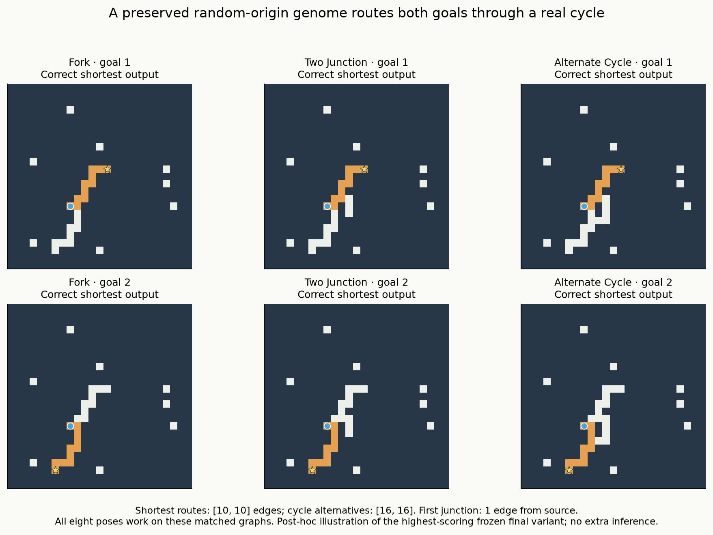

# V12I — broader validation finds useful variants, with uneven transfer

The equal-budget comparison is complete. **Broader validation improves several
existing selections, but no cohort passes the preregistered two-of-three
replicate gate.** The strongest final variant is selected by narrow validation.
This supports keeping broader coverage in our research toolkit while preserving
the alternatives and their different strengths. It does not justify an unchanged
60–90-minute evolutionary run.

No genome evolved in this experiment. The fixed pool contains **1,878 physical
genome/topology configurations**, preserving all initial G individuals and later
validation nominees within their original 30 condition pools. There are 3,612
genotype memberships and 3,632 identity memberships. No H score selected a subset,
no genotype moved between lineages, and known controls remained separate.
Protocol/pool were pushed in **5a00489** before validation; all choices and
validation data were pushed in **e53bfa1** before new final generation.

## What equal budgets mean here

Each genotype received **128 inputs per selector**: 48 two-goal branching pairs
and 32 matched corridor inputs. Narrow used four independent contexts × four
poses, while broad used sixteen contexts × one pose. Input counts matched for
family, prefix/tail stratum, goal side and pose. Three independent draws were
shared across the matched conditions in each historical replicate.

Both arms had **462,336 logical evaluations**, reduced equally to **240,384
physical calls** by sharing identical genotype/case evaluations. Actual work was
allowed to differ: narrow used 192.97 candidate seconds and broad 197.99 seconds.
Equal allowance does not mean artificially equal elapsed time. The ranking rule,
runtime, limits and genomes were identical between selectors.

Twelve of thirty choices changed. Narrow selected 28 distinct models, broad 29,
with 40 distinct models in their union. Each fixed selection then faced a new
corpus of **64 independent contexts**, all eight poses, three matched graph
complexities, two corridors and selected disconnected controls. Per model:
3,072 branched inputs / **1,536 paired opportunities**, 1,024 corridors and 128
no-path inputs. The graph variants and poses are correlated; 64 is the independent
context count, not 1,536.

## Paired shortest-path results

Each row below totals three historical replicates, so its denominator is
**4,608 complete-pair opportunities per selector**. Current/Branch label the
original G pools; they are not new training policies in I. Parentheses show the
three replicate counts. No cohort passed the required two replicate screens.

| Original genome pools | Narrow | Broad | Replicates passing broader-selection gate |
|---|---:|---:|---:|
| Carried, local, Current | 258 (184/2/72) | 328 (184/72/72) | 0/3 |
| Carried, local, Branch | 104 (88/2/14) | **212 (184/12/16)** | 1/3 |
| Carried, multirange, Current | 432 (64/184/184) | **492 (124/184/184)** | 1/3 |
| Carried, multirange, Branch | **610 (416/10/184)** | 606 (412/10/184) | 0/3 |
| Fresh, local, Current | 0 (0/0/0) | 0 (0/0/0) | 0/3 |
| Fresh, local, Branch | 0 (0/0/0) | 12 (0/12/0) | 0/3 |
| Fresh, local, resampling | 0 (0/0/0) | 0 (0/0/0) | 0/3 |
| Fresh, multirange, Current | 0 (0/0/0) | 0 (0/0/0) | 0/3 |
| Fresh, multirange, Branch | 56 (0/56/0) | 56 (0/56/0) | 0/3 |
| Fresh, multirange, resampling | 0 (0/0/0) | **80 (80/0/0)** | 0/3 |

Carried/local Branch improves pair counts in all three replicates, by 96, 10 and
two. Its descriptive, context-clustered 95% interval for the total gain is
approximately **75 to 143 pairs**. This conditions on the fixed selected models;
it does not include new lineage or validation-draw uncertainty. The largest gain
has no successful cycle contexts, and the two-pair gain loses a context and
corridor accuracy. Only the middle replicate satisfies the complete gate.

Carried/multirange Current improves by 60 pairs in one replicate and makes the
same choices in the other two. Its conditional interval spans approximately
−12 to +126 pairs. Carried/local Current's +70 is confined to three short
contexts and loses corridor accuracy. The preregistered gate explicitly requires
independent-context and cycle gains, improvement beyond the easiest stratum,
95% corridor retention and no additional false no-path claims. Larger pair totals
alone are insufficient.

## What useful behaviour was already present

The highest paired score among the frozen selections is the **254-gene**
`fork/carry/evolved/branch/evolution/0/i5140`, selected by narrow validation.
It completes **416/1,536 pairs**: 256 fork, 80 two-junction and 80 real-cycle pairs.
Its fork successes cover **all 32 short-prefix contexts in every pose**. Its
two-junction and cycle successes cover **ten independent contexts in every pose**.
Those ten all have a one-edge prefix. Paired routes reach 11 edges on forks and
10 edges on cycles. This is a stronger retained primitive than corridor-only
growth, with a sharply bounded operating range.

The broader replacement `.../i7406` has 256 genes and completes 412 pairs,
losing four cycle poses while improving corridor outputs from 1,008 to 1,024.
Both variants were born during G, at generations 72 and 103. Their recorded G
ancestries have 29 and 52 single-parent mutation steps from the same protected
random-origin V12E entry:
`foundation_pair_paired/evolved/fresh/evolution/0/i108890`.
These are newly evaluated selections from preserved diversity, not a new I-born
evolutionary improvement or a retrospective replacement of G/H primary results.

This post-hoc illustration uses only saved normal emissions. Both ten-edge
shortest routes beat their sixteen-edge alternatives, and all eight poses work
on the three matched graphs. The first junction is one edge from the source.
The illustrated final-best model is not substituted for any preregistered
selection. No additional inference or mechanistic intervention was performed.

Broader selection also recovers a local 256-gene G nominee, `.../current/evolution/1/i5138`,
which completes both five-edge goals in **three contexts, all eight poses and
all three graph variants**: 72 pairs, including 24 cycle pairs. Thus successful
cycle outputs are not confined to the multirange condition. We have not ablated
these new selections, so their performance does not establish a causal advantage
from nonlocal reads or identify which goal inputs are necessary.

The fresh random-origin track remains active. A 110-gene G descendant,
`fork/fresh/evolved/branch/evolution/1/i2653`, is selected by both arms and
completes 56 fork pairs across seven short contexts in all eight poses. Broader
fresh/local Branch recovers 12 fork pairs across four contexts, with no complete
eight-pose context. Its correct corridor outputs fall from 1,024 to 158 in that
replicate. These are useful but limited behaviours, not evidence that large
genomes or continued evolution consistently dominate random discovery.

The preserved **68-gene unmutated resampling draw**
`fork/fresh/evolved/current/resample/0/i4469` is selected by broad validation.
It completes 80 fork pairs across ten contexts, every pose, and all 1,024
corridors. It completes zero two-junction or cycle pairs. Keeping this control
prevents attributing all newly recovered performance to evolution or capacity.

## The remaining weakness

Twenty-one of the 40 physical random-origin selections complete at least one
pair, but **none completes a pair when the source-to-first-junction prefix is
5–8 edges**. There are 24 independent contexts in that range, or 576 paired
opportunities per model. All models also fail the combined long-prefix /
long-tail stratum.

At a four-edge prefix, only two physical models complete pairs. A narrow
carried/multirange Current choice completes 16 fork pairs on two seven/seven-edge
contexts in all eight poses. Broader validation replaces it with a stronger
short-prefix variant and loses those successes. An inherited local broad choice,
`foundation_pair_current/local/fresh/evolution/1/i114696` (born in E at 1365),
completes one pose of a seven/seven-edge context under all three graph variants:
three pairs total, including a cycle with thirteen/thirteen-edge alternatives.

These observations motivate testing distance to required branch decisions under
tighter matching. They do not prove that prefix distance alone causes failure:
the strata contain different geometries. The best variant's extra-junction
successes coincide exactly with the ten one-edge-prefix contexts. A controlled
test should separate first/second junction distance, bends and downstream
geometry before changing the runtime or merely adding more generations.

No random-origin selection correctly reports no path on any of the 128
disconnected cases. None falsely reports no path on reachable inputs. One narrow
fresh/local Current model emits one legal but non-shortest branched route;
legality and optimality remain separately scored. BFS, A*, bit-wavefront and the
intact VM solve **4,096/4,096 reachable and 128/128 disconnected inputs**.

## Cost and verification

Main candidate inference totals **532.99 seconds (8.88 minutes)** under the closed
720-second cap: 390.95 seconds validation and 142.04 seconds final. It makes
**658,176 calls** and **312,103,773,228 read/dispatch work units**. Main wall time,
including generation, grading and serialization, is **560.36 seconds**. Peak
main RSS is **680.83 MiB**; the largest reported candidate array footprint is
29,331 bytes. Model construction is recorded separately. This uses the local
Apple M4 CPU, Python 3.13.15, NumPy 2.5.4 and Numba 0.68.0; no GPU/cloud inference.

The calibration/profile packet adds 8,152 candidate calls, 6.10 inference seconds
and 3,663,646,291 work units, outside the main cap. Each main response receives
and emits a 625-byte raster: 411,360,000 bytes in each direction across physical
calls, before internal state/work and saved serialization. These are interface
volumes, not measured memory-bus traffic. There is no new latency benchmark or
speedup claim; wrong/partial outputs are not counted as faster solutions.

Ten new tests and 21 related existing tests pass: **31 focused passes**. There
are 195 collected tests; no fresh full-suite run is claimed. A rejected
pre-calibration cycle construction is preserved with zero candidate calls; the
corrected fixtures were validated before registration and screening.

The full audit **passes**: 666,328 exact candidate replays, 679,000 independently
graded rasters, 12,672 baseline replays and all 60 selections. It verifies 153
source hashes, 16 inputs, 115 pool-provenance files and 481 entries from the G/H
completion manifests. Audit wall time is 582.15 seconds, with
782.20 MiB peak RSS, recorded separately from the experiment.
There was one successful audit attempt and no post-freeze source repair. Exact
costs are recorded in
[`verification.json`](validation_breadth/verification.json) and
[`compute_accounting.json`](validation_breadth/compute_accounting.json).
The audit reconstructs pool membership, checks whole-layout exclusion, and
recomputes every rank and choice. Completion is certified in the separate
immutable artifact manifest.

All **144,120 whole layouts** through I must be excluded next, including the 192
rejected preflight layouts, 192 corrected fixtures, 2,400 validation layouts
(including unqueried poses) and 2,624 final layouts. Old populations/RNG,
genomes, nominees, narrow/broad choices and raw outputs remain available.

## Research direction

Broader coverage helps reveal usable existing variation, especially in the
carried/local Branch pool. It is not a universal replacement for pose coverage
or protected diversity. Its gains can exchange away corridor competence or a
rare longer-prefix skill. Random resampling remains a serious control.

The next proposed step is a bounded, fixed-genome **junction-distance and
branch-suppression calibration** on another untouched matched corpus. Preserve
both selectors, the longer-prefix exceptions and the 68-gene resampling control;
vary source-prefix/second-junction distance while holding downstream geometry
and pose comparisons fixed, with separately controlled goal inputs and stopping.
Use any resulting evidence to design the next evolutionary pressure change.
That proposal is not launched or preregistered here. General solving,
multirange advantage and competitive efficiency remain unestablished.
